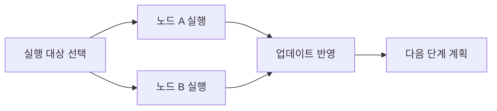

# LangGraph 만들기: 기본 원리에서 출발한 에이전트 런타임 설계

> 원제: Building LangGraph: Designing an Agent Runtime from first principles
>
> 작성자: Nuno Campos / 게시: The LangChain Team
>
> 게시일: 2025-09-04 / 예상 읽기 시간: 21분
>
> 출처: https://www.langchain.com/blog/building-langgraph
>
> 번역·해설 작성일: 2026-10-05
>
> 번역 기준: 사용자가 대화에 제공한 원문 전체. 본문, 성능 표, 관련 콘텐츠 및 페이지 하단 문구를 포함한다. 페이지 레이아웃과 중복된 입력 UI는 Markdown에 맞게 표현한다.
>
> 출처 신뢰도와 버전: 공식 개발팀이 설명하는 설계 의도의 1차 자료다. LangGraph 1.0 alpha 당시의 글이므로, 성능·경쟁 제품에 대한 주장은 당시 저자의 설명으로 읽어야 한다. 현재 설치 버전의 소스 검증 결과를 뜻하지 않는다.

## 목차

- A. 원문 전체 번역
  - 요약과 도입
  - 1. 에이전트에는 무엇이 필요한가?
  - 2. 애초에 왜 LangGraph를 만드는가?
  - 3. 우리의 설계 철학
  - 4. LangGraph 런타임
  - 5. 성능 특성
  - 시작하기
  - 관련 콘텐츠와 페이지 하단
- B. 추가 해설 — DeepAgents의 실행 기반을 이해하기 위한 설명

---

# A. 원문 전체 번역

페이지 분류: LangGraph

페이지 탐색: 블로그로 돌아가기 / 공유

원문의 탐색 목차:

1. 에이전트에는 무엇이 필요한가?
   - 지연 시간 관리
   - 신뢰성 관리
   - 비결정적인 LLM 관리
   - 개발자가 에이전트를 만드는 데 필요한 것
2. 애초에 왜 LangGraph를 만드는가?
   - 새로운 프레임워크가 필요했던 이유
3. 우리의 설계 철학
4. LangGraph 런타임
   - 개별 단계로 구성한 구조화된 에이전트
   - 실행 알고리즘
   - 프레임워크 기능 검증
5. 성능 특성
6. 시작하기

## 요약과 도입

**요약:** 우리는 약 2년 전에 저수준 에이전트 프레임워크인 LangGraph를 출시했습니다. 이미 LinkedIn, Uber, Klarna 같은 기업들이 이를 사용해 프로덕션 환경에서 운용할 수 있는 에이전트를 만들고 있습니다. LangGraph는 큰 인기를 얻은 LangChain 프레임워크에 대한 피드백을 바탕으로, 프로덕션 환경에서 에이전트 프레임워크가 어떻게 동작해야 하는지를 다시 생각한 결과입니다. 우리는 AI 에이전트에 적합한 추상화를 찾으려 했고, 추상화가 거의 없거나 아예 없는 것이 적절하다는 결론을 내렸습니다. 대신 제어와 내구성에 집중했습니다. 이 글에서는 신뢰할 수 있는 에이전트를 만들면서 얻은 경험을 바탕으로, LangGraph의 설계 원칙과 설계 접근 방식을 공유합니다.

**LangGraph ALPHA**

방금 LangGraph 1.0의 alpha 버전을 출시했습니다!

지금 사용해 보세요.

---

우리는 2년여 전에 큰 인기를 얻은 LangChain의 체인과 에이전트를 새롭게 다시 만드는 프로젝트로 LangGraph를 시작했습니다. 처음부터 새로 시작하면, 기존 `langchain` 오픈 소스 라이브러리 출시 이후 수많은 GitHub 이슈와 토론, Discord, Slack, Twitter 게시물에서 받은 피드백을 반영할 여지가 가장 커질 것이라고 판단했습니다. 가장 많이 들은 의견은 `langchain`이 시작하기는 쉽지만, 사용자 요구에 맞게 수정하고 확장하기는 어렵다는 것이었습니다.

이번에는 프로덕션 환경에서 에이전트를 실행할 때 선택할 만한 도구로 LangGraph를 만드는 것이 최우선 목표였습니다. 절충이 필요할 때는 입문하기 쉬운 것보다 프로덕션 환경에서 사용할 준비가 되어 있는 것을 우선했습니다.

이 글에서는 LangGraph의 범위를 정하고 설계한 과정을 공유하겠습니다.

- 먼저 에이전트를 만드는 일이 기존 소프트웨어 개발과 어떻게 다른지 살펴봅니다.
- 다음으로 이러한 차이를 어떻게 필요한 기능으로 바꾸었는지 설명합니다.
- 마지막으로 이러한 요구사항을 충족하도록 프레임워크를 어떻게 설계하고 검증했는지 보여드립니다.

그 결과 에이전트의 규모와 처리량이 증가해도 확장할 수 있는, 프로덕션 환경을 위한 저수준 에이전트 프레임워크가 만들어졌습니다.

## 1. 에이전트에는 무엇이 필요한가?

우리가 처음 던진 두 가지 질문은 “정말 LangGraph를 만들어야 하는가?”와 “기존 프레임워크로 에이전트를 프로덕션 환경에 배포할 수는 없는가?”였습니다. 이 질문에 답하려면 에이전트가 기존 소프트웨어와 어떻게 다른지, 또는 비슷한지 정의해야 했습니다. 직접 여러 에이전트를 만들고 Uber, LinkedIn, Klarna, Elastic 같은 팀들과 협력한 결과, 다음 세 가지 핵심 차이로 정리했습니다.

- 지연 시간이 길어질수록 사용자의 관심을 유지하기 어렵습니다.
- 오래 실행되는 작업이 실패했을 때 다시 시도하려면 비용과 시간이 많이 듭니다.
- AI의 비결정적인 특성 때문에 체크포인트, 승인, 테스트가 필요합니다.

### 지연 시간 관리

LLM 기반 에이전트의 첫 번째 특징이자 과제는 지연 시간입니다. 과거에는 백엔드 엔드포인트의 지연 시간을 밀리초 단위로 측정했습니다. 이제는 에이전트 실행 시간을 초, 분, 머지않아 시간 단위로 측정해야 합니다.

그 이유는 LLM 자체가 느리고, 추론 시점의 연산량이 늘어나면서 더 느려지고 있기 때문입니다. 원하는 결과를 얻으려면 여러 번 LLM을 호출해야 하는 경우도 많습니다. 에이전트가 반복 실행되거나, 앞선 출력을 수정하려고 여러 LLM 프롬프트를 연결하는 경우가 그렇습니다. 또한 보통 LLM 호출 앞뒤에 LLM을 사용하지 않는 단계도 추가해야 합니다. 예를 들어 데이터베이스의 행을 컨텍스트에 넣거나, LLM 호출 결과의 정확성을 확인하는 가드레일과 검증기를 만들 수 있습니다.

이처럼 긴 지연 시간을 감수하면서 새로운 기능을 만들 수 있지만, 실행 내내 최종 사용자의 관심을 유지해야 한다는 점은 여전합니다. 그래서 에이전트 개발에 유용한 두 가지 기능을 도출했습니다.

- **병렬화:** 에이전트에 여러 단계가 있고 다음 단계가 이전 단계의 출력을 필요로 하지 않는다면, 이들을 병렬로 실행할 수 있습니다. 다만 프로덕션 환경에서 신뢰성 있게 실행하려면 병렬 단계 사이의 데이터 경쟁을 피해야 합니다.
- **스트리밍:** 결과의 품질을 떨어뜨리지 않고 실제 지연 시간을 더 줄일 수 없다면, 사용자가 느끼는 지연 시간에 주목해야 합니다. 핵심은 에이전트가 실행되는 동안 사용자에게 유용한 정보를 보여주는 것입니다. 진행률 표시나 에이전트의 주요 동작을 보여주는 것부터, LLM 메시지를 토큰 단위로 실시간 전달하는 것까지 포함합니다.

### 신뢰성 관리

LLM 에이전트의 느린 실행은 다른 영향도 미칩니다. 누구나 잘 알듯이 모든 소프트웨어는 결국 오류를 일으킵니다. 오래 실행되는 에이전트는 실패할 가능성이 더 높습니다. 실행 시간이 길수록 문제가 생길 기회도 많아지기 때문입니다.

기존 소프트웨어에 오류가 생기면 보통 다시 시도하려 합니다. AI 에이전트에서는 이것이 최선의 접근이 아닐 수 있습니다. 10분짜리 작업이 9분째에 실패했다면, 처음부터 다시 실행하는 데 상당한 시간과 비용이 듭니다.

따라서 두 가지 기능을 더 추가해야 한다고 판단했습니다.

- **태스크 큐:** 에이전트의 실행을 그 실행을 시작한 요청과 분리하여 흔한 실패 원인 하나를 제거합니다. 필요할 때 에이전트를 신뢰성 있고 공정하게 재시도할 수 있는 기본 수단도 제공합니다.
- **체크포인팅:** 중간 단계의 계산 상태를 스냅샷으로 저장하여, 실패했을 때 재시도 비용을 크게 줄입니다.

### 비결정적인 LLM 관리

다음으로 LLM의 비결정적인 특성은 두 가지 과제를 더 만듭니다. 기존 소프트웨어를 작성할 때는 적어도 코드가 무엇을 해야 하며, 의도대로 작성되었다면 어떤 결과가 나와야 하는지 알고 있습니다. 생성형 AI는 이 상황을 분명히 바꿉니다.

LLM의 입력과 출력은 모두 열려 있습니다. ChatGPT에서 하루 전에 사용한 것과 같은 프롬프트를 입력했는데 다른 결과가 나온 경험이나, 같은 질문을 여러 방식으로 표현해도 비슷한 결과가 나오는 상황을 떠올릴 수 있습니다.

이러한 특성은 LLM 에이전트를 강력하게 만드는 중요한 요소이지만, 프로덕션 환경에서 운영할 때는 과제가 되기도 합니다.

개발 중에 수행하는 테스트만으로는 사용자가 에이전트를 활용하는 수많은 예상 밖의 방식을 거의 확실히 놓치게 됩니다. 사용자가 에이전트와 상호작용하는 모든 방식이나 LLM이 응답하는 모든 방식을 미리 계획할 수는 없습니다. 따라서 프로덕션 환경에서는 다음 두 기능도 매우 유용해집니다.

- **사람의 개입(Human-in-the-loop):** 그때까지 수행한 일을 다시 하지 않고 에이전트를 원하는 지점에서 중단하고 재개할 수 있는 도구는, AI 에이전트의 여러 필수 UX 패턴을 가능하게 합니다. 예를 들어 동작을 승인하거나 거부하고, 다음 동작을 수정하고, 추가 질문을 하거나, 과거 시점으로 돌아가 이전 단계부터 다시 수행할 수 있습니다.
- **추적(Tracing):** 규모를 확장하려면 에이전트 루프 내부에서 무엇이 일어나는지 명확하게 볼 수 있어야 합니다. 입력, 실행 경로, 출력을 관찰해야 합니다. 그렇지 않으면 사용자가 무엇을 요청하는지, 에이전트가 어떻게 처리하는지, 사용자가 결과에 만족하는지 알 수 없습니다.

### 개발자가 에이전트를 만드는 데 필요한 것

이렇게 프로덕션 환경에서 에이전트를 운영하는 대부분의 개발자에게 필요한 여섯 가지 기능을 정리했습니다.

- 병렬화 — 실제 지연 시간을 줄이기 위해
- 스트리밍 — 체감 지연 시간을 줄이기 위해
- 태스크 큐 — 재시도 횟수를 줄이기 위해
- 체크포인팅 — 각 재시도의 비용을 줄이기 위해
- 사람의 개입 — 사용자와 협력하기 위해
- 추적 — 사용자가 어떻게 사용하는지 배우기 위해

만들려는 에이전트에 이러한 기능 대부분이 필요하지 않다면, 예를 들어 도구 없이 단일 프롬프트만 사용하는 아주 짧은 에이전트라면, LangGraph나 다른 프레임워크가 필요하지 않을 수도 있습니다.

각 기능을 어떻게 구현할지 생각하면서, 모든 기능을 제공하더라도 최종 사용자가 LLM 애플리케이션을 눈에 띄게 느리다고 느끼게 한다면 개발자가 그 프레임워크를 채택하지 않을 것이라는 점도 깨달았습니다. 특히 챗봇으로 제공되는 에이전트에서는 더 그렇습니다. 따라서 낮은 지연 시간이 마지막이자 전체를 관통하는 요구사항이 되었습니다.

이제 이러한 기능을 LangGraph에 어떻게 구현했는지 살펴보겠습니다.

## 2. 애초에 왜 LangGraph를 만드는가?

근본적인 질문으로 돌아가 보겠습니다. 새로운 것을 만들어야 할까요, 아니면 LLM 이전에 만들어진 기존 오픈 소스 프레임워크를 채택해야 할까요? 필요한 기능 목록을 정리하고 나니 결정을 내리기는 꽤 쉬웠습니다.

### 새로운 프레임워크가 필요했던 이유

기존 프레임워크는 대체로 두 종류로 나뉘었습니다.

**DAG 프레임워크 — Apache Airflow 등으로 널리 알려진 유형**

이 유형은 이름에 드러나는 특성만으로도 제외해야 했습니다. LLM 에이전트에서는 반복 실행이 매우 유용하기 때문입니다. 즉, LLM 에이전트의 계산 그래프에는 순환이 있으므로 DAG 알고리즘으로 처리할 수 없습니다.

**내구성 있는 실행 엔진 — Temporal 등으로 널리 알려진 유형**

이 유형은 요구사항에 더 가까웠습니다. 하지만 LLM 에이전트 이전에 설계되었기 때문에 에이전트에 필요한 특정 기능, 특히 스트리밍이 부족했습니다. 또한 단계 사이에 지연 시간을 추가하여 챗봇 개발자가 알아차릴 정도의 지연을 만들었습니다. 마지막으로 설계 특성상 실행 이력에 단계가 많이 쌓일수록 성능이 떨어졌습니다. LLM 에이전트가 점점 길고 복잡해질 것이라는 점을 생각하면 적절한 선택으로 보이지 않았습니다.

결국 우리의 답은 “그렇다”였습니다. LLM은 충분히 달랐고, 기존 프로덕션 인프라가 새로운 시대에도 적합하려면 새로운 아이디어가 필요했습니다. 그래서 LangGraph 개발을 시작했습니다.

## 3. 우리의 설계 철학

우리는 두 가지 주요 원칙으로 LangGraph를 설계했습니다.

1. **AI의 미래가 어떻게 될지는 모릅니다.** 미래에 대한 가정이 적을수록 좋습니다. 1년, 2년, 3년 후에 LLM을 활용한 개발이 어떤 모습일지 실제로 아는 사람은 없습니다. 따라서 프레임워크 설계에 가정을 적게 넣을수록 미래에도 적합할 가능성이 커집니다. 우리가 설계에 넣고 싶었던 유일한 가정은 앞서 설명한 사실, 즉 LLM은 느리고, 불안정하며, 입력과 출력이 열려 있다는 것이었습니다.
2. **일반적인 코드를 작성하는 느낌이어야 합니다.** 프레임워크의 공개 API는 프레임워크 없이 작성하는 일반적인 코드에 최대한 가까워야 합니다. 개발자의 코드에 요구하는 모든 제약은 충분히 가치 있는 기능을 가능하게 한다는 점으로 정당화되어야 합니다. 그렇지 않으면 프레임워크 자체를 쓰지 않으려는 유인이 너무 커집니다. 모든 코드 프레임워크의 가장 큰 경쟁자는 언제나 프레임워크를 사용하지 않는 방식입니다.

이 원칙들은 이후에도 유지해 온 몇 가지 핵심 설계 결정에 영향을 주었습니다.

첫째, **라이브러리 런타임은 개발자 SDK와 독립적입니다.** SDK는 개발자가 에이전트를 만들 때 사용하는 공개 인터페이스, 즉 클래스, 함수, 메서드, 상수 등입니다. 현재 두 가지를 제공합니다. `StateGraph`와 명령형/함수형 API입니다. 우리가 `PregelLoop`라고 부르는 런타임은 앞서 나열한 각 기능을 구현하고, 에이전트 호출마다 계산 그래프의 실행을 계획하고 수행합니다.

이 설계 덕분에 개발자 API와 런타임을 독립적으로 발전시킬 수 있습니다. 예를 들어 SDK 측에서는 명령형 SDK를 도입하고, 공유 상태가 없는 `Graph` 인터페이스였던 최초 SDK를 사용 중단 대상으로 전환할 수 있었습니다. 런타임 측에서는 공개 API에 영향을 주지 않고 지난 2년 동안 여러 성능 개선을 구현할 수 있었고, 더 근본적인 런타임 변경도 실험할 수 있었습니다. 분산 실행을 다룰 때 이에 대해 더 설명하겠습니다.

둘째, **여섯 가지 기능을 각각 조립 가능한 구성 요소로 제공하고 싶었습니다.** 개발자가 에이전트에서 언제 어떤 기능을 사용할지 자유롭게 선택할 수 있게 하려는 것입니다. 예를 들어 사람의 개입을 위한 중단/재개 기능은 개발자가 사용하려고 하기 전까지는 방해가 되지 않습니다. 노드 안에서 `interrupt()` 함수를 호출하기만 하면 사용할 수 있습니다.

그 결과 LangGraph는 당시 유행하는 고수준 추상화에 모든 것을 걸도록 권하는 수많은 프레임워크 사이에서, 독특하게 저수준을 지향하는 프레임워크가 되었습니다. 그런 추상화들이 나타났다 사라지는 동안 LangGraph는 계속 유효했으므로, 지금까지의 접근 방식에 만족하고 있습니다.

## 4. LangGraph 런타임

이러한 배경을 바탕으로, 우리가 원했던 여섯 가지 기능을 LangGraph가 어떻게 구현하는지 살펴보겠습니다. 다시 나열하면 병렬화, 스트리밍, 체크포인팅, 사람의 개입, 추적, 태스크 큐입니다.

### 개별 단계로 구성한 구조화된 에이전트

다른 모든 아키텍처 결정에 영향을 준 생각 하나를 고른다면, 구조화된 에이전트라는 생각입니다. 컴퓨터 프로그램에 구조를 추가하고, 어느 정도의 유연성을 여러 새로운 기능과 맞바꾸는 것은 오랜 전통입니다. 한때는 `if` 문이나 `while` 루프 같은 기본 구문도 새로운 요소였습니다.

에이전트 역시 커다란 `while` 루프 하나를 가진 단일 함수로 직접 작성할 수 있습니다. 하지만 그렇게 하면 체크포인팅이나 사람의 개입 같은 기능을 구현할 수 있는 능력을 잃습니다. 참고로 제너레이터 같은 일부 서브루틴은 기술적으로 실행을 중단할 수 있을지도 모릅니다. 그러나 그 실행 상태를 다른 머신에서 다른 시간에 재개할 수 있는 이식 가능한 형식으로 저장할 수는 없습니다.

### 실행 알고리즘

에이전트를 여러 개별 단계로 구조화하기로 했다면, 실행을 조직할 알고리즘을 선택해야 합니다. LangGraph가 출시 전에 시작했던 것처럼 “알고리즘이 없다”고 느껴지는 단순한 방식도 결국 선택에 해당합니다.

“알고리즘이 없는” 방식의 문제는, 더 단순해 보이더라도 실행하면서 규칙을 그때그때 만들어 가게 되고 예상하지 못한 결과를 얻는다는 것입니다. 예를 들어 LangGraph의 전신이었던 초기 버전은 동시 실행되는 노드 때문에 비결정적인 동작을 보였습니다.

반복이 필요하므로 위상 정렬 등을 포함한 일반적인 DAG 알고리즘은 사용할 수 없습니다. 우리는 순환을 완전히 지원하면서 결정적인 동시 실행을 제공하는 BSP/Pregel 알고리즘을 기반으로 구현했습니다.

실행 알고리즘은 다음과 같이 동작합니다.

- **채널**은 데이터를 담습니다. Python/JavaScript의 어떤 데이터 타입이든 가능하며, 이름과 현재 버전이 있습니다. 버전은 단조 증가하는 문자열입니다.
- **노드**는 실행할 함수입니다. 하나 이상의 채널을 구독하고, 구독한 채널이 변경될 때마다 실행됩니다.
- 하나 이상의 채널을 **입력**에 연결합니다. 에이전트의 최초 입력을 이 채널에 기록하면 해당 채널을 구독하는 노드가 실행됩니다.
- 하나 이상의 채널을 **출력**에 연결합니다. 실행이 멈췄을 때 이 채널에 들어 있는 값이 에이전트의 반환값이 됩니다.

실행은 루프 형태로 진행되며 각 반복에서는 다음 작업을 수행합니다.

1. 채널의 현재 버전과 각 구독자가 마지막으로 관찰한 버전을 비교하여, 실행할 하나 이상의 노드를 선택합니다.
2. 각 노드에 독립적인 채널 값, 즉 상태의 사본을 제공하여 병렬로 실행합니다. 따라서 실행 중에 서로 영향을 주지 않습니다.
3. 노드는 실행하면서 자기 상태의 로컬 사본을 수정합니다.
4. 모든 노드가 완료되면 각 사본의 업데이트를 해당 채널에 결정적인 순서로 반영하고 채널 버전을 증가시킵니다. 이것이 데이터 경쟁이 없도록 보장하는 방식입니다.

더 실행할 노드가 없으면 실행 루프가 멈춥니다. 채널과 구독 상태를 비교했을 때 모든 노드가 구독 채널의 최신 버전을 이미 관찰한 경우입니다. 개발자가 설정할 수 있는 반복 단계 한도에 도달한 경우에도 실행 루프가 멈춥니다.

### 프레임워크 기능 검증

이 구조가 구현하려던 여섯 가지 기능과 어떻게 연결되는지 살펴보겠습니다.

**병렬화:** 이 알고리즘은 데이터 경쟁 없이 안전하게 병렬 실행하도록 설계되었습니다. 노드 사이의 의존성이 허용하면 자동으로 병렬 실행을 선택합니다. 병렬 노드는 격리된 상태 사본으로 실행하고, 노드가 시작하거나 완료한 순서에 의존하지 않는 순서로 업데이트를 반영합니다. 시작 및 완료 순서는 실행마다 달라질 수 있기 때문입니다. 이 방식은 각 노드의 실행 순서와 지연 시간이 에이전트의 최종 출력에 영향을 미치지 않도록 보장합니다. LLM 자체가 비결정적이라는 점을 고려하면, 출력의 변동성이 에이전트 프레임워크 때문에 발생하지 않도록 만드는 것은 중요합니다. 덕분에 문제를 훨씬 쉽게 디버깅할 수 있습니다.

**스트리밍:** 계산을 개별 단계나 노드로 나누는 구조화된 실행 모델은 중간 출력과 업데이트를 전달할 기회를 더 많이 제공합니다. 실행 엔진은 노드 실행 중의 스트리밍 출력과 단계 경계에서의 출력을 모두 수집하며, 개발자가 별도 코드를 작성할 필요가 없습니다. 이 덕분에 LangGraph에는 `values`, `updates`, `messages`, `tasks`, `checkpoints`, `custom`이라는 여섯 가지 스트림 모드가 있습니다. 스트리밍 챗봇에서는 `messages` 모드를, 오래 실행되는 에이전트에서는 `updates` 모드를 사용할 수 있습니다.

**체크포인팅:** 이 기능도 구조화된 실행 덕분에 가능합니다. 우리는 어느 머신에서든, 저장 후 얼마가 지났든 재개할 수 있는 체크포인트를 저장하고 싶습니다. 특정 머신에서 프로세스를 계속 실행해 두거나 메모리에 데이터를 유지해야 하는 체크포인트를 원하지 않습니다. 이를 위해 직렬화한 채널 값, 채널 버전 문자열, 각 노드가 마지막으로 관찰한 채널 버전의 기록을 저장합니다. 기본 직렬화 형식은 MsgPack이며, 선택적으로 암호화할 수 있습니다.

**사람의 개입:** 장애 허용을 가능하게 하는 체크포인팅은 에이전트의 “예상된 중단”에도 사용할 수 있습니다. 에이전트가 사용자나 개발자의 입력을 요청하기 위해 스스로 중단할 수 있다는 뜻입니다. 보통 이 기능은 입력을 기다리는 동안 에이전트를 계속 실행해 두는 방식으로 구현하지만, 이 방식은 대기 시간이나 에이전트 수가 증가할 때 확장하기 어렵습니다. 동시에 중단된 에이전트가 많거나, 응답까지 며칠 또는 몇 달을 기다려야 한다면, 체크포인팅으로 같은 지점에서 재개할 수 있는 실제 중단이 유일한 방법입니다.

**추적:** 구조화된 실행의 또 다른 장점은 실행 중과 실행 후에 에이전트의 진행 상황을 확인할 명확한 단계가 있다는 것입니다. 우리는 이전에 최초의 LLM 관측 플랫폼인 LangSmith를 만들었으므로, LangGraph는 자연스럽게 LangSmith와 기본적으로 통합됩니다. 현재는 실행 중 에이전트를 디버깅할 수 있는 LangGraph Studio도 있습니다. 또한 LangGraph는 더 폭넓은 호환성을 위해 OTEL 추적 정보를 내보낼 수 있습니다.

**태스크 큐:** 이 기능은 LangGraph 같은 Python 라이브러리의 범위를 벗어났습니다. 따라서 이 요구를 충족하려고 LangGraph Platform을 만들었습니다.

전체적으로 이 아키텍처는 에이전트에 필요한 여섯 가지 핵심 기능을 제공합니다. 동시에 구조화된 접근 방식과 탐색 도구 덕분에 에이전트를 더 빠르게 만들고 디버깅할 수 있습니다. 마지막으로 에이전트의 규모와 프로덕션 환경의 처리량 증가에 맞춰 확장할 수 있는 뛰어난 성능 특성도 갖습니다. 다음 절에서 더 자세히 살펴보겠습니다.

## 5. 성능 특성

앞서 설명했듯이 개발자는 신뢰성을 원하지만, 지연 시간을 희생하면서까지 원하지는 않습니다. 따라서 우리의 접근 방식이 이런 절충을 어떻게 처리하는지 살펴봐야 합니다. LangGraph는 에이전트의 규모를 나타내는 여러 측정값이 증가해도 매우 안정적으로 확장됩니다. 에이전트가 더 오래 실행되고, 단계와 중단이 많아지고, 상태가 커지는 미래에 적합한 특성입니다.

LangGraph 에이전트의 실행은 규모를 결정하는 핵심 변수들에 어떤 영향을 받을까요?

먼저 가장 많이 사용하는 LangGraph 개발자 SDK인 `StateGraph`의 주요 규모 변수를 나열하겠습니다.

- 노드 수 — 개별 단계이며 보통 함수입니다.
- 엣지 수 — 노드 사이의 연결이며 고정 연결 또는 조건부 연결입니다.
- 채널 수 — 상태 객체의 키 수입니다.
- 활성 노드 수 — 한 단계에서 병렬로 실행할 노드 수입니다.
- 호출 이력의 길이 — 현재 호출에서 이미 수행한 단계 수입니다.
- 스레드 수 — 서로 다른 입력과 컨텍스트를 가진 독립적인 호출 수입니다.

다음으로 에이전트 호출의 핵심 시점을 나열하고, 각 규모 변수가 각 시점에 어떻게 영향을 주는지 살펴보겠습니다.

- **호출 시작 또는 재개:** 저장소에서 해당 스레드의 최신 체크포인트를 가져와 역직렬화합니다.
- **다음 호출 단계 계획:** 다음에 실행할 노드를 결정하고 입력을 준비합니다.
- **활성 노드 실행:** 노드 코드를 실행하여 채널과 엣지에 기록할 값을 만듭니다.
- **호출 단계 마무리:** 각 채널에 업데이트를 적용합니다. 채널 리듀서를 실행하고 버전을 증가시키며, 최신 체크포인트를 직렬화해 저장소로 전송합니다.

별도의 “호출 마무리” 작업은 없다는 점에 주목하세요. 계획 단계에서 실행할 노드를 반환하지 않으면 실행이 그대로 멈춥니다.

각 작업이 에이전트 규모에 따라 어떻게 변하는지 정리하면 다음과 같습니다.

| 측정값 / 작업 | 호출 시작 | 단계 계획 | 단계 실행 | 단계 마무리 |
| --- | --- | --- | --- | --- |
| 노드 수 | O(n) | O(1) | O(1) | O(n) |
| 엣지 수 | O(1) | O(1) | O(n) | O(1) |
| 채널 수 | O(n) | O(n) | O(n) | O(n) |
| 활성 노드 수 | O(1) | O(n) | O(n) | O(n) |
| 이력 길이 | O(1) | O(1) | O(1) | O(1) |
| 스레드 수 | O(1) | O(1) | O(1) | O(1) |

이제 일부 항목을 더 자세히 살펴보겠습니다. 먼저 **호출 시작**입니다.

- **노드 수에 선형 비례합니다.** 각 노드에는 들어오는 엣지의 현재 상태를 담는 숨겨진 제어 채널 하나가 있습니다.
- **엣지 수에 대해서는 상수입니다.** 각 목적지 노드로 들어오는 모든 엣지의 상태를 하나의 제어 채널로 합치기 때문입니다.
- **채널 수에 선형 비례합니다.** 각 채널에는 현재 값의 직렬화된 표현이 있습니다.
- **활성 노드 수에 대해서는 상수입니다.** 이 변수와 관련이 없습니다.
- **이력 길이에 대해서는 상수입니다.** 최신 체크포인트만 가져오며 이전 단계를 재실행할 필요가 없습니다.
- **스레드 수에 대해서는 상수입니다.** 스레드는 완전히 독립적이고 각 호출은 스레드 하나만 다룹니다.

두 번째는 **다음 단계 계획**입니다.

- **노드 수에 대해서는 상수입니다.** 이전 단계를 마무리할 때 업데이트된 채널 목록을 저장하므로, 다음 단계를 계획할 때 모든 노드를 순회하지 않아도 됩니다.
- **엣지 수에 대해서는 상수입니다.** 모든 엣지를 노드별 하나의 트리거 채널로 합치기 때문입니다.
- **채널 수에 선형 비례합니다.** 각 노드의 입력을 조립할 때 채널을 순회하여 현재 값이 설정된 채널을 확인합니다.
- **활성 노드 수에 선형 비례합니다.** 해당 단계에서 실행할 각 노드의 입력과 호출 구성을 조립합니다.
- **이력 길이에 대해서는 상수입니다.** 이전 기록을 모두 집계한 최신 체크포인트만 다룹니다.
- **스레드 수에 대해서는 상수입니다.** 스레드는 완전히 독립적이고 각 호출은 스레드 하나만 다룹니다.

세 번째는 **단계 실행**입니다.

- **노드 수에 대해서는 상수입니다.** 해당 단계의 활성 노드만 실행에 영향을 줍니다.
- **활성 노드의 엣지 수에 선형 비례합니다.** 각 활성 노드는 나가는 엣지마다 값을 발행합니다.
- **채널 수에 선형 비례합니다.** 각 활성 노드에 대해 노드가 채널 값의 업데이트를 반환했는지 확인합니다. 다만 딕셔너리 반환값을 사용하는 경우, 반환한 딕셔너리의 키만 순회하므로 전체 채널 수에 대해서는 상수가 되도록 최적화합니다.
- **활성 노드 수에 선형 비례합니다.** 각 활성 노드를 동시에 실행합니다.
- **이력 길이에 대해서는 상수입니다.** 이 시점에는 실행 이력을 다루지 않습니다.
- **스레드 수에 대해서는 상수입니다.** 스레드는 완전히 독립적이고 각 호출은 스레드 하나만 다룹니다.

마지막은 **단계 마무리**입니다.

- **노드 수에 선형 비례합니다.** 각 노드에는 들어오는 엣지의 현재 상태를 담는 숨겨진 제어 채널 하나가 있습니다.
- **엣지 수에 대해서는 상수입니다.** 각 목적지 노드로 들어오는 모든 엣지의 상태를 하나의 제어 채널로 합치기 때문입니다.
- **채널 수에 선형 비례합니다.** 각 채널에 활성 노드가 기록한 업데이트를 적용하고 채널 버전을 증가시킵니다.
- **활성 노드 수에 선형 비례합니다.** 각 활성 노드가 기록한 값을 수집합니다.
- **이력 길이에 대해서는 상수입니다.** 이전 기록을 모두 집계한 최신 체크포인트만 다룹니다.
- **스레드 수에 대해서는 상수입니다.** 스레드는 완전히 독립적이고 각 호출은 스레드 하나만 다룹니다.

이러한 성능 특성은 라이브러리의 설계 선택과 지난 2년 동안 이루어진 여러 성능 최적화의 결과입니다.

## 시작하기

우리는 LLM을 활용한 개발이 어떤 점에서 다른지, 에이전트를 프로덕션 환경에서 실행하려면 무엇이 필요한지 깊이 고민했습니다. 이러한 생각을 바탕으로 LangGraph를 만들고 반복적으로 개선했습니다. LangGraph는 제어와 내구성에 집중하여, 에이전트가 의도한 일을 수행할 가능성을 최대한 높입니다.

LangGraph에 대해 더 배우고 직접 프로젝트에서 시험하려면 문서를 참고해 시작해 보세요.

## 관련 콘텐츠와 페이지 하단

### 관련 콘텐츠

| 분류 | 제목 번역 | 작성자 | 게시일 | 읽기 시간 |
| --- | --- | --- | --- | --- |
| 오픈 소스 / 에이전트 아키텍처 / LangGraph | Jev와 LangGraph로 프로덕션 시스템 만들기 (Building Prod with Jev and LangGraph) | S. Runkle, H. Lovell | 2026-09-25 | 9분 |
| 오픈 소스 / LangGraph / 에이전트 아키텍처 | LangGraph와 함께한 3년간의 그래프 엔지니어링 (3 Years of Graph Engineering with LangGraph) | S. Runkle, H. Chase | 2026-07-22 | 7분 |
| 오픈 소스 / 에이전트 아키텍처 / LangGraph | LangGraph의 장애 허용: 재시도, 타임아웃, 오류 처리기 (Fault Tolerance in LangGraph: Retries, Timeouts, and Error Handlers) | Q. Long, S. Runkle | 2026-06-04 | 7분 |

### 뉴스레터와 제품 안내

최신 소식을 받아보려면 뉴스레터를 구독하세요.

이메일 예시: `john.doe@acme.com`

**에이전트가 실제로 무엇을 하는지 확인하세요.**

에이전트 엔지니어링 플랫폼인 LangSmith는 개발자가 에이전트의 각 의사결정을 디버깅하고, 변경사항을 평가하며, 한 번의 클릭으로 배포하도록 돕습니다.

- LangSmith 사용해 보기
- 데모 요청하기

**제품**

- LangSmith Platform — LangSmith 플랫폼
- LangSmith Observability — LangSmith 관측 기능
- LangSmith Evaluation — LangSmith 평가
- LangSmith Deployment — LangSmith 배포
- LangSmith Fleet — LangSmith Fleet
- LangSmith Sandboxes — LangSmith 샌드박스
- Deep Agents — Deep Agents
- Deep Agents Code — Deep Agents Code
- LangChain — LangChain
- LangGraph — LangGraph

**자료**

- 블로그
- 고객 사례
- 가이드
- 커뮤니티
- 변경 이력
- 문서
- 지원
- LangChain Academy

**회사**

- 회사 소개
- 채용
- 파트너
- 언론 보도
- 신뢰 센터
- 브랜드 자료
- 행사

최신 소식을 받아보려면 뉴스레터를 구독하세요.

이메일 입력란: 여러분의 이메일

모든 시스템이 정상적으로 운영 중입니다.

개인정보 처리방침 / 서비스 이용약관

---

# B. 추가 해설 — DeepAgents의 실행 기반을 이해하기 위한 설명

이하 내용은 번역자가 작성한 학습용 해설이다. 원문 번역과 구분하며, 예시는 실제 DeepAgents의 노드 구성이나 체크포인트 저장 형식을 그대로 재현한 것이 아니다.

## B.1 이 글을 읽는 목적과 DeepAgents의 위치

학습 목표는 그래프 API를 호출하는 방법을 익히는 것이 아니라, 에이전트가 도구를 실행하고 상태를 갱신하고 중단되는 과정을 설명할 수 있게 되는 것이다.

현재 공식 아키텍처 설명은 세 계층을 구분한다.

| 계층 | 담당하는 일 | 분석할 질문 |
| --- | --- | --- |
| DeepAgents | 기본 설정, 미들웨어, 백엔드, 서브에이전트 등을 조립 | 어떤 기능을 에이전트에 추가했는가? |
| LangChain `create_agent()` | 모델·도구·미들웨어로 에이전트 루프 구성 | 모델 호출과 도구 호출을 어떻게 연결했는가? |
| LangGraph | 상태, 실행, 체크포인트, 스트리밍, 중단/재개 | 어떤 단계가 언제 실행되고 무엇이 보존되는가? |

`create_deep_agent()`는 구성 요소를 조립하고 `create_agent()`에 위임한다. 반환된 그래프를 호출하면 LangGraph가 실행을 진행한다. 따라서 LangGraph를 학습하면 실행 기반을 이해할 수 있고, 이후 DeepAgents 소스에서 기능을 조립하는 방식을 읽기 쉬워진다. 다만 파일 도구의 백엔드 동작까지 LangGraph의 책임으로 묶지는 말아야 한다. [공식 Deep Agents Architecture](https://github.com/langchain-ai/deepagents/blob/main/libs/ARCHITECTURE.md)

학습 순서는 설계 글 → Pregel 런타임 → 체크포인트·중단/재개 → DeepAgents 아키텍처 → 생성 소스로 잡는다.

## B.2 용어를 실행 관점으로 읽기

| 용어 | 이 노트에서의 의미 |
| --- | --- |
| 런타임(runtime) | 실행 대상을 결정하고 코드를 실행하며 결과를 다음 실행으로 넘기는 실행 기반 |
| 내구성(durability) | 메모리와 프로세스의 수명을 넘어서 실행에 필요한 정보를 보존하는 성질 |
| 비결정성(non-determinism) | 같은 조건에서 반복해도 결과가 항상 같다고 보장할 수 없는 성질 |
| 동시성(concurrency) | 여러 작업의 실행을 함께 관리하는 것. CPU에서 동시에 계산하는 병렬성과 항상 같지는 않음 |
| 데이터 경쟁(data race) | 동시 접근하는 작업의 읽기·쓰기 순서가 결과에 영향을 주는 문제 |
| 직렬화(serialization) | 메모리의 값을 저장하거나 전송할 수 있는 표현으로 바꾸는 것 |
| 리듀서(reducer) | 기존 값과 업데이트를 결합하는 규칙 |
| OTEL | OpenTelemetry. 추적 정보를 다른 관측 도구와 연결할 때 사용하는 표준 기반 생태계 |

여기서 스레드는 CPU나 운영체제의 실행 스레드를 세는 단어가 아니다. 원문에서는 독립적인 에이전트 호출의 흐름을 가리킨다. 한 사용자에게서 발생한 대화 흐름을 생각하면 이해하기 쉽지만, 구체적인 연결 규칙은 애플리케이션 구성에 달려 있다.

## B.3 실행을 단계로 나누는 이유

다음은 학습용 작업이다.

```text
검색 → 결과 분석 → 사용자 승인 → 외부 시스템 변경
```

이를 단일 함수로 작성했다고 가정하자.

```python
# 설명용 의사 코드: 실제 LangGraph API 예제가 아니다.
def run():
    documents = search()
    analysis = analyze(documents)
    approval = wait_for_approval(analysis)
    return execute(analysis, approval)
```

사용자가 다음 날 승인하는데 그 전에 프로세스가 종료되면, 지역 변수와 실행 위치를 그대로 활용할 수 없다. 이어서 수행하려면 다음 정보들을 애플리케이션이 다룰 수 있는 형태로 만들어야 한다.

- 검색과 분석으로 얻은 결과
- 완료한 작업과 아직 수행할 작업
- 대기 중인 사용자 입력

즉 실행 위치를 함수 호출 스택에만 맡기는 대신, 실행 진행을 외부에서 다룰 수 있는 표현으로 바꾸어야 한다. 이것이 구조화된 실행을 이해하는 첫 관점이다.

노드를 작게 나누면 진행을 관찰하고 복구할 경계를 늘릴 수 있다. 반대로 노드 하나에 수많은 외부 작업을 넣으면 해당 노드 내부의 복구와 부수 효과를 더 많이 직접 관리해야 한다. 노드의 크기는 코드의 줄 수보다, 결과를 보존하고 다시 실행할 때 의미 있는 작업 단위가 무엇인지로 판단하면 좋다.

## B.4 BSP와 super-step: 읽는 시점과 반영하는 시점

공식 문서는 Pregel의 한 단계를 Plan → Execution → Update로 설명한다. 노드는 채널 값을 읽고 업데이트를 내보내며, 같은 실행 단계에서 기록한 채널 업데이트는 다음 단계부터 보인다. 채널은 값뿐 아니라 업데이트를 적용하는 규칙도 가진다. [공식 LangGraph runtime](https://docs.langchain.com/oss/python/langgraph/pregel)



학습용으로 누적 합을 담는 채널 `total`을 생각하자. 초기 값은 10이고, A는 `+2`, B는 `+3`이라는 업데이트를 내보낸다.

| 시점 | A | B | 채널의 논리적 값 |
| --- | --- | --- | --- |
| 단계 시작 | 10을 읽음 | 10을 읽음 | 10 |
| 실행 중 | +2 업데이트 생성 | +3 업데이트 생성 | 이번 단계의 읽기 기준은 10 |
| 업데이트 반영 | 실행 완료 | 실행 완료 | 합산 규칙 적용 후 15 |
| 다음 단계 | 필요하면 15를 읽음 | 필요하면 15를 읽음 | 15 |

이 예시에서 업데이트는 새 전체 값 12와 13이 아니라 증가량 2와 3이다. 어떤 형태의 업데이트를 반환해야 하는지는 채널의 병합 규칙과 함께 정해야 한다. 병합 규칙이 다른 채널에 같은 예시를 그대로 적용하면 안 된다.

또한 원문의 “독립적인 사본”을 모든 중첩 객체가 항상 깊은 복사된다는 구현 보장으로 확대 해석하면 안 된다. 이 학습에서 확인한 핵심은 채널 업데이트의 가시성 경계다. 공유 객체를 제자리에서 수정하거나 외부 데이터베이스를 동시에 변경하는 문제까지 자동으로 해결된다고 가정하지 않는다.

## B.5 채널 값 외에 버전이 필요한 이유

원문은 채널의 현재 버전과 각 노드가 마지막으로 관찰한 버전을 비교한다고 설명한다. 다음 표는 이 개념을 정수로 단순화한 예시다. 실제 버전 표현이나 내부 저장 구조를 재현한 것은 아니다.

| 채널 | 현재 버전 | 노드 X가 관찰한 버전 | 판단 |
| --- | --- | --- | --- |
| search_results | 4 | 3 | X가 아직 처리하지 않은 갱신이 있음 |
| instructions | 2 | 2 | X가 이미 관찰한 버전 |

값만 저장하면 “현재 결과가 무엇인가?”에는 답할 수 있지만, “이 노드가 그 갱신을 이미 처리했는가?”에는 답하기 어렵다. 버전 정보는 데이터와 실행 진행을 연결하는 단서가 된다.

같은 값을 다시 기록하는 경우에도 버전 변화와 실행 여부는 채널 규칙에 따라 판단해야 한다. 버전을 값의 해시나 내용 비교와 같다고 생각하지 않는다.

이 표는 구독이 실행을 유발하는 경우를 단순화한 것이다. 실제 소스 분석에서는 노드 입력으로 읽는 채널과 노드 실행을 유발하는 트리거를 구분하고, 동적으로 생성하는 태스크의 경로도 확인해야 한다.

## B.6 결정적인 실행 규칙과 LLM 출력의 차이

학습용으로 두 작업이 각각 `A 결과`, `B 결과`를 반환한다고 하자. 먼저 끝난 순서대로 목록을 만들면 실행마다 `[A, B]` 또는 `[B, A]`가 될 수 있다. 고정된 반영 순서를 정의하면 이런 차이를 줄일 수 있다.

하지만 이 사실만으로 전체 에이전트의 결과가 항상 같아지는 것은 아니다. LLM 출력, 외부 API 응답, 현재 시각, 난수, 외부 저장소의 상태가 달라질 수 있기 때문이다.

따라서 원문의 결정성 주장은 프레임워크가 정의한 상태 반영 규칙의 취지로 읽어야 한다. 데이터 경쟁이 없는 실행 구조를 채택해도, 사용자 코드의 외부 부수 효과와 결과의 재현성은 별도로 설계해야 한다.

## B.7 체크포인트와 중단/재개를 구분해서 이해하기

원문이 채널 값 외에 버전과 노드의 관찰 기록을 저장한다고 설명하는 이유는, 저장된 데이터를 읽는 것과 실행을 이어가는 것이 서로 다른 문제이기 때문이다.

```text
저장된 값만 있음
→ 당시 결과는 알 수 있음

저장된 값 + 실행 진행을 판단할 정보가 있음
→ 복구 후 어떤 작업을 수행해야 하는지 판단할 기반이 생김
```

이 구분은 실행 상태 전체를 Python 호출 스택과 동일시하지 않게 해준다. 실제 체크포인트에는 원문에서 소개한 정보 외에도 구현에 필요한 정보가 있을 수 있으므로, 세 항목을 완전한 저장 스키마로 취급하지 않는다.

현재 공식 문서에 따르면 `interrupt()`로 중단된 노드는 재개할 때 처음부터 실행된다. 따라서 `interrupt()` 앞에 외부 변경 작업이 있다면 반복될 수 있다. [공식 Interrupts](https://docs.langchain.com/oss/python/langgraph/interrupts)

```python
# 설명용 의사 코드: 이 구조는 재개 시 중복 실행을 검토해야 한다.
def approval_node(state):
    send_notification()       # 재개할 때 다시 실행될 수 있음
    decision = interrupt("승인하시겠습니까?")
    return {"approved": decision}
```

원문의 “같은 지점에서 재개”는 에이전트의 논리적인 진행 지점을 뜻하는 설계 설명으로 이해하는 것이 적절하다. 중단된 Python 명령어 바로 다음 줄에서 기계적으로 실행을 계속한다는 뜻으로 읽으면 안 된다.

학습용 개선 방향으로는 알림에 중복 방지 키를 부여하거나, 알림 작업을 분리하고 완료 여부를 보존하는 방법을 생각할 수 있다. 어느 방법이 적절한지는 외부 시스템의 중복 처리 정책과 실패 조건에 따라 달라진다.

## B.8 스트리밍·체크포인트·태스크 큐의 서로 다른 역할

다음 표는 실행을 관찰하고 보존하고 요청에서 분리하는 일을 구분하기 위한 학습용 정리다.

| 관심사 | 질문 | 검토할 구성 요소 |
| --- | --- | --- |
| 스트리밍 | 실행 중 어떤 정보를 사용자에게 보여줄 것인가? | 그래프 이벤트, 토큰 출력, 애플리케이션 전송 계층 |
| 체크포인트 | 프로세스가 종료되면 무엇으로 복구할 것인가? | 실행 상태, 저장소, 저장 시점 |
| 태스크 큐 | 요청 연결과 작업 실행을 어떻게 분리할 것인가? | 작업 등록, 워커, 작업 상태 관리 |

사용자가 화면에서 토큰을 봤다고 해서 그 토큰이 복구 가능한 상태로 저장되었다는 결론을 낼 수는 없다. 화면 전달과 저장 완료는 서로 다른 관찰 지점이다.

또한 체크포인트가 있다고 해서 HTTP 연결이 종료되어도 백그라운드 작업이 반드시 계속 실행되는 것은 아니다. 복구할 정보의 존재와 실제 실행을 계속 책임지는 주체의 존재를 구분해야 한다. 이 관점은 사용자의 DeepAgents 스트리밍 실습과 연결해서 살펴볼 수 있다.

## B.9 성능 표를 정확히 읽는 방법

### 행마다 n이 가리키는 대상이 다르다

표의 `n`을 모든 행에서 동일한 숫자로 읽으면 안 된다. 노드 수 행에서는 노드 수, 채널 수 행에서는 채널 수를 늘렸을 때의 변화를 나타낸다. 이는 각 규모 변수에 따른 영향을 설명하는 표다.

예를 들어 전체 노드가 1,000개인데 이번 단계에서 활성 노드가 2개라고 하자. 원문의 설명 취지는 실행 중에 비활성 노드 998개의 사용자 코드를 실행하지 않는다는 것이다. 그렇다고 활성 노드 두 개의 LLM 호출 비용이 상수라는 뜻은 아니다.

### 작업량과 실제 지연 시간을 구분한다

활성 노드가 10개이고 모두 2초 동안 외부 응답을 기다린다고 가정하자. 충분한 동시 실행 자원이 있으면 모두 기다리는 시간은 약 2초가 될 수 있다. 그러나 10개 태스크를 만들고 결과를 수집하는 작업량은 여전히 활성 노드 수에 따라 증가한다.

따라서 “활성 노드 수에 선형 비례”와 “병렬 실행으로 지연을 줄인다”는 말은 동시에 성립할 수 있다. 자원 제한, 외부 API 동시 호출 제한, 느린 태스크, 스케줄링 오버헤드는 실제 소요 시간에 영향을 준다.

### 이력 길이에 대한 O(1)은 저장된 상태 크기의 상수가 아니다

메시지 한 개를 1KB라고 단순화해 보자. 최신 상태에 메시지 10개가 들어 있다면 약 10KB, 10,000개라면 약 10MB다. 최신 체크포인트 하나만 읽더라도 그 안의 데이터가 커지면 전송과 역직렬화 비용은 커질 수 있다.

따라서 원문의 이력 길이에 대한 `O(1)`을 “과거 실행을 처음부터 모두 재생하지 않는다”는 설명과 연결해서 읽어야 한다. 상태 크기, 직렬화 비용, 저장소 I/O까지 일정하다는 뜻으로 일반화할 수 없다.

더구나 현재 공식 문서에는 `langgraph>=1.2`의 beta 기능인 `DeltaChannel`이 소개되어 있다. 전체 누적값 대신 단계별 증가분을 저장하며, 스냅샷 없이 값을 복원하면 기록 길이에 비례하는 읽기 작업이 필요할 수 있다. 따라서 2025년 글의 성능 설명을 최신 채널 종류 전체에 그대로 적용하지 않는다. [현재 런타임 문서의 DeltaChannel 설명](https://docs.langchain.com/oss/python/langgraph/pregel#deltachannel)

### 스레드 수에 대한 O(1)은 서버 전체의 확장성 보장이 아니다

각 호출이 자기 스레드만 다룬다면, 다른 스레드의 기록을 전부 순회할 필요는 없다. 하지만 100개 호출이 동시에 실행되면 CPU, 메모리, 네트워크, 데이터베이스 연결, 모델 호출 제한을 공유할 수 있다.

그러므로 원문의 표는 호출별 처리 구조를 이해하는 자료다. 서버 전체의 지연 시간이나 최대 처리량은 실제 환경에서 검증해야 한다.

### 표는 총비용을 완전히 표현하는 다변수 수식이 아니다

예를 들어 활성 노드 각각의 입력을 구성하면서 여러 채널을 순회한다면, 총작업량을 계산할 때 활성 노드 수와 채널 수를 함께 고려해야 할 수 있다. 원문의 행별 `O(n)`을 그대로 더해 완전한 복잡도 공식이라고 주장하지 않는다.

실제 소스 분석에서는 입력 구성, 태스크 생성, 업데이트 병합, 직렬화, 저장소 호출을 따로 관찰해야 한다.

## B.10 설계 글의 비교와 표현을 읽을 때의 주의점

- **DAG 비교:** 순환을 DAG 내부의 엣지로 직접 표현할 수 없다는 구조상의 차이에 초점을 맞춘다. 개별 제품이 외부 반복이나 별도 실행 기능을 어떻게 지원하는지까지 이 글만으로 판단하지 않는다.
- **Temporal 비교:** 스트리밍과 이력에 대한 평가는 2025년 저자의 선택 근거다. 모든 내구성 실행 엔진의 최신 기능과 성능을 검증한 결론으로 취급하지 않는다.
- **제너레이터 비교:** 메모리에 살아 있는 실행을 잠깐 멈추는 기능과, 프로세스 종료 후 다른 머신에서 복구할 수 있는 저장 표현을 구분한다.
- **단계 한도:** 원문은 한도에 도달하면 루프가 멈춘다고 설명한다. 현재 설치 버전에서 정상 반환인지 오류인지, 어느 예외인지까지 이 문장만으로 확정하지 않는다.
- **플랫폼 명칭:** LangGraph Platform과 LangGraph Studio 등의 이름은 원문 그대로 보존했다. 현재 제품 이름과 기능 범위를 대조하는 것은 별도 작업이다.
- **분산 실행 언급:** 원문 3절은 분산 실행을 다룰 때 추가 설명하겠다고 예고하지만, 사용자가 제공한 본문에는 독립된 분산 실행 절이 없다. 번역에서 그 예고를 삭제하거나 없는 본문을 만들어 채우지 않았다.

## B.11 다음 학습에서 확인할 질문

1. `StateGraph`의 노드·엣지·상태 정의가 어떤 실행 구성으로 변환되는가?
2. 입력을 읽는 채널과 실행을 유발하는 트리거 채널은 어떻게 구분되는가?
3. 채널 업데이트와 버전 변경은 언제 확정되는가?
4. 같은 단계에서 여러 노드가 같은 필드에 쓰면 어떤 병합 규칙이 필요한가?
5. 실패한 단계의 성공한 태스크 결과는 어떻게 보존되고 재사용되는가?
6. `interrupt()` 재개 시 반복되는 코드는 무엇이며, 무엇으로 중복 실행을 제어하는가?
7. DeepAgents의 모델 호출, 도구 호출, 미들웨어, 서브에이전트는 각각 어떤 실행 경로에 위치하는가?

## 해설의 참고 자료

확인일은 2026-10-05이며 아래는 공식 문서 또는 공식 저장소다. 현재 문서와 `main`의 설명을 확인했으며 사용자의 설치 버전에 대한 소스 검증은 아직 수행하지 않았다.

- [LangGraph runtime](https://docs.langchain.com/oss/python/langgraph/pregel): 단계별 실행 규칙, 채널, 현재 DeltaChannel 설명.
- [Interrupts](https://docs.langchain.com/oss/python/langgraph/interrupts): 중단된 노드의 재실행과 부수 효과 관련 규칙.
- [Deep Agents Architecture](https://github.com/langchain-ai/deepagents/blob/main/libs/ARCHITECTURE.md): 세 계층의 역할, 생성과 실행의 구분.
