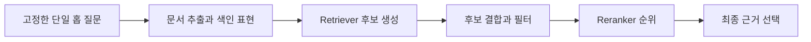

# Advanced RAG 이후의 단일 홉 검색 고도화 — 연구 방향과 개선 실험

> 조사일·자료 확인일: 2026-10-10
>
> 전제: Advanced RAG가 이미 구축되어 있다. 목표는 단일 홉 질문에서 필요한 근거를 검색하고 최종 상위 결과에 올리는 정확도를 높이는 것이다.
>
> 현재 임베딩 모델, retriever, reranker, corpus, 언어, 실제 실패 로그는 제공되지 않았다. 따라서 이 문서는 논문과 공식 문서를 바탕으로 한 조건부 연구·실험 제안이다. 사용자의 시스템을 실행하거나 성능을 측정한 결과가 아니다. 최신 모델 순위 선정이나 논문 완역을 목적으로 하지 않는다.

## 1. 지금 공부할 핵심 분야

가장 직접적인 분야는 **도메인에 적응하는 Neural Information Retrieval**이다. 특히 **hard negative mining, relevance learning, retriever·reranker fine-tuning, teacher distillation**이 이미 구축된 검색 시스템을 개선하는 데 연결된다.

학습 관점의 핵심 질문은 다음과 같다.

> 우리 시스템이 비슷하다고 판단하는 문서 중, 실제로 질문의 조건을 만족하는 근거와 만족하지 않는 문서를 어떻게 구별하게 만들 것인가?

Self-ask는 복잡한 질문을 하위 질문으로 분해하는 연구다. 여기서는 질문 하나를 주었을 때 검색기가 근거를 잘 찾도록 하는 문제를 다룬다. 관련 완역본: [Self-ask 한국어 번역](self-ask_ko_translation.md).

| 연구 분야 | 현재 시스템에 던지는 질문 | 우선 검토 조건 |
| --- | --- | --- |
| Domain Adaptation | 범용 모델의 관련성 기준이 우리 문서와 질문에도 맞는가? | 전문 용어·사내 표현·언어 차이에서 반복 실패 |
| Hard Negative Mining | 비슷하지만 잘못된 문서를 학습에서 구별하는가? | 제품·버전·연도·대상만 다른 문서 혼동 |
| Learning to Rank | 후보 중 실제 근거를 상위에 배치하는가? | 정답 근거가 후보에는 있지만 최종 결과에서 탈락 |
| Knowledge Distillation | 좋은 teacher의 관련성 판단을 빠른 retriever에 옮길 수 있는가? | teacher는 잘 구별하지만 retriever는 잘 구별하지 못함 |
| Late Interaction | 하나의 문서 벡터에서 세부 조건이 충분히 보존되는가? | 짧은 구절·수치·복수 제약을 반복해서 놓침 |
| Contextual Document Representation | 검색되는 chunk만으로 문서의 대상을 식별할 수 있는가? | 제목·표 머리글·적용 범위가 chunk 밖에 있음 |

이 표는 조사에 따른 판단 틀이다. 아래 출처들의 실험 결과가 특정 시스템에서 모든 방법의 효과를 보장하지는 않는다.

## 2. 먼저 근거와 평가 단위를 정의한다

단일 홉은 필요한 사실을 얻기 위해 중간 답으로 다음 검색을 구성할 필요가 없는 질문으로 정의한다. 단일 홉이라고 질문이 단순하거나 관련 chunk가 반드시 하나라는 뜻은 아니다.

예를 들어 “제품 A의 v3.2에서 관리자 계정 잠금 해제 절차는?”은 단일 검색으로 답할 수 있어도 제품, 버전, 계정 유형이라는 제약을 포함한다. “계정 잠금”을 설명하는 일반 문서는 주제상 관련되지만 이 질문의 충분한 근거가 아닐 수 있다.

실험에서는 세 대상을 구분한다.

| 대상 | 판정 |
| --- | --- |
| 주제 관련 문서 | 같은 주제를 언급하지만 직접 답하지 못할 수 있음 |
| 정답 근거 | 질문의 대상과 조건을 만족하며 답을 뒷받침함 |
| 실제 LLM 입력 | 최종 필터·중복 제거·토큰 제한까지 거쳐 전달된 내용 |

**제안:** qrels에는 chunk ID만 붙이지 않고 원문 위치와 관련성 판정 이유를 함께 둔다. 동일 근거를 포함한 겹치는 chunk는 evidence ID로 묶어서 중복 성과를 별도로 구분한다. 여러 대체 근거가 있으면 모두 positive로 기록한다.

```text
query_id
original_query
query_type / language / required_constraints
doc_id / chunk_id / evidence_id / source_span
relevance_grade: 0 / 1 / 2
judgment_reason
judgment_status: judged / unknown
```

등급 예시는 `0=조건을 만족하지 못함`, `1=관련되지만 충분하지 않음`, `2=직접적인 충분 근거`다. 시스템의 과제에 맞춰 라벨 지침을 확정해야 한다. 미판정 문서를 자동으로 negative로 확정하지 않는다.

## 3. 실패가 발생하는 지점을 분리한다



진단할 때는 이미 구축된 각 단계의 출력을 보존한다. 구조를 새로 추가하는 것이 아니라, 현재 구조에서 근거가 사라지는 위치를 찾는 것이다.

| 관찰 | 우선 조사할 원인 | 첫 실험 |
| --- | --- | --- |
| 원문에는 있지만 색인에 근거가 없음 | 파싱 누락, 표 머리글 손실, 청크 경계 | 원문과 실제 색인 텍스트 대조 |
| exact vector 검색에서는 찾고 ANN에서는 놓침 | 근사 탐색·필터 상호작용 | 같은 벡터·filter로 exact/ANN 비교 |
| exact 검색도 정답 근거를 못 찾음 | 표현·학습 분포·질의 인코딩 불일치 | 도메인 데이터와 모델 입력 규약 점검 |
| 각 검색 경로에는 있지만 결합 뒤 탈락 | fusion·후보 제한·중복 제거 | 각 경로와 결합 후 근거 순위 기록 |
| reranker 입력에는 있으나 출력 상위에서 탈락 | 관련성 판단·입력 절단·도메인 차이 | 고정 후보로 reranker 비교 |
| reranker 상위에는 있으나 LLM 입력에서 사라짐 | context 선택·토큰 제한 | 최종 전달 span 추적 |

**중요한 구분:** ANN이 exact vector Top-K를 얼마나 재현하는지와, 질문의 정답 근거를 얼마나 찾는지는 서로 다른 평가다. exact 검색은 주어진 벡터 유사도에 대한 기준일 뿐 의미적 정답의 기준이 아니다. 관련 기존 노트: [검색 원리와 검색 범위](../../Qdrant/06_검색_원리와_검색_범위.md).

## 4. 공통 연구 결과: 학습 데이터가 검색기의 구별 능력을 결정한다

### 4.1 Hard negative는 현재 시스템이 헷갈리는 오답이어야 한다

RocketQA는 dense retriever 학습의 문제로 학습·추론 분포 차이, 미표기 positive, 제한된 데이터를 다루며 cross-batch negatives, denoised hard negatives, data augmentation을 제안한다. NV-Retriever는 positive의 점수를 기준으로 잠재적 false negative를 제거하는 방법을 비교한다. 공통 메시지는 어려운 negative를 확보하되 실제 relevant 문서를 오답으로 학습하지 않도록 해야 한다는 것이다. [RocketQA](https://aclanthology.org/2021.naacl-main.466/), [NV-Retriever v1 본문](https://arxiv.org/html/2407.15831v1).

다음은 실제 데이터가 아닌 학습 예시다.

```text
q: 제품 A v3.2의 관리자 계정 잠금 해제 절차는?
d+: 제품 A v3.2 관리자 잠금 해제 절차
d-1: 제품 A v2.0 관리자 잠금 해제 절차
d-2: 제품 A v3.2 일반 사용자 잠금 해제 절차
d-3: 제품 B v3.2 관리자 잠금 해제 절차
```

반복 실패의 대상·버전·기간 차이를 이렇게 학습 사례에 담으면, 임의 문서를 negative로 넣는 것보다 필요한 구별을 직접 가르칠 수 있다. 다만 이전 버전의 절차가 현재에도 적용되는지는 실제 원문과 적용 범위를 확인해야 한다. 제목이 다르다는 이유만으로 negative로 정하면 안 된다.

**제안하는 데이터 흐름:** 운영 질문 확보 → 현재 retriever·reranker에서 상위 후보 수집 → 직접 근거와 혼동 오답 판정 → 중복·다른 positive 제거 → 학습용 triplet 또는 labeled pair 생성.

teacher 점수는 판정 보조 수단이다. threshold를 통과했다고 진짜 negative가 증명되는 것은 아니다. 샘플별 검토와 다중 positive 처리가 필요하다. 공식 구현에는 candidate rank 범위와 positive 대비 margin 같은 도구가 있다. [Sentence Transformers hard negative 문서](https://sbert.net/docs/package_reference/util/hard_negatives.html).

**공부할 내용:** contrastive learning, in-batch negatives, false negative masking, positive-aware mining, 반복 mining. **적용 판단의 신뢰도:** 학습 문제의 중요성은 높음, 현재 시스템의 개선 폭은 미측정.

### 4.2 범용 임베딩을 도메인에 맞추는 연구가 직접 연결된다

GPL은 target corpus에서 질의를 생성하고 cross-encoder로 pseudo label을 만들어 dense retriever를 도메인에 적응시킨다. 라벨이 부족한 환경에서 학습 데이터를 만드는 연구로 읽을 가치가 있다. 다만 생성 질문과 teacher 판정이 실제 사용자의 질의 분포를 대표하는지는 별도로 검증해야 한다. [GPL](https://aclanthology.org/2022.naacl-main.168/).

**제안:** 실제 실패 질의를 먼저 학습 자료의 기준으로 삼고, 합성 질의는 부족한 유형을 보충한다. 합성 질문만으로 train과 test를 만들면 현실의 짧은 질의, 오탈자, 사내 약어를 평가하지 못할 수 있다.

학습 전에 사용하는 모델의 query/document prefix, instruction, pooling, normalization, 최대 입력 길이가 공식 사용 규약과 맞는지 확인한다. 모델이나 벡터 생성 방식을 바꾸면 문서 벡터를 다시 생성해야 하는지, 색인의 버전을 어떻게 관리할지 함께 정한다.

**공부할 내용:** supervised domain adaptation, synthetic query generation, contrastive loss, margin-based distillation, held-out domain evaluation. **적용 판단의 신뢰도:** 방법 자체는 논문 근거가 있으나 해당 corpus·한국어에서의 효과는 확인되지 않음.

### 4.3 정답이 후보에 있다면 reranker의 관련성 기준부터 점검한다

Sentence Transformers 공식 문서는 특정 사용 사례에서 reranker가 성능을 떨어뜨릴 수 있으며 fine-tuning이 중요할 수 있다고 설명한다. labeled query-document pair의 binary cross entropy부터 listwise 학습까지 데이터에 맞는 목적함수를 검토할 수 있다. [학습 개요](https://sbert.net/docs/cross_encoder/training_overview.html), [Cross-encoder losses](https://sbert.net/docs/package_reference/cross_encoder/losses.html).

**제안:** 현재 후보군을 고정하고 reranker만 변경하는 비교를 먼저 한다. 입력에 제목, 버전, 섹션 경로를 제공하되, 답을 포함하는 본문이 길이 제한으로 잘리지 않는지 확인한다. 학습 라벨도 단순 주제 관련성이 아닌 질문 조건과 근거 충분성을 반영한다.

reranker를 학습했는데 후보 생성도 동시에 바뀌면 어디에서 개선됐는지 알기 어렵다. 후보 고정 실험과 전체 검색 실험을 모두 둔다. 평가 데이터에서만 정답을 후보 맨 위에 배치하는 oracle 진단을 해 보면, 현재 후보군으로 가능한 개선 여지를 가늠할 수 있다. 이 oracle은 운영 모델이 아니다.

**공부할 내용:** pointwise/pairwise/listwise relevance learning, truncation, negative sampling, calibration. **적용 판단의 신뢰도:** 후보 존재 조건에서 직접적인 개선 지점, 효과 크기는 실험 필요.

### 4.4 Teacher의 판단을 retriever에 옮기는 단계가 있다

RocketQAv2는 retriever와 reranker를 공동으로 학습하고 dynamic listwise distillation을 통해 양쪽의 관련성 정보를 이용한다. 이 연구는 검색과 재정렬을 독립적인 완성품으로만 보는 접근에서 더 나아간다. [RocketQAv2](https://aclanthology.org/2021.emnlp-main.224/).

**제안:** teacher가 우리의 문서에서 충분히 정확한지 먼저 확인한다. teacher가 정답 근거를 구별하지만 retriever가 놓친다면, teacher의 점수 차이나 순위 분포를 학습 신호로 사용하는 방향을 검토한다. 잘못된 teacher의 판단을 그대로 증류하면 그 오류도 전달된다.

**공부할 내용:** score-margin distillation, listwise distribution distillation, retriever–reranker 공동 학습. **적용 판단의 신뢰도:** 연구 근거 높음, teacher 품질이 핵심 적용 조건.

### 4.5 표현의 한계가 남으면 token-level matching을 검토한다

ColBERTv2는 query와 document를 토큰 수준의 다중 벡터로 표현하는 late interaction 계열이다. 논문은 residual compression과 denoised supervision을 결합하여 이 방식의 공간 비용과 검색 품질을 개선한다. [ColBERTv2](https://aclanthology.org/2022.naacl-main.272/).

**제안:** 여러 제약이 있는 질문에서 single-vector retriever가 혼동한다면 비교 후보로 삼는다. 현재 후보의 후단 점수화로 시험하면 reranking 개선이고, corpus 전체에서 후보를 생성하게 해야 retrieval recall 개선 여부를 평가할 수 있다. 두 용도를 구분한다.

토큰 단위 비교가 버전·수치·부정 표현을 반드시 정확히 판별한다는 보장은 없다. 필수 조건이 구조화할 수 있는 값이라면 field/filter를 함께 평가한다. multi-vector의 색인 크기와 검색 비용도 측정한다.

**공부할 내용:** late interaction, MaxSim, multi-vector indexing, compression. **적용 판단의 신뢰도:** 표현 방식의 차이는 명확함, 사용자의 실패를 해결할지는 미측정.

### 4.6 Chunk에서 사라진 문맥은 학습과 별도로 복원해야 한다

Anthropic의 Contextual Retrieval은 chunk별 설명 문맥을 embedding과 BM25 색인 전에 덧붙이는 접근이다. 근거는 벤더 자체 실험이므로 방법에 대한 1차 자료이지만, 보고한 효과를 일반적인 개선율로 사용하지 않는다. [공식 기술 글](https://www.anthropic.com/engineering/contextual-retrieval).

**제안:** 기존 Advanced RAG에 문맥 보강이 없다면 `제품명 / 문서 버전 / 섹션 경로 / 표 머리글`을 원문 기반으로 보존하는 실험부터 한다. 생성 문맥은 검색용 보조 표현으로 두고 실제 답의 근거 span과 구분한다. 존재하지 않는 적용 범위를 생성해 추가하지 않았는지 확인한다.

**공부할 내용:** document representation, contextual indexing, 구조를 보존하는 표·문서 처리. **적용 판단의 신뢰도:** 문맥 손실이 확인된 경우에 유용한 가설, 자체 검증 필요.

## 5. 연구 사이의 긴장과 적용 한계

| 서로 다른 관점 | 왜 함께 고려해야 하는가? | 우리 시스템에서 판별할 실험 |
| --- | --- | --- |
| 더 어려운 negative가 필요함 / 상위 negative에 미표기 정답이 섞임 | 어려움과 라벨 정확도가 동시에 필요 | naive mining과 판정·정제 mining 비교 |
| 합성 데이터로 도메인 적응 가능 / 합성 질문이 실제 사용자와 다를 수 있음 | corpus 분포와 query 분포가 모두 중요 | 실제 사용자 질문 holdout에서 비교 |
| reranker가 정밀 판단 가능 / 특정 도메인에서는 순위를 악화시킬 수 있음 | 모델을 붙였다는 사실은 효과의 증거가 아님 | 동일 후보에서 개선·회귀 질의별 분석 |
| 더 큰 표현력 / 비용·색인 크기 증가 | 품질 목표와 운영 예산을 함께 만족해야 함 | 같은 최종 K에서 품질·p95·색인 크기 비교 |
| 공개 benchmark 성능 / 사내 한국어·문서 구조의 적합성 | 연구 데이터와 배포 데이터가 다름 | 도메인별·언어별 점수와 실제 근거 판정 |

BEIR는 다양한 검색 과제에서 zero-shot 일반화를 평가하며 접근별 품질·계산 비용 차이를 보여 준다. 이 연구를 사용하는 이유는 특정 최신 모델을 추천하기 위해서가 아니라, 단일 공개 점수로 corpus 적합성을 판단하지 않기 위해서다. [BEIR v4](https://arxiv.org/abs/2104.08663v4).

## 6. 기존 시스템에서 수행할 구체적인 실험

다음 숫자와 실험 순서는 운영 현황을 모르는 상태의 **착수 예시**다. 논문의 보편적인 권장값이 아니다.

### 6.1 고정 평가 집합과 기준선

우선 수백 개 규모의 실제 단일 홉 질문으로 파일럿을 구성하고, 빈번한 실패 유형과 정상 사례를 함께 포함한다. 예를 들어 200~500개로 판정 체계를 검증한 뒤 표본을 확대할 수 있다. 이 규모만으로 작은 개선의 통계적 확실성이 보장되지는 않는다.

train/dev/test는 동일 질문을 조금 바꾼 문장, 같은 문서의 중복 chunk, 같은 템플릿이 양쪽에 섞이지 않도록 문서 계열과 질문 계열 기준으로 나눈다. 동일 corpus 검색이 운영 목표면 이를 명시하고, 별도 문서·시점 holdout으로 일반화도 확인한다. 시험 질문과 qrels를 학습·teacher 라벨 생성·threshold 튜닝에 사용하지 않는다.

기준선에는 원질의, corpus snapshot, 모델 revision, tokenizer, 입력 규약, 색인 설정, 후보 수, 최종 K, filters, context token budget를 기록한다.

### 6.2 후보와 최종 결과를 따로 측정한다

| 지표 | 용도 |
| --- | --- |
| Candidate evidence Hit@N | 후보 N개 안에 직접 근거가 하나 이상 있는 질문의 비율 |
| Candidate evidence Recall@N | 판정한 관련 근거 전체 중 후보가 찾은 비율 |
| Final evidence Hit@K | 실제 최종 K개에 직접 근거가 있는 질문의 비율 |
| MRR@K | 첫 직접 근거가 얼마나 높은 순위에 있는가 |
| nDCG@K | 충분 근거와 부분 관련성을 포함한 순위 품질 |
| Delivered evidence Hit | 토큰 제한 이후 LLM 입력에도 직접 근거가 남는가 |
| p50/p95·색인 크기·질의 비용 | 품질 개선의 운영 비용 |

positive가 하나뿐이면 Hit@K와 Recall@K의 질의별 값은 같을 수 있다. 다중 positive에서는 뜻이 다르다. 부분 관련 문서를 MRR의 positive로 볼지, 직접 근거만 볼지 라벨 정책에 명시한다. 미판정 후보를 전부 오답으로 처리하면 새로운 검색 모델에 불리하므로, 여러 실험의 후보를 합쳐 추가 판정한다.

### 6.3 변경 하나의 효과부터 분리한다

| 실험 | 바꾸는 것 | 검증 질문 |
| --- | --- | --- |
| B0 | 없음 | 현재 실패가 어디서 발생하는가? |
| B1 | 색인 문맥과 입력 규약 | 표현 손실·입력 오류를 바로잡으면 나아지는가? |
| B2 | retriever의 도메인 학습 | 같은 질문에서 필요한 근거를 더 찾는가? |
| B3 | 동일 B2 모델의 negative 정제 방식 | naive negative보다 정제 negative가 도움이 되는가? |
| B4 | 고정 후보에서 reranker 학습 | 상위 K에서 충분 근거가 증가하는가? |
| B5 | 검증된 teacher를 이용한 증류 | 후보 품질이 향상되는가? |
| B6 | late interaction | 표현 차이가 남은 실패 유형을 줄이는가? |

실제 우선순위는 3절의 실패 위치에 따른다. B2~B6을 모두 구현할 필요는 없다. 최종 K와 context budget은 고정하고, 후보 수를 바꾸는 실험은 별도 변수로 다룬다. 학습 손실 감소를 검색 개선으로 해석하지 않는다.

질의별 baseline 대비 차이, 유형별 개선·회귀, paired bootstrap 같은 방법의 불확실성 추정을 함께 확인한다. 개발 집합에서 선택한 최종 구성을 고정 시험 집합에서 평가한다. 평가 결과는 전체 평균뿐 아니라 버전 구분, 정확 식별자, 부정·조건, 한국어 표현 등 실제 유형별로 남긴다.

## 7. 논문을 읽는 순서

다음은 개선 원리를 이해하기 위한 읽기 순서다. 최신성 또는 모델 성능의 순위가 아니다.

1. **RocketQA**: 검색 학습에서 분포 차이·negative·미표기 positive가 왜 문제가 되는지 파악한다.
2. **NV-Retriever**: 혼동 후보를 negative로 만드는 과정과 false negative 정제를 더 깊게 읽는다. 본문에서 확인한 알고리즘은 v1 기준이며, arXiv에는 v2도 있다.
3. **GPL**: 라벨이 부족한 도메인에서 query·pseudo label을 어떻게 만드는지 읽는다.
4. **RocketQAv2**: teacher와 retriever를 연결하는 listwise distillation을 읽는다.
5. **ColBERTv2**: single-vector 표현의 대안을 검토할 때 읽는다.

정답 근거가 이미 후보에 거의 항상 존재한다면 이 순서보다 reranker 학습 자료를 먼저 보는 편이 적용에 더 직접적이다. 후보가 자주 비면 RocketQA·NV-Retriever·GPL 쪽이 우선이다. 현재 어느 쪽인지 판단할 실제 수치는 아직 없다.

## 8. 확인한 원자적 주장과 출처 신뢰도

자료 확인일은 모두 2026-10-10이다. 정적 논문은 명시한 판본을 사용하고, 공식 문서는 확인 시점의 웹 페이지를 사용했다. 공개 근거의 신뢰도와 사용자 시스템에 적용한 효과의 확실성은 구분한다.

| ID | 출처·판본 | 원자적 주장 | 확인 범위·신뢰도 |
| --- | --- | --- | --- |
| S1 | [RocketQA, NAACL 2021](https://aclanthology.org/2021.naacl-main.466/) | 학습·추론 차이, 미표기 positive, 데이터 부족을 위한 학습 개선을 제안 | 학회 게재본 초록·서지; 방법 개요 근거 높음 |
| S2 | [NV-Retriever v1, 2024-07-22](https://arxiv.org/html/2407.15831v1) / [v2, 2025-02-07](https://arxiv.org/abs/2407.15831v2) | positive 점수 기반의 false-negative 정제를 비교 | v1 본문 mining·ablation, v2 서지; preprint 실험 근거 중간~높음 |
| S3 | [GPL, NAACL 2022](https://aclanthology.org/2022.naacl-main.168/) | query 생성과 cross-encoder pseudo labeling으로 domain adaptation 수행 | 학회 게재본 초록·서지; 방법 개요 근거 높음 |
| S4 | [RocketQAv2, EMNLP 2021](https://aclanthology.org/2021.emnlp-main.224/) | dynamic listwise distillation으로 retrieval·reranking 공동 학습 | 학회 게재본 초록·서지; 방법 개요 근거 높음 |
| S5 | [ColBERTv2, NAACL 2022](https://aclanthology.org/2022.naacl-main.272/) | token-level late interaction에 압축·denoised supervision 결합 | 학회 게재본 초록·서지; 표현 방식 근거 높음 |
| S6 | [BEIR v4, 2021-10-21](https://arxiv.org/abs/2104.08663v4) | 다양한 과제에서 OOD 검색 일반화와 접근별 차이를 평가 | NeurIPS 2021 benchmark 논문 초록·서지; 평가 필요성 근거 높음 |
| S7 | [Contextual Retrieval, 2024-09-19](https://www.anthropic.com/engineering/contextual-retrieval) | 색인 전에 chunk별 문맥을 덧붙임 | 벤더 공식 글; 동작 근거 높음, 보편적 효과 중간 이하 |
| S8 | [Hard negative 공식 문서](https://sbert.net/docs/package_reference/util/hard_negatives.html) | 후보 범위와 positive 대비 margin으로 mining 조절 가능 | 라이브 API 문서; 확인 시점 동작 설명 근거 높음, 설치 버전 미확인 |
| S9 | [Reranker 학습 개요](https://sbert.net/docs/cross_encoder/training_overview.html) / [손실 함수](https://sbert.net/docs/package_reference/cross_encoder/losses.html) | 도메인 fine-tuning과 labeled pair 기반 학습을 지원 | 라이브 공식 문서; 방법·API 근거 높음, 설치 버전 미확인 |

## 9. 현재 남아 있는 정보 공백

현재 retriever·embedding model·reranker, corpus 종류와 언어, query 수, 후보 N과 최종 K, latency budget, 반복 실패 사례가 없다. 따라서 특정 모델 교체, 학습 규모, threshold, 예상 개선율은 확정하지 않는다.

다음으로 판단할 것은 **우리 시스템의 정답 근거가 어느 단계에서 사라지는지**, 그리고 **그 혼동을 어떤 query–positive–negative 사례로 학습할 수 있는지**다. 이 두 정보가 확보되면 위 연구 방향에서 실제 우선순위를 선택할 수 있다.
