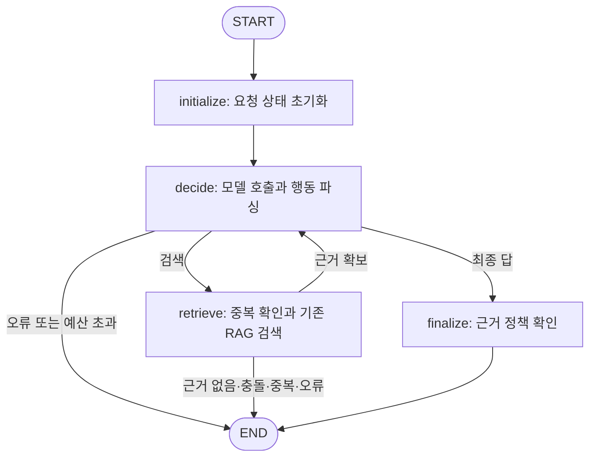

# Self-ask를 LangGraph로 구현하기

> 작성·검증: 2026-10-10. Python 3.11 환경의 LangGraph **1.2.11**로 실행 검증했다. 모델·검색 결과는 대역이며 실제 모델 호출은 수행하지 않았다.
> 기준: [Self-ask 번역본](self-ask_ko_translation.md), [기존 프롬프트·실행 분석](02_self_ask_prompt_and_execution_analysis.md). 기존 문자열 completion과 중간 답 삽입 방식을 유지하고, 반복 실행을 LangGraph로 변환했다. 파인튜닝이 필요하지 않다.

## 1. 변환된 구조

기존 `while` 루프를 노드 하나 안에서 호출하는 방식으로 감싸지 않았다. 초기화, 다음 행동 결정, 검색, 최종 답 처리에 각각 별도 노드를 사용한다.



`StateGraph`에 상태·노드·조건 분기를 정의하고 `compile()` 후 `invoke()`나 `stream()`으로 실행한다. API 구성 근거: [LangGraph Graph API 공식 문서](https://docs.langchain.com/oss/python/langgraph/graph-api), 2026-10-10 확인. 원 논문은 이 프레임워크를 사용하지 않았으며 이 문서의 구현은 실행 구조를 옮긴 것이다.

## 2. 파일별 역할

| 파일 | 역할 |
| --- | --- |
| [code/self_ask_langgraph.py](code/self_ask_langgraph.py) | `SelfAskState`, 네 노드, 조건 분기, `build_self_ask_graph()` |
| [code/self_ask.py](code/self_ask.py) | 프롬프트·자료형·파서·질의 정규화. `run_self_ask()`는 그래프 실행을 호출하는 호환 진입점 |
| [code/self_ask_ollama.py](code/self_ask_ollama.py) | 보유 Ollama 모델 연결. 기존 콜백 계약 유지 |
| [code/example_self_ask.py](code/example_self_ask.py) | 두 단계 검색 대역과 노드별 업데이트 스트리밍 |
| [code/test_self_ask.py](code/test_self_ask.py) | 기존 24개 회귀 테스트 |
| [code/test_self_ask_graph.py](code/test_self_ask_graph.py) | 노드 분리·실행 순서·요청별 상태 분리·그래프 단계 제한 테스트 4개 |
| [code/requirements-self-ask.txt](code/requirements-self-ask.txt) | 검증한 LangGraph 버전 고정 |

공통 자료형과 파서를 그래프 모듈에서 재사용한다. 모델·검색 콜백은 외부에서 주입하므로 특정 제공자 SDK나 모델에 실행 구조가 묶이지 않는다.

## 3. 실행하기

LangGraph가 없는 실행 환경에서는 아래 의존성을 해당 가상환경에 설치한다. 다른 프로젝트 환경을 수정할 필요는 없다.

```powershell
python -m pip install -r .codex/research/AgentComponent/Decomposer/code/requirements-self-ask.txt
python .codex/research/AgentComponent/Decomposer/code/example_self_ask.py
python -m unittest discover -s .codex/research/AgentComponent/Decomposer/code -p "test_self_ask*.py"
```

이번 작업에서는 저장소의 기존 `AI/agent_hitl/.venv`에 LangGraph 1.2.11이 이미 설치되어 있어 패키지를 추가하지 않고 그 Python으로 검증했다. 위 명령의 `python`은 LangGraph가 설치된 환경의 Python이어야 한다.

예제의 노드 실행 순서는 다음과 같다.

```text
initialize
decide
retrieve
decide
retrieve
decide
finalize

종료 상태: completed
최종 답: 매일 새벽 2시에 백업합니다.
근거 ID: ['doc-1', 'doc-2']
```

## 4. 코드에서 직접 사용하기

아래 코드는 `code/`를 import 가능한 위치에 둔 상태에서 실행한다. 실제 동작하는 대역 콜백을 사용하므로 모델 API가 없어도 그래프 실행을 확인할 수 있다.

```python
from example_self_ask import make_demo_callbacks
from self_ask_langgraph import build_self_ask_graph

complete, search_answer = make_demo_callbacks()

graph = build_self_ask_graph(
    complete=complete,
    search_answer=search_answer,
    max_searches=5,
    require_evidence=True,
)

result = graph.invoke({
    "question": "서비스 A가 사용하는 DB의 백업 주기는?"
})

print(result["status"])
print(result["answer"])
print(result["searches"])
```

대역 출력은 호출 때마다 소비되므로 별도 실험을 시작할 때는 `make_demo_callbacks()`를 다시 호출한다. 실제 모델·검색 콜백은 이러한 미리 정해진 출력 목록을 사용하지 않는다.

실제 적용에서는 `complete`를 `make_ollama_complete(보유_모델명)`처럼 실제 모델 연결로, `search_answer`를 기존 RAG 콜백으로 교체한다. 다음 계약은 이전 보완본과 같다.

- `complete(prompt, stop)` → `Completion(text, finish_reason)`
- `search_answer(query)` → `SearchResult(status, answer, evidence)`

기존 호출 방식도 사용할 수 있다. `run_self_ask(question, complete, search_answer, **options)`는 내부에서 그래프를 빌드하고 실행한다. 그래프를 한 번 만들어 여러 요청에서 재사용하거나 스트리밍하려면 `build_self_ask_graph()`를 직접 사용하는 것이 적합하다.

## 5. 상태와 노드가 하는 일

공유 상태에는 다음 값이 있다. 각 노드는 입력 상태를 직접 변경하지 않고 새 업데이트를 반환한다. 리스트 누적은 해당 노드가 새 리스트로 반환하며 LangGraph의 기본 덮어쓰기 동작을 사용한다. 누적 reducer를 중복 적용하지 않는다.

| 상태 | 내용 |
| --- | --- |
| `question` | 이번 사용자 질문 |
| `transcript` | 고정 예시·사용자 질문·확보한 중간 답의 누적 프롬프트 |
| `action`, `value` | 다음 행동과 후속 질문 또는 최종 답 |
| `searches` | 검색 질문, 답, 상태, 근거 ID·인용 |
| `seen_queries` | 정규화한 검색 질문 기록 |
| `events`, `model_calls` | 실행 이벤트와 모델 호출 수 |
| `started` | 이번 실행의 시간 예산 기준 |
| `status`, `answer` | 종료 상태와 성공 시 최종 답 |

`initialize`는 매 요청에서 새 상태를 만든다. `decide`는 모델 출력과 종료 사유를 검증한다. `retrieve`는 중복·검색 제한을 확인하고 검색 근거를 프롬프트와 상태에 넣는다. `finalize`는 근거 정책과 예산을 확인한 뒤 최종 답을 반환한다.

재시도는 `decide`와 `retrieve` 내부에서 제한된 횟수로 수행한다. 검색 단계 간 반복은 Python `while`이 아니라 `retrieve → decide` 그래프 분기로 실행한다. 기존 파싱·근거·시간·문자·검색·모델 호출 정책을 유지한다.

검색 횟수와 LangGraph super-step 수는 서로 다르다. 그래프에 정책상 필요한 단계 수를 고려한 기본 `recursion_limit` 설정을 부여했다. 직접 실행할 때 더 작은 제한으로 덮어쓰면 LangGraph의 `GraphRecursionError`가 먼저 발생할 수 있으므로 이를 검색 횟수로 해석하지 않는다.

## 6. 이번 변환에 포함한 것과 남는 확인

이번 변경은 **실행 흐름을 LangGraph로 옮기는 것**이다. 문자열 표식 파서를 구조화 출력·도구 호출로 바꾸는 변경까지 함께 수행하지 않았다. 따라서 원 논문의 문자열 생성 방식과 보유 모델 콜백 계약이 유지된다. 파서를 제거하려면 모델 출력 계약도 별도로 변경해야 한다.

LangGraph를 사용한다고 검색 근거의 타당성이 자동 검증되는 것은 아니다. 검색 콜백이 `supported`로 반환하는 근거의 의미적 타당성은 실제 RAG 연결에서 확인한다. 기본 근거 필요 정책은 이미 확보한 근거의 존재를 검사하며 최종 답의 모든 주장을 검증하는 것은 아니다.

체크포인터를 설정하지 않았으므로 장기 저장·중단 후 재개는 이번 예제에 포함하지 않았다. 상태 초기화와 `monotonic` 시간 예산은 요청별 실행에 맞춘 구성이다. 요청 간 공유되는 콜백·클라이언트 자체의 동시 실행 적합성도 실제 환경에서 확인해야 한다.

## 7. 검증 결과

LangGraph 1.2.11에서 총 **28개 테스트**가 통과했다. 기존 24개 회귀 테스트는 `run_self_ask()`를 통해 실제 그래프를 실행했다. 추가 네 테스트는 노드가 분리되어 있는지, 검색 뒤 다음 모델 입력에 중간 답이 들어가는지, 같은 그래프의 두 요청 사이에 근거가 섞이지 않는지, 25단계를 넘는 정상 실행이 설정된 예산으로 완료되는지 확인한다.

두 단계 검색 예제는 실제 `graph.stream(..., stream_mode="updates")`에서 노드 순서와 근거 보존을 확인했다. 검증은 대역 모델·검색기와 HTTP 응답을 사용했다. 실제 모델 추론이나 검색 성능 개선은 이번 검증 범위에 포함하지 않는다.
