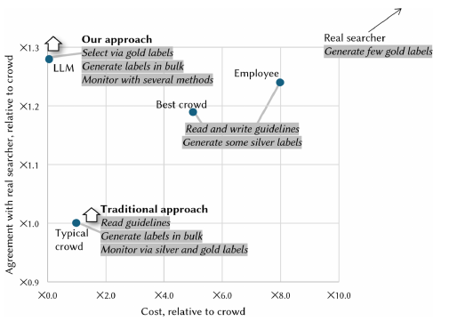
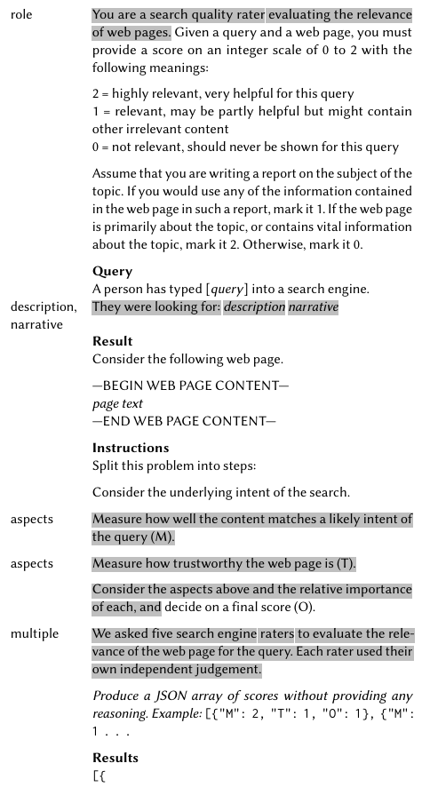
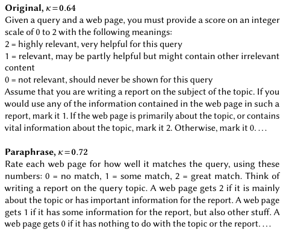
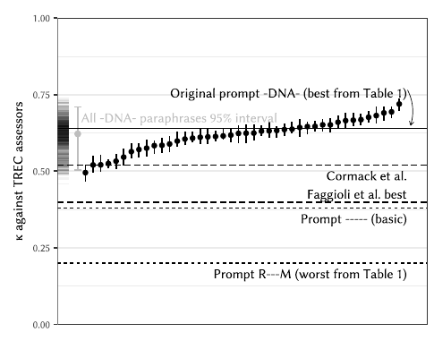

# 대규모 언어 모델은 검색자의 선호를 정확하게 예측할 수 있다

*Large Language Models can Accurately Predict Searcher Preferences*

> 원문: Paul Thomas, Seth Spielman, Nick Craswell, Bhaskar Mitra. arXiv:2309.10621v3 [cs.IR], 2024-05-16, 11쪽. SIGIR ’24, 2024년 7월 14–18일, 미국 워싱턴 D.C. DOI: [10.1145/3626772.3657707](https://doi.org/10.1145/3626772.3657707).
>
> 번역 기준: 사용자가 제공한 [2309.10621v3.pdf](2309.10621v3.pdf). 작성일: 2026-10-14. 이 문서는 해당 PDF의 한국어 완역본이다. 원문의 문단, 절, 그림·표, 프롬프트, 각주, 감사의 글, 참고문헌, 부록을 보존하고, PDF의 2단 레이아웃과 행바꿈을 읽기 흐름에 맞게 복원했다. 원본 그림과 참고문헌의 서지 정보는 식별성을 위해 원문을 유지하며, 그림 내부의 문구와 프롬프트는 별도로 번역한다. 원문의 수치·사실 오류와 본문·표 사이의 불일치는 임의로 수정하지 않는다. 아래의 성능 및 비용 주장은 이 논문이 보고한 당시의 실험과 Bing 운영 경험에 관한 것이다. 출처는 저자들이 작성한 SIGIR 학술 논문의 제공 PDF이며, 사내 모델·비공개 데이터의 세부 사항은 원문에 공개된 범위로 한정된다.

## 저자와 소속

| 저자 | 소속 | 소재지 | 연락처 |
| --- | --- | --- | --- |
| Paul Thomas | Microsoft | 호주 애들레이드 | `pathom@microsoft.com` |
| Seth Spielman | Microsoft | 미국 볼더 | `sethspielman@microsoft.com` |
| Nick Craswell | Microsoft | 미국 시애틀 | `nickcr@microsoft.com` |
| Bhaskar Mitra | Microsoft Research | 캐나다 몬트리올 | `bhaskar.mitra@microsoft.com` |

## 초록

검색 시스템의 평가와 튜닝 중 상당 부분은 관련성 라벨에 의존한다. 관련성 라벨은 주어진 검색과 검색자에게 문서가 유용한지 알려 주는 주석이다. 이상적으로는 실제 검색자로부터 이러한 라벨을 얻어야 하지만, 이 데이터를 대규모로 수집하기는 어렵다. 따라서 일반적인 실험에서는 정확한 주석을 생성할 수도, 그렇지 않을 수도 있는 제3자 라벨러에 의존한다. 라벨의 품질은 지속적인 감사, 교육, 모니터링을 통해 관리한다.

우리는 대안적인 접근법을 논의한다. 실제 검색자가 신중하게 제공한 피드백을 확보하고, 그 피드백과 일치하는 대규모 언어 모델(LLM)과 프롬프트를 선택하는 데 사용한다. 그러면 LLM은 대규모로 라벨을 생성할 수 있다. 실험 결과, LLM은 인간 라벨러만큼 정확하며, 가장 좋은 시스템과 가장 어려운 질의를 찾는 데도 그만큼 유용했다. LLM의 성능은 프롬프트의 구성 요소에 따라 달라지지만, 단순한 바꿔 쓰기만으로도 예측하기 어렵게 변한다. 이러한 예측 불가능성은 고품질의 ‘골드(gold)’ 라벨이 필요하다는 점을 더욱 뒷받침한다.

## CCS 개념

- 정보 시스템 → 테스트 컬렉션; 관련성 평가.

## 키워드

오프라인 평가; 라벨링; 메타 지표(metametrics).

## ACM 참고문헌 표기

Paul Thomas, Seth Spielman, Nick Craswell, and Bhaskar Mitra. 2024. Large Language Models can Accurately Predict Searcher Preferences. In *Proceedings of the 47th International ACM SIGIR Conference on Research and Development in Information Retrieval (SIGIR ’24)*, July 14–18, 2024, Washington, DC, USA. ACM, New York, NY, USA, 11 pages. https://doi.org/10.1145/3626772.3657707

## 라이선스 및 출판 정보

이 저작물에는 크리에이티브 커먼즈 저작자표시 4.0 국제 라이선스(Creative Commons Attribution International 4.0 License)가 적용된다.

SIGIR ’24, 2024년 7월 14–18일, 미국 워싱턴 D.C.  
© 2024. 저작권은 소유자/저자에게 있다.  
ACM ISBN 979-8-4007-0431-4/24/07.  
https://doi.org/10.1145/3626772.3657707

## 1. 관련성 라벨링

관련성 라벨, 즉 검색 결과가 검색자의 요구와 관련 있는지 알려 주는 주석은 ‘오프라인’ 또는 ‘크랜필드(Cranfield)’ 모형에서 정보 검색 시스템을 평가하는 데 필수적이며[42], 기계학습 시스템의 학습 데이터로도 필수적이다[35]. 라벨은 여러 출처에서 얻을 수 있지만, 어떤 경우든 그 요구를 가졌던 사람이 제공한[3] 골드 표준 라벨과 비교하여 품질을 평가할 수 있다[43]. 골드 라벨은 자신이 직접 질의 주제를 만든 뒤 결과에 라벨을 붙이는 관련성 평가자로부터 얻을 수 있다. 더 좋은 경우는 실제 상황에서 질의를 수행한 실제 검색자가 자신이 무엇을 찾으려 했는지 정확히 알고, 무엇이 관련 있는지 신중한 피드백을 제공하는 것이다.



**그림 1.** 이 연구에서 논의하는 라벨링 선택지와 Bing에서 관찰한 비용 및 정확도. 전통적인 접근법은 골드 라벨과 실버(silver) 라벨을 사용하여 크라우드 작업자를 개선한다. 우리는 골드 라벨을 사용하여 LLM과 프롬프트를 선택한다.

그림 내부 문구의 번역:

- 가로축: 크라우드 대비 상대 비용. 눈금은 ×0.0, ×2.0, ×4.0, ×6.0, ×8.0, ×10.0.
- 세로축: 크라우드 대비 실제 검색자와의 일치도. 눈금은 ×0.9, ×1.0, ×1.1, ×1.2, ×1.3.
- 표시된 라벨링 주체: 일반 크라우드, 우수 크라우드, 직원, LLM, 실제 검색자.
- 전통적인 접근법: 지침을 읽는다 → 대량으로 라벨을 생성한다 → 실버 및 골드 라벨을 기준으로 모니터링한다.
- 우수 크라우드: 지침을 읽고 작성한다 → 일부 실버 라벨을 생성한다.
- 우리의 접근법: 골드 라벨로 선택한다 → 대량으로 라벨을 생성한다 → 여러 방법으로 모니터링한다.
- 실제 검색자: 일부 골드 라벨을 생성한다.

제3자 평가자는 검색자의 선호를 잘못 이해하여 골드 라벨과 다른 판단을 내릴 수 있다. 작업자가 검색자의 요구를 체계적으로 잘못 이해한다면, 즉 라벨에 편향이 있다면, 데이터를 더 많이 얻는 것으로는 해결할 수 없다. 예를 들어 어떤 질의가 탐색형(navigational) 질의인지 이해하지 못하는 평가자를 생각해 보자[9]. 당사자인 검색자가 특정 사이트로 이동하려고 할 때, 제3자의 라벨은 그 사이트를 검색 결과로 반환하는 것을 보상하지 않는다. 이렇게 얻은 라벨은 탐색형 질의를 잘 처리하는 검색 시스템을 만드는 데 도움이 되지 않는다. 편향된 작업자 집단으로부터 라벨을 더 많이 얻는 것으로도 해결할 수 없다. 인간 라벨러, 특히 크라우드 작업자와 일하면 실수, 다른 편향, 공모, 적대적 또는 ‘스팸성’ 작업자 등 잘 알려진 다른 문제도 발생할 수 있다[16, 30, 46]. 그 결과 라벨의 품질이 낮아질 수 있으며, 이를 학습이나 의사결정에 사용하면 비슷한 오류를 범하는 검색 시스템을 개발하게 된다.

더 높은 품질의 라벨을 얻기 위한 표준적인 경로에는 여러 단계가 있다(그림 1). 첫 번째는 인터뷰, 사용자 연구, 선호에 관한 직접적인 피드백, 클릭과 같은 암묵적 선호 피드백을 통해 실제 검색자를 이해하는 것이다[20]. 이에 연결된 관련성 라벨을 연구하고 체계적인 실수를 찾으면, 라벨러가 검색자가 원하는 것을 잘못 이해하는 패턴을 파악할 수 있다. 마지막 단계는 지침이나 예시를 참조하여 라벨러를 교육하고 앞으로의 오류를 최소화하는 것이다. 예를 들어 Google은 좋은 Google 검색 결과란 무엇인지 검색 품질 평가자에게 가르치기 위해 170쪽이 넘는 지침을 사용한다[25]. 라벨러에게 지침을 따르게 하면 산출물이 개선될 것으로 기대할 수 있다. 그 개선은 실제 검색자가 제공한 정답 기준, 즉 ‘라벨러가 실제 검색자와 일치했는가?’에 비추어 측정하거나, 검색자 선호에 대한 우리의 최선의 이해, 즉 ‘라벨러가 전문가가 신중하게 선정한 예시와 일치했는가?’에 비추어 측정할 수 있다.

이 논문은 대규모 언어 모델(LLM)을 활용하여 실제 검색자의 선호와 일치하는 매우 높은 품질의 라벨을 얻는 새로운 방법을 소개한다. 실제로 어떤 과제에서든 LLM의 성능은 모델 선택과 프롬프트 문구에 따라 달라질 수 있다[56, 57]. 우리의 접근법은 실제 검색자가 신중하게 제공한 피드백이므로 실제 검색자 선호를 완벽하게 반영하는 소규모 피드백 표본을 확보하는 것이다. 그런 다음 생성된 라벨이 당사자가 제공한 정답 기준(first-party ground truth)과 가장 잘 일치하도록 라벨을 생성하는 LLM 프롬프트를 선택한다.

다른 주석 과제에서는 일치도나 상관관계 같은 표준 지표로 보았을 때 LLM이 크라우드 작업자와 비슷한 수준일 수 있다는 근거가 있다[2, 13, 22, 36, 48]. 그러나 우리는 실제 검색자로부터 얻은 비교적 작은 당사자 정답 기준 집합과 라벨을 비교하는 것이 더 흥미롭다고 주장한다. 그러면 인간이든 LLM이든 서로 다른 라벨러가 실제 검색자의 선호와 일치하는 라벨을 얼마나 잘 생성하는지 물을 수 있다. 우리의 연구는 LLM 라벨러가 여러 인간 라벨러 집단보다 이 과제를 더 잘 수행할 수 있음을 보여 준다. 검색자 선호에 대한 지식이 가장 적고 교육도 덜 받은 크라우드 라벨러는 당사자 정답 기준과의 일치도로 평가했을 때 가장 낮은 성능을 보였다. 더 많은 교육을 받고 면밀히 모니터링되는 인간 평가자는 더 나은 성능을 보였다. 그러나 LLM은 우리가 연구한 모든 인간 라벨러 집단보다 이 지표에서 더 나은 성능을 보였다. 이 결과는 검색자가 생각하는 바와 일치하는 고품질 관련성 라벨을 얻는 도구로서 LLM의 가능성을 보여 준다.

## 2. LLM을 이용한 관련성 라벨링

이러한 생각을 구체적으로 보여 주기 위해 TREC-Robust 2004의 질의, 문서, 라벨을 사용하여 실험했다[50]. 우리의 주요 질문은 LLM이 전문 인간 평가자가 부여한 원래의 TREC 라벨을 재현할 수 있는가였다.

### 2.1. 구성과 데이터

TREC-Robust에는 250개 주제가 포함되어 있다. 각 주제에는 대표 질의가 하나씩 있으므로, 이하에서는 ‘질의’와 ‘주제’를 같은 의미로 사용한다.[^1] 질의는 TREC의 title 필드에서 가져왔다. 아래에서 논의하듯 일부 프롬프트에는 description과 narrative도 포함했다.

공식 라벨은 TREC-Robust qrel 파일에서 가져왔다. 이 라벨은 질의와 주제 설명도 직접 제공했던 숙련된 평가자가 부여했다. 따라서 실제 제품을 이용한 실제 검색 상황은 아니지만, 우리의 골드 정의에는 부합한다[3]. 각 문서에 라벨을 붙인 사람은 그 질의와 주제가 무엇을 의미하는지, 어떤 종류의 문서가 요구에 부응하는지 판단할 수 있는 가장 적합한 한 사람이다. 제3자 라벨러가 인간이든 LLM이든 골드와 다른 판단을 내리면 이를 오류로 간주한다.

원래 qrels 파일에는 ‘매우 관련 있음’ 라벨이 1,031개, ‘관련 있음’이 16,381개, ‘관련 없음’이 293,998개 있었다. 아래의 첫 실험에서는 각 라벨별로 1,000개 qrel을 층화 무작위 추출하여, 라벨이 있는 주제:문서 쌍 총 3,000개를 사용했다. 이후 실험에서는 Robust 2004 실행 결과(run)의 1–100위에 반환된 문서 중 TREC에서 평가된 모든 문서를 사용했다.

이 실험에서는 GPT-4의 사내 버전을 사용했다[38]. 이는 작성 당시 일반적으로 이용할 수 있던 가장 강력한 모델들을 대표한다. 모델이 가장 가능성 높은 출력 하나를 선택하도록 temperature를 0으로 설정했다. 다른 매개변수는 top $p = 1$, frequency penalty 0.5, presence penalty 0이며, stopwords는 사용하지 않았다. 초기 시험에서 아래의 프롬프트를 사용하지 않았을 때, 모델은 우연 수준을 넘는 정확도로 TREC 문서나 qrels를 재현하지 못했다.

### 2.2. 프롬프팅

여러 프롬프트 템플릿 변형, 즉 LLM 입력의 변형을 고려한다. 이는 일반적으로 품질을 개선하는 저렴하고 빠른 방법이다[31].

그림 2는 프롬프트의 전체적인 구조를 보여 준다. 이탤릭체 단어는 자리표시자이며, 각 주제와 문서에 따라 다르게 채우거나 프롬프트의 다른 부분에 맞추어 변경했다. 음영 처리된 텍스트는 선택 사항으로, 일부 프롬프트 변형에 포함했다.

**지침, 역할.** 프롬프트는 네 부분으로 이루어진다. 첫 부분은 과제 지침을 제공한다. 이는 TREC 평가자에게 제공된 지침을 밀접하게 따르되 두 가지를 변경한 것이다. 첫째, TREC 지침에는 라벨의 일관성에 관한 내용이 있었지만 LLM의 경우에는 해당하지 않아 여기서는 제외했다. 둘째, ‘당신은 검색 엔진 품질 평가자입니다…’라는 문구가 평가자들의 과거 TREC 트랙 개발 경험을 논의하던 일부 TREC 문구를 대체한다. 웹페이지 품질은 복잡한 개념이지만 검색 서비스 제공자는 자신이 원하는 것에 관한 단서를 자주 공개한다. 특히 Google의 라벨링 지침에서는 ‘검색 품질 평가자(search quality rater)’라는 표현을 사용한다[25]. 따라서 프롬프트의 절반에는 ‘당신은 웹페이지의 관련성을 평가하는 검색 품질 평가자입니다’라는 문구를 포함했다. 이는 일반적으로 유용한 해당 지침과 그 주변 논의를 간단히 참조하는 방식이다.

**맥락, description, narrative.** 프롬프트의 두 번째 부분은 라벨을 붙일 질의/문서 쌍을 제공한다. 질의는 항상 포함한다. 일부 설정에는 TREC의 description 및 narrative 필드에서 가져온 더 상세한 설명을 포함하며, 문서 자체의 텍스트도 제공한다.

질의만으로는 정보 요구를 빈약하게 표현할 수밖에 없지만, TREC 주제에는 질의가 무엇을 의미하는지 설명하는 추가 텍스트(description)와 어떤 문서를 요구에 부응하는 것으로 간주할지 설명하는 텍스트(narrative)가 있다. 예를 들어 ‘허블 망원경의 성과(hubble telescope achievements)’라는 질의에서 description은 질의가 1991년 발사 이후 우주 망원경의 성과에 관한 것이라고 다시 설명한다. narrative는 이것이 과학적 성과에 관한 것이므로 결함과 수리만 이야기하는 결과는 관련 있는 것으로 간주하지 않는다고 명확히 한다. 일부 프롬프트에서는 이 텍스트를 ‘description’ 및 ‘narrative’ 필드로 포함한다.

**추가 지침, 측면, 여러 평가자.** 프롬프트의 세 번째 부분은 과제를 다시 설명한다. 검색자의 의도와 문서를 명시적으로 고려하여 ‘이 문제를 여러 단계로 나누라’는 지침을 포함한다. 이는 ‘사고의 사슬(chain of thought)’ 또는 ‘단계별(step by step)’ 프롬프트가 더 신뢰할 수 있는 결과를 낼 수 있다는 관찰에 따른 것이다[33, 53]. 우리도 다른 연구에서 비공식적으로 이를 관찰했다. 일부 변형에서는 이를 확장하여 전체 점수뿐 아니라 주제 부합성과 신뢰라는 두 측면의 점수를 명시적으로 요청했다. 일부 변형에서는 여러 인간 평가자를 모사하고 각자의 점수를 제공하도록 요청하기도 했다.

TREC 지침을 따르는 직접적인 접근법은 각 질의:문서 쌍에 대해 전체 라벨을 요청하는 것이다. 과거 인간 라벨링 연구에서 우리는 여러 측면을 명시하고, 전체 라벨을 요청하기 전에 각 측면에 대한 평가를 요청하는 방식이 더 유용하다는 것을 발견했다. 이러한 추가 질문은 최종 라벨을 제약하지 않으면서 평가자의 판단 기준을 잡아 주는 데 유용했다. 즉, 전체 라벨이 측면별 라벨의 단순 평균일 필요는 없다. 마찬가지로 LLM에서도 ‘단계별로 생각하라’와 같은 프롬프트로 문제를 여러 단계로 나누는 방식의 성공 사례가 입증되었다[33].

이러한 아이디어에 영감을 받아 일부 프롬프트 변형에서는 전체 라벨뿐 아니라 ‘관련성’의 여러 측면에 대한 라벨도 명시적으로 요청한다. TREC Robust에서는 주제 부합성과 신뢰성에 대한 라벨을 요청한다. 두 측면에 대한 추가 정의는 제공하지 않는다.

사람들이 부여하는 라벨에는 자연스럽게 차이가 생긴다. 각 결과에 대한 여러 라벨을 집계하면 대수의 법칙에 따라 잡음이 줄고 민감도가 높아질 수 있다. 일부 프롬프트에서는 모델에 여러 평가자를 모사하게 하여, LLM 호출 한 번으로 모사된 평가자 다섯 명의 출력을 생성하도록 요청한다. 출력이 순서대로 생성되므로 이들은 실제로 독립적인 라벨러가 아니다. 그러나 이전에 이런 방식으로 여러 라벨을 생성하고 집계하는 것이 유용하다는 것을 발견했으므로, 여기에서도 프롬프트 변형으로 포함한다.

**출력.** 프롬프트의 마지막 부분은 출력 형식을 지정하며, 올바른 구문을 유도하기 위해 짧은 JSON 예시를 포함한다.



**그림 2.** TREC Robust 실험에서 사용한 프롬프트의 일반적인 형태. 이탤릭체 단어는 적절한 값으로 채우는 자리표시자다. 음영 처리된 텍스트는 선택 사항으로, 일부 프롬프트 변형에 포함한다.

그림 2의 프롬프트를 번역하면 다음과 같다. `[query]`, `description`, `narrative`, `page text`는 원문의 자리표시자다. `M`, `T`, `O`와 JSON 구문은 출력 형식을 보존하기 위해 유지한다.

```text
[역할(role): 선택 사항]
당신은 웹페이지의 관련성을 평가하는 검색 품질 평가자입니다.

질의와 웹페이지가 주어지면 다음 의미에 따라 0부터 2까지의 정수 점수를
제공해야 합니다.

2 = 매우 관련 있음. 이 질의에 매우 유용함.
1 = 관련 있음. 부분적으로 유용할 수 있지만 다른 무관한 내용이 있을 수 있음.
0 = 관련 없음. 이 질의에 대해서는 절대로 보여 주어서는 안 됨.

이 주제에 관한 보고서를 작성한다고 가정하세요. 그 보고서에서 웹페이지에
포함된 정보 중 어떤 것이든 사용한다면 1로 표시하세요. 웹페이지가 주로
이 주제에 관한 것이거나 이 주제에 관한 핵심 정보를 포함한다면 2로
표시하세요. 그렇지 않으면 0으로 표시하세요.

질의
어떤 사람이 검색 엔진에 [query]를 입력했습니다.

[description, narrative: 선택 사항]
그 사람이 찾고 있던 것은 다음과 같습니다: description narrative

결과
다음 웹페이지를 고려하세요.

—웹페이지 내용 시작—
page text
—웹페이지 내용 끝—

지침
이 문제를 여러 단계로 나누세요.
검색의 기저 의도를 고려하세요.

[측면(aspects): 선택 사항]
콘텐츠가 이 질의의 개연성 있는 의도와 얼마나 잘 맞는지 측정하세요(M).

[측면(aspects): 선택 사항]
웹페이지를 얼마나 신뢰할 수 있는지 측정하세요(T).

[측면(aspects): 선택 사항]
위의 측면과 각각의 상대적인 중요성을 고려하여 최종 점수를 결정하세요(O).

[여러 평가자(multiple): 선택 사항]
검색 엔진 평가자 다섯 명에게 질의에 대한 웹페이지의 관련성을 평가하도록
요청했습니다. 각 평가자는 자신만의 독립적인 판단을 사용했습니다.

추론 설명을 제공하지 말고 점수의 JSON 배열을 생성하세요.
예: [{"M": 2, "T": 1, "O": 1}, {"M": 1...

결과
[{
```

이것은 과제 예시를 포함하지 않는다는 점에서 ‘제로샷(zero-shot)’ 프롬프트다. Liang 등[34]은 과제와 모델 전반에 걸쳐 매우 혼재된 결과를 보고한다. 따라서 예시를 하나 이상 제공하여 개선할 가능성은 분명히 있지만, 일부 성능 저하가 생길 가능성도 있다. TREC 문서의 길이 때문에 여러 예시는커녕 완전한 예시 하나를 포함하기도 어렵다. 원샷 또는 퓨샷 프롬프트 실험은 향후 연구로 남긴다.

우리가 이것이 가장 좋은 프롬프트, LLM 또는 형식이라고 주장하는 것은 아니라는 점에 유의하라. 실제로 4.3절에서는 사소한 바꿔 쓰기도 실질적인 차이를 만들 수 있음을 보게 된다. 여기서 우리의 관심은 Faggioli 등[21]이나 Liang 등[34]의 최소한의 프롬프트와 대비되는, 합리적인 LLM과 프롬프트에서 관찰되는 결과의 범위, 불일치가 실제로 미치는 영향, 그리고 프롬프트의 어떤 구성 요소가 정확도를 높이거나 낮추는 것으로 보이는가에 있다.

## 3. 라벨 평가

라벨 간에, 더 정확히는 라벨링 과정 간에 어떻게 선택해야 하는가? 주요 기준은 타당성이다. 특히 새로운 출처에서 얻은 라벨은 골드 라벨과 일치해야 한다[21]. 이를 라벨 자체를 살펴보는 방법과 문서 간 선호를 살펴보는 방법, 두 가지로 측정할 수 있다. 또한 라벨은 일반적으로 질의 수준 또는 시스템 수준 점수로 집계된다. 따라서 기계 라벨이 이러한 집계 수준에서 비슷한 결론으로 이어지는지에도 관심을 가질 수 있다.

### 3.1. 문서 라벨

기계 라벨링 과정을 평가하는 가장 단순한 방법은 ‘인간 라벨러가 생성할 것과 같은 라벨을 생성하는가?’라고 묻는 것이다. 어떤 문서에 대해서든 라벨이 같다면, 품질에 대한 우려 없이 기계 과정으로 직접 대체할 수 있다.

기계 라벨과 인간 라벨 사이의 차이는 혼동 행렬로 요약할 수 있다. 라벨은 등간 척도가 아닌 서열 척도지만, 두 수준에 0과 1의 점수를 부여하면 인간 라벨과 기계 라벨 사이의 평균 차이도 계산할 수 있다. 이하에서는 평균 절대 오차(mean absolute error, MAE)로 정확도를 보고한다. 0은 두 출처가 항상 같은 라벨을 부여한다는 뜻이고, 1은 최대한 다르다는 뜻이다.

이전 연구에서 Faggioli 등[21]은 TREC 평가자와 GPT-3.5 및 YouChat LLM 사이의 Cohen의 $\kappa$를 보고했다. 여기서도 $\kappa$를 보고한다. $\kappa$는 1(완전한 일치)에서 0(우연에 의한 일치만 존재)을 거쳐 −1(완전한 불일치)까지의 범위를 갖는다. Faggioli 등과 직접 비교하기 위해, 부분적으로 관련 있는 경우와 매우 관련 있는 경우를 하나로 합친 이진화 라벨에 대해 $\kappa$를 보고한다.

### 3.2. 문서 선호

문서 수준 MAE를 최소화하면 질의 간에 보정되어 있고 디버깅과 개발을 위해 해석할 수 있는 점수를 얻는다. 그러나 순위 결정에는 보정된 점수 대신 문서 간 선호를 사용할 수 있으며, 이는 많은 학습 기반 순위 결정(learning-to-rank) 알고리즘에도 충분하다[35]. 여기서는 임의의 두 문서 사이의 상대적인 순서가 중요하다. 이를 쌍별 정확도(pairwise accuracy) 또는 AUC로 측정할 수 있다. 인간이 선호를 나타낸 임의의 두 문서가 주어졌을 때, 모델의 선호가 그와 같을 확률이다. 점수 1은 모델이 항상 인간의 선호와 일치한다는 뜻이고, 0은 항상 불일치한다는 뜻이며, 0.5는 우연 수준이다.

또 다른 고려 사항은 두 점수 부여 방식의 척도와 위치가 다를 수 있다는 점이다. 예를 들어 한 출처는 1–5점을 부여하고 다른 출처는 1–10점 또는 0–99점을 부여할 수 있다. 이 경우 한 출처에서 다른 출처로 완전히 일관되게 대응시킬 수 있더라도 MAE는 오해를 불러일으킨다. 쌍별 선호는 이런 종류의 차이에 강건하다.

### 3.3. 질의 순서

우리의 주된 관심은 문서 라벨을 생성하고 평가하는 것이다. 그러나 기존 연구에서는 문서 라벨의 오류가 질의 수준 또는 시스템 수준 점수로 집계될 때 상쇄될 수 있음을 보였다[3]. 라벨의 차이가 질의 또는 시스템 수준 평가에 영향을 주지 않을 가능성은 분명히 있다.

이를 고려하여, 어떤 고정된 검색 엔진에 대해 인간이 생성한 라벨을 바탕으로 결과 목록(SERP)을 RBP나 MAP 같은 지표로 정렬하고, 같은 결과 목록을 같은 지표에서 모델이 생성한 라벨을 바탕으로 정렬한 뒤, 두 순서가 얼마나 비슷한지 물을 수도 있다.

이 질의 수준 분석에서는 성능이 나쁜 질의, 즉 시스템 점수가 0에 가까운 질의를 찾으려 할 가능성이 높다. 따라서 여기서는 질의를 점수가 낮은 것부터 높은 것까지 정렬한 뒤 순위 편향 중첩(rank-biased overlap, RBO)으로 상관관계를 측정한다[52]. 이렇게 하면 점수가 가장 낮은 질의, 즉 조사하고 싶은 질의에 관한 일치 또는 불일치가 점수가 높은 질의에 관한 일치 또는 불일치보다 더 크게 반영된다.

우리의 경우 두 순위는 순열이므로 RBO에 명확한 하한이 있다. 해석하기 쉽도록 이 최솟값을 사용하여 RBO 점수를 0부터 1까지로 정규화한다. 0은 정확히 반대인 순위이고 1은 동일한 순위다. 실험자가 평균적으로 첫 열 개 질의를 살펴보는 상황에 해당하는 $\phi = 0.9$를 사용한다.

### 3.4. 시스템 순서

질의:문서 점수의 주된 용도는 물론 전체 시스템에 점수를 부여하는 것이다. 먼저 문서 점수를 질의 점수로 집계하고, 이어서 질의 점수를 시스템 점수로 집계한다. 인간 평가자와 LLM 평가자 사이의 불일치가 미치는 영향을 보기 위해, 같은 질의를 실행한 시스템들에 대해 RBO를 보고한다. 여기서도 시스템 집합이 고정되어 있으므로 RBO의 최솟값을 계산하고 정규화할 수 있다. 실험자는 상위 세 개 또는 네 개 시스템을 진지하게 살펴볼 수 있으므로 $\phi = 0.7$로 설정한다.

### 3.5. 결과 간 정답 기준 선호

대안적인 관점은 인간이 부여한 라벨 자체에도 편향이나 잡음이 있을 수 있으므로, 라벨은 그 대신 실제 검색자의 선호를 정확히 예측해야 한다는 것이다.

기계 라벨을 인간 라벨과의 일치도로 평가하는 것은 유용하다. 많은 상황에서 기존 라벨로 이루어진 대규모 말뭉치를 사용할 수 있기 때문이다. 그러나 이는 라벨의 타당성, 즉 라벨 또는 라벨에서 도출된 지표가 실제 검색자 경험을 반영하는지는 말해 주지 않는다. 기계 라벨이 인간 라벨과 예를 들어 80% 일치한다면, 나머지 20%의 불일치는 기계의 잘못일 수도, 인간이 제공한 낮은 품질의 라벨 때문일 수도, 둘의 조합일 수도 있다. 5절에서 이 생각을 더 자세히 다룬다.

### 3.6. 다른 기준

라벨링 과정을 선택하는 다른 기준도 생각해 볼 수 있다. 비용, 시간, 신뢰성, 확장성, 유연성, 디버깅의 용이성 등이 포함될 수 있다. 우리의 경험상 LLM 라벨링은 이 모든 기준에서 크라우드 작업자 라벨링보다 우수하며, 디버깅 가능성을 제외한 모든 기준에서 전문가 라벨링보다 우수하다.

## 4. 결과

프롬프트를 실행한 뒤 라벨을 [0, 2] 범위의 점수로 변환했다. 여러 라벨을 생성한 경우 최종 점수는 단순 평균이다. TREC 지침에 따라, 여러 측면에 대한 점수를 요청했더라도 전체 라벨만 고려했다. 모델이 파싱할 수 없는 출력을 생성하면 해당 결과를 완전히 제외했다. 이는 96,000건 중 90건에서 발생했다.

TREC-Robust에는 두 주제 집합이 포함되어 있었다. 650번까지의 주제는 이전 TREC에서 가져왔으며, ‘관련 있음’ 또는 ‘관련 없음’, 즉 1 또는 0의 이진 관련성 판단만 있었다. 651–700번 주제는 해당 트랙을 위해 개발되었으며, ‘매우 관련 있음’, 즉 2를 추가한 3수준 판단을 갖는다. 우리의 프롬프트는 새로운 주제에 대해 TREC-Robust 평가자에게 제공된 지침에 맞추어 모든 문서에 대해 0부터 2까지의 점수를 생성했다. 3수준 척도와 2수준 척도 사이의 비교는 어렵기 때문에, TREC 및 Faggioli 등[21]을 따라 ‘관련 있음’과 ‘매우 관련 있음’을 함께 고려한다. 즉, 모든 경우에 점수를 이진화한다.

우리는 문서 자체가 아니라 이러한 라벨의 품질을 두 가지 방식으로 평가한다. 각 문서에 대한 모델 라벨을 TREC 평가자의 라벨과 비교하고, 그 결과로 만들어지는 전체 질의 순위 및 시스템 순위를 비교한다. 추가 시험은 부록에 설명한다.

### 4.1. 점수 비교

Faggioli 등[21]과 마찬가지로, 모델이 생성한 점수를 TREC 평가자의 점수와 비교한다. 표 1은 위에서 설명한 것처럼 프롬프트를 변경했을 때 3,000개 질의:문서 쌍에 대해 모델이 인간 평가자와 얼마나 일치하는지 요약한다. 각 행은 프롬프트 하나이며, 포함된 선택적 구성 요소로 식별한다. 예를 들어 ‘--N-M’으로 표시된 행은 narrative와 여러 평가자는 있지만 역할 선언, description, 측면은 없는 프롬프트다. 각 프롬프트에 대해 앞에서 설명한 세 가지 문서 수준 지표와, 문서에 대해 수행한 20번의 부트스트랩에 기초한 95% 신뢰구간을 보고한다. 각 지표에서 가장 좋은 성능을 보인 프롬프트에는 ★를 표시했다. 이들은 다른 모든 프롬프트보다 유의하게 우수하다($t$ 검정, $p < 0.05$).

**표 1.** TREC Robust 데이터의 층화 표본에 대한 인간 라벨과 비교한 그림 2의 변형 프롬프트 성능. R = 역할 포함, D = description 포함, N = narrative 포함, A = 측면 포함, M = 여러 ‘평가자’ 포함. ★는 각 지표에서 최선의 프롬프트를 나타낸다. 이는 차선의 프롬프트보다 유의하게 우수하다(단측 $t$ 검정, $p < 0.05$).

| 프롬프트 구성 요소(R/D/N/A/M) | 문서 점수 MAE | 문서 점수 $\kappa$ | 문서 선호 AUC |
| --- | --- | --- | --- |
| `-----` | 0.34 ± 0.01 | 0.38 ± 0.02 | 0.73 ± 0.01 |
| `R----` | 0.38 ± 0.02 | 0.32 ± 0.02 | 0.71 ± 0.01 |
| `-D---` | 0.36 ± 0.02 | 0.35 ± 0.03 | 0.72 ± 0.01 |
| `--N--` | 0.35 ± 0.02 | 0.37 ± 0.03 | 0.73 ± 0.01 |
| `---A-` | 0.19 ± 0.02 | 0.60 ± 0.03 | 0.82 ± 0.02 |
| `----M` | 0.46 ± 0.02 | 0.22 ± 0.02 | 0.65 ± 0.01 |
| `RD---` | 0.40 ± 0.02 | 0.30 ± 0.03 | 0.69 ± 0.01 |
| `R-N--` | 0.38 ± 0.02 | 0.33 ± 0.02 | 0.71 ± 0.01 |
| `R--A-` | 0.21 ± 0.02 | 0.56 ± 0.03 | 0.81 ± 0.02 |
| `R---M` | 0.49 ± 0.02 | 0.20 ± 0.02 | 0.64 ± 0.01 |
| `-DN--` | 0.35 ± 0.02 | 0.37 ± 0.02 | 0.74 ± 0.01 |
| `-D-A-` | 0.19 ± 0.01 | 0.59 ± 0.03 | 0.83 ± 0.01 |
| `-D--M` | 0.45 ± 0.01 | 0.24 ± 0.02 | 0.66 ± 0.01 |
| `--NA-` | 0.18 ± 0.01 | 0.62 ± 0.02 | 0.84 ± 0.01 |
| `--N-M` | 0.41 ± 0.02 | 0.29 ± 0.02 | 0.69 ± 0.01 |
| `---AM` | 0.31 ± 0.02 | 0.42 ± 0.04 | 0.80 ± 0.02 |
| `RDN--` | 0.37 ± 0.02 | 0.34 ± 0.03 | 0.72 ± 0.02 |
| `RD-A-` | 0.22 ± 0.01 | 0.53 ± 0.03 | 0.82 ± 0.01 |
| `RD--M` | 0.46 ± 0.02 | 0.23 ± 0.02 | 0.66 ± 0.01 |
| `R-NA-` | 0.20 ± 0.01 | 0.59 ± 0.03 | 0.83 ± 0.01 |
| `R-N-M` | 0.42 ± 0.02 | 0.28 ± 0.02 | 0.69 ± 0.01 |
| `R--AM` | 0.38 ± 0.02 | 0.32 ± 0.02 | 0.78 ± 0.01 |
| `-DNA-` | 0.17 ± 0.01 | 0.64 ± 0.02 ★ | 0.85 ± 0.01 ★ |
| `-DN-M` | 0.40 ± 0.02 | 0.31 ± 0.02 | 0.70 ± 0.01 |
| `-D-AM` | 0.31 ± 0.01 | 0.42 ± 0.02 | 0.80 ± 0.01 |
| `--NAM` | 0.27 ± 0.02 | 0.49 ± 0.03 | 0.82 ± 0.02 |
| `RDNA-` | 0.19 ± 0.01 | 0.61 ± 0.02 | 0.84 ± 0.01 |
| `RDN-M` | 0.41 ± 0.01 | 0.29 ± 0.02 | 0.69 ± 0.01 |
| `RD-AM` | 0.37 ± 0.02 | 0.34 ± 0.02 | 0.80 ± 0.01 |
| `R-NAM` | 0.33 ± 0.01 | 0.39 ± 0.02 | 0.80 ± 0.01 |
| `-DNAM` | 0.26 ± 0.01 | 0.50 ± 0.02 | 0.82 ± 0.01 |
| `RDNAM` | 0.16 ± 0.02 ★ | 0.51 ± 0.06 | 0.77 ± 0.03 |

구성 요소를 바꾸면 성능이 크게 달라진다. 즉, 라벨링 품질은 프롬프트 구조나 템플릿에 상당히 의존한다. 예를 들어 Cohen의 $\kappa$는 최저 0.20(프롬프트 ‘R---M’)에서 0.64(프롬프트 ‘-DNA-’)까지 변한다. 따라서 단일 프롬프트에 근거한 주장을 해석할 때는 그만큼 신중해야 한다. 특히 기존 라벨에 맞추어 그 프롬프트를 조정하지 않은 경우에는 더욱 그렇다. 이러한 현상은 예를 들어 Liang 등[34]이 보고한 가변적인 성능에서도 관찰된다.

여기의 성능($\kappa$ 0.20–0.62)은 TREC-Robust의 문서 120개를 재평가하여 크라우드 작업자에서 $\kappa$ 0.24–0.52, 통제된 실험실의 작업자에서 $\kappa$ 0.58을 관찰한 Damessie 등[18]의 결과와 비교해도 양호하다. 특히 여기서는 32개 프롬프트 중 6개가 0.58보다 좋고, 32개 중 3개만 0.24보다 나쁘다. 우리의 일치도는 두 번째 평가자 집단을 사용하여 TREC 임의 주제 검색(ad-hoc) 문서에 다시 라벨을 붙인 Cormack 등[17]의 보고와 비교해도 양호하다. 그들의 데이터로부터 두 숙련된 인간 평가자 집단 간 Cohen의 $\kappa = 0.52$를 계산할 수 있다.

다른 데이터셋에서는 Castillo 등[12]이 웹페이지 스팸 라벨링에서 $\kappa = 0.56$, Hersh 등[26]이 OHSUMED 컬렉션의 관련성에 대해 $\kappa = 0.41$, Agarwal 등[1]이 뉴스 감성에 대해 $\kappa = 0.44$를 보고했다. Scholer 등[44]은 문서를 두 번째로 본 평가자가 첫 라벨과 일치한 비율이 52%에 불과했다고 보고했다. Faggioli 등[21]은 TREC-8 및 TREC Deep Learning의 이진화 라벨에 대해 $\kappa$ 0.26–0.40을 보고했다. Faggioli 등은 다른 LLM과 비교적 단순한 프롬프트를 사용했으며, 이는 LLM이 프롬프트에 민감하다는 점을 다시 뒷받침한다.

적어도 이 지표에서는, 최소한의 반복 개선만으로도 이 컬렉션의 일부 프롬프트에서 LLM이 이미 인간 수준의 품질에 도달했다고 결론 내릴 수 있다. 5절에서는 웹 환경에서 LLM이 제3자 평가자보다 상당히 좋은 성능을 낼 수 있음을 보게 된다.

### 4.2. 프롬프트 구성 요소의 효과

표 1은 다섯 가지 구성 요소를 켜거나 꺼서 만든 32개 프롬프트 템플릿의 결과를 보여 준다. 각 요소의 효과를 개별적으로 요약하기 위해, 표 2는 각 요소가 $\kappa$에 미치는 영향을 보고한다. 즉, 다른 요소가 켜져 있는지 꺼져 있는지와 독립적으로 프롬프트 구성 요소를 포함하는 것의 효과다.

**표 2.** 그림 2의 선택적 프롬프트 구성 요소가 성능에 미치는 영향. 모든 변화는 통계적으로 유의하며, 효과의 95% 신뢰구간은 ±0.005다.

| 구성 요소 | $\kappa$의 변화 |
| --- | --- |
| 역할, R | −0.04 |
| description, D | +0.01 |
| narrative, N | +0.06 |
| 측면, A | +0.21 |
| 여러 ‘평가자’, M | −0.13 |

예상과 달리 역할(R)과 여러 ‘평가자’(M)는 통계적으로 유의한 부정적 효과를 보였다. $\kappa$가 각각 평균 0.04와 0.13 감소한다. description(D)을 추가하면 미미한 개선만 나타난다($\kappa$ 0.01점). narrative(N)를 추가하면 0.06 개선된다. 이는 완만한 개선인데, 특히 이런 공개 데이터에 대한 LLM의 배경지식이 충분하여 narrative가 질의 단어 이상의 정보를 거의 추가하지 못하는 것일 수 있다.

측면(A)은 TREC 평가자와의 $\kappa$를 +0.21만큼 상당히 개선한다. 여기서는 주제 부합성과 신뢰성이라는 두 측면을 사용했지만, 물론 중요한 측면은 이 둘만이 아니며 이것이 최선의 선택이라고 주장하지도 않는다. Bing에서는 여러 측면을 사용하고 이 모두에 대해 LLM의 성능을 측정하여 좋은 결과를 얻고 있다. 실제로 이런 개선을 일으키는 것은 개별 측면의 구체적인 내용보다 측면별 라벨링이 갖는 단계적인 성격일 가능성이 높아 보인다.

여기서는 요소를 개별적으로 제시하지만 실제 프롬프트에는 이들 중 0개, 1개, 2개, 3개, 4개 또는 5개 모두가 동시에 포함될 수 있다는 점에 유의하라. 효과는 단순히 더해지지 않는다. 예를 들어 역할 선언과 여러 판단은 각각은 도움이 되지 않지만, 둘 다 포함하면 $\kappa$가 개선된다. 표 1에서 가장 좋은 성능을 보인 프롬프트는 ‘-DNA-’ 형태이며, 이 요소별 분석에서 예상되는 결과다.

### 4.3. 프롬프트 바꿔 쓰기의 효과

과제와 입력 데이터가 고정되어 있더라도 프롬프트를 바꾸면 LLM 성능이 크게 달라지는 것을 보았다. 이는 한 가지 질문을 제기한다. LLM은 측면별 평가를 요청하는 것처럼 큰 단위의 프롬프트 구성 요소뿐 아니라 표현의 사소한 특성에도 얼마나 민감한가? 다시 말해 ‘보고서를 작성한다고 가정하라’를 ‘보고서를 위해 정보를 수집하고 있다고 생각하라’ 또는 ‘보고서를 쓰기 전에 읽을 자료를 수집하고 있다’로 바꾸면 라벨이 달라지는가? 그렇다면 LLM은 겉보기에 사소한 이러한 사항에도 매우 민감한 것이다. 이는 첫째, 위 결과가 광범위한 가능한 성능을 대표하는 것에 불과하며, 둘째, LLM을 대규모로 사용하려는 진지한 시도는 크고 비구조적인 프롬프트 공간을 탐색해야 한다는 뜻이다.

이를 시험하기 위해 앞에서 가장 좋았던 ‘-DNA-’ 프롬프트를 사용했다. ‘질의와 웹페이지가 주어지면… 그렇지 않으면 0으로 표시하세요’ 부분과 ‘이 문제를 여러 단계로 나누세요: … 추론 설명을 제공하지 말고 점수의 JSON 배열을 생성하세요’ 부분을 다시 써서 42개 바꿔 쓰기 변형을 만들었다. 그림 3은 몇 가지 예를 보여 준다.



**그림 3.** 프롬프트 형식 ‘-DNA-’(description, narrative, 측면)에 기반하여 바꿔 쓴 프롬프트의 예시 발췌.

**원본, $\kappa = 0.64$**

```text
질의와 웹페이지가 주어지면 다음 의미에 따라 0부터 2까지의 정수 점수를
제공해야 합니다.

2 = 매우 관련 있음. 이 질의에 매우 유용함.
1 = 관련 있음. 부분적으로 유용할 수 있지만 다른 무관한 내용이 있을 수 있음.
0 = 관련 없음. 이 질의에 대해서는 절대로 보여 주어서는 안 됨.

이 주제에 관한 보고서를 작성한다고 가정하세요. 그 보고서에서 웹페이지에
포함된 정보 중 어떤 것이든 사용한다면 1로 표시하세요. 웹페이지가 주로
이 주제에 관한 것이거나 이 주제에 관한 핵심 정보를 포함한다면 2로
표시하세요. 그렇지 않으면 0으로 표시하세요. …
```

**바꿔 쓰기, $\kappa = 0.72$**

```text
각 웹페이지가 질의와 얼마나 잘 맞는지 다음 숫자를 사용하여 평가하세요.
0 = 맞지 않음, 1 = 어느 정도 맞음, 2 = 매우 잘 맞음.
질의 주제에 관한 보고서를 작성한다고 생각하세요. 웹페이지가 주로 그 주제에
관한 것이거나 보고서에 중요한 정보를 담고 있으면 2점을 받습니다.
보고서에 쓸 정보가 조금 있지만 다른 내용도 있으면 1점을 받습니다.
주제나 보고서와 아무 관계가 없으면 0점을 받습니다. …
```

그림 4는 그 결과 나타나는 라벨 품질의 분포를 보여 준다. 역시 TREC 평가자 라벨에 대한 Cohen의 $\kappa$를 사용하여, 층화 추출한 문서 3,000개에 걸쳐 측정했다. 각 바꿔 쓰기 변형은 짙은 선 하나로 표시되며, 평균 $\kappa$와 문서에 대한 20번의 부트스트랩으로 도출한 95% 신뢰구간을 나타낸다. 범위는 평균 $\kappa = 0.50$(중간 정도의 일치)부터 평균 $\kappa = 0.72$(상당한 일치이며 앞서 인용한 참고 값[1, 12, 17, 21, 26]보다 우수함)까지로 넓다. 모든 부트스트랩과 모든 바꿔 쓰기 변형에 걸친 경험적 95% 신뢰구간은 0.50–0.71이다(그림 4의 왼쪽 끝에 표시). Wang 등[51]과 달리, 우리는 프롬프트 또는 문서 길이에 따른 일관되거나 실질적인 효과를 관찰하지 못했다.



**그림 4.** TREC-Robust에서 층화 추출한 문서 3,000개에 대해 프롬프트를 바꿔 쓸 때, LLM 라벨과 인간 라벨 사이의 Cohen의 $\kappa$가 어떻게 달라지는지 보여 준다.

그림 내부 문구의 번역:

- 세로축: TREC 평가자와 비교한 $\kappa$ 점수. 눈금은 0.00, 0.25, 0.50, 0.75, 1.00.
- 원래 프롬프트 ‘-DNA-’(표 1의 최선).
- 모든 ‘-DNA-’ 바꿔 쓰기 변형의 95% 구간.
- Cormack 등의 결과.
- Faggioli 등의 최선 결과.
- 프롬프트 ‘-----’(기본).
- 프롬프트 ‘R---M’(표 1의 최악).

이는 단일 프롬프트 설계에서 나온 결과치로서는 넓은 범위다. 그림 3을 보아도 어떤 버전이 더 높은 점수를 받을지, 그 이유가 무엇인지 전혀 명확하지 않다. 단순한 바꿔 쓰기가 지나치게 큰 효과를 내는 현상은 다른 분야에서도 관찰되었다[56, 57]. 이는 두 가지 관찰로 이어진다. 첫째, 표 1의 프롬프트를 포함하여 어떤 프롬프트의 측정 성능도 더 넓은 잠재적 성능 범위에서 추출된 단일 표본으로 받아들여야 한다. 프롬프트의 전체 설계를 바꾸지 않더라도 작은 문구 수정만으로 눈에 띄게 다른 성능이 나올 수 있다. 둘째, 전체 설계를 고정한 뒤 표현 변경과 다른 선택지를 탐색하는 것이 현명하다. Pryzant 등[41], Yang 등[55], Zhou 등[57]과 다른 연구들은 프롬프트를 미세 조정하는 대안을 제시한다.

### 4.4. 문서 선택의 효과

서로 다른 프롬프트와 바꿔 쓰기 변형의 성능이 다르므로, 가장 좋은 변형을 선택하고 이후 라벨링에 계속 사용하고 싶어질 수 있다. 물론 여기에는 위험이 따른다. 이 주제와 문서에서의 성능이 보지 못한 다른 주제와 문서에서의 성능을 예측하지 못할 수 있다. 이를 막는 전통적인 방법은 학습:시험 분할이다. 여기서 ‘학습’은 프롬프트 선택으로 해석할 수 있다. 우리는 최선의 변형을 선택하는 위험을 이해하기 위해 반복 분할을 사용했다. 1,000번의 반복 각각에서 3,000개 TREC 및 LLM 라벨을 문서 1,500개씩 두 집합으로 무작위 분할했다. 첫 1,500개에 대해 각 프롬프트 또는 바꿔 쓰기 변형의 $\kappa$를 측정하여 최선, 즉 $\kappa$가 가장 높은 변형을 기록하고, 두 번째 1,500개에서 다시 측정했다.

결과는 일관적이었다. 프롬프트(표 1)에 점수를 부여했을 때, 1,000번의 모든 반복에서 첫 번째 분할의 최선 프롬프트는 두 번째 분할에서도 기준 프롬프트 ‘-----’보다 좋았다. 이는 기준 프롬프트에서 시작하여 어떤 문서 집합에서 가장 크게 개선되었기 때문에 대안을 선택했다면, 다른 문서 집합에서도 그 프롬프트가 개선을 가져올 것이라고 거의 확신할 수 있다는 뜻이다. 첫 번째 분할 1,000번 중 829번에서 최선의 변형은 ‘-DNA-’였다. 이는 앞의 결과와도 일관되며, 그 선택이 신뢰할 만함을 시사한다. 다음으로 좋은 것은 ‘--NA-’였고 1,000번 중 139번 선택되었다. 실제로 두 프롬프트는 매우 비슷하다.

그림 4의 바꿔 쓰기 변형 42개를 살펴보면, 1,000번 중 989번에서 첫 1,500개 문서의 최선 변형이 두 번째 1,500개에서도 초기 ‘-DNA-’ 프롬프트보다 좋았다. 최선의 바꿔 쓰기 변형도 역시 일관적이었다. 13번 변형은 1,000번 중 838번에서 첫 번째 분할의 $\kappa$가 가장 높았다. 이는 전체 프롬프트 설계의 선택보다 약간 덜 일관적이다.

이러한 관찰은 성능이 가변적이더라도 후회할 가능성은 낮다는 것을 시사한다. 즉, 기준 프롬프트에서 시작하여 구성 요소를 추가하거나 문구를 바꿔 쓰는 등의 방식으로 변형을 생성한 뒤 최선의 변형으로 전환한다면, 그것은 안전한 선택이다. 어떤 문서 집합에서 최선의 변형을 선택했다면, 보지 못한 문서에서 성능이 기준 프롬프트보다 나빠지는 일은 거의 없을 것이다.

### 4.5. 질의 난이도와 실행 결과의 효과성

문서 라벨 자체는 대부분 평가의 목표가 아니다. 대신 보통 라벨을 수치로 변환한 다음 평균 정밀도(average precision) 같은 지표를 사용하여 질의별 및 실행 결과별 점수로 집계한다. 질의 점수는 성능이 나쁜 사례, 즉 개선의 여지가 있는 사례를 조사할 수 있게 한다. 실행 결과 점수는 어떤 알고리즘과 매개변수 조합이 전반적으로 가장 좋은 성능을 내는지 선택할 수 있게 한다.

따라서 라벨링 방식을 판단하는 또 다른 방법은 어떤 지표에서 같은 질의 또는 실행 결과 순위를 만드는지 살펴보는 것이다. 라벨링 방식을 바꾸어도 같은 질의를 어렵다고 판단할 것인가? 같은 실행 결과를 최상위 성능으로 판단할 것인가?

표 3에서는 인간이 부여한 라벨에서 LLM이 부여한 라벨로 전환할 때 질의 및 실행 결과 순위의 일관성을 보고한다. 각 경우 TREC의 인간 라벨을 바탕으로 P@10 같은 하나의 지표로 모든 질의의 점수를 매기고, LLM 라벨을 바탕으로 다시 점수를 매긴다. 이를 위해 모든 실행 결과에서 깊이 100까지 검색된 모든 문서에 ‘-DNA-’ 프롬프트로 라벨이 붙도록 추가 라벨을 수집했다. 단, TREC에서 한 번도 라벨을 붙이지 않은 문서는 제외했다. TREC와의 일관성을 위해 이러한 무라벨 문서는 관련 없는 것으로 가정한다. 이로부터 두 질의 순위를 얻는다. 두 순위 사이의 일관성은 RBO로 측정하며, 0은 반대 순서이고 1은 동일한 순서가 되도록 정규화한다. 실험자가 가장 나쁜 질의 열 개를 살펴볼 의향이 있다고 가정하므로 $\phi = 0.9$로 설정한다.

이 과정을 110개 모든 실행 결과에 대해 반복한다. 여기서는 최선의 세 개 또는 네 개 실행 결과를 찾고 싶다고 가정한다($\phi = 0.7$). 같은 그룹의 실행 결과들은 매우 비슷할 가능성이 높으므로, 각 그룹의 최선 실행 결과에 대해서도 이 과정을 반복한다. 이는 최선의 매개변수 설정이 아니라 최선의 접근법 또는 공급업체를 선택하는 상황을 모사한다. 여기서도 최선의 세 개 또는 네 개를 찾고 싶다고 가정한다.

**표 3.** TREC-Robust의 모든 qrel을 깊이 100까지 재현하여 얻은, 인간 라벨 대비 LLM 라벨에 따른 순위의 일관성.

| 지표 | 가장 어려운 질의 RBO | 가장 어려운 질의 $\tau$ | 최선 실행 결과 RBO | 최선 실행 결과 $\tau$ | 최선 그룹 RBO | 최선 그룹 $\tau$ |
| --- | --- | --- | --- | --- | --- | --- |
| P@10 | 0.40 | 0.43 | 0.79 | 0.82 | 0.97 | 0.86 |
| RBP@100, $\phi = 0.6$ | 0.42 | 0.44 | 0.63 | 0.86 | 0.91 | 0.80 |
| MAP@100 | 0.48 | 0.42 | 0.50 | 0.77 | 0.58 | 0.65 |

세 경우 모두 순위의 일관성은 사용한 지표에 따라 달라진다. 질의는 MAP으로 정렬하는 편이 더 일관적이고, 실행 결과와 그룹은 평균 P@10으로 정렬하는 편이 더 일관적이다. 어떤 지표에서든 그룹 수준 순위는 실행 결과나 질의보다 더 일관적이다. 110개 실행 결과나 14개 그룹의 순위를 매길 때보다 250개 질의의 순위를 매길 때 일관성을 유지하기가 더 어렵다. 많은 질의의 점수가 비슷하므로 작은 변화도 순위에 더 큰 차이를 만든다. 그럼에도 어떤 문제와 지표 선택에서든 LLM 라벨은 적어도 인간 라벨과 비슷한 전체 순위를 만들며, 우리가 가정한 실험자는 비슷한 선택을 하게 된다. 예를 들어 모든 지표에서 상위 세 실행 결과는 같다. 그룹은 P@10에서 상위 다섯 개가 일치하고, RBP@100에서 상위 세 개가 일치하며, MAP@100에서 상위 네 개 중 세 개가 일치한다. 가장 성능이 나쁜 질의는 P@10 및 RBP@100에서 TREC 라벨과 LLM 라벨 간에 같고, MAP@100에서는 상위 세 개 중 두 개가 같다.

물론 인간이 라벨링하더라도 완벽한 일치는 기대하기 어렵다. 비교를 위해 Voorhees[49]는 서로 다른 평가자의 라벨을 사용했을 때 실행 결과 전반에서 $\tau = 0.94$를 보고한다. 이는 다른 데이터셋이고 그에 따른 판단도 다르며 실행 결과도 33개뿐이지만, 실행 결과가 얼마나 일관될 수 있는지에 대한 대략적인 상한을 제공한다. Faggioli 등[21]은 TREC Deep Learning 데이터에서 $\tau$ 0.76–0.86을 보여 준다. 역시 상황이 조금 다르며, 특히 문서가 더 짧고 실행 결과 수가 더 적다. 우리는 전체 문서를 사용하는 110개 실행 결과에서 $\tau$ 0.77(MAP@100)부터 0.86(P@10)까지를 관찰한다. 표 1의 $\kappa$와 AUC 수치를 고려하면, 이는 적어도 유망하며 대부분 인간 라벨러만큼 좋다고 볼 만하다.

### 4.6. 관찰

우리는 Faggioli 등[21]이 보고한 것보다, 특히 원래 라벨과의 일치도($\kappa$)에서 다소 더 좋은 결과를 얻었다. 여기에는 적어도 두 요인이 작용한다. 첫째, 우리는 더 강력한 모델을 사용한다. 표준 GPT-3.5가 아니라 자체 수정이 적용된 GPT-4다. 둘째, 우리의 프롬프트는 Bing에서의 경험을 바탕으로 하며 비교적 길지만, Faggioli 등의 프롬프트는 더 단순하다. 작은 문구 변경도 차이를 만들 수 있고(그림 4), 프롬프트 구성 요소 선택은 더 큰 차이를 만든다(표 1). 이는 크라우드 작업자나 사내 작업자를 위한 도구 및 지침에 들이는 시간에 대응하는 이러한 설정 시간이 좋은 성과로 돌아올 수 있음을 다시 보여 준다.

이 결과는 적어도 GPT-4와 TREC-Robust 환경에서 LLM이 라벨링을 능숙하게 수행함을 보여 준다. 사람들 사이에도 원래 불일치가 있음을 고려하면, 라벨은 기대할 수 있는 만큼 인간 라벨에 가깝다. 가장 어려운 질의, 최선의 실행 결과, 최선의 그룹을 상당히 일관되게 식별할 수 있다.

이제 운영 중인 검색 엔진의 맥락에서 대규모 LLM 라벨링으로 넘어간다. 이 환경에서 LLM은 기존 방식보다 효율적일 뿐 아니라 더 정확한 것으로 입증되었다.

## 5. Bing의 웹 검색

앞의 결과는 숙련된 평가자가 모사된 정보 요구를 평가한 라벨을 갖는 하나의 TREC 말뭉치에 관한 것이다. Bing에서는 웹 말뭉치, 실제 사용에서 나온 질의, 실제 요구를 가진 검색자의 라벨에서도 좋은 결과를 관찰했다.

### 5.1. LLM 사용 경험

Bing에서는 필요한 라벨 수, 언어, 시장 규모에 대응하기 위해 여러 해 동안 크라우드 작업자를 많이 활용해 왔다. 낮은 품질의 라벨과 작업자를 탐지하는 시스템이 있음에도, 이 규모에는 편향, 실수, 적대적 작업자라는 대가가 따랐다.

표 4에서는 정규직 직원, 주로 지표를 다루는 과학자와 엔지니어, 지표 관련 문제를 위해 선발·교육하고 면밀히 감독하는 최우수 크라우드 작업자, 품질 관리를 받지만 최소한의 교육만 받는 일반 크라우드 작업자 집단, 그리고 LLM 모델에 관한 경험을 요약한다.

**표 4.** 비교한 라벨링 방식. ‘크라우드’는 사내 플랫폼의 크라우드 작업자를 뜻하고, ‘LLM’은 비공개 실험에서 가장 좋은 성능을 보인 프롬프트를 뜻한다. 전체적인 비교를 제공하지만, 우리의 구체적인 자원, 계약, 교육 및 기타 세부 사항에 따라 달라진다.

| 라벨링 방식 | 상대 정확도 | 지연 시간 | 상대 처리량 | 상대 비용 |
| --- | --- | --- | --- | --- |
| 직원 | +24% | 수 시간–수일 | ×1/100 | ×8 |
| 최우수 크라우드 | +19% | 수 시간–수일 | ×1/15 | ×5 |
| 일반 크라우드 | — | 수 시간 | ×1 | ×1 |
| LLM(GPT-4) | +28% | 수 분–수 시간 | ×10 | ×1/20 |

우리의 경험상 LLM은 매우 좋은 성능을 보인다. 직원을 포함한 모든 제3자 라벨러보다 더 정확했고, 크라우드 작업자를 포함한 모든 인간 평가자보다 처음부터 끝까지 걸리는 시간이 훨씬 짧았으며, 훨씬 높은 처리량으로 확장할 수 있었고, 물론 비용도 여러 배 저렴했다. 이 덕분에 이전보다 훨씬 많은 결과를 측정할 수 있었고, 이에 따라 민감도도 향상되었다. 더 많은 항목에 라벨을 붙이면 더 작은 효과를 관찰할 수 있다. 크게 개선된 전체 처리 속도는 Bing 엔지니어들이 더 많은 시도를 하고 더 많은 일을 완수하는 데 도움이 되고 있다. 우리는 2022년 말부터 대부분의 오프라인 지표에 전문 인간 라벨러와 함께 LLM을 사용하고 있다.

### 5.2. 라벨러와 프롬프트 평가

Bing의 경우 깊이보다 폭이 더 낫다는 것을 발견했다. 즉, 적은 질의에 더 많은 데이터를 확보하는 TREC-Robust 방식보다, 많은 질의에 대해 소량의 데이터를 확보하는 것을 선호한다. 다른 조건이 같다면 TREC-Robust에서 만들어 낸 요구보다 실제 웹 검색 작업량과 닮은 질의를 선호한다.

따라서 우리의 골드 라벨은 주로 실제 상황에서 수집한다. 직원과 계약 인력의 일상적인 검색 활동 맥락에서 얻고, 일반 대중의 피드백에서도 얻는다. 이 데이터는 그 요구를 가진 사람이 요구가 발생한 시점이나 그에 가까운 시점에 수집하며, 이미지, 지도, 광고 등을 포함한 전체 SERP를 보면서 제공한다. 이러한 특성 덕분에 데이터는 매우 신뢰할 만하다. 어떤 라벨이 특정 문서가 해당 검색에 좋다거나 나쁘다고 말한다면 거의 확실히 그러하다.

우리의 정답 기준 말뭉치는 질의, 요구 설명, 위치 및 날짜 같은 메타데이터, 질의당 적어도 두 개의 예시 결과로 구성된다. 역시 실제 검색자가 결과를 좋음, 중립, 나쁨으로 태깅하며, 이 태그는 말뭉치에 포함되기 전에 Microsoft 직원이 검토할 수 있다. 앞의 TREC 실험과 마찬가지로, 이 데이터로부터 선호 결과와 비선호 결과의 쌍을 도출하고 라벨링 및 점수 부여를 이진 분류 문제로 다룰 수 있다. 모든 질의와 결과 쌍에서 선호 결과의 점수가 비선호 결과보다 높아야 한다. 여기서도 쌍별 일치도를 사용하여 라벨을 평가할 수 있다. 이 실험 당시 정답 기준 말뭉치에는 약 10개 언어와 약 50개 국가에서 수집한 이러한 쌍 약 250만 개가 있었다.

세 라벨을 사용하면 ‘조금 더 좋다’, 예를 들어 좋은 결과와 중립 결과의 차이처럼 작은 구분과, ‘훨씬 더 좋다’, 즉 좋은 결과와 나쁜 결과의 차이처럼 큰 구분을 하나로 취급하게 된다. 그러나 우리의 정답 기준 말뭉치는 실제 검색자로부터 그들의 맥락에서 선호를 수집할 수 있고, 절대적인 라벨을 제공하는 것보다 선호를 제공하는 것이 더 쉽다는 뚜렷한 장점이 있다[11].

정답 기준 말뭉치는 제3자 평가자의 라벨과 독립적인 평가를 제공한다. 특히 검색자가 생성한 라벨을 기준으로 측정하면 모델이 제3자 인간 평가자보다 더 정확한 사례를 식별할 수 있다. 제3자 라벨만 있었다면 라벨링의 불일치를 식별할 수는 있어도 어느 쪽이 옳은지는 판정할 수 없다. 물론 AUC 점수가 유용하려면 데이터가 관심 있는 어떤 모집단을 대표해야 한다. Bing에서는 중요한 결과 속성, 예를 들어 언어, 최신성, 권위성, 주제 부합성에 따라 삼중항을 층화한다. 이는 균등 표본이 아니라 특별히 우려되는 영역을 식별할 수 있게 하는 표본이다.

### 5.3. LLM 시스템 모니터링

위 결과는 적절한 프롬프트가 주어진 LLM이 적어도 몇몇 중요한 측면에서 고품질 라벨을 생성할 수 있다는 상당한 확신을 준다. 추가적인 안전 점검으로 매주 모델이 최근 생성한 라벨의 층화 표본을 추출한다. 숙련된 평가자가 여기에 다시 라벨을 붙이고, 불일치율이나 불일치 패턴의 변화를 모니터링한다. 변화가 있으면 크라우드 과정과 LLM 과정 모두에 전문성이 있는 지표 팀이 조사한다. 실제로 큰 변화는 드물며, 문제가 해결될 때 LLM 쪽 판단이 옳다고 결론 나는 경우도 인간 쪽이 옳다고 결론 나는 경우만큼 자주 있다.

LLM 기반 라벨에 대한 인간의 감독에 더해, 지속적으로 다시 라벨링하는 대규모 질의 집합도 있다. 이 집합은 하루하루 변하지 않을 것으로 기대한다. 이는 라벨링 시스템의 상태를 모니터링하고 변화에 신속하게 대응할 수 있도록 설계되었다.

따라서 우리의 시스템은 Clarke 등이 제시한 ‘수동 검증’과 ‘완전 자동화’ 선택지 사이 어딘가에 위치한다[15]. 자동화의 규모를 가지면서도 수동 검증을 통한 일부 통제와 품질 보증을 갖는다. 불일치 및 그 분석은 LLM 라벨러뿐 아니라 지표와 골드 집합의 향후 개발에도 정보를 제공한다.

또한 LLM 라벨은 평가에서 중요하지만 웹 규모 검색 시스템의 한 부분일 뿐임을 지적한다. 무엇보다 웹 검색은 스팸, 허위 정보, 불법 복제 및 기타 바람직하지 않은 자료를 고려해야 한다. 건강, 금융 등의 주제는 신중하게 다루고 편집적 판단을 반영해야 하며, 최종 순위의 다양성도 고려해야 한다. 우리의 LLM 프롬프트는 어떤 안전 시스템도 대체하지 않는다.

## 6. 잠재적 한계와 함정

이 접근법의 잠재적 한계와 부정적인 외부 효과를 인정해야 한다. 언어 모델은 해로운 고정관념과 편향을 재현하고 증폭하는 것으로 알려져 있지만[4, 5, 7, 10, 23], 관련성 라벨링에서 그러한 편향이 어느 정도인지 우리는 알지 못한다. 이는 검색 시스템의 기존 표상적 위해와 자원 배분상의 위해를 심화시킬 수 있다[37, 45]. 더 긴 문서의 관련성을 과소평가하는 것 같은 다른 형태의 편향도 나타날 수 있다[28]. 이를 해결하기 위해 여러 프롬프트와 기반 LLM을 사용하고 싶어질 수 있지만, 이들 변형이 비슷한 편향을 보인다면 원하는 효과를 얻을 수도 있고 얻지 못할 수도 있다. 서로 다른 학습 데이터 때문에 LLM이 생성한 라벨은 언어, 위치, 인구통계학적 집단에 따라 달라질 수도 있다. 이는 더 광범위한 데이터 수집을 유도하는 바람직하지 않은 동기를 만들 수 있다.

LLM 기반 라벨에 맞추어 최적화하는 것은 관련성을 개선하기보다 LLM의 특이성에 과적합할 위험도 있다[14, 24, 29, 47]. 우리의 데이터는 아직 이것이 문제가 아님을 시사한다. 제3자 평가자보다 LLM을 사용할 때 정답 기준에 더 가깝기 때문이다. 그러나 대규모 모델이 순위 결정에서 더 큰 역할을 하거나 웹 작성자가 LLM 라벨에 맞추어 최적화하기 시작하면 상황이 달라질 수 있다. LLM이 생성한 라벨은 자체적으로 LLM을 포함하는 순위 결정 모델을 편애할 수도 있다. 또는 LLM 기반 라벨로 더 저렴한 모델을 평가하고 학습시키는 것을 지식 증류의 한 형태로 볼 수도 있다[27]. 이 경우 교사 모델에 대한 과적합이 덜 문제가 될 수 있다. 흥미롭게도 이러한 맥락에서 LLM 기반 라벨러는 평가 지침을 부가 정보로 추가할 수 있는 새로운 부류의 기계학습 기반 관련성 추정기를 나타낸다.

편향은 LLM이 허위 상관관계를 학습해서만 생기는 것이 아니라 LLM과 인간의 주의 집중 방식 차이에서도 생길 수 있다[6, 32]. 웹사이트 설계자가 이러한 편향을 이용하여 부당하게 더 많이 노출될 수 있는지, 또는 LLM이 중요하다고 보는 것에 맞추어 최적화하는 것이 온라인 콘텐츠에 바람직하지 않은 변화와 획일화를 가져오는지도 중요한 질문이다.[^2]

마지막으로 이러한 LLM의 생태적 비용은 여전히 활발하게 논의되고 있으며[4, 8, 19, 39, 40, 54], 추가 연구가 필요한 중요한 영역이다.

## 7. 맺음말

정보 검색 평가는 일반적으로 관련성 라벨에 의존하며, 이를 수집하는 데에는 여러 선택지가 있다. 그림 1은 이 논문에서 논의한 선택지를 보여 준다. 실험자로서 우리의 목표는 정확도를 높이고 비용을 낮추는, 위쪽 및 왼쪽 방향으로 이동하는 것이다. 전통적인 목표는 크라우드 라벨을 개선하는 것, 즉 왼쪽 아래 점을 위로 이동시키는 것이었다. 이를 위해 (i) 실제 검색자로부터 통찰을 수집하고, (ii) 이를 지침으로 만들고, (iii) 신뢰할 수 있는 작업자가 지침을 읽고 ‘실버’ 라벨을 생성하게 하며, (iv) 같은 지침을 크라우드 작업자에게 제공해 왔다. 크라우드 작업자는 실버 라벨을 기준으로 모니터링되며, 개선은 대체로 지침을 개선하는 데서 이루어진다.

우리의 접근법은 다르다. 검색자 자신에게서 고품질 골드 라벨을 수집하고, 이 라벨로 LLM 프롬프트를 평가하고 선택한다. 모델에서 얻는 라벨은 품질이 높으며, 실제로 숙련된 평가자가 제공한 라벨보다도 유용하다. 물론 더 저렴하게 얻을 수 있고 새로운 언어나 다른 새로운 맥락에서도 더 쉽게 수집할 수 있다. 하지만 실제 검색자의 선호를 예측하는 데 제3자 라벨보다 더 정확하기도 하다. 이는 실질적인 효과를 가져왔다. 다른 모든 조건을 고정한 채 이 모델의 라벨로 순위 결정 모델의 일부를 재학습한 결과, 한 번의 단계에서 약 6개월치에 해당하는 관련성 개선을 얻었다.

Faggioli 등[21]이 설명한 선택지 중 우리의 라벨링은 ‘인간 검증(human verification)’에 가장 가깝지만, LLM의 특성을 의도적으로 다양하게 바꾸지는 않는다. 인간의 감독을 유지하고 모든 라벨은 아니더라도 LLM 출력 사례를 감사한다. 품질 관리, 더 나아가 LLM 품질의 일반적인 측정은 Faggioli 등이 예상한 것처럼 어렵다. 대부분 경우 LLM의 품질이 ‘인간을 넘어서’ 제3자 평가자에게 더 이상 의존할 수 없기 때문이다. 실제 검색과 실제 검색자의 질의 및 라벨로 이루어진 골드 컬렉션이 큰 도움이 되지만, 물론 검색자도 주의를 흐리는 설명 문구나 신뢰할 수 없는 결과에 영향을 받을 수 있다. 말뭉치의 모든 질의와 URL을 검토하지만, 이는 과정에 인간을 한 명 더 추가하는 것일 뿐이다. Clarke 등의 견해와 달리, 우리는 기계가 만든 평가가 품질을 떨어뜨리는 것을 전혀 관찰하지 못했다. 적어도 숙련된 주석 작성자와 비교하면 이를 ‘매우 비싸다’고 보지도 않는다.

어떤 면에서 이는 쉬운 사례다. 언어 모델은 웹 텍스트로 학습되었고, 우리는 웹 텍스트에 라벨을 붙이고 있다. 웹페이지를 평가한다는 개념은 이미 모델에 담겨 있을 가능성이 높지만, 이를 뒷받침하는 명확한 근거는 없다. 또한 이 주제들은 말뭉치에서 다룰 수 있다. 개인적·기업 내부적 또는 기타 접근 제한 데이터도, 텍스트에 이미 존재하지 않는 특정 분야 전문지식도 필요하지 않다. LLM을 라벨링에 사용하는 것은 인간 평가자에게 접근 권한을 줄 수 없는 비공개 말뭉치의 라벨링 같은 새롭고 더 어려운 응용을 시사한다. 앞의 실험으로 이러한 응용이 효과적일지는 검증할 수 없으며, 이는 향후 연구로 남는다. 라벨의 일부는 TREC와 Bing 말뭉치라는 시험 집합을 사용하여 측정했는데, 둘 다 명확한 과제 설명을 갖고 있다. 운영 중인 시스템에서 질의 작업량을 표본 추출한다면 이런 설명이 없으며 라벨은 덜 정확할 것이다. 또한 우리는 강력한 모델을 사용한다. Liang 등[34]은 여러 과제에서 모델 간 큰 차이를 관찰했지만, 4절의 관찰을 고려하면 이 역시 모델:프롬프트 상호작용 때문일 수 있다. 새로운 모델이 등장하면 물론 시험해야 한다.

앞의 결과는 하나의 특정 모델을 사용했다. 모델이 개선되면 측정 지표가 포화되기 시작하면서 라벨을 측정하기가 더 어려워진다[21]. 우리는 시간이 지남에 따라 더 어려운 골드 집합을 만들 필요가 있음을 발견했다. 라벨러와 프롬프트를 더 잘 구별하기 위해 더 미세한 차이를 담는 것이다. 공개 데이터셋에는 이에 상응하는 장치가 없으며, LLM 기반 라벨링이 보편화되면 이 문제가 시급해질 수 있다.

LLM으로 문서의 관련성 라벨을 붙이고 그에 따라 검색 시스템을 평가하는 것은 분명히 가능하다. TREC 평가자에 필적하고 크라우드 평가자보다 눈에 띄게 좋은 성능을 얻을 수 있다. 차이를 만드는 선택지가 많기 때문에 좋은 시스템과 나쁜 시스템을 구별하려면 지표를 평가하는 지표(metrics-for-metrics)가 필요하고, 지속적인 감사와 인간 검증도 필요하다. 우리의 경험상 진정한 ‘골드’ 판단이 있으면 프롬프트와 지표 설계를 실험할 수 있다. Bing에서 이 접근법은 생산적이었으며, 이를 통해 속도를 높이고 비용을 줄이며 운영 중인 시스템을 상당히 개선했다.

## 감사의 글

Bing의 LLM 라벨링 시스템을 여러 차례 개발하고 시험하는 데 힘써 준 David Soukal과 Stifler Sun에게 감사한다. Ian Soboroff는 TREC-Robust 평가 지침을 친절하게 제공했다. Dave Hedengren, Andy Oakley 및 Bing 동료들은 원고에 유용한 의견을 제공했다.

## 각주

[^1]: 한 질의에는 관련 있는 문서가 없었다. 분석에는 포함했지만 공식 라벨을 사용하면 어떤 지표에서든 항상 0점이 된다.

[^2]: https://www.theverge.com/2019/5/28/18642978/music-streaming-spotify-song-length-distribution-production-switched-on-pop-vergecast-interview

## 참고문헌

원문의 서지 정보와 번호를 그대로 보존한다.

[1] Aashish Agarwal, Ankita Mandal, Matthias Schaffeld, Fangzheng Ji, Jhiao Zhan, Yiqi Sun, and Ahmet Aker. 2019. Good, neutral or bad news classification. In Proceedings of the Third International Workshop on Recent Trends in News Information Retrieval. 9–14.

[2] Meysam Alizadeh, Maël Kubli, Zeynab Samei, Shirin Dehghani, Juan Diego Bermeo, Maria Korobeynikovo, and Fabrizio Gilardi. 2023. Open-source large language models outperform crowd workers and approach ChatGPT in text-annotation tasks. arXiv:2307.02179 [cs.CL]

[3] Peter Bailey, Nick Craswell, Ian Soboroff, Paul Thomas, Arjen P. de Vries, and Emine Yilmaz. 2008. Relevance assessment: Are judges exchangeable and does it matter?. In Proceedings of the International ACM SIGIR Conference on Research and Development in Information Retrieval. 667–674.

[4] Emily M. Bender, Timnit Gebru, Angelina McMillan-Major, and Shmargaret Shmitchell. 2021. On the dangers of stochastic parrots: Can language models be too big? . In Proceedings of the ACM Conference on Fairness, Accountability, and Transparency.

[5] Su Lin Blodgett, Solon Barocas, Hal Daumé III, and Hanna Wallach. 2020. Language (technology) is power: A critical survey of “bias”’ in NLP. In Proceedings of the Annual Meeting of the Association for Computational Linguistics. 5454–5476.

[6] Valeria Bolotova, Vladislav Blinov, Yukun Zheng, W Bruce Croft, Falk Scholer, and Mark Sanderson. 2020. Do people and neural nets pay attention to the same words: studying eye-tracking data for non-factoid QA evaluation. In Proceedings of the ACM International Conference on Information and Knowledge Management. 85–94.

[7] Tolga Bolukbasi, Kai-Wei Chang, James Y Zou, Venkatesh Saligrama, and Adam T Kalai. 2016. Man is to computer programmer as woman is to homemaker? Debiasing word embeddings. Advances in neural information processing systems 29 (2016).

[8] Rishi Bommasani, Drew A Hudson, Ehsan Adeli, Russ Altman, Simran Arora, Sydney von Arx, Michael S Bernstein, Jeannette Bohg, Antoine Bosselut, Emma Brunskill, et al. 2021. On the opportunities and risks of foundation models. arXiv:2108.07258 [cs.LG]

[9] Andrei Broder. 2002. A taxonomy of web search. In ACM Sigir forum, Vol. 36. ACM New York, NY, USA, 3–10.

[10] Aylin Caliskan, Joanna J Bryson, and Arvind Narayanan. 2017. Semantics derived automatically from language corpora contain human-like biases. Science 356, 6334 (2017), 183–186.

[11] Ben Carterette, Paul N Bennett, David Maxwell Chickering, and Susan T Dumais. 2008. Here or there: Preference judgments for relevance. In Proceedings of the European Conference on Information Retrieval. 16–27.

[12] Carlos Castillo, Debora Donato, Luca Becchetti, Paolo Boldi, Stefano Leonardi, Massimo Santini, and Sebastiano Vigna. 2006. A reference collection for web spam. SIGIR Forum 40, 2 (Dec. 2006), 11–24.

[13] Cheng-Han Chiang and Hung-yi Lee. 2023. Can large language models be an alternative to human evaluations?. In Proceedings of the Annual Meeting of the Association for Computational Linguistics. 15607–15631.

[14] K. Alec Chrystal and Paul D. Mizen. 2001. Goodhart’s law: Its origins, meaning and implications for monetary policy. Prepared for the Festschrift in honour of Charles Goodhart.

[15] Charles L A Clarke, Gianluca Demartini, Laura Dietz, Guglielmo Faggioli, Matthias Hagen, Claudia Hauff, Noriko Kando, Evangelos Kanoulas, Martin Potthast, Ian Soboroff, Benno Stein, and Henning Wachsmuth. 2023. HMC: A spectrum of human–machine-collaborative relevance judgment frameworks. In Frontiers of Information Access Experimentation for Research and Education, Christine Bauer, Ben Carterette, Nicola Ferro, and Norbert Fuhr (Eds.). Vol. 13. Leibniz-Zentrum für Informatik. Issue 1.

[16] Paul Clough, Mark Sanderson, Jiayu Tang, Tim Gollins, and Amy Warner. 2013. Examining the limits of crowdsourcing for relevance assessment. IEEE Internet Computing 17, 4 (2013).

[17] Gordon V Cormack, Christopher R Palmer, and Charles L A Clarke. 1998. Efficient construction of large test collections. In Proceedings of the International ACM SIGIR Conference on Research and Development in Information Retrieval. 282–289.

[18] Tadele T. Damessie, Taho P. Nghiem, Falk Scholer, and J. Shane Culpepper. 2017. Gauging the quality of relevance assessments using inter-rater agreement. In Proceedings of the International ACM SIGIR Conference on Research and Development in Information Retrieval.

[19] Jesse Dodge, Taylor Prewitt, Remi Tachet des Combes, Erika Odmark, Roy Schwartz, Emma Strubell, Alexandra Sasha Luccioni, Noah A Smith, Nicole DeCario, and Will Buchanan. 2022. Measuring the carbon intensity of AI in cloud instances. In Proceedings of the ACM Conference on Fairness, Accountability, and Transparency. 1877–1894.

[20] Susan Dumais, Robin Jeffries, , Daniel M. Russell, Diane Tang, and Jaime Teevan. 2014. Understanding user behavior through log data and analysis. In Ways of knowing in HCI, Judith S. Olson and Wendy A. Kellogg (Eds.). Springer, New York, 349–372.

[21] Guglielmo Faggioli, Laura Dietz, Charles Clarke, Gianluca Demartini, Matthias Hagen, Claudia Hauff, Noriko Kando, Evangelos Kanoulas, Martin Potthast, Benno Stein, and Henning Wachsmuth. 2023. Perspectives on large language models for relevance judgment. arXiv:2304.09161 [cs.IR]

[22] Fabrizio Gilardi, Meysam Alizadeh, and Maël Kubli. 2023. ChatGPT outperforms crowd-workers for text-annotation tasks. arXiv:2303.15056 [cs.CL]

[23] Hila Gonen and Yoav Goldberg. 2019. Lipstick on a pig: Debiasing methods cover up systematic gender biases in word embeddings but do not remove them. In Proceedings of the Conference of the North American Chapter of the Association for Computational Linguistics: Human Language Technologies. 609–614.

[24] Charles A E Goodhart. 1975. Problems of monetary management: The UK experience. In Papers in Monetary Economics. Vol. 1. Reserve Bank of Australia.

[25] Google LLC. 2022. General Guidelines. https://guidelines.raterhub.com/searchqualityevaluatorguidelines.pdf, Downloaded 29 July 2023..

[26] William Hersh, Chris Buckley, TJ Leone, and David Hickam. 1994. OHSUMED: An interactive retrieval evaluation and new large test collection for research. In Proceedings of the International ACM SIGIR Conference on Research and Development in Information Retrieval. 192–201.

[27] Geoffrey Hinton, Oriol Vinyals, and Jeff Dean. 2015. Distilling the knowledge in a neural network. In NIPS Deep Learning and Representation Learning Workshop. http://arxiv.org/abs/1503.02531

[28] Sebastian Hofstätter, Hamed Zamani, Bhaskar Mitra, Nick Craswell, and Allan Hanbury. 2020. Local self-attention over long text for efficient document retrieval. In Proceedings of the International ACM SIGIR Conference on Research and Development in Information Retrieval. 2021–2024.

[29] Keith Hoskin. 1996. The ‘awful’ idea of accountability: Inscribing people into the measurement of objects. In Accountability: Power, ethos and technologies of managing, R Munro and J Mouritsen (Eds.). International Thompson Business Press, London.

[30] Oana Inel, Tim Draws, and Lora Aroyo. 2023. Collect, measure, repeat: Reliability factors for responsible AI data collection. arXiv:2308.12885 [cs.LG]

[31] Andrej Karpathy. 2023. State of GPT. Seminar at Microsoft Build. https://build.microsoft.com/en-US/sessions/db3f4859-cd30-4445-a0cd-553c3304f8e2.

[32] Gabriella Kazai, Bhaskar Mitra, Anlei Dong, Nick Craswell, and Linjun Yang. 2022. Less is less: When are snippets insufficient for human vs machine relevance estimation?. In Proceedings of the European Conference on Information Retrieval. 153–162.

[33] Takeshi Kojima, Shixiang Shane Gu, Machel Reid, Yutaka Matsuo, and Yusuke Iwasawa. 2022. Large language models are zero-shot reasoners. In Advances in Neural Information Processing Systems, Vol. 35. 22199–22213.

[34] Percy Liang, Rishi Bommasani, Tony Lee, Dimitris Tsipras, Dilara Soylu, Michihiro Yasunaga, Yian Zhang, Deepak Narayanan, Yuhuai Wu, Ananya Kumar, Benjamin Newman, Binhang Yuan, Bobby Yan, Ce Zhang, Christian Cosgrove, Christopher D. Manning, Christopher Ré, Diana Acosta-Navas, Drew A. Hudson, Eric Zelikman, Esin Durmus, Faisal Ladhak, Frieda Rong, Hongyu Ren, Huaxiu Yao, Jue Wang, Keshav Santhanam, Laurel Orr, Lucia Zheng, Mert Yuksekgonul, Mirac Suzgun, Nathan Kim, Neel Guha, Niladri Chatterji, Omar Khattab, Peter Henderson, Qian Huang, Ryan Chi, Sang Michael Xie, Shibani Santurkar, Surya Ganguli, Tatsunori Hashimoto, Thomas Icard, Tianyi Zhang, Vishrav Chaudhary, William Wang, Xuechen Li, Yifan Mai, Yuhui Zhang, and Yuta Koreeda. 2022. Holistic evaluation of language models. arXiv:2211.09110 [cs.CL]

[35] Tie-Yan Liu. 2009. Learning to rank for information retrieval. Foundations and Trends in Information Retrieval 3, 3 (2009), 225–331.

[36] Yang Liu, Dan Iter, Yichong xu amd Shuohang Wang, Ruochen Xu, and Chenguang Zhu. 2023. G-EVAL: NLG evaluation using GPT-4 with better human alignment. arXiv:2303.16634v3 [cs.CL]

[37] Safiya Umoja Noble. 2018. Algorithms of oppression. New York University Press.

[38] OpenAI. 2023. GPT-4 Technical Report. arXiv:2303.08774 [cs.CL]

[39] David Patterson, Joseph Gonzalez, Urs Hölzle, Quoc Le, Chen Liang, Lluis-Miquel Munguia, Daniel Rothchild, David R So, Maud Texier, and Jeff Dean. 2022. The carbon footprint of machine learning training will plateau, then shrink. Computer 55, 7 (2022), 18–28.

[40] David Patterson, Joseph Gonzalez, Quoc Le, Chen Liang, Lluis-Miquel Munguia, Daniel Rothchild, David So, Maud Texier, and Jeff Dean. 2021. Carbon emissions and large neural network training. (2021). arXiv:2104.10350 [cs.LG]

[41] Reid Pryzant, Dan Iter, Jerry Li, Yin Tat Lee, Chenguang Zhu, and Michael Zeng. 2023. Automatic prompt optimization with “gradient descent” and beam search. arXiv:2305.03495

[42] Mark Sanderson. 2010. Test collection based evaluation of information retrieval systems. Foundations and Trends in Information Retrieval 4, 4 (2010), 248–375.

[43] Tefko Saracevic. 2008. Effects of inconsistent relevance judgments on information retrieval test results: A historical perspective. Library Trends 56, 4 (2008), 763–783.

[44] Falk Scholer, Diane Kelly, Wan-Ching Wu, Hanseul S. Lee, and William Webber. 2013. The effect of threshold priming and need for cognition on relevance calibration and assessment. In Proceedings of the International ACM SIGIR Conference on Research and Development in Information Retrieval. 623–632.

[45] Latanya Sweeney. 2013. Discrimination in online ad delivery. Commun. ACM 56, 5 (2013), 44–54.

[46] Paul Thomas, Gabriella Kazai, Ryen W. White, and Nick Craswell. 2022. The crowd is made of people: Observations from large-scale crowd labelling. In Proceedings of the Conference on Human Information Interaction and Retrieval.

[47] Rachel L. Thomas and David Uminsky. 2022. Reliance on metrics is a fundamental challenge for AI. Patterns 3, 5 (2022).

[48] Petter Törnberg. 2023. ChatGPT-4 outperforms experts and crowd workers in annotating political Twitter messages with zero-shot learning. arXiv:2304.06588 [cs.CL]

[49] Ellen M Voorhees. 1998. Variations in relevance judgments and the measurement of retrieval effectiveness. In Proceedings of the International ACM SIGIR Conference on Research and Development in Information Retrieval. 315–323.

[50] Ellen M Voorhees. 2004. Overview of the TREC 2004 Robust Retrieval Track. In Proceedings of the Text REtrieval Conference.

[51] Yizhong Wang, Hamish Ivison, Pradeep Dasigi, Jack Hessel, Tushar Khot, Khyathi Raghavi Chandu, David Wadden, Kelsey MacMillan, Noah A. Smith, Iz Beltagy, and Hannaneh Hajishirzi. 2023. How far can camels go? Exploring the state of instruction tuning on open resources. arXiv:2306.04751 [cs.CL]

[52] William Webber, Alistair Moffat, and Justin Zobel. 2010. A similarity measure for indefinite rankings. ACM Transactions on Information Systems 28, 4, Article 20 (Nov. 2010).

[53] Jason Wei, Xuezhi Wang, Dale Schuurmans, Maarten Bosma, Brian Ichter, Fei Xia, Ed Chi, Quoc Le, and Denny Zhou. 2022. Chain-of-thought prompting elicits reasoning in large language models. arXiv:2201.11903 [cs.CL]

[54] Carole-Jean Wu, Ramya Raghavendra, Udit Gupta, Bilge Acun, Newsha Ardalani, Kiwan Maeng, Gloria Chang, Fiona Aga, Jinshi Huang, Charles Bai, et al. 2022. Sustainable AI: Environmental implications, challenges and opportunities. Proceedings of Machine Learning and Systems 4 (2022), 795–813.

[55] Chengrun Yang, Xuezhi Wang, Yifeng Lu, Hanxiao Liu, Quoc V. Le, Denny Zhou, and Xinyun Chen. 2023. Large language models as optimisers. arXiv:2309.03409 [cs.LG]

[56] Tianjun Zhang, Xuezhi Wang, Denny Zhou, Dale Schuurmans, and Joseph E. Gonzalez. 2022. TEMPERA: Test-time prompt editing via reinforcement learning. arXiv:2211.11890 [cs.CL]

[57] Yongchao Zhou, Andrei Ioan Muresanu, Ziwen Han, Keiran Paster, Silviu Pitis, Harris Chan, and Jimmy Ba. 2022. Large language models are human-level prompt engineers. arXiv:2211.01910 [cs.LG]

## 부록 A. 추가 실험 결과

### A.1. LLM과 인간의 혼동 행렬

4절의 평가에 더해, 층화 TREC 표본의 각 질의:문서 쌍에 대해 모델이 생성한 점수를 평가자의 점수와 직접 비교할 수 있다. 표 5는 하나의 프롬프트와 3,000개 모든 질의:문서 쌍에 대한 혼동 행렬을 보여 준다. 이런 행렬은 각 프롬프트 구성 요소 집합마다 하나씩, 또는 표 1의 각 행마다 하나씩 총 32개가 있다. 이 경우 LLM은 TREC 평가자보다 ‘관련 없음’이라고 말할 가능성이 높고(44% 대 33%), 그에 따라 정확도가 낮은 것을 볼 수 있다. LLM이 ‘관련 없음’이라고 말할 때 TREC와의 일치도는 68%다. 그러나 LLM의 ‘관련 있음’ 또는 ‘매우 관련 있음’ 평가는 신뢰할 만하다(일치도 94%).

**표 5.** TREC Robust 데이터의 층화 표본에 대해, 그림 2의 최선 프롬프트, 즉 description, narrative 및 측면을 포함하는 ‘-DNA-’의 결과. 전반적으로 LLM은 TREC 평가자보다 ‘관련 없음’이라고 말할 가능성이 높다. LLM의 ‘관련 있음’ 또는 ‘매우 관련 있음’ 평가는 신뢰할 만하다. 파싱할 수 없는 LLM 출력으로 인해 일부 qrel이 누락되었으며, 그 비율은 1.6%다.

| TREC 평가자 \ 모델 | 0 | 1 또는 2 |
| --- | --- | --- |
| 0 | 866 | 95 |
| 1 또는 2 | 405 | 1,585 |

### A.2. 프롬프트 길이의 효과

LLM을 사용하여 텍스트를 비교한 Wang 등[51]은 프롬프트 길이의 효과를 관찰했다. 텍스트가 길수록 LLM의 평가가 더 긍정적이었다. 우리의 데이터에서도 비슷한 효과가 있는지 확인하기 위해, LLM의 부호 있는 오차(signed error)를 프롬프트 길이에 대한 반응으로 모형화했다. 이는 길이가 실제 관련성에 미치는 영향을 통제한다. 긴 문서가 단지 더 관련 있을 가능성이 높거나 낮을 뿐이라면, 이를 반영하는 LLM에 불이익을 주어서는 안 된다. Wang 등의 효과를 재현하려면 양의 효과가 있어야 한다. 즉, 프롬프트가 길어질수록 오차가 더 양수가 되어야 한다. LLM이 더 과대평가하거나 더 낙관적이어야 한다는 뜻이다.

프롬프트 구성 요소를 통제했을 때 프롬프트 길이와 부호 있는 오차 사이에 실질적인 상관관계는 관찰되지 않았다. 효과는 프롬프트 구성 요소에 따라 달랐으며, 모형화된 점수의 변화는 프롬프트 문자당 $-9 \times 10^{-6}$부터 $1 \times 10^{-5}$까지였다. 이는 중앙값 프롬프트 길이에서 점수가 −0.05부터 0.06까지 변하는 것에 불과하다. 통계적으로는 유의하지만, 표 1의 MAE를 고려하면 실질적인 의미가 없다.
