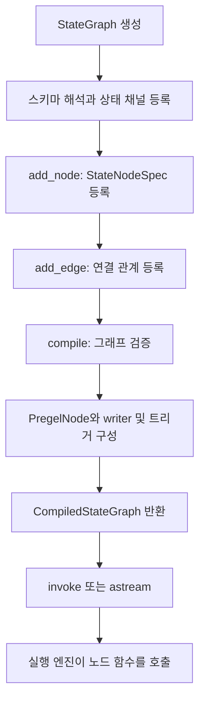
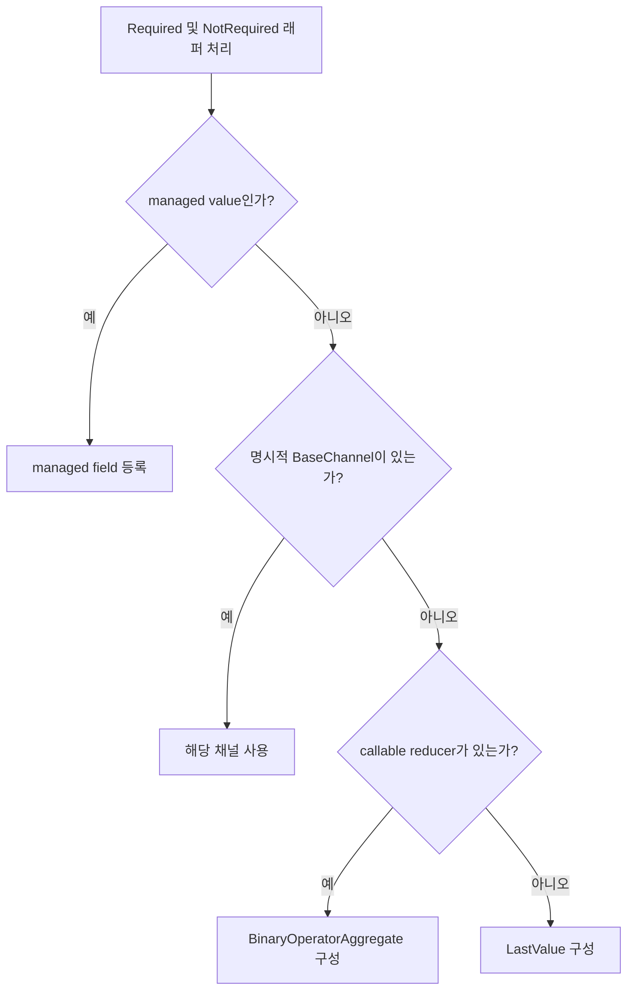
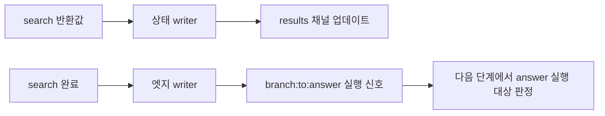

# 01. 상태 스키마에서 실행 가능한 그래프까지

> 기준: LangGraph 1.2.11, `AI/agent_hitl/.venv/Lib/site-packages` 설치 소스.
>
> 확인일: 2026-10-05. [전체 학습 목록](2026-10-05_langgraph_runtime_source_guide.md)의 01번 상세 분석.
>
> 범위: StateGraph 생성, 스키마 해석, 노드·엣지 등록, 컴파일 결과. 체크포인트·재시도·DeepAgents의 기능 조립은 여기서 확장하지 않는다.

## 먼저 구분할 등록과 실행 시점

| 시점 | 실행되는 작업 | 사용자 노드 함수 실행 여부 |
| --- | --- | --- |
| `StateGraph(State)` | 스키마 등록, 상태 필드별 채널 생성 | 실행하지 않음 |
| `add_node`, `add_edge` | 노드 명세와 연결 관계 등록 | 실행하지 않음 |
| `compile()` | 검증, PregelNode와 트리거·writer 연결 | 실행하지 않음 |
| `invoke()` / `astream()` | 입력을 주고 런타임 실행 | 실행 조건에 따라 실행 |

핵심은 **상태 채널이 compile에서 처음 만들어지는 것이 아니라는 점**이다. 생성자에서 이미 만들어지고, compile에서 실행에 필요한 제어 채널과 노드 연결이 추가된다.

컴파일은 기계어 변환이 아니다. 개발자가 작성한 그래프 정의를 Pregel 실행 엔진이 사용할 구성으로 변환하는 작업이다.



## 따라갈 예시

다음은 내부 객체 관찰을 위한 예시다. 실제 검색 API나 모델을 호출하지 않는다.

```python
from operator import add
from typing import Annotated
from typing_extensions import TypedDict
from langgraph.graph import StateGraph, START, END

class InputState(TypedDict):
    question: str

class OutputState(TypedDict):
    answer: str

class State(InputState, OutputState):
    results: Annotated[list[str], add]

def search(state: State):
    return {"results": ["evidence for " + state["question"]]}

def answer(state: State):
    return {"answer": " | ".join(state["results"])}

builder = StateGraph(State, input_schema=InputState, output_schema=OutputState)
builder.add_node("search", search)
builder.add_node("answer", answer)
builder.add_edge(START, "search")
builder.add_edge("search", "answer")
builder.add_edge("answer", END)
graph = builder.compile()
```

이 예시를 실행하고 실제 객체 구조를 검사한 코드와 결과는 [inspect_compilation.py](code/inspect_compilation.py), [inspect_compilation_result.json](code/inspect_compilation_result.json)에 있다.

## 1. 생성자: 상태를 담을 공간과 스키마를 등록한다

**소스:** [StateGraph.__init__](../../../../AI/agent_hitl/.venv/Lib/site-packages/langgraph/graph/state.py) 216~270행.

생성자는 nodes, edges, branches, schemas, channels, managed 등의 관리 구조를 초기화한다. 상태·입력·출력 스키마를 보관하고 다음을 호출한다.

```python
# 실제 소스의 스키마 등록 부분
self._add_schema(self.state_schema)
self._add_schema(self.input_schema, allow_managed=False)
self._add_schema(self.output_schema, allow_managed=False)
```

입력·출력 스키마를 지정하지 않으면 각각 상태 스키마를 사용한다. 예시에서는 전체 내부 상태가 question/answer/results인 반면, 외부 입력은 question, 반환 출력은 answer다.

중요한 구분은 다음과 같다.

- `schemas`: 각 스키마가 어떤 필드를 선언하는지 기록.
- `channels`: 그래프 전체가 사용하는 상태 필드별 채널 정의.
- `nodes`: 사용자 함수와 그 실행 설정을 담을 노드 명세.

필드를 선언했다는 이유만으로 모든 값이 현재 존재하는 것은 아니다. 입력으로 받지 않았거나 아직 쓰이지 않은 일반 채널은 비어 있을 수 있다. 반면 누적 채널은 타입에 따라 빈 컬렉션 같은 초기값을 가질 수 있다.

## 2. _add_schema: 스키마별 필드를 그래프 전체에 병합한다

**소스:** `graph/state.py`의 `_add_schema` 343~373행.

아직 등록하지 않은 스키마이면 `_get_channels(schema)`로 채널과 managed field를 얻는다. 스키마별 필드 구성을 `self.schemas`에 등록하고 채널을 `self.channels`에 합친다.

같은 필드 이름이 다른 스키마에도 나오면 채널 정의를 비교한다. 이 설치본은 들어오는 정의가 기본 LastValue인 경우 기존 채널과 다르더라도 유지하는 경로가 있다. 그 외 다른 채널 정의의 충돌에는 ValueError를 낸다.

예시에서 InputState의 question과 OutputState의 answer는 전체 State에 이미 존재한다. 세 스키마를 등록한다고 question/answer 채널이 각각 여러 개 생기지는 않는다.

**개발 시 주의점:** 여러 스키마에서 같은 필드를 선언할 때 reducer/채널 정의를 일관되게 유지한다. “마지막으로 등록한 타입 선언이 무조건 앞선 것을 덮어쓴다”는 방식으로 이해하지 않는다. 이름을 공유한다는 것은 같은 상태 채널에 대한 계약을 공유한다는 뜻이다.

## 3. _get_channels와 _get_channel: 타입 메타데이터가 채널을 결정한다

**소스:** `graph/state.py`의 `_get_channels` 1815~1835행, `_get_channel` 1850~1873행, `_is_field_binop` 1904~1922행.

`get_type_hints(schema, include_extras=True)`로 Annotated 등의 추가 메타데이터를 보존하며 타입 힌트를 얻는다. 각 필드에 `_get_channel(name, annotation)`을 적용한다.

핵심 선택 순서는 다음과 같다.



이 예시의 생성 결과는 다음과 같다.

| 필드 선언 | 채널 종류 | 업데이트의 의미 |
| --- | --- | --- |
| `question: str` | LastValue | 해당 단계의 단일 쓰기로 값 교체 |
| `answer: str` | LastValue | 해당 단계의 단일 쓰기로 값 교체 |
| `results: Annotated[list[str], add]` | BinaryOperatorAggregate | 기존 리스트와 업데이트 리스트를 add로 결합 |

`_is_field_binop()`은 마지막 메타데이터가 callable인지 확인하고, 위치 인자 두 개를 받는 reducer인지 검사한다. 문자열 설명만 넣으면 reducer가 아니다. callable 위치와 인자 형식도 중요하다.

```python
# reducer가 아님: 기본 LastValue로 해석될 수 있는 선언
description: Annotated[str, "설명"]
```

**개발 시 주의점:** `TypedDict`와 Annotated는 이 경로에서 실행 구성을 결정하는 입력이다. 모든 값의 타입을 매 단계 자동 검증하는 장치라고 가정하지 않는다. 필드를 어떻게 갱신할지부터 생각하고 채널/reducer를 결정해야 한다.

**실제 관찰:** compile 이전에도 builder.channels에 LastValue 두 개와 BinaryOperatorAggregate 하나가 이미 있었다.

## 4. add_node와 add_edge: 실행 명세를 모은다

**소스:** `graph/state.py`의 `add_node` 구현 667~926행, `add_edge` 928~980행.

등록 과정의 상세 분석: [01-1. add_node와 add_edge의 코드 경로](01a_node_and_edge_registration.md). 이름 결정과 검사, 입력 스키마 추론, runnable 변환, StateNodeSpec 저장, 엣지 종류별 검증 시점을 순서대로 다룬다.

`add_node()`는 이름을 결정하고 함수나 runnable을 실행 가능한 wrapper로 바꾼 뒤 StateNodeSpec으로 등록한다. 명세에는 입력 스키마, metadata, retry/cache/timeout 정책 등이 들어간다. 실제 함수 호출은 하지 않는다.

입력 스키마는 명시한 input_schema → 함수에서 추론한 입력 스키마 → 그래프 state_schema의 우선순위로 정한다. 예시의 두 함수는 State를 입력으로 선언하므로 내부 상태 필드들을 읽는 명세가 된다.

일반 `add_edge("search", "answer")`는 문자열 연결 쌍을 edges 집합에 저장한다. 시작 노드가 여러 개인 list 형식은 waiting_edges에 따로 보관한다. 이때는 아직 각 노드의 writer를 연결하는 단계가 아니다.

**개발 시 주의점**

- 노드 입력 타입 선언은 노드가 받는 상태 필드 구성을 바꿀 수 있다. 실제 사용할 필드와 annotation을 맞춘다.
- `destinations`는 이 설치본의 API 설명상 그래프 표시를 위한 정보이며, 그것만으로 런타임 이동이 구현되는 것은 아니다.
- 이미 컴파일한 builder에 노드/엣지를 추가하면 기존 compiled graph에 반영되지 않는다는 경고가 있다. 바뀐 구성은 다시 컴파일하여 반환 객체를 사용한다.

## 5. compile: 검증과 실행 객체 생성

**소스:** `graph/state.py`의 `compile` 1177~1401행, builder `validate` 1129~1175행.

이 설치본의 주요 순서는 다음과 같다.

1. checkpointer 설정 및 직렬화 관련 설정을 처리한다.
2. 그래프의 시작점, 엣지/분기의 source와 target, 지정한 interrupt 노드 이름 등을 검증한다.
3. output_channels와 stream_channels를 결정한다.
4. 노드별 기본 정책과 설정을 정리한다.
5. CompiledStateGraph를 생성한다.
6. START와 일반 노드를 attach한다.
7. 일반 엣지·waiting edge·조건부 분기를 attach한다.
8. compiled 실행 구성을 검증하여 반환한다.

`CompiledStateGraph`는 `Pregel`을 상속한다. 즉 builder의 정의가 Pregel 기반 실행 객체로 연결된다.

```python
# 실제 생성 코드의 핵심 부분만 발췌
channels={
    **self.channels,
    **self.managed,
    START: EphemeralValue(self.input_schema),
}
```

상태 채널 외에 START 입력 채널을 추가한다. Pregel 생성자에서는 동적 태스크를 담는 예약 채널 TASKS도 추가한다. 실제 출력에는 `__pregel_tasks: Topic`으로 나타났다. Send 실행은 [02의 목적지와 Send 비교](02_conditional_edges_and_execution.md)에서 다룬다.

**소스:** [Pregel.__init__](../../../../AI/agent_hitl/.venv/Lib/site-packages/langgraph/pregel/main.py) 758행, TASKS 구성 803~809행.

**개발 시 주의점:** compile 성공은 연결 설정이 검증되었다는 뜻이다. 도구의 입력이 올바른지, 종료 조건이 논리적으로 맞는지, 외부 작업이 재실행되어도 안전한지까지 검증하는 것은 아니다.

## 6. attach_node: 사용자 함수를 PregelNode에 연결한다

**소스:** `graph/state.py`의 `attach_node` 1444~1549행.

START는 외부 입력을 받아 상태 필드에 쓰는 특별한 노드다. 일반 노드는 아래와 같은 요소로 구성된다.

| 속성 | 의미 | 예시의 search |
| --- | --- | --- |
| channels | 함수에 입력으로 구성할 필드 | question, answer, results |
| triggers | 이 노드를 다음 단계에서 활성화할 제어 채널 | branch:to:search |
| bound | 실행할 함수/runnable | search wrapper |
| mapper | 입력을 스키마 객체로 변환하는 함수, 필요할 때만 사용 | TypedDict 예시는 None |
| writers | 반환값을 채널 쓰기와 제어 쓰기로 변환할 구성 | ChannelWrite |

```python
# 실제 코드의 구조를 축약한 의사 코드
PregelNode(
    channels=input_channels,
    triggers=[branch_channel],
    bound=node.runnable,
    mapper=mapper,
    writers=[state_and_control_writer],
)
```

여기서 channels와 triggers를 구분해야 한다. question을 읽는다고 question 자체가 search의 기본 실행 트리거인 것은 아니다. 실행 흐름의 엣지가 branch:to:search에 신호를 쓰는 구조다.

`_pick_mapper()`는 Pydantic/dataclass에는 스키마 생성 mapper를 사용할 수 있고, TypedDict에는 mapper를 두지 않는다. 이 예시의 State는 일반 딕셔너리 형태로 입력을 구성하는 경로다.

**개발 시 주의점:** 노드가 읽을 필드와 실행 경로를 별도로 설계한다. “그 필드를 읽으니까 값이 바뀌면 자동으로 실행된다”는 규칙은 이 StateGraph 구성에 적용되지 않는다.

## 7. writer와 attach_edge: 데이터 쓰기와 제어 쓰기를 연결한다

**소스:** `graph/state.py`의 `_get_updates` 1456행, writer 구성 1494행, `attach_edge` 1551~1575행. [pregel/_write.py](../../../../AI/agent_hitl/.venv/Lib/site-packages/langgraph/pregel/_write.py)의 `_write` 75행, `do_write` 106행.

writer는 노드의 반환값을 받아 `(채널 이름, 값)` 쌍을 만든다. 딕셔너리 업데이트는 그래프에 등록된 상태 키에 대해서 추출된다. 제어 흐름을 위한 Command 처리도 별도의 mapper로 연결된다.

일반 엣지를 attach할 때는 출발 노드의 writers에 목적지 트리거로 쓰는 ChannelWrite를 추가한다.



그래프의 엣지는 단순히 다음 함수를 Python에서 직접 호출하는 코드로 바뀌는 것이 아니다. 다음 런타임 단계가 실행 대상을 결정할 수 있게 제어 채널에 신호를 쓰도록 구성된다.

writer가 생겼다고 compile 단계에서 채널 값을 갱신하는 것도 아니다. writer는 실행할 때 사용하는 구성이다. 실제 쓰기는 태스크 설정의 CONFIG_KEY_SEND로 전달되고, 업데이트의 최종 반영은 뒤의 실행 단계에서 처리된다.

예시에서 search에는 상태 writer와 answer를 위한 엣지 writer가 있어 ChannelWrite가 두 개다. answer→END에는 일반 목적지 트리거를 연결하지 않으므로 answer의 writer 목록은 상태/제어 writer 하나로 관찰되었다. 이 개수는 예시의 결과이며 모든 노드가 항상 같은 개수를 갖는다는 규칙은 아니다.

**개발 시 주의점**

- 미등록 상태 키 반환이 이 경로에서 필터링될 수 있으므로 필드명을 점검한다.
- 입력 상태를 직접 수정하는 것보다 writer/reducer 경로로 업데이트를 전달한다. 그 이유와 객체 공유는 [03. 노드 반환값과 단계 반영](03_node_returns_reducers_and_supersteps.md)에서 자세히 다룬다.
- 내부 예약 채널 이름을 사용자 상태나 업무 라우팅의 공개 계약으로 사용하지 않는다.

## 8. output_schema와 stream_channels는 다르다

**소스:** `graph/state.py` 1269~1286행.

이 예시의 실제 compile 결과는 다음과 같다.

```text
input_channels: __start__
output_channels: [answer]
stream_channels: [question, answer, results]
```

`invoke()` 결과는 output schema에 해당하는 answer만 나온다. 그러나 기본 상태 스트리밍의 대상 채널 구성에는 question과 results도 들어 있다. output schema를 좁혔다고 모든 스트리밍 경로의 노출도 자동으로 좁아지는 것은 아니다.

**개발 시 주의점:** 반환 출력 스키마를 스트림이나 로그의 정보 노출 경계로 간주하지 않는다. 어떤 모드와 output_keys를 사용하는지 실제 전송 경로에서 확인해야 한다. 이 장에서는 컴파일된 구성의 차이만 확인했다.

## 실제 관찰 결과

| 관찰 시점 | 확인한 결과 |
| --- | --- |
| StateGraph 생성 직후 | question/answer/results 채널이 존재하고 nodes는 비어 있음 |
| compile 직후 | CompiledStateGraph이며 Pregel 기반. START·TASKS·branch 채널 추가 |
| compile 직후의 함수 호출 기록 | 빈 목록. search/answer는 실행되지 않음 |
| invoke 후 | search → answer 순서로 실행되고 answer만 반환 |

결과 반환값:

```json
{"answer": "evidence for runtime"}
```

재실행 명령은 저장소 루트 기준이다.

```powershell
.\AI\agent_hitl\.venv\Scripts\python.exe -X utf8 .codex/research/LangGraph/runtime/code/inspect_compilation.py
```

## 이번 항목에서 설명할 수 있어야 하는 것

1. 채널 생성은 왜 compile 이전에 일어나는가?
2. schema와 channels는 무엇이 다른가?
3. add_node의 결과인 StateNodeSpec과 compile 후 PregelNode는 무엇이 다른가?
4. 읽기 채널과 트리거 채널이 왜 구분되는가?
5. 엣지가 다음 함수를 직접 호출하는 대신 무엇을 구성하는가?
6. output_schema가 스트림 노출까지 제한하는 것은 왜 아닌가?

다음 자료: [01-1. add_node와 add_edge 등록](01a_node_and_edge_registration.md). 이어서 [02. 조건부 분기와 실행](02_conditional_edges_and_execution.md)에서 add_conditional_edges 등록 → compile에서 분기 연결 → invoke 입력과 첫 노드 선택 → 다음 노드 실행을 따라간다.
