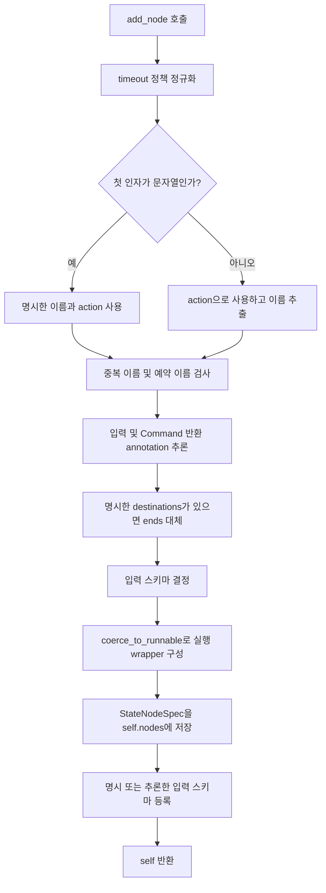
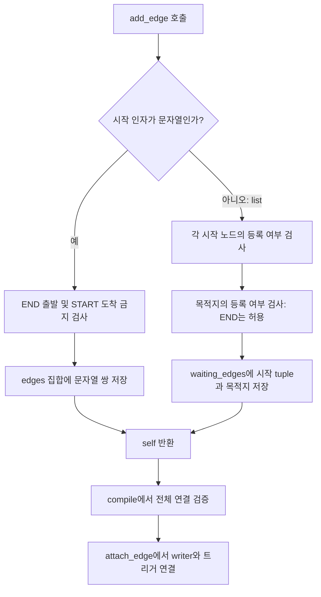
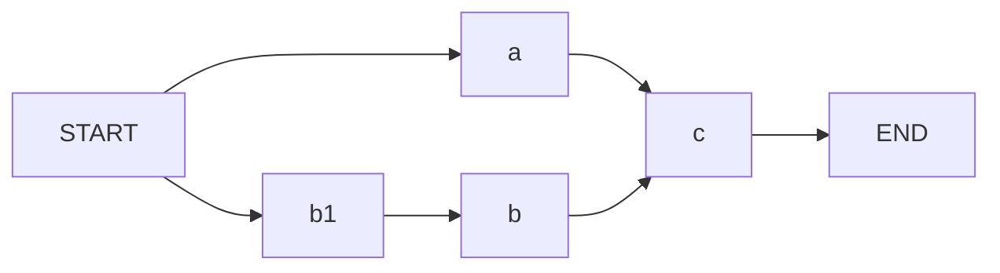

# 01-1. add_node와 add_edge는 내부에서 무엇을 하는가?

> 기준: 로컬 설치 LangGraph 1.2.11. 확인일: 2026-10-05.
>
> 근거: 설치된 패키지의 Python 소스와 오프라인 객체 관찰. 해당 버전의 동작을 설명하며, 다른 버전에 그대로 적용한다고 가정하지 않는다.
>
> [01. 상태 스키마와 그래프 컴파일](01_state_schema_and_graph_compilation.md)의 등록 과정 상세 분석이다. 실제 태스크 실행과 라우팅은 전체 목록의 03~05에서 이어간다.

`add_node()`가 builder에 등록하는 것은 **실행할 함수와 설정을 담은 StateNodeSpec**이다. `add_edge()`가 저장하는 것은 **연결 관계를 담은 집합의 항목**이다. 두 메서드의 반환값은 builder 자신이다. 등록되는 객체와 API 반환값을 구분한다. compile이 이 명세들을 PregelNode, 트리거, writer로 연결한다.

## 1. add_node의 호출 순서

**소스:** [graph/state.py](../../../../AI/agent_hitl/.venv/Lib/site-packages/langgraph/graph/state.py) 실제 구현 667~926행. overload 선언과 실행 구현을 구분해서 읽는다.



잘못된 이름이나 action은 해당 검사에서 오류가 난다. 이미 compile한 builder이면 경고도 남긴다. error_handler를 지정하면 handler용 숨겨진 노드 명세를 만드는 추가 경로가 있다. 여기서는 등록을 다루고 실제 오류 처리 실행은 확장하지 않는다.

## 2. 이름 결정과 검사

**소스:** `state.py` 778~811행.

```python
builder.add_node("search", search)  # 명시한 문자열 이름
builder.add_node(search)            # 함수 이름을 추출
```

문자열 이름을 생략하면 Runnable은 `get_name()`, 일반 callable은 `__name__` 또는 클래스 이름을 사용한다. 같은 클래스의 callable 인스턴스 두 개는 같은 이름으로 추론될 수 있다. 여러 인스턴스를 등록한다면 이름을 명시하는 편이 안전하다.

`self.nodes`에 이름이 이미 있으면 ValueError다. START/END의 예약 이름과 내부 namespace 구분 문자도 금지한다. 이름은 이후 노드 조회와 트리거 채널 구성에도 사용되므로 단순한 표시 문구가 아니다.

## 3. 입력 스키마를 어떻게 추론하는가?

**소스:** `state.py` 813~865행, 스키마 추가 922~924행.

선택 우선순위는 **명시한 input_schema → 추론한 입력 스키마 → 그래프 state_schema**다.

추론은 지원하는 함수·메서드·callable의 타입 힌트를 읽는다. 첫 매개변수 annotation이 타입이고 그 타입에 필드 타입 힌트가 있으면 입력 스키마 후보로 채택한다. 매개변수의 이름이 state인지를 기준으로 삼지 않는다.

```python
class SearchInput(TypedDict):
    question: str

def search_only(data: SearchInput):
    return {"results": [data["question"]]}

builder.add_node("search_only", search_only)
# SearchInput 추론: compile 시 question만 읽는 구성

builder.add_node("search_full", search_only, input_schema=State)
# 명시한 State가 우선: 함수 annotation이 이를 막지는 않음
```

추론 중 NameError, TypeError, StopIteration은 잡아서 넘긴다. annotation을 해석하지 못하면 예상한 좁은 입력 대신 기본 state_schema를 사용할 수 있다. decorator가 signature와 annotation을 보존하는지도 확인한다.

명시하거나 추론한 입력 스키마는 `_add_schema()`로 등록한다. 새 필드가 있으면 **add_node 시점에도 전체 상태 채널 집합이 확장될 수 있다.** 이 필드에 실제 값이 자동으로 채워지는 것은 아니다. 초기 입력이나 앞선 노드의 업데이트가 값을 제공해야 한다.

입력 스키마는 읽을 필드의 구성이다. 위 함수는 question만 읽지만, 그래프에 등록된 results의 업데이트를 반환할 수 있다. 읽기 스키마와 쓰기 대상 필드 목록을 동일하게 취급하지 않는다.

## 4. 함수는 어떤 실행 객체로 바뀌는가?

**소스:** [coerce_to_runnable](../../../../AI/agent_hitl/.venv/Lib/site-packages/langgraph/_internal/_runnable.py) 550~581행.

| 전달한 action | 변환 결과 |
| --- | --- |
| 기존 Runnable | 그대로 사용 |
| generator / async generator 함수 | RunnableLambda |
| async callable | 비동기 함수를 가진 RunnableCallable |
| sync callable | 동기 함수와 executor 기반 비동기 호출 경로를 가진 RunnableCallable |
| dict | RunnableParallel |
| 지원하지 않는 객체 | TypeError |

동기 함수의 비동기 경로에는 `partial(run_in_executor, None, thing)`을 감싼 함수가 들어간다. 등록 시 executor에서 함수를 실행하는 것이 아니다. 나중에 사용할 실행 경로를 준비한다. async 함수 내부의 blocking I/O까지 자동으로 executor로 이동하는 것도 아니다.

## 5. StateNodeSpec에는 무엇이 남는가?

**소스:** [graph/_node.py](../../../../AI/agent_hitl/.venv/Lib/site-packages/langgraph/graph/_node.py) 90~103행, `state.py` 882~920행.

명세에는 runnable, metadata, input_schema, retry_policy, cache_policy, error_handler_node, ends, defer, timeout, trace_policy 등이 저장된다. compile이 만드는 PregelNode의 triggers와 writers는 아직 구성되지 않는다.

`Command[Literal[...]]` 반환 annotation에서 목적지 후보를 ends로 추론하는 경로가 있다. destinations를 명시하면 이 후보를 대체한다. 이 정보는 그래프 검증과 도식에 사용된다. 실제 이동은 실행 시 반환하는 Command 또는 등록된 엣지/분기에서 나온다. destinations만 지정했다고 해당 노드로 이동하지 않는다.

정책도 등록 순간 발동하지 않는다. retry_policy를 넣었다고 함수를 시험 실행하지 않는다. add_node가 반환하는 값은 명세나 wrapper가 아니라 **builder 자신**이므로 메서드 체이닝이 가능하다.

## 6. add_edge는 형태에 따라 검증 시점이 다르다

**소스:** `state.py` 928~980행, `validate` 1129~1175행.



문자열 경로는 이 StateGraph 구현에서 일반 source/target의 존재 여부를 add_edge에서 모두 검사하지 않는다. 아직 등록하지 않은 이름을 연결하면 등록은 통과하고 compile의 validate에서 오류가 날 수 있다. 문자열 엣지를 먼저 등록하고 나중에 노드를 추가하는 구성도 가능하다.

반면 list 경로는 각 시작 노드와 END 이외의 목적지가 이미 등록되어 있는지 add_edge에서 검사한다. END 출발과 START 도착도 허용하지 않는다. 이름 오류라도 입력 형태에 따라 발생 시점이 다르다.

```python
builder.add_edge("a", "c")
builder.add_edge("b", "c")
# edges에 일반 연결 두 개 저장

builder.add_edge(["a", "b"], "c")
# waiting_edges에 모든 시작 노드를 기다리는 연결 저장
```

후자는 attach_edge가 NamedBarrierValue 계열 채널을 만들고 a/b의 완료 신호를 모아 c를 활성화한다. 전자는 각 source가 c의 기본 트리거에 쓰는 연결이다. 실제 단계 배치에 따라 일반 연결들도 같은 단계의 c 실행으로 합쳐질 수 있으므로, 일반 연결 두 개면 c가 반드시 두 번 실행된다고 단정하지 않는다.

집합에 저장하므로 동일 문자열 엣지를 반복 등록한다고 별도 실행 횟수가 추가되지 않는다. 엣지는 함수 호출 목록이 아니라 연결 명세다.

### 6-1. 분기 깊이가 다른 그래프에서 확인한다

다음 그래프에서 a는 바로 끝나고, 다른 경로는 b1을 거쳐 b가 끝난다. 각 a/b는 results 누적 채널에 자기 이름을 추가하며 c는 입력 results를 기록한다.



도식만으로는 두 연결의 대기 계약을 구분할 수 없다. 실제 코드가 다음 중 무엇인지 확인해야 한다.

```python
# 구성 A: source마다 c의 일반 트리거에 쓴다
builder.add_edge("a", "c")
builder.add_edge("b", "c")

# 구성 B: 위 두 줄 대신 이름을 모으는 barrier를 만든다
builder.add_edge(["a", "b"], "c")
```

| 실행 단계 | 구성 A: 일반 엣지 두 개 | 구성 B: 대기 엣지 하나 |
| --- | --- | --- |
| a와 b1 실행 | a가 c를 활성화, b1이 b를 활성화 | barrier.seen에 a, b 대기 |
| 다음 단계 | b와 c 실행. c 입력은 a만 포함 | b 실행. c는 아직 실행 안 됨 |
| 그다음 단계 | b가 다시 활성화한 c 실행. 입력 a/b | barrier 완성 후 c 실행. 입력 a/b |

구성 A의 첫 c는 같은 단계에서 실행 중인 b의 새 업데이트를 아직 읽지 못한다. 구성 B는 두 이름을 모은 뒤 c를 실행한다. 반대로 a/b가 같은 단계에 완료되면 구성 A에서도 c는 다음 단계에 한 번 실행될 수 있다. **일반 엣지 두 개를 등록했다고 c가 항상 두 번 실행되는 것은 아니다.**

**소스:** [NamedBarrierValue](../../../../AI/agent_hitl/.venv/Lib/site-packages/langgraph/channels/named_barrier_value.py)의 update, is_available, consume. update는 허용된 source 이름을 seen 집합에 넣고, seen==names일 때만 읽을 수 있다. 소비 후 seen을 비워 다음 완료 신호를 모은다. c에 defer를 설정한 경로는 AfterFinish 변형이므로 위의 일반 barrier 예제와 구분한다.

조건부 경로 때문에 b가 아예 실행되지 않으면 barrier는 완성되지 않는다. 실험에서는 c가 실행되지 않은 채 다른 활성 태스크가 없어 전체 호출이 종료됐다. 모든 source가 실제로 도달할 수 있는지 확인해야 한다. barrier가 모든 조건부 경로의 완료를 자동 판별하거나 누락된 신호를 생성해 주지는 않는다.

[보강 실험 코드](code/probe_review_gaps.py), [결과](code/review_gaps_result.json)의 unequal_join, same_step_join, missing_barrier_signal에서 이 세 경우를 확인했다. 시간 지연보다 **그래프의 단계 깊이와 trigger 계약**이 차이를 만든다.

## 7. 개발할 때 확인할 항목

- 자동 추론한 이름이 중복될 수 있는 callable에는 이름을 명시한다.
- 입력 annotation과 input_schema가 실제 읽기 범위를 결정하는지 확인한다.
- 노드 입력 스키마에서 추가한 필드의 값 공급 경로를 정한다.
- add_node의 반환값과 노드 함수의 반환값을 구분한다.
- destinations를 실제 이동 명령으로 사용하지 않는다.
- 모든 source 완료가 필요하면 list 형태의 엣지 계약을 검토한다.
- compile한 후 builder를 바꿨다면 새로 compile한 반환 객체를 사용한다.

[관찰 코드](code/inspect_compilation.py)는 노드 등록 후 StateNodeSpec, 엣지 등록 후 edges/waiting_edges, compile 후 PregelNode를 차례로 기록한다. 추가 관찰은 입력 스키마 추론과 명시적 우선순위, 채널 확장, 엣지 검증 시점, 중복 엣지 저장을 확인한다. [결과](code/inspect_compilation_result.json)는 외부 모델이나 저장소를 사용하지 않은 로컬 실행 결과다.

다음 자료: [02. 조건부 분기 등록과 다음 노드 실행](02_conditional_edges_and_execution.md).
