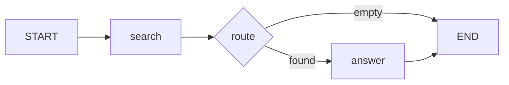
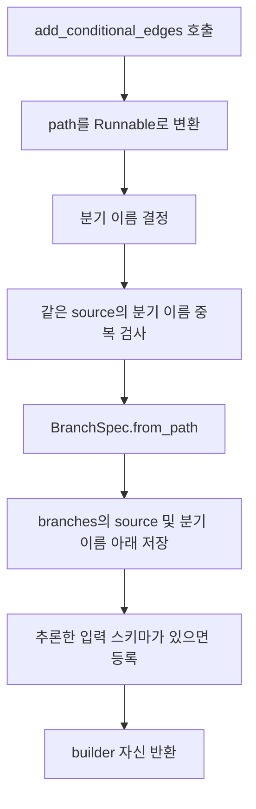
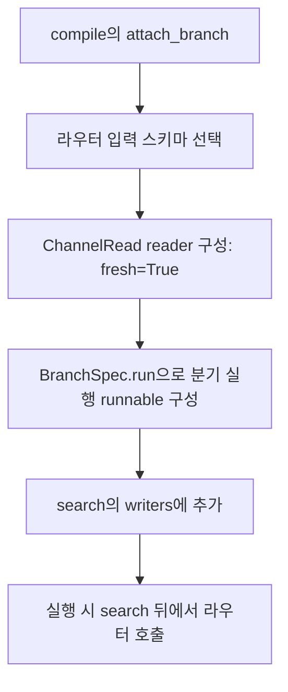
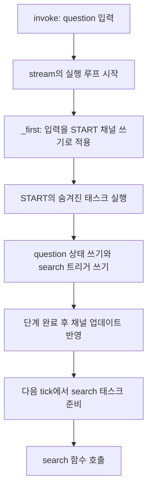
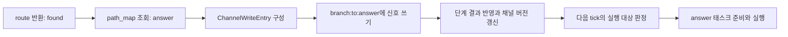
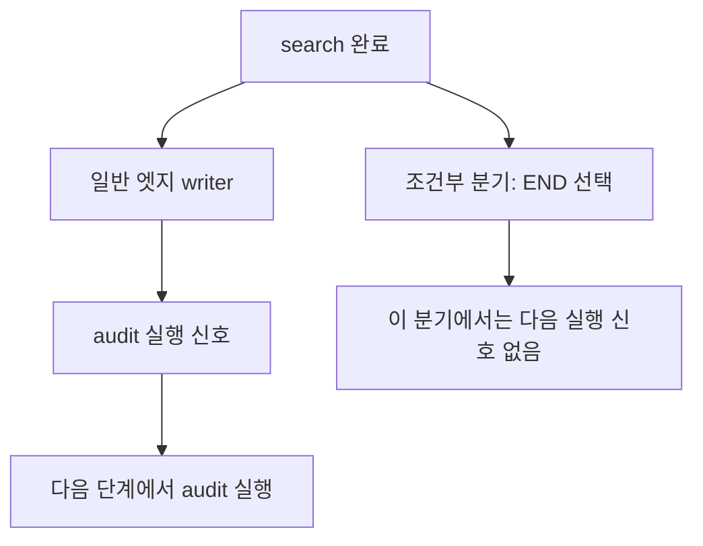
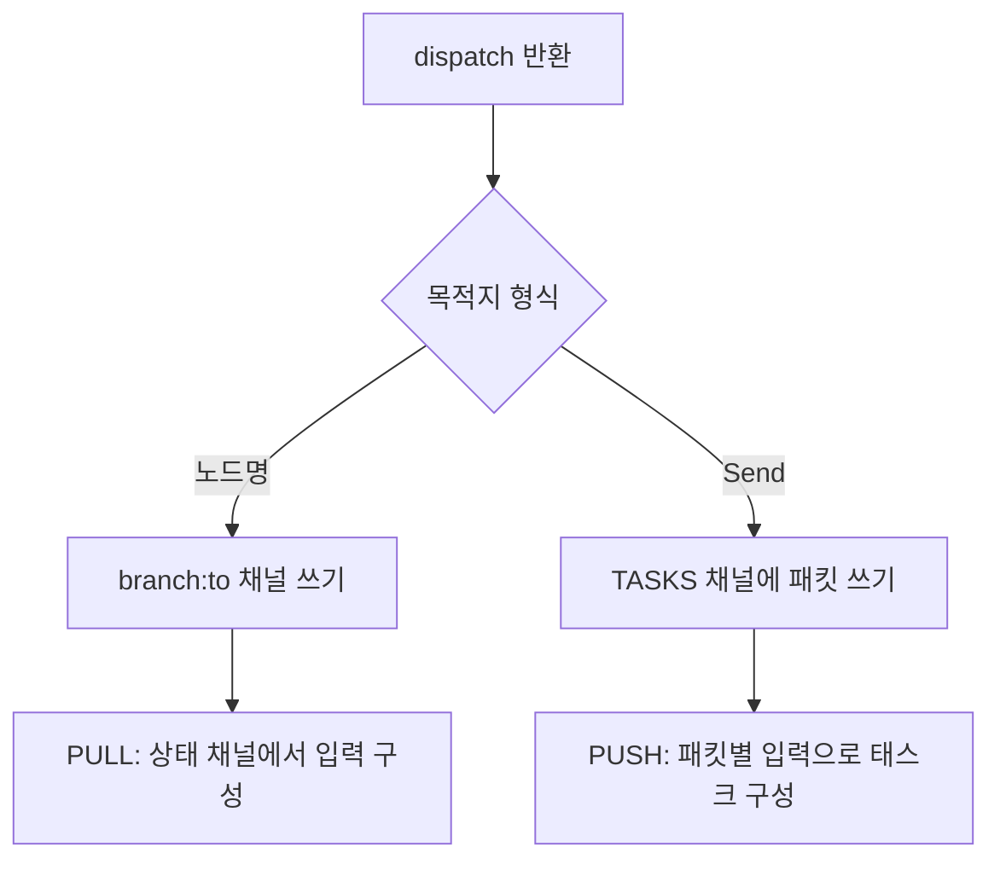

# 02. add_conditional_edges에서 invoke의 다음 노드 실행까지

> 기준: 로컬 설치 LangGraph 1.2.11. 확인일: 2026-10-05.
>
> 근거: 설치된 Python 소스의 정적 분석과 모델·외부 저장소를 사용하지 않은 로컬 실험. 소스는 이 환경의 구현을 확인하는 직접 근거이며, 다른 버전의 계약을 보장하지 않는다.
>
> 이전: [01. 스키마와 컴파일](01_state_schema_and_graph_compilation.md), [01-1. 노드와 엣지 등록](01a_node_and_edge_registration.md). 이 문서의 02는 읽는 순서다. 전체 내부 목록의 03~05를 API 흐름에 맞춰 연결한다.

`add_conditional_edges()`는 **출발 노드 실행 뒤 호출할 라우터를 등록한다.** compile은 이 라우터를 출발 노드의 writer 실행 경로에 연결하고, invoke에서는 라우터 결과가 다음 노드의 실행 신호로 변환된다. 라우터가 목적지 함수를 직접 호출하는 구조가 아니다.

## 1. 이번에 따라갈 그래프

앞 장의 search → answer 예제에 결과 유무에 따른 분기를 넣는다. 그래프 작성 순서와 실제 호출 경로를 같은 예제로 연결한다.

```python
from operator import add
from typing import Annotated, Literal
from typing_extensions import TypedDict
from langgraph.graph import StateGraph, START, END

class State(TypedDict):
    question: str
    results: Annotated[list[str], add]
    answer: str

def search(state: State):
    found = [] if state["question"] == "empty" else ["evidence"]
    return {"results": found}

def route(state: State) -> Literal["found", "empty"]:
    return "found" if state["results"] else "empty"

def answer(state: State):
    return {"answer": " | ".join(state["results"])}

builder = StateGraph(State)
builder.add_node("search", search)
builder.add_node("answer", answer)
builder.add_edge(START, "search")
builder.add_conditional_edges(
    "search", route, {"found": "answer", "empty": END}
)
builder.add_edge("answer", END)
graph = builder.compile()
result = graph.invoke({"question": "runtime"})
```



route는 위 도식에서 판단을 표현한 것이며, `add_node()`로 등록한 별도 노드가 아니다. 내부적으로 search의 태스크 실행 경로에 붙는다.

results는 누적 채널이므로 이전 값에 새 리스트를 더한다. 이 예제는 checkpointer 없이 새 실행을 시작하므로 초기 results가 비어 있다. **기억을 유지하는 thread에서 빈 리스트를 반환해도 기존 누적 results가 지워지지는 않는다.** 이 경우 라우터는 이전 결과까지 포함한 누적값으로 판단한다. 실제 검색 결과의 수명이 한 턴이라면 상태와 reducer 계약부터 그 의도에 맞춰야 한다.

## 2. add_conditional_edges 호출 전후의 객체

**소스:** [StateGraph.add_conditional_edges](../../../../AI/agent_hitl/.venv/Lib/site-packages/langgraph/graph/state.py) 982~1030행.

주요 등록 순서는 다음과 같다.



핵심 등록 코드는 다음과 같다. 실제 소스에서 경고와 검사를 제외한 부분을 발췌했다.

```python
path = coerce_to_runnable(path, name=None, trace=True)
name = path.name or "condition"
self.branches[source][name] = BranchSpec.from_path(path, path_map, True)
if schema := self.branches[source][name].input_schema:
    self._add_schema(schema)
```

예제의 등록 결과는 다음과 같다.

| 위치 | 저장된 내용 |
| --- | --- |
| `builder.nodes["search"]` | 앞 장에서 만든 StateNodeSpec |
| `builder.branches["search"]["route"]` | BranchSpec |
| BranchSpec.path | route를 감싼 RunnableCallable |
| BranchSpec.ends | found → answer, empty → `__end__` |
| BranchSpec.input_schema | State |

등록 시 route를 호출하지 않는다. compile 직후에도 search, route, answer의 호출 기록은 비어 있었다.

중복 검사는 source별 분기 이름을 기준으로 한다. 같은 source에 같은 이름의 route를 다시 등록하면 ValueError다. 다른 source에 같은 라우터를 사용하는 것은 별도 등록이다. lambda나 이름 없는 runnable이 condition이라는 이름으로 겹치는 경우도 확인해야 한다.

## 3. path_map과 Literal은 어떤 역할을 하는가?

**소스:** [BranchSpec.from_path](../../../../AI/agent_hitl/.venv/Lib/site-packages/langgraph/graph/_branch.py) 89~120행.

| 입력 | BranchSpec.ends 구성 |
| --- | --- |
| dict path_map | dict를 복사해 저장 |
| list path_map | 각 이름을 자기 자신에 매핑 |
| path_map 없이 반환 annotation이 Literal | Literal 항목을 자기 자신에 매핑 |
| 그 외 | None: 실행 결과를 목적지로 사용 |

예제에서 found는 노드명이 아니라 **라우터의 판단 라벨**이다. path_map이 이를 answer라는 노드명으로 변환한다.

```python
# 라벨을 반환하는 경우
def route(state: State) -> Literal["found", "empty"]:
    return "found" if state["results"] else "empty"

builder.add_conditional_edges(
    "search", route, {"found": "answer", "empty": END}
)

# 노드명을 직접 반환하는 경우
def route_by_name(state: State) -> Literal["answer", "__end__"]:
    return "answer" if state["results"] else END

# 새 builder에서 앞선 분기 대신 사용
builder.add_conditional_edges("search", route_by_name)
```

두 번째 예제는 path_map을 생략했지만 Literal에서 identity mapping이 추론된다. 반대로 found/empty 라벨을 반환하면서 path_map을 생략하면 이 라벨을 노드명으로 해석할 수 있다. compile에서 존재하지 않는 목적지로 검증될 수 있으므로 라벨과 노드명을 구분한다.

Literal은 모든 반환값을 자동으로 검사하는 런타임 타입 검사기가 아니다. 이 구현에서는 목적지 매핑을 추론하는 데 사용된다. 등록된 map에 없는 라벨을 실제로 반환하면 `_finish()`의 `self.ends[r]`에서 KeyError가 발생했다.

`add_node(..., destinations=...)`의 목적지 표시 정보와 `path_map`도 역할이 다르다. path_map은 실제 실행 중 라우터 결과를 변환한다.

## 4. compile은 무엇을 검증하고 연결하는가?

**소스:** `graph/state.py`의 `validate` 1129~1175행, `attach_branch` 1577~1624행.

validate는 분기의 source가 등록된 노드 또는 START인지, 알려진 목적지가 등록된 노드 또는 END인지 검사한다. 예제의 path_map에 answer 대신 missing을 넣으면 compile에서 ValueError가 발생한다.

ends가 None이면 라우터의 모든 미래 반환값을 알 수 없다. 이때 compile은 가능한 목적지 집합을 보수적으로 취급한다. **compile 성공을 모든 실행 시 라우팅 결과가 검증되었다는 뜻으로 해석하지 않는다.** 목적지 선언이 없으면 도식에도 가능한 연결이 넓게 나타날 수 있다.

각 일반 노드는 attach_node 단계에서 `branch:to:<노드명>` 제어 채널을 이미 갖는다. attach_branch는 목적지마다 새 데이터 채널을 만드는 대신 이 트리거에 쓸 구성을 만든다.

attach_branch가 연결하는 두 요소는 reader와 분기 실행 writer다.



스키마 선택은 **라우터의 입력 스키마 → 출발 노드의 입력 스키마 → 그래프 상태 스키마** 순서다. 루트 스키마나 Pydantic 등은 별도 mapper 처리가 있으며, 여기서는 TypedDict 경로를 따른다.

실험에서 compile 이후 search.writers는 ChannelWrite와 RunnableCallable이었다. 첫 항목은 상태 업데이트 등을 처리하고, 두 번째가 조건부 분기 경로다. writer가 항상 ChannelWrite 타입인 것은 아니다.

## 5. invoke에서 처음 search가 실행되기까지

**소스:** [Pregel.invoke](../../../../AI/agent_hitl/.venv/Lib/site-packages/langgraph/pregel/main.py) 실제 구현 3836~3957행, [PregelLoop._first](../../../../AI/agent_hitl/.venv/Lib/site-packages/langgraph/pregel/_loop.py) 848~1079행, `graph/state.py`의 START 구성 1507행 이후.

invoke는 기본 values 출력 경로에서 stream의 결과를 소비해 최종값을 반환한다. 여기서는 기본 v1 출력과 일반 dict 입력을 기준으로 읽는다. v2 출력, Command 입력, checkpoint 재개는 뒤의 해당 학습에서 다룬다.



외부 입력 채널 START와 상태 필드 question은 역할이 다르다. 입력 dict는 START를 거친 뒤 숨겨진 START 태스크의 writer가 입력 스키마에 해당하는 상태 필드로 풀어 쓴다. 일반 START → search 엣지도 search 트리거에 신호를 쓰도록 연결된다.

따라서 invoke가 search라는 함수를 바로 찾고 호출하는 단순 dispatch가 아니다. 입력 쓰기, 태스크 선택, 실행, 채널 반영이라는 동일 실행 모델을 거친다.

## 6. search 반환 직후 라우터가 실행되는 위치

**소스:** [PregelNode.node](../../../../AI/agent_hitl/.venv/Lib/site-packages/langgraph/pregel/_read.py) 227~248행, `graph/_branch.py`의 `_route` 146~167행.

PregelNode.node는 bound와 writers를 RunnableSeq로 연결한다. 이 예제의 개념적 순서는 다음과 같다. writer 합치기 등의 내부 최적화는 이 그림에서 생략했다.


search가 `{"results": ["evidence"]}`를 반환하면 상태 writer가 results 쓰기를 태스크에 기록한다. 그 다음 분기 reader가 상태를 읽고 route를 호출한다. route는 search와 같은 태스크 안에서 동작하며, 별도 super-step을 사용하지 않는다.

라우터의 반환값은 상태 업데이트가 아니다. 라벨, 목적지 이름, 목적지 목록, Send 등으로 해석된다. route에서 `{"results": ...}`를 반환하는 방식으로 상태를 갱신하지 않는다. 상태 변경은 출발 노드의 반환값 등 해당 업데이트 경로로 표현한다.

라우터 오류도 출발 태스크의 실행 경로에서 발생한다. 라우터의 외부 호출·알림 등을 반복 실행해도 되는지 검토해야 한다. 앞선 노드 함수가 반환했다는 사실만으로 해당 태스크와 체크포인트가 정상 완료되었다고 판단하지 않는다.

## 7. fresh=True는 어떤 상태를 읽는가?

**소스:** [local_read](../../../../AI/agent_hitl/.venv/Lib/site-packages/langgraph/pregel/_algo.py) 188~224행.

local_read는 현재 태스크의 writes 중 선택한 채널의 값을 모은다. fresh=True이면 채널을 복사하고 이 writes를 update한 뒤 값을 읽는다. 여기서 reducer도 해당 채널의 update 규칙대로 적용된다.

| 관찰 위치 | results 값 | 의미 |
| --- | --- | --- |
| search가 받은 입력 | 빈 리스트 | search 실행 전 단계의 상태 |
| 같은 태스크의 route 입력 | evidence를 포함한 리스트 | search 자신의 업데이트가 반영된 읽기 |
| 다음 단계의 answer 입력 | evidence를 포함한 리스트 | 단계 종료 후 공유 채널에 반영된 상태 |

**fresh=True는 같은 단계의 다른 노드 결과까지 모두 기다려 읽는 옵션이 아니다.** 현재 태스크 자신의 writes를 반영한다. 병렬로 실행하는 다른 검색 노드의 결과까지 합친 뒤 판단하려면 join 다음에 판단할 노드를 배치하는 등 실행 의존성을 표현해야 한다.

또한 채널 복사는 모든 중첩 데이터의 deepcopy를 보장하지 않는다. 라우터에서도 입력 리스트나 dict를 직접 수정하지 않는다.

라우터에 results만 가진 RouteInput을 annotation으로 선언한 실험에서는 route가 받은 키가 results 하나였다. 좁은 입력 스키마는 실제로 읽는 범위에 영향을 준다. 라우터 스키마가 추론되지 않았고 입력과 읽은 값이 모두 dict이면 `_route()`에는 출발 노드의 반환 dict에서 추가 키를 전달하는 병합 경로도 있다. 미등록 임시 키 전달을 영속 상태 계약으로 삼지 않는다.

## 8. 라벨이 다음 실행 신호로 바뀌는 과정

**소스:** `graph/_branch.py`의 `_finish` 192~225행, `graph/state.py`의 `attach_branch.get_writes` 1580행 이후, [ChannelWrite.do_write](../../../../AI/agent_hitl/.venv/Lib/site-packages/langgraph/pregel/_write.py) 106~126행.

실제 판단 흐름을 단순화한 의사 코드다.

```python
results = result if isinstance(result, (list, tuple)) else [result]
destinations = [ends[r] for r in results] if ends else results
# 실제 구현에는 Send를 그대로 통과시키는 분기와 목적지 검사가 있음
entries = get_writes(destinations, static=False)
ChannelWrite.do_write(config, entries)
```



**소스:** `_algo.py`의 `prepare_next_tasks` 실제 구현 392~513행, `_triggers` 1260~1277행.

다음 태스크 준비에서 PULL 경로는 노드의 트리거 채널 가용성과 관찰한 버전 대비 새 버전을 확인한다. answer는 results가 바뀌었다는 이유만으로 선택되지 않는다. 분기 writer가 answer의 제어 채널에 신호를 썼기 때문에 선택된다.

단계에 변경된 채널과 트리거→노드 매핑이 있으면 후보 노드를 줄이는 최적화도 있다. 모든 상황에서 전체 노드를 순회하지 않는다고 단정하지는 않는다.

## 9. END는 다른 엣지를 취소하는 명령이 아니다

get_writes는 실제 실행에서 END 목적지를 일반 트리거 쓰기로 만들지 않는다. 이 분기는 다음 노드를 추가하지 않는다. 다른 실행 대상도 없으면 실행 루프가 종료한다.

```python
builder.add_edge("search", "audit")
builder.add_conditional_edges(
    "search", route, {"found": "answer", "empty": END}
)
```

이렇게 일반 엣지와 분기를 함께 등록하면 두 경로가 함께 존재한다. route가 empty → END를 선택해도 일반 엣지가 audit의 트리거를 쓴다. 실험에서는 search → route → audit가 실행되었다.



하나의 경로만 선택하려는 의도라면 그 의도를 조건부 연결로 표현한다. 일반 엣지가 조건부 엣지로 대체된다고 생각하지 않는다. END 상수의 값은 `__end__`이므로 코드에서는 import한 END를 사용하는 편이 명확하다.

## 10. 여러 목적지와 Send는 어떻게 다른가?

목적지 이름 목록을 반환하면 각 목적지의 제어 채널에 신호를 쓴다. 실행 엔진은 다음 단계에 활성화된 노드를 준비한다. 목록 순서를 노드 완료 순서로 해석하지 않는다.

Send는 노드명뿐 아니라 **그 태스크에 전달할 개별 입력**을 담는다.

```python
from langgraph.types import Send

def dispatch(state):
    return [Send("worker", {"item": item}) for item in state["items"]]

builder.add_conditional_edges(START, dispatch, ["worker"])
```

**소스:** `_write.py`의 `_assemble_writes` 172~192행, `_algo.py`의 prepare_next_tasks 내 PUSH 처리 442행 이후.



실험에서 items가 a/b인 경우 worker가 받은 입력은 각각 item만 가진 dict였다. worker는 각각 처리 결과를 반환하고, processed 누적 채널의 reducer가 결과를 합쳤다. 같은 worker 이름으로 입력별 태스크를 만드는 것은 일반 트리거에 같은 이름을 여러 번 쓰는 것과 다르다.

Send에 END를 목적지로 넣으면 `_finish()`에서 InvalidUpdateError다. 일반 결과의 None이나 START도 유효한 목적지로 허용하지 않는다. 이 절에서는 입력과 트리거의 차이까지만 확인하고 복잡한 fan-out 설계로 확장하지 않는다.

## 11. 동기와 비동기에서 확인한 범위

동기 분기는 `_route()`가 path.invoke를 호출하고, 비동기 분기는 `_aroute()`가 path.ainvoke를 await한다. 둘 다 이후 `_finish()`에서 목적지 쓰기를 구성한다.

같은 그래프에 ainvoke를 호출한 실험에서도 search → route → answer와 업데이트 가시성이 같았다. 예제 노드와 라우터는 동기 함수이므로 이것은 **동기 callable을 비동기 실행 경로에서 호출한 확인**이다. 실제 async I/O, 취소, 타임아웃, 외부 저장소 복구까지 검증한 것은 아니다.

## 12. 실행 결과와 개발 점검

[실험 코드](code/probe_conditional_routing.py), [실행 결과](code/conditional_routing_result.json), [소스 식별 정보](conditional_routing_source_manifest.json)에 근거를 남겼다.

| 실험 | 확인한 결과 |
| --- | --- |
| normal_route | 등록·compile 시 함수 미실행. route는 자신의 업데이트를 읽고 answer는 다음 단계 실행 |
| route_to_end | 결과가 비어 있으면 answer 미실행 |
| static_edge_and_end | END 분기와 별개로 일반 엣지 audit 실행 |
| narrow_router_input | 라우터 입력 스키마에 따라 results만 전달 |
| routing_errors | 미등록 라벨은 실행 시 KeyError, 중복 분기는 등록 시 ValueError, 미등록 map 목적지는 compile 시 ValueError |
| send_inputs | 같은 worker에 item별 개별 입력 전달, 결과 reducer 병합 |
| async_route | ainvoke에서도 동일한 순서와 상태 가시성 확인 |

새 실행의 관찰에서 search와 route의 langgraph_step은 1, answer는 2였다. 이는 숨겨진 START 단계가 포함된 이 예제의 결과다. 재개나 중첩 그래프 등 모든 실행에서 절대 번호가 같다고 가정하지 않는다. 핵심은 **search와 route가 같은 단계이며 answer는 그 다음 단계**라는 관계다.

저장소 루트에서 재실행한다.

```powershell
.\AI\agent_hitl\.venv\Scripts\python.exe -X utf8 .codex/research/LangGraph/runtime/code/probe_conditional_routing.py
```

개발할 때는 다음을 확인한다.

- 반환하는 값이 판단 라벨인지 실제 노드명인지 구분하고 path_map을 맞춘다.
- 라우터의 annotation이 읽기 범위와 목적지 추론에 미치는 영향을 확인한다.
- 라우터가 읽는 값에는 출발 태스크의 writes가 반영되지만 병렬 태스크 결과는 아직 포함되지 않을 수 있다.
- reducer 때문에 이전 results가 남는다면 현재 턴의 결과 유무와 누적 결과 유무를 구분한다.
- 일반 엣지와 조건부 엣지가 함께 있으면 실행 경로도 함께 존재한다.
- 라우터에서 상태를 직접 변경하거나 상태 dict를 반환해 갱신하려 하지 않는다.
- 라우터의 외부 부수 효과와 오류는 출발 태스크의 재실행 범위 안에서 검토한다.
- compile 검증과 실행 중 반환 라벨 검증을 같은 것으로 간주하지 않는다.

다음 자료에서는 이미 사용한 `invoke()`와 노드의 `return {...}`를 진입점으로 삼아 **writer의 업데이트 추출 → LastValue와 reducer → 병렬 쓰기 충돌 → 단계 반영**을 더 자세히 추적한다. 이번 장의 분기 판단이 어떤 상태를 읽는지 이해한 뒤, 그 상태 자체가 만들어지는 규칙을 확인하는 순서다.

이어 읽기: [03. 노드 반환값과 reducer 및 super-step](03_node_returns_reducers_and_supersteps.md).
