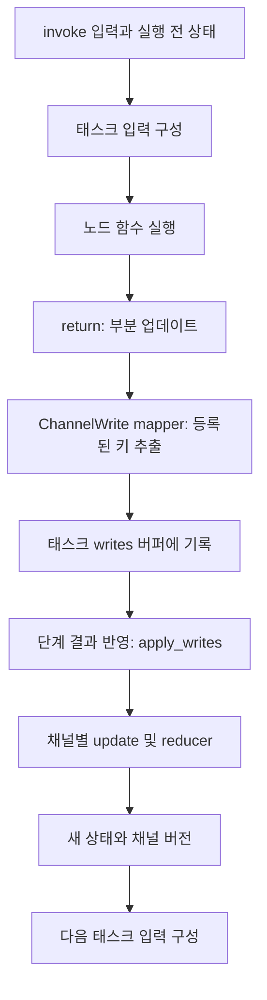
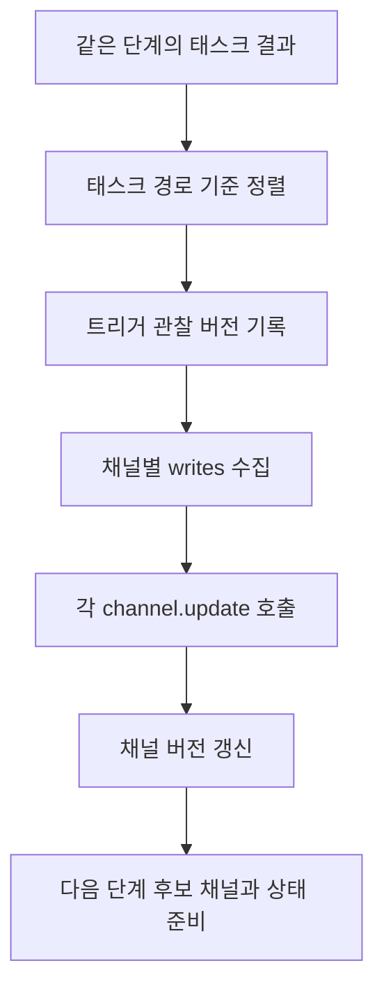
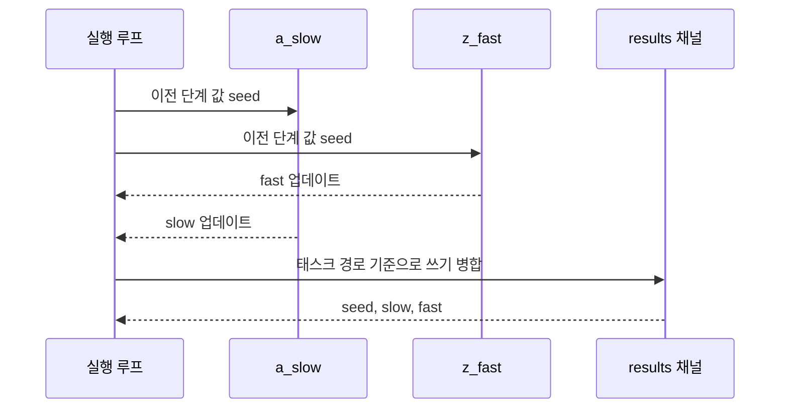

# 03. invoke와 노드 반환값: writer, reducer, super-step

> 기준: 로컬 LangGraph 1.2.11, 확인일 2026-10-05.
>
> 근거: 설치 소스와 오프라인 실험. 모델·외부 저장소·프로세스 장애는 이번 실험에 포함하지 않는다.
>
> 이전: [02. 조건부 분기 등록과 실행](02_conditional_edges_and_execution.md). 전체 내부 분류의 02·04·05를 실제 invoke와 return 흐름에 연결한다.

노드가 반환한 dict는 상태 전체를 대체하는 객체가 아니라 **채널에 적용할 업데이트**다. writer는 이 업데이트를 태스크에 기록하고, 단계 반영에서 채널별 update가 기존 값과 새 값의 관계를 결정한다.

## 1. 같은 예제에서 무엇을 추적할 것인가?

```python
class State(TypedDict):
    question: str
    results: Annotated[list[str], add]
    answer: str

def search(state: State):
    return {"results": ["new"]}

graph.invoke({"question": "q", "results": ["seed"]})
```

이 선언에서 question/answer는 LastValue, results는 BinaryOperatorAggregate다. 초기 results가 seed인 상황에서 search 반환값이 new이면 최종 results는 seed/new다. question은 반환하지 않았으므로 기존 값을 유지한다.



외부 API나 파일 변경은 이 그림의 채널 쓰기가 아니다. 노드 내부에서 수행한 외부 변경까지 writer가 버퍼링하거나 reducer가 롤백하는 것은 아니다.

## 2. 함수가 받는 state는 어떻게 구성되는가?

**소스:** [pregel/_algo.py](../../../../AI/agent_hitl/.venv/Lib/site-packages/langgraph/pregel/_algo.py)의 `_proc_input` 1348행.

PULL 태스크의 입력은 PregelNode.channels에 적힌 채널 중 현재 사용 가능한 값을 읽어서 구성한다. TypedDict 예제에서는 dict가 만들어진다. 값이 없는 채널은 입력 dict에 없을 수 있다. 필요한 경우 mapper를 적용한다.

같은 입력 구성을 재사용하는 캐시가 있으면 `copy(input_cache[...])`로 얕게 복사한다. 채널 안의 리스트나 중첩 dict까지 모두 deepcopy하지 않는다.

실험에서 병렬 두 노드는 서로 다른 최상위 dict를 받았지만 nested 값은 같은 객체였다. 따라서 아래 패턴은 지양한다.

```python
state["results"].append("new")
state["nested"]["count"] += 1
return state
```

직접 변경은 다른 입력의 공유 객체에 영향을 줄 수 있고, 변경을 명시적으로 쓰기로 전달하는 경계를 우회한다. return state까지 하면 reducer 필드에는 누적 전체 값이 다시 전달된다.

```python
# results가 리스트 덧셈 reducer인 경우
return {"results": ["new"]}

# nested가 일반 교체 필드인 경우
return {"nested": {**state["nested"], "count": state["nested"]["count"] + 1}}
```

중첩이 더 깊으면 수정하는 경로의 객체들도 새로 구성한다. 항상 전체 상태를 deepcopy하는 정책보다 필드의 업데이트 계약에 맞게 반환하는 편이 의도를 드러낸다.

## 3. _get_updates는 무엇을 받아들이는가?

**소스:** [graph/state.py](../../../../AI/agent_hitl/.venv/Lib/site-packages/langgraph/graph/state.py)의 attach_node 내부 `_get_updates` 1456~1492행.

| 반환 형식 | 이 경로의 처리 |
| --- | --- |
| None | 상태 업데이트 없음 |
| dict | 등록된 output_keys에 해당하는 키만 추출 |
| Command | Command.update를 튜플로 추출. 부모 graph 명령은 별도 처리 |
| Command를 포함한 list/tuple | 명령과 지원하는 다른 항목의 업데이트를 추출 |
| 지원하는 annotation 기반 객체 | 해당 객체의 업데이트 추출 경로 사용 |
| 지원하지 않는 값 | InvalidUpdateError |

위 output_keys는 일반 노드에서는 그래프의 상태·managed 필드 범위다. 외부 반환 output_schema만을 뜻하지 않는다. 앞 장의 input_schema로 읽기 범위를 좁혀도 그래프에 등록된 다른 필드에 업데이트를 쓸 수 있다.

미등록 dict 키는 여기서 필터링된다. `{"anser": "typo", "answer": "ok"}`를 반환한 실험에서는 anser가 사라지고 answer만 반영되었다. 오타를 프레임워크가 반드시 오류로 알려준다고 가정하지 않는다.

TypedDict 기반 dict 경로에서 모든 값의 타입을 엄격하게 검사하는 것은 아니다. 예를 들어 `{"answer": None}`은 업데이트 생략과 다른 값이다. downstream에서 문자열을 기대한다면 그 계약을 개발자가 지켜야 한다.

## 4. writer는 채널을 즉시 바꾸는가?

**소스:** [pregel/_write.py](../../../../AI/agent_hitl/.venv/Lib/site-packages/langgraph/pregel/_write.py)의 `_write` 75행, `do_write` 106행, `_assemble_writes` 172행. `_algo.py`의 태스크 CONFIG_KEY_SEND 설정.

ChannelWrite는 mapper와 entry를 통해 `(채널, 값)` 목록을 만들고 태스크 config의 CONFIG_KEY_SEND에 전달한다. 태스크 구성에는 writes 버퍼에 추가하는 경로가 주입된다. writer 호출을 일반 채널의 최종 update와 같은 순간으로 생각하지 않는다.

이 차이가 앞 장의 분기 reader에 필요한 이유다. 같은 태스크의 라우터는 fresh=True로 자신의 writes를 반영해 읽는다. 같은 단계의 다른 노드는 아직 해당 쓰기가 반영된 입력을 받지 않는다.

`None`이나 `{}`를 반환해도 일반 엣지 writer는 실행된다. 실험에서 noop → next 연결에 noop이 None을 반환하자 next가 정상 실행되었다. 상태 업데이트가 없다는 것과 실행 경로가 없다는 것은 다르다. 종료 의도는 END 연결이나 조건부 라우팅 등으로 표현한다.

## 5. LastValue는 마지막 완료 노드가 이기는 채널인가?

**소스:** [channels/last_value.py](../../../../AI/agent_hitl/.venv/Lib/site-packages/langgraph/channels/last_value.py)의 update 56행.

| 한 단계에 모인 업데이트 수 | 처리 |
| --- | --- |
| 0 | 갱신하지 않음 |
| 1 | 해당 값으로 교체 |
| 2 이상 | InvalidUpdateError |

서로 다른 단계에서 한 번씩 쓰는 것은 가능하다. 문제가 되는 것은 같은 단계의 다중 쓰기다. 두 병렬 노드가 동일한 answer 값을 써도 업데이트 수가 두 개이므로 충돌했다.

LastValue를 사용하는 필드는 어느 노드가 어떤 단계에 쓸지 정해야 한다. 결과 하나를 최종 선택해야 하는 업무라면 후보 결과를 별도 누적 필드에 모은 뒤 선택 노드가 최종 answer를 쓰도록 구성할 수 있다.

충돌을 숨기려고 무조건 임의의 reducer를 붙이지 않는다. "먼저 온 값", "마지막 값", "두 값의 병합"은 서로 다른 업무 의미다.

## 6. BinaryOperatorAggregate는 반환값을 어떻게 합치는가?

**소스:** [channels/binop.py](../../../../AI/agent_hitl/.venv/Lib/site-packages/langgraph/channels/binop.py)의 생성자와 update 123행.

생성자는 가능한 경우 필드 타입의 빈 값으로 시작한다. 예를 들어 list는 빈 리스트다. update는 기존 값과 각 일반 업데이트에 등록된 연산자를 적용한다.

```python
# 리스트 덧셈의 개념적 동작
value = value + first_update
value = value + second_update
```

기존 값 자체가 reducer의 왼쪽 인자에 이미 있다. 다음 두 반환값은 같지 않다.

```python
return {"results": ["new"]}                       # 추가분
return {"results": state["results"] + ["new"]}    # 전체 누적값
```

| 초기 상태 | 반환한 업데이트 | 최종 결과 |
| --- | --- | --- |
| seed | new | seed, new |
| seed | seed, new | seed, seed, new |
| seed | 빈 리스트 | seed |

빈 리스트는 덧셈의 추가분이 없다는 뜻이다. 누적값 초기화가 아니다. 이러한 채널에는 일반적으로 변경분만 반환한다.

## 7. 누적 필드를 정말 교체해야 한다면?

이 설치본은 `langgraph.types.Overwrite`를 지원한다. BinaryOperatorAggregate의 update는 Overwrite를 확인해 reducer를 우회하고 값을 교체한다.

```python
from langgraph.types import Overwrite

return {"results": Overwrite([])}
```

실험에서 seed가 들어 있던 results를 빈 리스트로 교체했다. 이 동작은 현재 분석 버전의 기능이다. 다른 버전의 지원 여부를 확인하고 사용한다.

같은 채널·같은 단계에 Overwrite가 여러 개면 InvalidUpdateError다. 이 구현에서 하나의 Overwrite와 일반 업데이트가 함께 들어오면 Overwrite가 앞선 일반 병합을 대체하고 뒤의 일반 업데이트도 병합하지 않는 경로다. 이를 동시성 우선순위 규칙으로 남용하지 않는다. 초기화나 요약 교체를 해야 한다면 해당 단계의 쓰기 책임을 명확히 한다.

## 8. 단계가 끝날 때 writes는 어떤 순서로 반영되는가?

**소스:** `_algo.py`의 `apply_writes` 232행 이후, [pregel/_loop.py](../../../../AI/agent_hitl/.venv/Lib/site-packages/langgraph/pregel/_loop.py)의 `after_tick` 683행.

apply_writes는 태스크 경로를 기준으로 정렬하고, 쓰기를 채널별로 모은 뒤 `channel.update(vals)`를 호출한다. 사용한 트리거의 관찰 버전도 기록하고 채널 버전을 갱신한다. 실제 처리에는 제어 쓰기 제외, consume, finish 등의 경로도 포함된다.

여기서 버전은 상태 dict의 업무 필드가 아니다. checkpoint.channel_versions는 채널의 진행 버전을, versions_seen은 각 노드가 관찰한 트리거 버전을 기록한다. 다음 태스크 선택은 이 둘을 비교한다. 노드 B가 question을 읽더라도 B를 활성화하는 branch:to:B와 question의 역할은 다르다.

예를 들어 A가 B의 트리거에 쓰기 전 B가 본 버전을 v1, 그 쓰기 반영 후 버전을 v2라고 표시하면, 다음 계획은 v2>v1인 읽을 수 있는 트리거로 B를 선택한다. B 단계의 쓰기를 반영할 때 관찰 버전도 기록한다. v1/v2는 이해를 위한 표기이며 실제 버전 문자열·증가 방식은 saver.get_next_version의 구현에 따른다.

버전 갱신은 모든 채널에서 Python 값의 `!=` 비교로 결정되는 것이 아니다. channel.update/consume/finish의 반환 신호가 관련된다. 따라서 “이전과 같은 값을 반환했으니 엣지는 실행되지 않는다”는 결론은 성립하지 않는다. 실행 신호와 업무 데이터 변화 여부를 구분한다.



실험에서는 이름 a_slow의 노드가 z_fast보다 늦게 완료되도록 Event로 제어했다. 완료 기록은 fast/slow였지만 results 병합 결과는 seed/slow/fast였다. 두 입력 모두 seed만 읽었다.



이 결과는 현재 예제의 내부 정렬을 확인한 것이다. 노드명 정렬을 제품의 우선순위 계약으로 사용하지 않는다. 사용자에게 순서가 중요하면 결과에 명시적인 순서 키를 넣고 최종 선택·정렬 노드에서 처리한다.

채널 update 루프를 외부 DB 트랜잭션과 같은 보장으로 간주하지 않는다. 채널 갱신 중 오류가 날 수 있으며, 저장과 복구는 별도 실행 경로다. 외부 변경의 원자성이나 롤백을 보장하는 것은 아니다.

## 9. reducer를 설계할 때 지향할 성질

reducer는 단순 오류 회피 함수가 아니라 필드의 변경 규칙이다. 다음 성질이 실제 데이터 의미와 맞는지 검토한다.

| 성질 | 도움이 되는 상황 | 주의점 |
| --- | --- | --- |
| 부수 효과 없이 입력으로 결과 결정 | 재실행·복원·분기용 읽기 | 시간·난수·외부 호출에 의존하지 않기 |
| 기존 객체를 직접 수정하지 않음 | 공유 입력·채널 복사 | 새 컬렉션을 반환하는 방식 지향 |
| 결합 순서나 묶음에 대한 명확한 의미 | 병렬 결과·증분 저장 | 특히 DeltaChannel에는 별도 batch 계약이 필요 |
| 순서가 달라도 같은 결과 | 순서가 업무적으로 무관한 병렬 결과 | 리스트 순서처럼 필요한 경우에는 강요하지 않기 |
| 동일 ID 업데이트를 반복해도 중복되지 않음 | 재전달 가능한 데이터 | 단순 add는 이런 성질이 없으므로 ID 기반 규칙 검토 |

모든 reducer가 교환법칙이나 멱등성을 가져야 한다는 뜻은 아니다. 어떤 입력 순서와 중복을 허용할지 먼저 정하고 그에 맞는 규칙을 선택한다. 특히 DeltaChannel의 reducer는 다음 장에서 다루는 batch 단위 입력이라 이항 reducer와 구분해야 한다.

## 10. Command는 업데이트와 이동을 함께 표현한다

**소스:** `graph/state.py`의 `_get_updates`와 `_control_branch`. Command 타입과 내부 실행은 노드 반환 경로에 연결된다.

```python
def source(state) -> Command[Literal["chosen"]]:
    return Command(update={"value": 1}, goto="chosen")
```

update는 상태 쓰기로 추출되고 goto는 목적지 제어 쓰기로 추출된다. 다음 단계의 chosen은 반영된 value를 읽는다. 별도 `add_edge("source", "fixed")`도 등록했다면 fixed 경로가 함께 실행된다. 실험에서 chosen과 fixed 모두 value=1을 읽었다.

Command.goto가 기존 일반 엣지를 취소한다고 가정하지 않는다. 이동을 노드 반환값에서 결정할지, 조건부 엣지 라우터에서 결정할지 의도를 명확히 하고 중복된 경로를 확인한다. 부모 graph 명령과 resume는 뒤의 해당 자료에서 다룬다.

## 11. 지향할 패턴과 지양할 패턴

| 상황 | 지향 | 지양 |
| --- | --- | --- |
| 일반 노드 업데이트 | 변경한 필드만 반환 | 모든 필드를 그대로 반환 |
| 누적 채널 | reducer가 요구하는 추가분 반환 | 누적 전체 리스트를 다시 추가 |
| 일반 필드 병렬 결과 | 쓰기 책임 또는 최종 선택 노드 지정 | 완료 시간으로 마지막 쓰기 결정 기대 |
| 입력 객체 | 읽고 필요한 새 객체 반환 | 중첩 dict·메시지 객체 직접 수정 |
| 누적 데이터 초기화 | 명시적 교체 계약과 단일 담당 | 빈 리스트 반환을 초기화로 간주 |
| 실행 종료 | 의도한 END 또는 라우팅 경로 | None 반환을 종료 명령으로 취급 |
| reducer | 데이터 의미를 먼저 정하기 | 충돌 오류 제거를 위해 임의 병합 추가 |
| 결과 순서 | 업무 순서 키로 정렬 | 내부 태스크 정렬 순서에 의존 |

## 12. 로컬 실험 근거

[실험 코드](code/probe_state_updates.py), [결과](code/state_updates_result.json). 여섯 실험은 부분 업데이트와 Overwrite, 반환 형식, 병렬 단계 가시성과 병합 순서, 같은 값의 다중 쓰기 충돌, 입력 객체 공유, Command와 일반 엣지의 동시 실행을 확인한다.

```powershell
.\AI\agent_hitl\.venv\Scripts\python.exe -X utf8 .codex/research/LangGraph/runtime/code/probe_state_updates.py
```

다음은 DeepAgents 개발에 직접 연결되는 messages 필드다. `return {"messages": [...]}`가 ID 기반 병합을 어떻게 수행하고, DeepAgentState의 DeltaChannel이 일반 add_messages 채널과 어떤 점에서 다른지 추적한다.

이어 읽기: [04. messages와 DeepAgents DeltaChannel](04_messages_identity_and_deepagent_delta.md). [후속 소스 식별 정보](runtime_followup_source_manifest.json)에 분석 기준을 보존했다.
