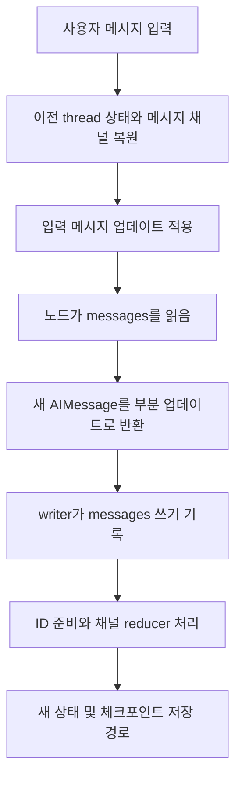
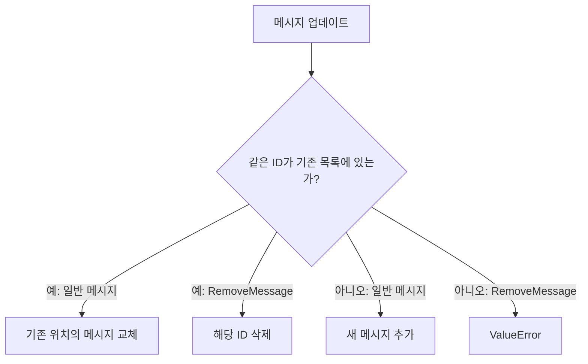
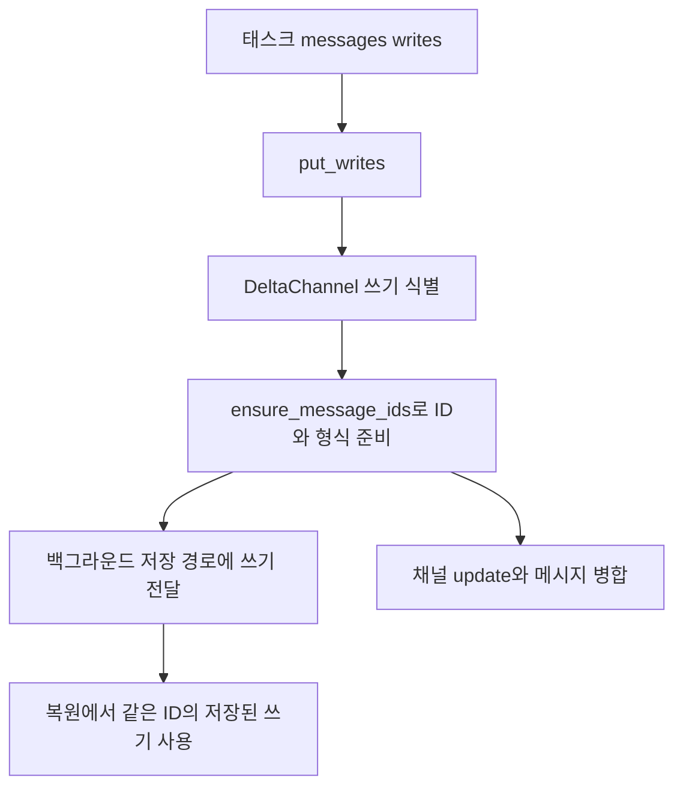
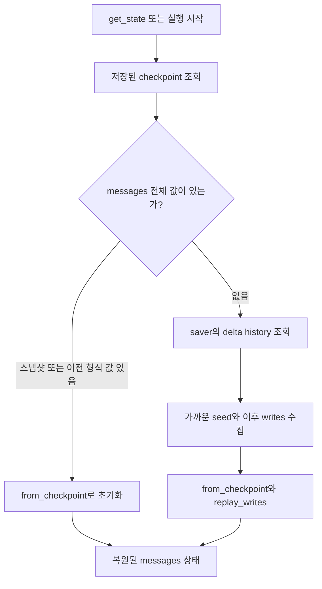

# 04. messages 반환값과 DeepAgents의 DeltaChannel

> 기준: LangGraph 1.2.11, DeepAgents 0.7.13, 확인일 2026-10-05.
>
> 근거: 실제 설치된 Python 소스와 오프라인 실험. 실제 DeepAgentState를 사용하지만 DeepAgents의 모델·도구 조립 구현으로 범위를 확장하지 않는다.
>
> 이전: [03. 노드 반환값과 reducer](03_node_returns_reducers_and_supersteps.md). 전체 내부 분류의 06을 messages 입력·반환·조회 흐름으로 읽는다.

`return {"messages": [...]}`는 단순 append라고 일반화할 수 없다. **messages에 등록된 채널과 reducer가 메시지 ID 기반 수정·삭제·저장 규칙을 결정한다.** 이 설치본에서 DeepAgentState는 일반 add_messages 이항 reducer 대신 DeltaChannel과 별도의 batch reducer를 사용한다.

## 1. 먼저 내 그래프의 messages 채널을 확인한다

**소스:** [deepagents/graph.py](../../../../AI/agent_hitl/.venv/Lib/site-packages/deepagents/graph.py)의 DeepAgentState 73행.

```python
# 설치 소스의 선언
class DeepAgentState(AgentState):
    messages: Required[
        Annotated[list[AnyMessage],
                  DeltaChannel(_messages_delta_reducer, snapshot_frequency=50)]
    ]
```

일반적으로 사용하는 다음 상태 선언과 구분한다.

```python
class State(TypedDict):
    messages: Annotated[list[AnyMessage], add_messages]
```

| 구성 | 실제 상태 채널 | reducer 입력 |
| --- | --- | --- |
| Annotated의 callable add_messages | BinaryOperatorAggregate | 기존 메시지 목록 + 한 업데이트 |
| DeepAgentState의 DeltaChannel 객체 | DeltaChannel | 기존 메시지 목록 + 여러 업데이트의 목록 |

스키마 해석은 앞 장의 `_get_channel()` 경로다. 명시한 채널 객체가 있으므로 DeltaChannel이 선택된다. 키 이름이 messages라는 이유만으로 모든 그래프가 같은 채널을 갖는 것은 아니다. custom state_schema로 선언을 바꾸었다면 실제 compiled graph의 채널을 확인한다.

## 2. messages를 읽고 추가하는 기본 흐름

```python
def reply(state: DeepAgentState):
    return {"messages": [AIMessage(content="reply")]}

graph.invoke(
    {"messages": [HumanMessage(content="question")]},
    {"configurable": {"thread_id": "conversation-1"}},
)
```



체크포인트 로딩, ID 준비, 채널 업데이트, 저장에는 입력과 태스크 결과의 세부 경로 차이가 있다. 아래에서 messages 관련 경계를 따로 추적한다. 전체 대화 목록을 다시 반환할 필요가 있는지는 reducer 계약을 먼저 확인한다.

## 3. 일반 add_messages는 ID를 어떻게 사용하나?

**소스:** [graph/message.py](../../../../AI/agent_hitl/.venv/Lib/site-packages/langgraph/graph/message.py)의 add_messages, 실제 병합 본문 187행 이후.

입력값을 메시지로 변환하고 필요한 경우 메시지 chunk를 완성 메시지로 바꾼다. ID가 없는 메시지에는 UUID를 부여한다. 기존 메시지 목록을 복사하고 ID→위치 매핑을 만든 뒤 업데이트를 처리한다.



```python
left = [HumanMessage(content="old", id="u1")]
right = [HumanMessage(content="edited", id="u1")]
merged = add_messages(left, right)
# u1 하나가 남고 content는 edited
```

같은 내용이어도 ID가 다르면 별도 메시지다. 같은 ID이면 기존 메시지의 위치를 유지하며 교체한다. "텍스트가 같으면 자동 중복 제거"라는 규칙은 아니다.

삭제는 `RemoveMessage(id=...)`를 업데이트로 전달한다. ID가 없는 메시지의 제거 대상을 내용으로 추측하지 않는다.

## 4. 일반 add_messages에서 전체 초기화

```python
from langgraph.graph.message import REMOVE_ALL_MESSAGES

return {"messages": [
    RemoveMessage(id=REMOVE_ALL_MESSAGES),
    HumanMessage(content="new context", id="new-context"),
]}
```

REMOVE_ALL_MESSAGES가 있으면 마지막 해당 표식 뒤에 있는 메시지들로 결과가 구성된다. 이전 목록과 그 표식 앞 업데이트를 유지하는 append가 아니다. 실험에서도 기존 대화가 제거되고 새 메시지만 남았다.

삭제·초기화는 모델 입력의 도구 호출 관계에도 영향을 준다. AIMessage의 tool_calls와 대응 ToolMessage를 유지하는지는 별도 메시지 의미의 문제다. reducer가 모든 모델 공급자의 대화 유효성까지 검사한다고 가정하지 않는다.

## 5. DeepAgents의 batch reducer는 어떻게 다른가?

**소스:** [deepagents/_messages_reducer.py](../../../../AI/agent_hitl/.venv/Lib/site-packages/deepagents/_messages_reducer.py)의 `_messages_delta_reducer` 31행 이후.

DeltaChannel의 reducer는 기존 state와 **한 단계 또는 복원 과정에서 모은 writes 목록**을 받는다. 예를 들어 두 노드가 각각 `[msg_a]`, `[msg_b]`를 썼다면 writes는 `[[msg_a], [msg_b]]` 형태가 될 수 있다.

DeepAgents reducer는 여러 쓰기를 평탄화하고 메시지 형식으로 변환한다. 마지막 REMOVE_ALL_MESSAGES 이후의 항목만 남기는 경로, ID 기반 교체, ID 기반 삭제, 새로운 ID 추가를 처리한다.

| 동작 | 일반 add_messages | 이 설치본의 DeepAgents reducer |
| --- | --- | --- |
| 기존 ID의 새 메시지 | 기존 위치 교체 | 기존 위치 교체 |
| 새 ID의 메시지 | 추가 | 추가 |
| 없는 ID 삭제 | ValueError | 해당 삭제를 무시 |
| REMOVE_ALL_MESSAGES | 초기화 | 초기화 지원 |
| ID 없는 메시지 | reducer가 UUID 부여 | reducer 자체에서는 ID를 부여하지 않고 추가 |
| 입력 chunk 처리 | 완성 메시지 변환 경로 있음 | 일반 add_messages와 같은 chunk 처리 경로를 포함하지 않음 |

실험에서 없는 ID의 삭제와 reducer 직접 호출의 ID 처리 차이를 확인했다. DeepAgents reducer와 LangGraph 내부의 비슷한 이름을 가진 reducer를 같은 구현으로 취급하지 않는다. 여기서는 DeepAgentState가 실제로 참조하는 DeepAgents 모듈의 함수를 읽었다.

## 6. DeepAgents reducer가 ID를 만들지 않는데 어떻게 안정적인가?

**소스:** [PregelLoop.put_writes](../../../../AI/agent_hitl/.venv/Lib/site-packages/langgraph/pregel/_loop.py) 415행, DeltaChannel ID 처리 458~465행. [ensure_message_ids](../../../../AI/agent_hitl/.venv/Lib/site-packages/langgraph/pregel/_messages.py) 426행 이후.

DeltaChannel 쓰기를 저장 경로로 넘기기 전에 런타임의 ensure_message_ids가 ID 없는 메시지의 ID를 준비한다. 메시지 객체, 인식 가능한 메시지 dict, 그 목록을 처리한다. 일부 입력은 typed 메시지로 바꾸며 공유된 쓰기 목록을 갱신한다.



reducer 안에서 임의 ID를 생성하면 복원 중 같은 메시지의 ID가 달라질 수 있다. 이 설치본은 저장할 쓰기 자체에 안정적인 ID를 준비하는 방식으로 그 문제를 피한다. 스트리밍 핸들러 등 다른 경로가 이미 ID를 준비한 경우도 있으므로 ID 부여가 이 함수 한 곳에서만 일어난다고 일반화하지 않는다.

실험에서 ID 없는 HumanMessage와 AIMessage로 두 턴을 실행한 뒤 get_state를 두 번 호출했다. 네 메시지 모두 ID가 있었고 두 조회의 ID가 같았다. 외부 앱의 자체 중복 요청을 자동으로 같은 ID로 바꿔 준다는 뜻은 아니다.

**경로별 주의점:** 위 설명은 일반 실행 루프의 put_writes 경로다. [06. update_state](06_update_state_writers_and_execution_position.md)의 수동 메시지 추가 실험에서는 같은 ID 준비 경로를 거치지 않아 ID 없는 메시지가 그대로 남았다. DeepAgents 메시지를 수동 수정할 때는 안정적인 ID를 명시하고 API의 쓰기 경로를 확인한다.

## 7. DeltaChannel은 언제 reducer를 실행하나?

**소스:** [channels/delta.py](../../../../AI/agent_hitl/.venv/Lib/site-packages/langgraph/channels/delta.py)의 update 182행과 replay_writes 157행.

이 설치본의 update는 기본값 또는 기존값에 `self.reducer(base, list(values))`를 호출한다. replay_writes도 모아 온 저장 쓰기를 reducer에 전달한다. 즉 **현재 실행 중 업데이트와 저장 상태 복원에서 모두 호출된다.**

직접 관찰한 실험에서는 update로 `[1]`을 적용하고 replay_writes로 `[2]`를 적용했다. reducer 호출이 각각 한 번씩 있었고 최종 값은 `[1, 2]`였다.

이항 reducer가 한 업데이트씩 받는 것과 달리 DeltaChannel에는 묶음이 전달된다. 복원에서는 여러 과거 쓰기가 한 번에 전달될 수 있으므로 묶는 방식에 따라 결과가 바뀌지 않아야 한다.

```python
reducer(reducer(state, xs), ys) == reducer(state, xs + ys)
```

DeepAgents reducer의 수정·추가·삭제를 포함한 한 사례에서 이 성질을 확인했다. 이 한 실험이 모든 custom reducer의 모든 입력을 검증하는 것은 아니다. custom reducer를 작성한다면 초기 상태, 교체, 삭제, reset, 중복 ID와 batch 경계가 달라지는 사례를 확인해야 한다.

reducer 안에 외부 저장, 시간 읽기, 무작위 ID 생성 같은 부수 효과를 넣지 않는다. 조회만 해도 복원 때문에 reducer가 실행될 수 있다.

## 8. DeltaChannel의 체크포인트에는 전체 messages가 항상 있는가?

**소스:** delta.py의 checkpoint, [pregel/_checkpoint.py](../../../../AI/agent_hitl/.venv/Lib/site-packages/langgraph/pregel/_checkpoint.py)의 create_checkpoint 149행, channels_from_checkpoint 229행, achannels_from_checkpoint 280행.

DeltaChannel.checkpoint는 기본적으로 MISSING을 반환한다. 전체 상태 스냅샷을 넣을지는 create_checkpoint와 해당 계획 경로에서 결정한다. 스냅샷 단계에서는 `_DeltaSnapshot` 값을 넣고, 그 외 단계는 전체 messages 값을 생략할 수 있다.



실험에서 두 턴을 마친 최신 체크포인트의 channel_values에는 messages 전체 값이 없었다. 그러나 saver가 delta history의 네 쓰기를 제공했고 get_state에서는 사용자/응답 네 메시지를 복원했다.

**channel_values에 messages가 없다는 사실만으로 기억이 사라졌다고 판단하면 안 된다.** 반대로 이전 checkpoint와 writes를 임의 삭제하면 복원에 필요한 seed와 경로를 잃을 수 있다. 저장 구조를 직접 다룰 때는 saver의 계약을 확인한다.

## 9. snapshot_frequency=50의 의미

**소스:** `_checkpoint.py`의 delta_channels_to_snapshot 51행, `_loop.py`의 `_put_checkpoint` 1081행 이후.

채널별 카운터는 업데이트가 있었던 단계 수와 마지막 스냅샷 이후 전체 단계 수를 추적한다. 업데이트 카운터가 snapshot_frequency에 도달하거나 전체 단계 수가 내부 상한에 도달하면 스냅샷 대상으로 선택된다. Overwrite 등으로 스냅샷을 강제하는 경로도 있다.

50은 메시지 객체 50개, 토큰 50개, 사용자 턴 50개를 그대로 의미하지 않는다. 같은 단계에 메시지가 여러 개 있어도 해당 채널의 단계 업데이트 카운트와는 다르다.

스냅샷 빈도는 저장 비용과 복원 비용의 관계에 영향을 준다. 빈도만 낮춰도 항상 유리하다고 판단하지 않는다. 이 실험은 저장 공간의 전체 벤치마크나 외부 DB 조회 비용을 측정하지 않았다.

## 10. ID와 모델용 도구 호출 ID를 구분한다

메시지 ID는 이 장에서 다룬 교체·삭제의 식별자다. AIMessage 안의 tool_calls 항목 ID와 ToolMessage의 tool_call_id는 도구 호출과 응답의 대응 관계다. 메시지 ID로 교체한다고 그 관계가 자동으로 새로 구성되는 것은 아니다.

도구 결과 메시지를 편집·삭제하거나 대화 일부를 초기화할 때는 남은 대화가 모델에 유효한지도 검토한다. messages reducer와 모델 프로토콜 검증은 서로 다른 책임이다.

전체 메시지를 다시 반환하는 패턴도 피한다. 안정적인 ID가 있으면 같은 ID는 교체되므로 단순 리스트 add처럼 항상 두 배가 되지는 않는다. 그러나 불필요한 전체 쓰기, 형식 변환, delta 저장 비용과 ID가 없는 데이터의 중복 위험을 늘릴 수 있다. 필요한 새 메시지나 수정 대상만 반환한다.

## 11. 지향할 패턴과 지양할 패턴

| 상황 | 지향 | 지양 |
| --- | --- | --- |
| 새 메시지 추가 | 새 메시지만 업데이트로 반환 | 누적 전체 대화를 매번 반환 |
| 기존 메시지 수정 | 기존 ID를 유지한 명시적 교체 | 텍스트 동일성으로 중복 제거 기대 |
| 메시지 삭제 | 채널의 RemoveMessage 계약 확인 | 목록 객체를 직접 remove |
| custom reducer | batch 경계에 독립적인 처리와 부수 효과 배제 | replay에서 난수·외부 호출 실행 |
| 상태 조회 | get_state로 복원된 상태 확인 | raw checkpoint의 한 필드만으로 기억 판정 |
| history 정리 | seed·delta writes 의존성을 함께 확인 | 과거 checkpoint만 임의 삭제 |
| custom state_schema | 실제 messages 채널 종류 확인 | DeepAgents 기본 규칙이 항상 유지된다고 가정 |
| 도구 대화 수정 | 메시지 ID와 tool_call_id 관계를 각각 확인 | reducer가 대화 프로토콜을 모두 검증한다고 가정 |

## 12. 실행 근거와 다음 API

[실험 코드](code/probe_message_channels.py), [실행 결과](code/message_channels_result.json). 다섯 실험은 ID 교체·삭제·초기화, reducer 차이, batch 예제, update/replay 호출, 실제 DeepAgentState의 저장·복원을 확인했다. 모델 호출과 외부 영속 DB는 사용하지 않았다.

```powershell
.\AI\agent_hitl\.venv\Scripts\python.exe -X utf8 .codex/research/LangGraph/runtime/code/probe_message_channels.py
```

다음은 `compile(checkpointer=...)`, 같은 thread의 `invoke(...)`, `get_state(...)`, `get_state_history(...)`다. 현재 상태와 실행 위치를 어떻게 저장·조회하고 STM과 실행 재개에 함께 사용하는지 이어서 추적한다.

이어 읽기: [05. 체크포인트와 상태 조회](05_checkpointer_stm_and_state_views.md). [후속 소스 식별 정보](runtime_followup_source_manifest.json).
