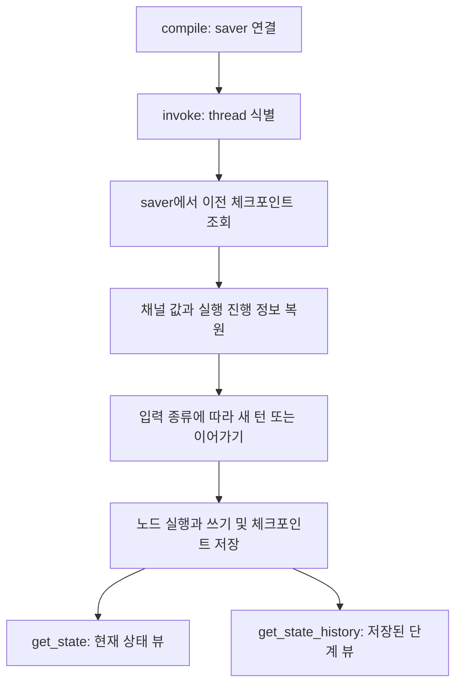
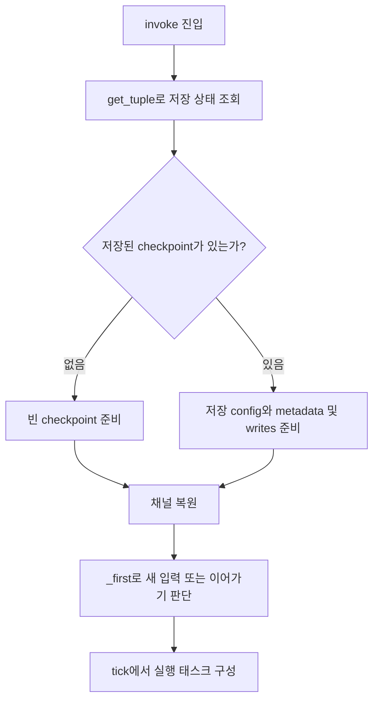
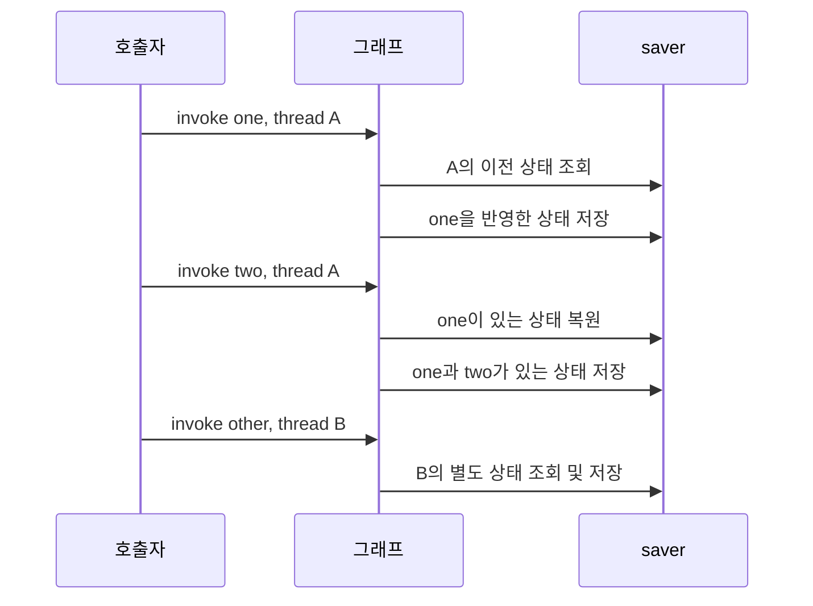
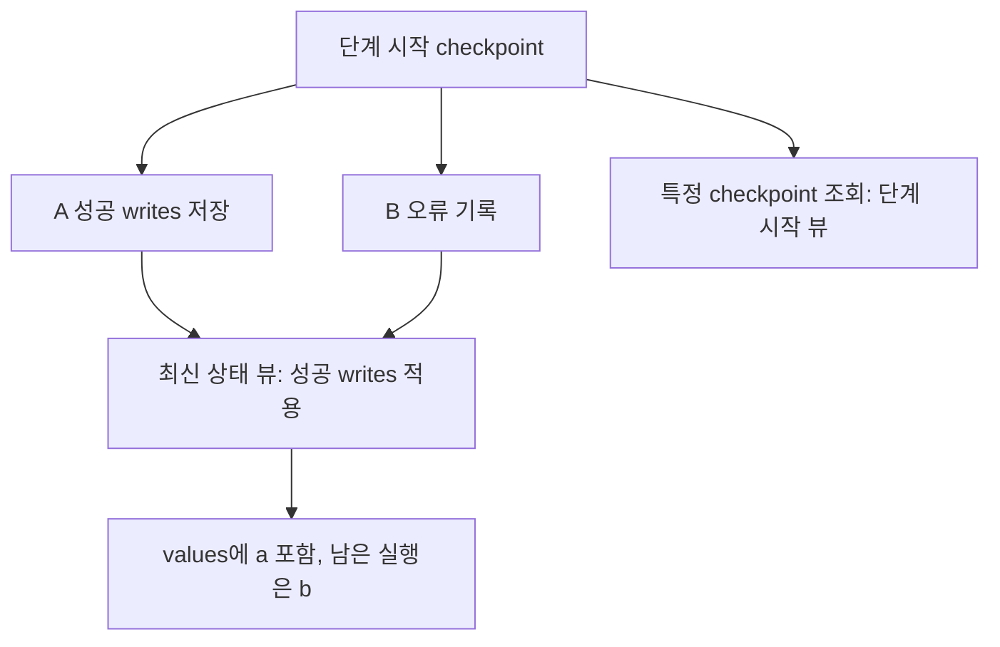

# 05. compile의 checkpointer, 같은 thread의 invoke, 상태 조회

> 기준: LangGraph 1.2.11, langgraph-checkpoint 4.2.0. 확인일 2026-10-05.
>
> 근거: 로컬 설치 소스와 InMemorySaver 실험. 프로세스 재시작, 외부 DB, 다중 worker는 검증하지 않았다.
>
> 이전: [04. messages와 DeepAgents의 DeltaChannel](04_messages_identity_and_deepagent_delta.md). 전체 내부 분류 07~08의 상태 로딩·조회·pending writes를 사용 API 순서로 읽는다.

Checkpointer는 메시지 목록만 저장하는 기억 장치가 아니다. **상태 채널과 실행 진행 정보를 저장한다.** 그 상태를 새 턴의 시작점으로 사용하면 STM이고, 남은 작업과 중단 정보를 사용하면 실행 복구·재개가 된다.

## 1. 우리가 호출하는 API 순서

```python
saver = InMemorySaver()
graph = builder.compile(checkpointer=saver)
config = {"configurable": {"thread_id": "conversation-1"}}

graph.invoke({"question": "one"}, config)
graph.invoke({"question": "two"}, config)

state = graph.get_state(config)
history = list(graph.get_state_history(config, limit=3))
```



compile이 상태 저장소를 만드는 모든 설정을 대신하는 것은 아니다. 예제는 이미 생성한 InMemorySaver를 연결한다. 실제 외부 saver의 초기화와 저장소 준비는 해당 구현의 계약에 따른다.

## 2. thread_id와 checkpoint_id는 어떻게 다른가?

| 식별 정보 | 역할 |
| --- | --- |
| thread_id | 이어서 사용할 실행·대화 상태의 식별자 |
| checkpoint_ns | 부모·하위 그래프 등 체크포인트 영역 구분 |
| checkpoint_id | 조회·실행할 특정 저장 시점 지정 |

thread_id만 주면 해당 영역의 최신 체크포인트를 조회하는 경로를 사용한다. checkpoint_id가 포함된 config는 특정 시점을 대상으로 한다. get_state 결과의 config는 실제로 조회한 checkpoint_id를 포함할 수 있다.

새 턴에 과거 snapshot.config를 그대로 사용하면 "같은 대화의 최신 상태" 대신 특정 시점을 대상으로 할 수 있다. 평소 대화를 이어갈 config와 과거 시점 재현에 사용할 config의 의도를 구분한다.

thread_id를 새로 만들면 기존 대화 상태를 자동으로 조회하지 않는다. 반대로 서로 다른 대화에 같은 thread_id를 쓰면 그 상태를 함께 사용한다. thread_id 자체를 저장소 잠금이나 접근 권한 검증으로 취급하지 않는다.

## 3. 저장되는 실행 정보는 무엇인가?

**소스:** [checkpoint/base/__init__.py](../../../../AI/agent_hitl/.venv/Lib/site-packages/langgraph/checkpoint/base/__init__.py)의 Checkpoint 92행, CheckpointTuple 139행. [pregel/_checkpoint.py](../../../../AI/agent_hitl/.venv/Lib/site-packages/langgraph/pregel/_checkpoint.py)의 empty_checkpoint와 create_checkpoint.

| Checkpoint 필드 | 실행에서의 의미 |
| --- | --- |
| channel_values | 저장한 채널 값 또는 스냅샷 표현 |
| channel_versions | 채널 버전 |
| versions_seen | 노드가 관찰한 트리거 버전 |
| updated_channels | 변경된 채널 정보 |
| id, ts, v | 체크포인트 ID, 시각, 저장 형식 버전 |

CheckpointTuple은 checkpoint뿐 아니라 config, metadata, parent_config, pending_writes도 함께 제공한다. 메시지와 일반 필드만 복원해서는 어느 노드를 실행해야 하는지 모두 알 수 없다. 채널 버전과 관찰 버전, 남은 태스크 쓰기가 함께 필요하다.

이 설치본의 생성된 체크포인트 v는 4였다. 일부 타입 docstring의 예전 설명보다 실제 생성 코드와 저장값을 기준으로 읽는다. 채널 버전의 구체적 표현도 saver별 구현을 확인한다.

앞 장의 DeltaChannel은 channel_values에 전체 값이 없는 경우 delta history에서 seed와 writes를 복원한다. 따라서 "각 checkpoint에 전체 상태 dict가 그대로 있다"는 모델로 모든 채널을 이해하지 않는다.

## 4. invoke 시작 시 어떻게 복원하는가?

**소스:** [pregel/_loop.py](../../../../AI/agent_hitl/.venv/Lib/site-packages/langgraph/pregel/_loop.py)의 SyncPregelLoop.__enter__, AsyncPregelLoop.__aenter__, `_first` 848행.

이 문서는 동기 경로를 먼저 따른다. 일반적인 시작에서는 saver.get_tuple로 최신 또는 지정 체크포인트를 가져온다. 저장값이 없으면 빈 체크포인트로 시작한다. config와 metadata, parent_config, pending_writes를 준비하고 channels_from_checkpoint로 채널을 복원한다.



비동기 경로는 aget_tuple과 achannels_from_checkpoint를 사용한다. sync/async 차이를 단지 함수명 접두사로만 판단하지 않고 사용하는 saver의 I/O와 저장 대기 경로까지 확인해야 한다.

## 5. STM은 어떻게 만들어지는가?

예제의 records는 리스트 덧셈 reducer이고, record 노드는 새 question을 records에 추가한다. 같은 thread에서 one 다음 two를 호출한 실험에서는 records가 one/two로 유지되었다. 다른 thread의 other 호출은 other 하나만 가졌다.



records나 messages만 STM이 되는 것은 아니다. checkpointer가 보존하는 채널 상태가 다음 호출에 영향을 준다. reducer 없는 일반 필드는 새 값으로 교체되고, 누적 필드는 기존 상태와 병합한다.

기억된 모든 데이터를 모델 요청에 그대로 넣는지는 다른 경로다. 모델 입력을 선택·요약하는 동작과 상태 저장을 구분한다. 이 장에서는 LangGraph의 저장된 상태를 다음 호출에 사용하는 규칙에 집중한다.

## 6. 새 입력과 이어가기는 어떤 차이가 있는가?

`_first()`는 이전 checkpoint가 있고 입력이 None 또는 Command인 경우 등을 이어가기 신호로 판단하는 경로가 있다. 새 dict 입력은 일반적인 새 실행 입력 처리 경로를 사용한다.

| 호출 | 대표 의도 | 주의점 |
| --- | --- | --- |
| invoke(new_dict, config) | 이전 상태를 바탕으로 새 턴 실행 | 중단 작업의 승인 응답과 동일하지 않음 |
| invoke(None, config) | 남아 있는 작업 이어가기 | dynamic interrupt의 응답값을 자동으로 제공하지 않음 |
| invoke(Command(resume=...), config) | interrupt에 응답하며 이어가기 | 이전 중단 상태와 필요한 resume 값 필요 |

이 표는 일반적인 사용 의도다. 내부에는 run_id 기반 이어가기, 하위 그래프와 과거 시점 재현 등의 추가 분기가 있다. 이 세 값만으로 모든 실행 맥락을 분류한다고 단정하지 않는다.

새 dict 입력 경로에는 이전 미완료 태스크를 처리하는 로직도 있다. 중단된 실행에 아무 dict나 보내면 남은 승인 작업이 같은 방식으로 재개된다고 기대하지 않는다. interrupt 호출과 resume 매칭은 별도 장에서 자세히 추적한다.

## 7. get_state는 단순히 저장된 dict를 반환하는가?

**소스:** [Pregel.get_state](../../../../AI/agent_hitl/.venv/Lib/site-packages/langgraph/pregel/main.py) 1392~1434행, `_prepare_state_snapshot` 1145~1266행. [StateSnapshot](../../../../AI/agent_hitl/.venv/Lib/site-packages/langgraph/types.py) 683행.

get_state는 checkpointer가 필요하다. 없으면 ValueError다. 저장된 checkpoint를 가져온 뒤 채널을 복원하고 다음 태스크를 준비하는 정보를 구성해 StateSnapshot을 반환한다.

| StateSnapshot 필드 | 확인할 내용 |
| --- | --- |
| values | 사용자에게 노출하는 상태 채널의 현재 뷰 |
| next | 아직 실행할 태스크의 노드 이름 |
| tasks | 태스크 식별과 오류·중단·결과 등의 정보 |
| interrupts | 해결되지 않은 중단 정보 |
| config | 이 snapshot에 대응하는 config |
| metadata | source, step 등 저장 시점 정보 |
| created_at, parent_config | 시각과 부모 체크포인트 관계 |

사용자 노드 함수를 실행해서 값을 재계산하지 않는다. 다만 채널 복원에서 reducer가 실행될 수 있고 내부 태스크 구성이 수행된다. 따라서 네트워크나 부수 효과를 reducer에 넣으면 조회 경로에도 문제가 생길 수 있다.

첫 실행 전 저장값이 없다면 empty StateSnapshot의 values는 빈 dict, next는 빈 tuple이었다. 상태 스키마에 누적 필드가 있다고 최초 조회에 항상 해당 빈 컬렉션이 포함된다고 생각하지 않는다.

## 8. output_schema와 상태 조회의 범위

실험은 외부 출력 스키마에 count만 넣었다. 두 번째 invoke의 반환은 `{"count": 2}`였지만 get_state.values에는 question, records, count가 모두 있었다.

output_schema를 좁혔다고 내부 상태 조회 API나 저장값에서도 다른 필드가 사라지는 것은 아니다. 상태 조회를 외부에 노출한다면 API가 내보낼 필드를 별도로 정한다.

또한 next가 빈 tuple이라는 것은 조회 뷰에서 다음 실행 대상이 없다는 뜻이다. 외부 업무 처리의 성공 여부나 취소·중단·오류 여부를 그 값 하나로 모두 판단하지 않는다. 필요한 tasks, interrupts와 애플리케이션의 업무 상태를 함께 확인한다.

## 9. 최신 상태 조회는 성공 pending writes를 반영할 수 있다

get_state는 config에 checkpoint_id가 없을 때 `_prepare_state_snapshot(..., apply_pending_writes=True)`를 호출한다. 명시한 checkpoint_id가 있으면 이 옵션을 활성화하지 않는다.

병렬 A/B에서 A의 records 쓰기가 저장되고 B가 실패한 상황을 실험했다. B는 saver가 A 쓰기를 기록했다는 Event를 확인한 뒤 실패하게 하여 순서를 통제했다.

| 조회 | records | next |
| --- | --- | --- |
| thread의 최신 get_state | a | b |
| 같은 저장 checkpoint_id를 명시한 get_state | 빈 리스트 | a, b |



최신 조회의 values는 raw checkpoint.channel_values만 읽은 결과와 다를 수 있다. "왜 조회 결과에 A가 있는데 저장된 단계 값에는 없지?"라는 상황은 pending writes 반영 경로를 확인해야 한다.

이어 invoke(None, config)를 호출한 실험에서는 A는 총 1회, B는 총 2회 실행되었고 최종 records는 a/b였다. 저장된 성공 writes를 재사용했기 때문이다. 실제 프로세스 종료와 외부 DB의 장애 복구를 검증한 결과는 아니다.

## 10. get_state_history는 무엇의 이력인가?

**소스:** `main.py`의 get_state_history 1480~1531행, aget_state_history 1533행 이후.

history는 saver.list 또는 alist가 제공하는 CheckpointTuple들을 StateSnapshot으로 변환한다. 사용자 메시지의 대화 턴 목록과 같은 개념이 아니다. 입력 처리, 숨겨진 START, 사용자 노드 실행 등 여러 저장 시점이 포함될 수 있다.

실험의 최근 세 snapshot은 source=loop, loop, input이었다. input 시점에는 새 입력이 START에 대기 중이고 일반 question 채널은 이전 값을 가질 수도 있었다. metadata의 source만 보고 모든 상태 필드가 이미 새 입력으로 바뀌었다고 가정하지 않는다.

해당 구현은 saver.list 결과를 먼저 list로 소비하여 DB cursor를 오래 잡지 않도록 한 뒤 각 snapshot을 만든다. 이 구현 세부 때문에 limit 없이 매우 긴 history를 조회하는 비용도 고려한다. DeltaChannel의 복원 비용이 더해질 수 있다.

실험에서는 limit=3으로 세 저장 시점을 확인했고, get_state와 history 조회는 record 노드의 호출 횟수를 늘리지 않았다. 이때 순서는 InMemorySaver가 제공하는 최신 시점부터였다. 다른 saver의 list 계약과 필터 지원도 확인한다.

## 11. 상태 수정은 조회 객체를 고치는 방식인가?

get_state가 반환한 values를 직접 변경해서 저장 상태를 수정하지 않는다. 값이 조회 결과나 로컬 메모리 객체인 것과 saver에 새 체크포인트를 작성한 것은 다르다.

```python
snapshot = graph.get_state(config)
# 다음 방식은 저장 상태 수정 API가 아님
snapshot.values["records"].append("manual")

# 명시적 상태 수정은 update_state 경로로 표현
graph.update_state(config, {"records": ["manual"]})
```

update_state는 reducer와 실행 경로에도 영향을 준다. 일반 dict overwrite와 동일하게 취급하지 않는다. 다음 장에서 values가 어떤 writer를 통해 적용되고 as_node가 다음 실행에 어떻게 영향을 주는지 다룬다.

## 12. 지향할 패턴과 지양할 패턴

| 상황 | 지향 | 지양 |
| --- | --- | --- |
| 대화 이어가기 | 대화별 thread와 최신 조회 config 사용 | 매 턴 새 thread 또는 과거 checkpoint_id 혼용 |
| 중단 응답 | interrupt와 resume 계약대로 전달 | 새 dict를 모든 재개의 대체로 사용 |
| 상태 확인 | values, next, tasks, interrupts 함께 해석 | messages dict 하나로 실행 위치 판정 |
| STM 설계 | 필드별 유지·교체·누적 규칙 지정 | messages만 기억되고 다른 필드는 초기화된다고 가정 |
| 현재 상태 디버깅 | 최신 뷰와 특정 checkpoint 뷰를 구분 | raw channel_values만으로 현재 상태 판정 |
| 이력 조회 | 목적에 맞는 limit와 시점 지정 | 모든 이력을 무제한 조회 |
| 상태 수정 | update_state의 쓰기 경로 사용 | snapshot.values 직접 변경 |
| 운영 저장 | saver의 내구성과 복원 계약 확인 | InMemorySaver로 재시작 복구 보장 기대 |

Checkpointer가 외부 부수 효과의 exactly-once나 같은 thread의 동시 실행 직렬화까지 자동으로 보장하지는 않는다. 저장·실행 제어의 상세 경계는 뒤의 재시도·durability·동시 실행 학습에서 이어간다.

## 13. 실행 근거

[실험 코드](code/probe_checkpoint_views.py), [실행 결과](code/checkpoint_views_result.json). 세 실험 그룹은 같은 thread의 상태 유지와 분리, 출력과 상태 조회 범위, 과거 checkpoint 조회, history 조회의 노드 미실행, 성공 pending writes 뷰와 복구, checkpointer 미설정 오류를 확인했다.

```powershell
.\AI\agent_hitl\.venv\Scripts\python.exe -X utf8 .codex/research/LangGraph/runtime/code/probe_checkpoint_views.py
```

다음 API는 `update_state(config, values, as_node=...)`다. 상태 수정이 reducer, 다음 노드 선택, 새 체크포인트와 어떻게 연결되는지 따라간다.

이어 읽기: [06. update_state와 실행 위치](06_update_state_writers_and_execution_position.md). [후속 소스 식별 정보](runtime_followup_source_manifest.json).
