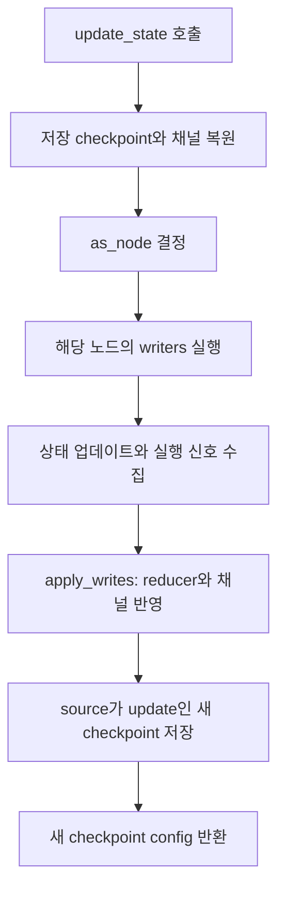
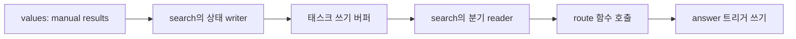

# 06. update_state는 상태와 실행 위치를 어떻게 바꾸는가?

> 기준: LangGraph 1.2.11, DeepAgents 0.7.13. 확인일 2026-10-05.
>
> 근거: 실제 설치 소스, InMemorySaver 오프라인 실험. 외부 저장소의 트랜잭션·동시 실행은 검증하지 않았다.
>
> 이전: [05. 체크포인트와 상태 조회](05_checkpointer_stm_and_state_views.md). 전체 내부 분류 02·03·07·08을 update_state API에 연결한다.

`update_state()`는 저장된 dict에 값을 직접 덮어쓰는 API가 아니다. **특정 노드의 반환값처럼 업데이트를 writer에 통과시키고, reducer와 실행 제어 쓰기를 적용한 새 체크포인트를 만든다.** as_node는 업데이트를 어느 노드에서 나온 것으로 취급할지 정한다.

## 1. 평소 사용하는 호출에서 시작한다

```python
updated_config = graph.update_state(
    config, {"results": ["manual evidence"]}, as_node="search"
)
snapshot = graph.get_state(updated_config)
graph.invoke(None, updated_config)
```

search → route → answer 예제에서 results는 리스트 덧셈 reducer다. 이 호출은 기존 results를 교체하는 것이 아니라 추가한다. as_node=search는 search 함수 실행 명령이 아니다.



## 2. update_state의 실제 진입점

**소스:** [Pregel.update_state](../../../../AI/agent_hitl/.venv/Lib/site-packages/langgraph/pregel/main.py) 2515~2526행, bulk_update_state 1590~2054행.

```python
# 실제 동기 구현
return self.bulk_update_state(config, [[StateUpdate(values, as_node, task_id)]])
```

하나의 StateUpdate를 한 super-step 묶음에 넣어 bulk 경로를 호출한다. 비동기 aupdate_state는 abulk_update_state를 await한다. 여기서는 일반적인 하나의 dict 업데이트와 명시한 as_node를 추적한다.

bulk 경로에는 입력으로 취급하는 갱신, checkpoint 복사, 작업 정리 등 별도 분기도 있다. 이 특수 경로를 일반 수정의 기본 동작으로 혼합하지 않는다.

## 3. 저장 상태를 복원하고 새 시점을 만든다

perform_superstep은 saver.get_tuple로 대상 checkpoint를 가져온다. 있으면 기존 checkpoint를 복사하고 채널 버전을 준비한다. 없으면 빈 checkpoint를 사용한다. channels_from_checkpoint로 일반 값과 DeltaChannel도 복원한다.

checkpoint_id가 포함된 config라면 특정 시점을 대상으로 할 수 있다. 반환 config에는 새 checkpoint_id가 포함된다. 수정된 그 시점에서 이어가려면 반환 config를 명시적으로 사용하는 편이 의도를 드러낸다.

실험에서는 업데이트 후 checkpoint_id가 바뀌었고, 기존 snapshot.config로 조회한 results는 seed를 유지했다. 전체 checkpoint 값을 제자리 수정하는 호출이 아니다.

다만 기존 checkpoint와 연결된 pending writes를 기록하는 경로도 있다. 최신 뷰와 특정 checkpoint 뷰가 달라질 수 있다는 앞 장의 규칙을 함께 고려한다. 기존 저장 행에 어떤 변경도 없다는 식으로 저장소 전체의 불변성을 일반화하지 않는다.

## 4. as_node 생략 시 어떻게 결정되는가?

**소스:** main.py 1890행 이후의 valid_updates 구성.

구현은 노드 구성과 관찰 버전을 바탕으로 출처를 추론한다. 단일 노드 구성, 아직 관찰 버전이 없는 입력 단계, 마지막 갱신 노드를 구분할 수 있는 경우 등의 경로가 있다. 마지막 단계에서 여러 노드가 같은 버전으로 진행해 출처를 정할 수 없으면 InvalidUpdateError가 발생할 수 있다.

실험에서 a/b가 병렬로 results를 갱신하고 끝난 뒤 as_node를 생략하자 `Ambiguous update, specify as_node` 오류가 발생했다.

존재하지 않는 노드 이름도 오류다. as_node는 표시 태그가 아니라 어떤 writer와 연결 관계를 사용할지 결정한다. 사람이 편집한 데이터라도 다음 실행 의도에 맞는 출처를 정한다.

## 5. 노드 함수는 호출하지 않지만 writer는 호출한다

**소스:** main.py 1953행 이후의 flat_writers 선택과 run.invoke 구성.

```python
# 주요 동작을 단순화한 의사 코드
writers = graph.nodes[as_node].flat_writers
run = sequence_of(writers)
run.invoke(values, config_with_local_read_and_write_buffer)
```

bound, 즉 search 함수는 이 묶음에 없다. 대신 상태 writer, 일반 엣지 writer, 조건부 분기 runnable이 포함될 수 있다. 따라서 **update_state 도중 라우터 함수가 실행될 수 있다.**



일반 실행의 호출 기록은 search/route/answer였다. 이후 as_node=search로 수동 수정할 때 새 호출 기록은 route 하나였다. search와 answer는 update_state 자체에서는 실행되지 않았다.

관리 기능에서 상태를 편집하는 동안에도 라우터의 외부 변경이 실행될 수 있다. 라우터는 상태로 목적지를 판단하는 역할에 집중시키는 편이 좋다.

## 6. 같은 values도 as_node에 따라 다음 실행이 달라진다

| 수정 출처 | results | next | answer |
| --- | --- | --- | --- |
| search | seed/manual로 누적 | answer 대기 | 아직 이전 seed 응답 |
| answer | seed/manual로 누적 | 없음 | 여전히 이전 seed 응답 |

첫 경우는 search의 분기 writer가 answer 트리거를 쓴다. 두 번째 경우는 answer가 END로 연결되어 다음 일반 노드를 추가하지 않는다.

as_node가 노드 이름이라고 그 노드가 평소 반환하는 필드만 허용하는 것은 아니다. 실험에서 as_node=answer로 results도 수정했다. 쓰기 출처와 연결 관계를 사용하는 것이며 필드별 권한 검사를 대신하지 않는다.

업데이트 직후 answer가 이전 값을 유지하는 점도 중요하다. 필드 의존 관계가 자동 계산되어 모든 파생값이 즉시 재계산되는 구조가 아니다. 재계산이 필요하면 해당 노드 실행 경로를 준비하고 이어서 실행한다.

## 7. reducer와 Overwrite는 그대로 적용된다

상태 writer의 쓰기는 apply_writes와 channel.update를 거친다. update_state가 모든 reducer를 우회하지 않는다.

```python
# 기존 리스트에 추가
graph.update_state(config, {"results": ["manual"]}, as_node="search")

# 현재 분석 버전에서 명시적으로 교체
graph.update_state(config, {"results": Overwrite([])}, as_node="search")
```

첫 결과는 seed/manual였다. Overwrite로 초기화한 뒤 route는 빈 results를 보고 END를 선택했고 next는 비어 있었다. 기존 answer는 여전히 남았다. results 초기화가 answer 삭제까지 의미하지 않는다.

분기 reader는 이번 update의 writes를 반영한 상태를 읽는다. as_node=search로 수정할 때 route가 이전 results만으로 판단한다고 가정하지 않는다.

## 8. 이어서 실행하려면?

```python
updated = graph.update_state(config, {"results": ["manual"]}, as_node="search")
graph.invoke(None, updated)
```

실험에서는 answer만 실행되어 seed/manual를 포함한 새 응답을 만들었다. 새 dict 입력을 주면 새 입력과 START 처리 경로가 개입할 수 있다. 준비된 다음 작업을 이어갈지 새 턴을 시작할지 구분한다.

update_state는 dynamic interrupt에 승인값을 주는 resume의 자동 대체가 아니다. 상태 필드 편집과 interrupt 응답값 전달은 목적이 다르다. 이후 중단·재개 자료에서 두 경로를 나란히 확인한다.

## 9. DeepAgents 메시지 수동 추가의 ID 주의점

앞 장은 일반 실행 루프의 put_writes → ensure_message_ids를 설명했다. 이번 bulk_update_state는 chosen node의 writers를 실행한 뒤 checkpointer.put_writes와 put을 직접 호출하며, 같은 루프의 ID 준비 함수를 통과하지 않는다.

```python
graph.update_state(
    config,
    {"messages": [HumanMessage(content="manual", id="manual-message-1")]},
    as_node="noop",
)
```

실제 DeepAgentState 실험에서 ID 없는 HumanMessage를 update_state로 추가하면 복원된 그 메시지의 ID도 None이었다. ID를 명시한 메시지는 반복 조회에서도 동일 ID를 유지했다.

이는 현재 버전과 이 수동 수정 사례의 관찰이다. 모든 메시지 API가 ID를 부여하지 않는다는 뜻은 아니다. 일반 add_messages reducer는 자체 ID 부여를 한다. DeepAgents delta reducer는 하지 않으므로 경로 차이가 드러난다.

기존 메시지는 원래 ID를 유지해 편집한다. 새 수동 메시지는 안정적인 ID를 명시하고 재전달 시 같은 메시지인지 새 메시지인지 정한다. reducer 복원 중 무작위 ID를 생성하는 방식으로 보완하지 않는다.

## 10. 지향할 패턴과 지양할 패턴

| 상황 | 지향 | 지양 |
| --- | --- | --- |
| 수동 수정 | 변경 필드와 출처 노드 명시 | 저장 dict의 제자리 overwrite로 이해 |
| 병렬 실행 뒤 수정 | as_node로 실행 의도 지정 | 마지막 노드 추론에 항상 의존 |
| 누적 필드 수정 | 추가 또는 교체를 명확히 표현 | 모든 reducer 우회 기대 |
| 실행 위치 | 수정 후 values와 next 확인 | 값만 바뀌고 실행 위치는 고정이라고 가정 |
| 파생값 | 필요한 노드를 이어서 실행 | answer 자동 재계산 기대 |
| 라우터 | 상태로 목적지 판단 | 편집 API에서도 발생할 외부 변경 포함 |
| 수동 메시지 | 안정적인 ID 제공 | 모든 쓰기 경로의 자동 ID 부여 기대 |
| 중단 승인 | Command.resume 계약 사용 | 상태 수정으로 모든 승인 응답 대체 |

## 11. 실험 근거

[코드](code/probe_update_state.py), [결과](code/update_state_result.json). 네 실험 그룹은 writer와 라우터 실행, 출처별 next, reducer와 Overwrite, 새 checkpoint와 과거 뷰, 병렬 출처 추론 오류, DeepAgents 수동 메시지 ID를 확인했다.

```powershell
.\AI\agent_hitl\.venv\Scripts\python.exe -X utf8 .codex/research/LangGraph/runtime/code/probe_update_state.py
```

다음은 노드의 interrupt와 호출자의 Command.resume다. 재개 과정에서 어느 코드가 반복되고 상태 수정과 승인 응답이 어떻게 다른지 추적한다.

이어 읽기: [07. interrupt와 Command.resume](07_interrupt_resume_and_reexecution.md). [후속 소스 식별 정보](runtime_followup_source_manifest.json).
