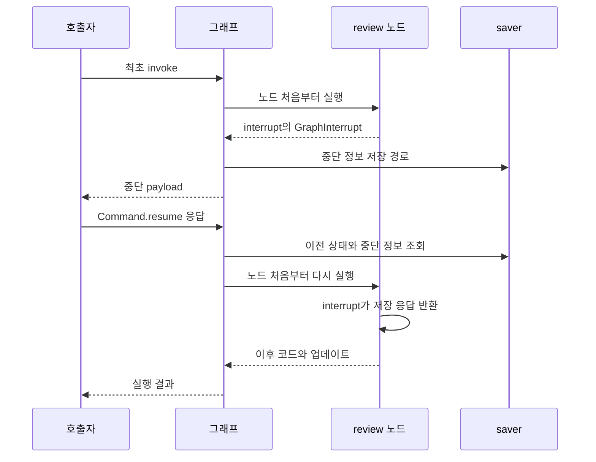
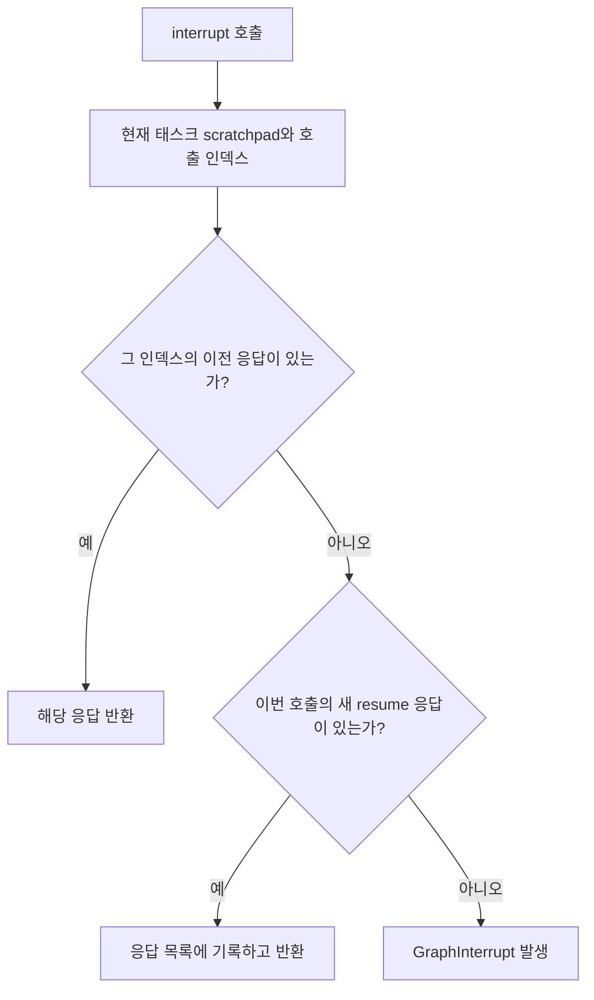

# 07. interrupt와 Command.resume: 어느 코드가 다시 실행되는가?

> 기준: LangGraph 1.2.11, 확인일 2026-10-05. 설치 소스와 InMemorySaver 실험에 근거한다.
>
> 이전: [06. update_state와 실행 위치](06_update_state_writers_and_execution_position.md). 내부 분류 09를 실제 중단·응답 API로 읽는다.

interrupt는 사용자 응답을 기다리며 Python 함수의 현재 위치를 메모리에 유지하는 API가 아니다. **중단 정보를 저장하고, 재개 시 노드를 다시 실행하면서 해당 interrupt 호출에 저장된 응답값을 반환한다.** 따라서 interrupt 앞의 코드가 반복된다.

## 1. 호출자와 노드에서 사용하는 API

```python
def review(state):
    approved = interrupt({"question": "approve?"})
    return {"approved": approved}

graph = builder.compile(checkpointer=saver)
config = {"configurable": {"thread_id": "approval-1"}}

paused = graph.invoke({}, config)
snapshot = graph.get_state(config)
result = graph.invoke(Command(resume=False), config)
```

예제는 기본 v1 출력 형태다. 최초 결과의 `__interrupt__` 또는 snapshot.interrupts에서 payload를 읽는다. 다음 호출에는 같은 thread의 상태를 사용한다. False도 유효한 응답값이며 승인과 거절을 bool 값대로 처리할 수 있다.



실제로 기다리는 프로세스나 네트워크 요청의 생존을 재개 조건으로 삼지 않는다. 이 실험은 같은 프로세스의 InMemorySaver를 사용했으며, 다른 프로세스 재개는 영속 saver와 호환 코드가 별도로 필요하다.

## 2. interrupt 함수 내부의 선택 순서

**소스:** [langgraph/types.py](../../../../AI/agent_hitl/.venv/Lib/site-packages/langgraph/types.py)의 interrupt 851행, 실행 본문 950행 이후.

interrupt는 현재 태스크 config에서 scratchpad를 얻고 호출 인덱스를 증가시킨다. 이미 기록된 task별 응답이 그 인덱스에 있으면 반환한다. 새로 전달한 공통 응답을 소비할 수 있으면 resume 목록에 추가하고 반환한다. 없으면 GraphInterrupt를 발생시킨다.



이 위치를 확인하면 재개 동작이 왜 다음 줄로 단순 점프하는 것이 아닌지 이해할 수 있다. 함수의 stack frame을 복원하는 대신 함수를 다시 호출하고, 이전 interrupt 응답을 재사용한다.

현재 구현에서 None은 새 응답 없음과 구분하기 어려워 일반적인 resume 응답으로 사용하지 않는다. 값이 없음을 답하려면 업무 의미가 명확한 dict 등으로 표현한다. False, 0, 빈 문자열을 None과 같은 것으로 취급하지 않는다.

## 3. runner는 중단을 어떻게 기록하는가?

**소스:** [pregel/_runner.py](../../../../AI/agent_hitl/.venv/Lib/site-packages/langgraph/pregel/_runner.py)의 commit 574행.

runner는 GraphInterrupt에 대해 INTERRUPT 쓰기를 기록하고, 해당 태스크에 RESUME 쓰기가 있으면 함께 보존하는 경로를 사용한다. 일반 오류의 ERROR 기록과 구분된다.

실행 상태 뷰에서는 해당 노드가 next에 남고 tasks/interrupts에 중단 정보가 나타날 수 있다. "노드가 실행을 시도했다"와 "정상 업데이트가 단계에 반영되었다"는 다른 사실이다.

GraphInterrupt는 GraphBubbleUp 계열이고, 그 계열은 Exception을 상속한다. 따라서 사용자 코드의 넓은 `except Exception`이 중단을 잡아버릴 수 있다. interrupt 주변에서 업무 오류와 중단 제어 흐름을 구분하고, 중단 예외를 일반 성공값으로 바꾸지 않는다.

## 4. Command.resume는 무엇을 준비하는가?

**소스:** [pregel/_loop.py](../../../../AI/agent_hitl/.venv/Lib/site-packages/langgraph/pregel/_loop.py)의 `_first` 848행, Command 처리 902행. [pregel/_algo.py](../../../../AI/agent_hitl/.venv/Lib/site-packages/langgraph/pregel/_algo.py)의 `_scratchpad` 1280행.

Command.resume 입력은 저장 상태를 대상으로 한다. 일반 dict 입력과 달리 RESUME 정보 또는 interrupt ID mapping을 준비한다. scratchpad는 저장된 task별 응답 목록, 공통 응답, mapping을 사용해 interrupt에서 읽을 값을 구성한다.

재개 시 노드가 다시 실행되고 interrupt 인덱스도 처음부터 진행한다. 같은 태스크의 앞선 interrupt 응답은 목록의 해당 위치에서 반환된다. 사용자가 입력한 응답을 state의 모든 필드에 자동으로 넣는 것은 아니다. 노드가 interrupt 반환값을 받아 필요에 맞게 업데이트해야 한다.

## 5. 앞의 코드와 interrupt 사이 코드는 몇 번 실행되나?

한 interrupt를 가진 승인 노드의 관찰 결과는 다음과 같다.

| 위치 | 최초 호출 | 재개 | 총 호출 |
| --- | --- | --- | --- |
| interrupt 앞 | 실행 | 다시 실행 | 2 |
| interrupt 뒤 | 실행하지 않음 | 실행 | 1 |

두 interrupt를 연속으로 둔 사례도 확인했다.

```python
def review(state):
    name = interrupt("name?")
    age = interrupt("age?")
    return {"name": name, "age": age}
```

최초 실행은 name에서 멈췄다. Jay로 응답하면 name은 저장 응답을 반환하고 age에서 멈췄다. 30으로 응답하면 처음부터 실행하면서 name은 Jay를 재사용하고 age는 30을 반환했다.

| 코드 위치 | 총 실행 횟수 |
| --- | --- |
| 첫 interrupt 앞 | 3 |
| 첫 interrupt와 두 번째 사이 | 2 |
| 두 번째 interrupt 뒤 | 최종 실행에서 1 |

interrupt를 여러 개 사용하면 호출 순서가 응답 매칭의 일부다. 중단된 thread가 존재하는 동안 호출 순서를 바꾸거나 조건부로 interrupt를 건너뛰는 코드 변경을 신중히 다룬다. payload 문자열을 같게 유지한다고 응답 위치 매칭이 보장되는 것은 아니다.

## 6. 여러 노드가 동시에 중단되면?

병렬 a/b 노드가 각각 interrupt를 호출한 실험에서 pending interrupt는 두 개였다. 단일 문자열 resume를 보내면 어느 중단의 응답인지 특정할 수 없어 RuntimeError가 발생했다.

```python
interruptions = graph.get_state(config).interrupts
resume_values = {
    item.id: response_for(item.value)
    for item in interruptions
}
graph.invoke(Command(resume=resume_values), config)
```

현재 구현은 interrupt ID를 키로 한 mapping을 구분해 해당 실행 맥락에 응답을 연결한다. ID를 노드명이나 화면의 순번으로 임의 대체하지 않는다. 저장 상태에서 받은 실제 interrupt ID를 사용한다.

실험에서는 mapping으로 두 중단에 응답하여 a=ok-a, b=ok-b 결과를 얻었다. 순차적으로 한 태스크 안에서 여러 interrupt를 사용하는 경우와 병렬 태스크의 여러 중단은 매칭 단위가 다르다.

## 7. invoke(None)은 항상 중단 응답인가?

아니다. None은 기존 실행을 이어가는 신호일 수 있지만 dynamic interrupt의 응답값을 제공하지 않는다. 응답 없는 상태에서 invoke(None)을 호출한 실험은 노드를 다시 실행하고 동일한 질문으로 다시 중단했다.

반면 `compile(interrupt_before=["review"])`로 둔 static breakpoint에서는 review가 실행되기 전에 멈췄고, invoke(None)으로 review가 실행되어 완료됐다.

| 방식 | 중단 위치 | 보통 이어가기 |
| --- | --- | --- |
| 노드 안의 interrupt | 노드 내부에서 응답이 필요한 지점 | Command.resume로 응답 |
| static interrupt_before | 지정 노드 실행 전 | invoke(None)으로 진행 |

static breakpoint는 노드 내부의 사용자 응답 반환 API와 같은 것이 아니다. 디버깅용 중단과 업무 승인 패턴의 의도를 구분한다.

## 8. update_state로 승인 필드를 바꾸면 같은가?

update_state는 writer를 사용해 상태와 실행 위치를 수정한다. Command.resume는 interrupt에 반환할 응답을 준비한다. 두 동작을 서로 대체하지 않는다.

예를 들어 approved 필드를 수동 변경했다고 기존 interrupt의 scratchpad에 응답값이 들어가는 것은 아니다. 코드가 여전히 interrupt를 호출하면 다시 응답을 요구할 수 있다. 반대로 사용자 응답을 받아 노드에서 approved를 반환하면 해당 업데이트가 상태로 반영된다.

상태를 편집하고 중단 작업을 건너뛰는 별도 실행 제어를 의도했다면 그 효과를 next/tasks/interrupts에서 확인해야 한다. 이를 승인값 전달의 기본 경로로 가르치지 않는다.

## 9. 외부 부수 효과는 어디에 두어야 하나?

```python
# 주의: 재개할 때 알림이 다시 발생할 수 있음
send_notification()
approved = interrupt({"question": "approve?"})
```

가능하면 interrupt 전에는 재실행해도 안전한 계산을 둔다. 분리 가능한 완료 작업은 앞선 노드에서 수행하고 체크포인트 경계를 둬 복구 범위를 명확히 하는 방법도 검토한다.

외부 작업을 interrupt 뒤로 옮겨도 모든 중복 위험이 사라지는 것은 아니다. 이후 오류나 과거 checkpoint 재실행으로 반복될 수 있다. 업무상 외부 변경은 재실행 가능한 범위와 중복 방지 키를 함께 정한다.

interrupt payload에는 저장·전달 가능한 데이터를 넣는다. DB 세션·HTTP 클라이언트·실행 중 coroutine 등의 살아 있는 객체를 사용자 응답 요청이나 checkpoint state에 넣지 않는다.

## 10. 지향할 패턴과 지양할 패턴

| 상황 | 지향 | 지양 |
| --- | --- | --- |
| 재개 | 노드 전체 재실행을 전제로 작성 | 다음 줄에서 자동 재시작 기대 |
| interrupt 전 코드 | 재실행 안전한 계산 또는 분리된 작업 | 알림·외부 변경을 중복 방지 없이 실행 |
| 여러 질문 | 안정적인 호출 순서와 대응 응답 | 중단 thread를 무시한 질문 순서 변경 |
| 병렬 승인 | 실제 interrupt ID mapping 사용 | 단일 응답이나 임의 노드명으로 매칭 |
| 중단 예외 | GraphInterrupt를 제어 흐름으로 보존 | 넓은 except에서 성공 응답으로 변환 |
| 상태 수정과 승인 | update_state와 resume의 목적 구분 | 승인 필드 편집을 resume로 간주 |
| 저장 | 영속 saver와 코드 호환성 검토 | 메모리 stack frame 복원 기대 |
| 외부 변경 | 모든 재실행 경로에 중복 방지 고려 | interrupt 뒤라서 exactly-once라고 가정 |

## 11. 실험 근거

[코드](code/probe_interrupt_resume.py), [결과](code/interrupt_resume_result.json). 다섯 그룹은 거절값 False 재개, 여러 interrupt의 순서와 코드 반복, None 입력의 재중단, 병렬 ID mapping, static breakpoint를 확인했다.

```powershell
.\AI\agent_hitl\.venv\Scripts\python.exe -X utf8 .codex/research/LangGraph/runtime/code/probe_interrupt_resume.py
```

다음 자료: [08. 재시도·타임아웃·저장 경계](08_retry_timeout_and_durability.md). 실패 시 노드 코드, writes, checkpoint가 각각 어떤 경계에서 반복·보존되는지 연결한다.

[후속 소스 식별 정보](runtime_followup_source_manifest.json)에 이 장의 코드 기준을 보존했다. 전체 진행 범위는 [학습 목록](2026-10-05_langgraph_runtime_source_guide.md)에서 확인한다.
