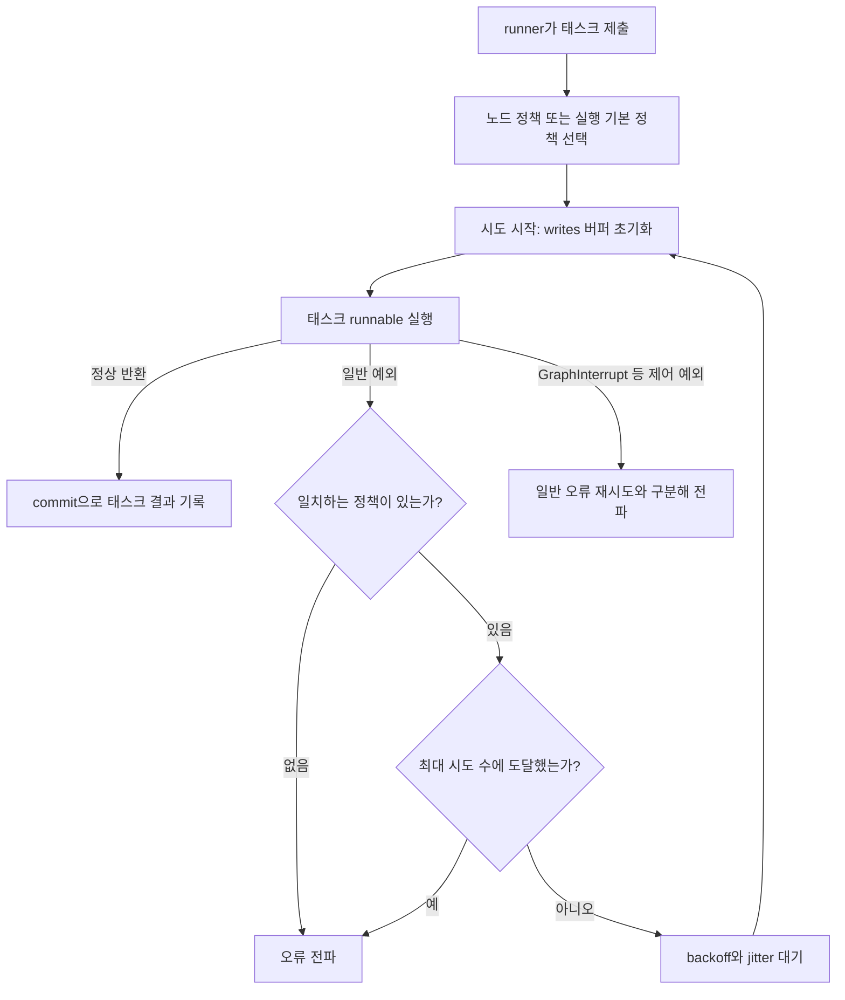
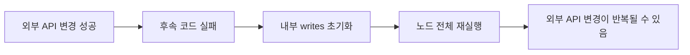
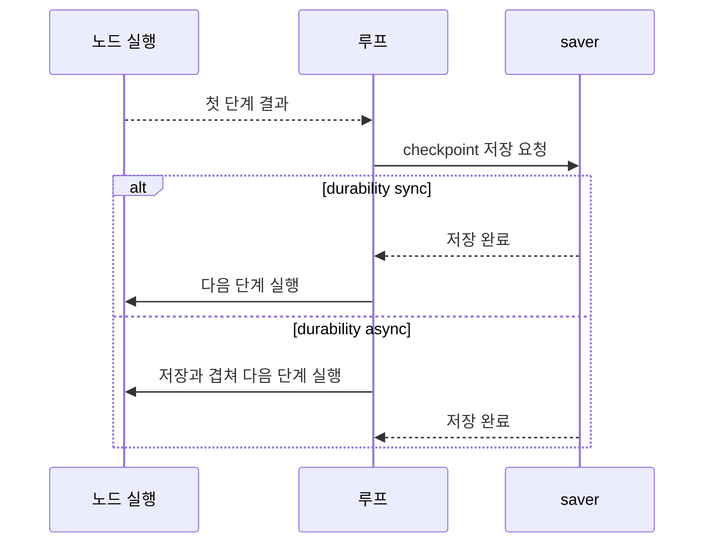

# 08. retry_policy, timeout, durability의 실행·저장 경계

> 기준: LangGraph 1.2.11, 확인일 2026-10-05. 설치 소스와 오프라인 실험에 근거한다.
>
> 이전: [07. interrupt와 resume](07_interrupt_resume_and_reexecution.md). 내부 분류 08·10을 add_node와 invoke 옵션에 연결한다.

노드 재시도, 태스크 결과 저장, 단계 체크포인트 저장은 서로 다른 경계다. **RetryPolicy는 노드 실행을 반복하고 durability는 저장 대기 시점을 바꾸며, 둘 다 이미 수행한 외부 변경을 롤백하지 않는다.**

## 1. 우리가 사용하는 API

```python
from typing_extensions import TypedDict
from langgraph.checkpoint.memory import InMemorySaver
from langgraph.graph import END, START, StateGraph
from langgraph.types import RetryPolicy

class State(TypedDict):
    value: int

def work(state: State):
    return {"value": state["value"] + 1}

builder = StateGraph(State)
builder.add_node(
    "work", work,
    retry_policy=RetryPolicy(
        max_attempts=3, retry_on=ConnectionError
    ),
)
builder.add_edge(START, "work")
builder.add_edge("work", END)
saver = InMemorySaver()
graph = builder.compile(checkpointer=saver)
config = {"configurable": {"thread_id": "retry-example"}}
graph.invoke({"value": 0}, config, durability="sync")
```

위 work는 정상 반환하는 최소 예제다. ConnectionError를 발생시키는 실제 작업에 정책을 적용하면 2절의 재시도 경로를 탄다. timeout 예제는 별도 builder에서 compile **이전**에 등록한다.

```python
import asyncio

async def async_work(state: State):
    await asyncio.sleep(0.01)
    return {"value": state["value"] + 1}

async_builder = StateGraph(State)
async_builder.add_node("async_work", async_work, timeout=5.0)
async_builder.add_edge(START, "async_work")
async_builder.add_edge("async_work", END)
async_graph = async_builder.compile()
# async 함수 또는 notebook의 async 실행 맥락에서 호출
result = await async_graph.ainvoke({"value": 0})
```

retry_policy와 timeout은 add_node에서 명세로 저장되고 compile에서 PregelNode 정책에 연결된다. 등록 시 노드를 실행하거나 실패를 검사하지 않는다. durability는 호출의 저장 진행 방식을 선택한다.

## 2. 재시도의 실제 호출 경로

**소스:** [pregel/_retry.py](../../../../AI/agent_hitl/.venv/Lib/site-packages/langgraph/pregel/_retry.py)의 run_with_retry 573행, arun_with_retry 685행. [pregel/_runner.py](../../../../AI/agent_hitl/.venv/Lib/site-packages/langgraph/pregel/_runner.py)의 태스크 제출과 commit 574행.



태스크 runnable에는 사용자 함수뿐 아니라 연결된 writer와 분기 실행 경로도 포함될 수 있다. 함수의 마지막 줄만 다시 실행하는 방식이 아니다. 노드 함수가 반환한 뒤 writer나 라우터에서 예외가 발생해도 해당 태스크 실행 경로를 고려해야 한다.

## 3. RetryPolicy의 각 값은 무엇을 뜻하나?

**소스:** [RetryPolicy](../../../../AI/agent_hitl/.venv/Lib/site-packages/langgraph/types.py) 418행, `_retry.py`의 `_should_retry_on` 841행.

| 필드 | 의미 |
| --- | --- |
| max_attempts | 최초 실행을 포함한 최대 시도 수 |
| retry_on | 예외 클래스, 클래스 목록 또는 판단 함수 |
| initial_interval | 첫 재시도까지의 기본 대기 |
| backoff_factor | 실패 횟수에 따른 간격 증가 |
| max_interval | 기본 backoff 간격 상한 |
| jitter | 추가 무작위 지연 사용 여부 |

여러 정책을 주면 이 구현은 발생한 예외에 처음 일치하는 정책을 선택한다. 정책 순서가 의미를 가질 수 있다. 현재 jitter는 기본 간격에 무작위 값을 더하는 경로이므로 max_interval을 실제 최종 대기 시간의 엄격한 상한으로 단정하지 않는다.

예제 실험에서는 jitter 없이 대기를 0으로 두고 첫 두 ValueError 뒤 세 번째 실행을 성공시켰다. 외부 변경을 모사한 리스트 기록은 세 번, 정상 채널 결과는 success 하나였다. 같은 정책에서 TypeError는 일치하지 않아 한 번 실행 후 전파됐다.

## 4. 기본 retry_on은 모든 Exception인가?

**소스:** [langgraph/_internal/_retry.py](../../../../AI/agent_hitl/.venv/Lib/site-packages/langgraph/_internal/_retry.py)의 default_retry_on.

현재 기본 판단에는 연결 오류와 일부 HTTP 서버 오류를 재시도하고, ValueError·TypeError·RuntimeError 등 여러 일반 프로그램 오류를 제외하는 분기가 있다. 따라서 default policy를 등록했다는 이유만으로 모든 오류가 반복되지 않는다.

실험에서 ValueError를 재시도한 것은 retry_on=ValueError를 **명시했기 때문**이다. 프로그램 오류를 전부 재시도하라는 권장이 아니다. 일시적 장애와 잘못된 입력·코드 오류를 구분하고 필요한 경우 좁은 정책을 설정한다.

노드나 도구 계층이 예외를 정상 ToolMessage나 dict로 바꾸면 그래프의 예외 재시도 조건이 아닐 수 있다. 어떤 계층에서 오류가 예외로 남는지 확인한다. 모델 SDK 재시도나 도구 재시도가 겹칠 때는 총 호출 횟수도 함께 계산한다.

## 5. writes.clear는 무엇을 되돌리는가?

arun_with_retry와 동기 구현은 각 시도 전에 task.writes를 비운다. 이것은 태스크의 내부 쓰기 버퍼를 초기화하는 동작이다.



외부 DB 변경, 이메일 발송, 파일 교체 등의 완료 결과를 버퍼 초기화가 취소하지 않는다. 네트워크 timeout도 상대 서버가 요청을 처리하지 않았다는 증거가 아니다. 중복이 문제인 작업은 안정적인 요청 식별자와 결과 확인 등 업무 계약을 정한다.

노드의 재시도 범위를 작게 유지할 수 있도록 서로 다른 외부 변경과 후속 판단을 적절히 분리하는 방법도 검토한다. 다만 노드 분리와 checkpointer만으로 외부 exactly-once가 완성되는 것은 아니다.

## 6. timeout은 언제 적용되나?

**소스:** types.py의 TimeoutPolicy 452행, [langgraph/_internal/_timeout.py](../../../../AI/agent_hitl/.venv/Lib/site-packages/langgraph/_internal/_timeout.py), `_retry.py`의 `_arun_with_timeout` 422행.

| 정책 | 의미 |
| --- | --- |
| run_timeout | 한 노드 시도의 전체 실행 시간 한도 |
| idle_timeout | 진행 신호 없이 유지될 수 있는 시간 |
| refresh_on=auto | 구현이 관찰하는 진행 신호와 heartbeat로 idle 갱신 |
| refresh_on=heartbeat | 명시적 Runtime.heartbeat만 idle 갱신 |

노드의 한 시도마다 timeout 경로가 구성된다. run_timeout은 heartbeat로 늘어나지 않는다. 여러 재시도가 있으면 노드 전체 호출의 총 시간은 한 시도의 timeout보다 길 수 있다.

이 설치본은 sync Python 노드의 안전한 강제 취소를 지원하지 않으므로 sync 함수에 timeout을 설정하면 compile에서 ValueError가 발생했다. async 함수에 설정한 뒤 ainvoke로 실행하는 경로를 기준으로 사용한다.

async 함수라고 내부의 time.sleep이나 blocking I/O가 자동으로 비동기화되는 것은 아니다. asyncio 기반 timeout은 협력적 취소에 의존하므로 이벤트 루프를 막으면 timeout 감지와 취소도 늦어질 수 있다.

## 7. timeout이 발생한 시도의 결과

timeout 구현은 node coroutine과 watchdog을 함께 실행한다. watchdog이 먼저 timeout을 발생시키면 scope를 닫고 task.writes를 비우며 coroutine 취소를 요청하고 NodeTimeoutError를 발생시킨다.

실험에서는 외부 변경을 모사한 기록 후 await로 기다리는 노드가 run timeout으로 실패했고 취소를 관찰했다. 외부 변경 기록은 남았다. 취소는 롤백이 아니다.

NodeTimeoutError는 built-in TimeoutError의 하위 클래스가 아니다. 현재 기본 RetryPolicy의 판단에서는 재시도 가능하게 취급되는 예외다. 실제 재시도에는 정책 등록과 최대 시도 조건이 필요하다. 일반 I/O에서 발생한 TimeoutError와 런타임 watchdog의 NodeTimeoutError를 구분한다.

노드가 직접 asyncio.CancelledError를 발생시킨 경우와 framework가 태스크를 취소한 경우도 코드에서 구분하는 경로가 있다. 취소를 성공 반환이나 영구적인 외부 작업 중단과 동일하게 해석하지 않는다.

## 8. 정상 완료와 저장 완료의 네 시점

앞 장의 pending writes와 연결하면 다음을 구분해야 한다.

1. 외부 작업이 끝남.
2. 태스크가 반환하고 commit에서 writes 기록 경로를 시작함.
3. 단계 결과가 channel.update를 통해 반영됨.
4. 필요한 writes와 checkpoint가 saver에 저장됨.

**소스:** `_runner.py`의 commit, [pregel/_loop.py](../../../../AI/agent_hitl/.venv/Lib/site-packages/langgraph/pregel/_loop.py)의 put_writes 415행, after_tick 683행, `_put_checkpoint` 1081행. [pregel/main.py](../../../../AI/agent_hitl/.venv/Lib/site-packages/langgraph/pregel/main.py)의 sync 저장 대기 2987행과 async 경로 3462행.


쓰기 기록과 checkpoint 저장에는 background I/O가 포함될 수 있다. 이 도식의 각 화살표를 하나의 외부 트랜잭션으로 보지 않는다.

## 9. sync, async, exit의 차이를 API로 확인한다

| durability | 다음 단계와 저장의 관계 | 검토할 개발 문제 |
| --- | --- | --- |
| sync | 단계 checkpoint 저장을 기다린 뒤 다음 단계 | 저장 지연이 실행 지연에 포함 |
| async | 저장을 예약하고 실행과 겹침 | 프로세스 강제 종료 시 아직 저장하지 못한 구간 가능 |
| exit | 일반 중간 저장을 생략하고 종료 경로에서 저장 | 실행 중 강제 종료의 중간 복구 범위 제한 |

실험은 saver의 첫 노드 결과 저장을 Event로 막았다. sync에서는 두 번째 노드가 기다렸고, async에서는 저장을 풀기 전 두 번째 노드가 실행됐다. 정상 완료한 뒤에는 둘 다 최종 value=2를 조회했다.



exit 실험은 value=1 중간 checkpoint를 저장하지 않고 최종 value=2만 저장했다. 이는 정상 실행 사례의 관찰이다. exit 경로는 interrupt·오류 등의 종료 처리도 고려하며 DeltaChannel writes를 위한 별도 처리가 있으므로 "모든 실행에서 saver.put은 딱 한 번" 같은 계약으로 단순화하지 않는다.

## 10. 성공 태스크 복구와 과거 시점 재실행

[05의 pending writes 실험](05_checkpointer_stm_and_state_views.md)에서는 병렬 A 성공/B 실패 후 A writes를 재사용해 B만 재실행했다. 이것은 같은 실패 단계에서 저장된 성공 쓰기를 재사용하는 동작이다.

과거 checkpoint를 선택해 replay하거나 다른 분기로 진행하면 업무 코드가 다시 실행될 수 있다. 성공 태스크 재사용을 모든 과거 실행의 전역 캐시로 이해하지 않는다. interrupt 앞 코드, retry 범위, replay 범위를 각각 검토한다.

checkpointer와 cache도 구분한다. checkpoint는 해당 실행의 상태·진행 정보를 보존하고, node cache는 입력 기반 결과 재사용을 한다. 캐시 키와 context의 관계는 10장에서 다룬다.

## 11. 지향할 패턴과 지양할 패턴

| 상황 | 지향 | 지양 |
| --- | --- | --- |
| 재시도 정책 | 일시 오류를 좁게 지정 | 모든 예외 무조건 재시도 |
| 재실행 범위 | 노드·writer·라우터 범위 확인 | 실패한 한 줄만 반복한다고 가정 |
| 외부 변경 | 중복 방지와 결과 확인 계약 | writes 초기화를 외부 롤백으로 해석 |
| timeout | async 실행·협력적 취소 고려 | sync 함수를 강제 종료할 수 있다고 기대 |
| 진행 신호 | 의미 있는 heartbeat와 제한 | heartbeat로 run_timeout 연장 기대 |
| 저장 모드 | 복구 필요와 지연을 함께 선택 | async 또는 exit를 무조건 빠른 기본값으로 사용 |
| 완료 판정 | 태스크·단계·저장 완료 구분 | 토큰이나 노드 반환을 저장 성공으로 해석 |
| replay | 외부 변경의 반복 가능성 검토 | 모든 성공 태스크가 영원히 재사용된다고 가정 |

## 12. 실험 근거

[코드](code/probe_reliability.py), [결과](code/reliability_result.json). 다섯 그룹은 재시도와 외부 변경 반복, 정책 미일치 예외, async timeout과 sync timeout 거부, 세 durability 모드의 저장 순서를 확인했다. heartbeat 갱신은 정적 분석이며 실제 모델·외부 DB·강제 종료 시험은 포함하지 않는다.

```powershell
.\AI\agent_hitl\.venv\Scripts\python.exe -X utf8 .codex/research/LangGraph/runtime/code/probe_reliability.py
```

다음 자료: [09. 스트리밍·종료·취소](09_stream_modes_lifecycle_and_cancellation.md). 실행 중 출력이 어느 단계에서 나오며 스트림을 닫을 때 실행 태스크에 어떤 일이 생기는지 이어서 추적한다.

[후속 소스 식별 정보](runtime_followup_source_manifest.json)에 이 장의 코드 기준을 보존했다. 전체 흐름은 [학습 목록](2026-10-05_langgraph_runtime_source_guide.md)에서 확인한다.
