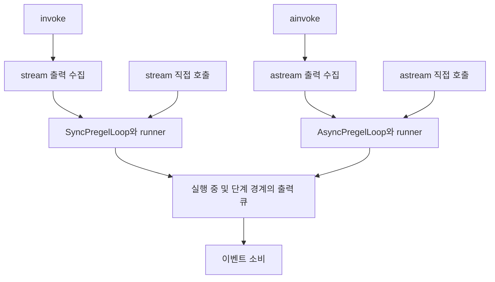
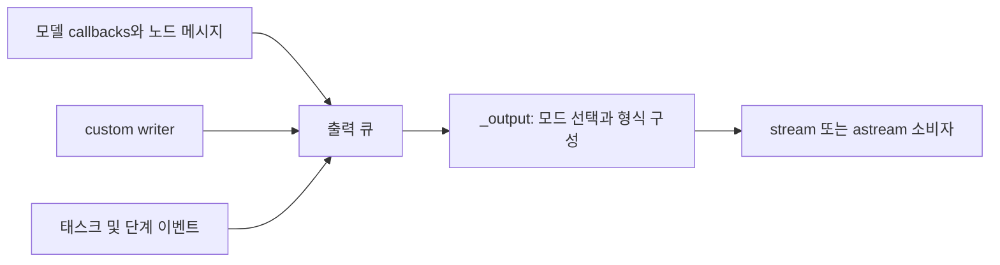
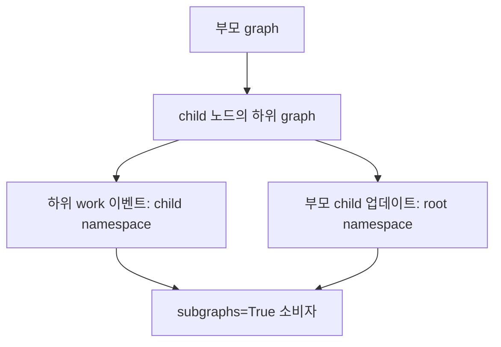
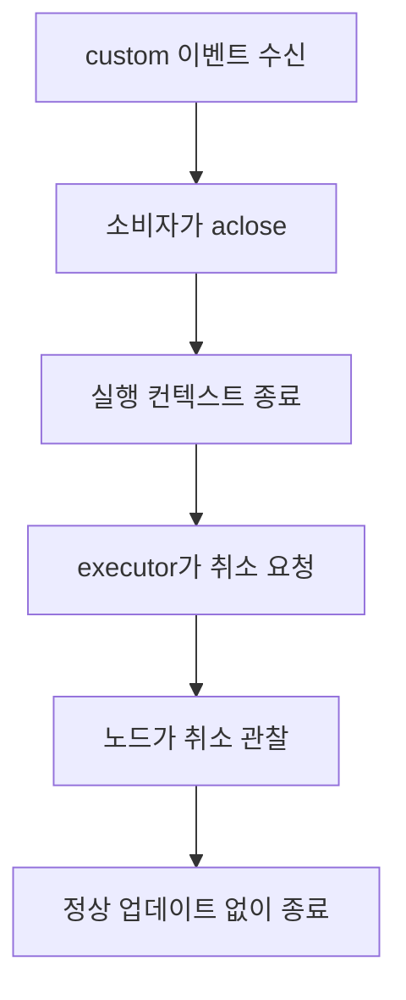

# 09. stream과 astream: 출력 시점, 형식, 취소

> 기준: LangGraph 1.2.11, 확인일 2026-10-05. 설치 소스와 오프라인 실험에 근거한다.
>
> 이전: [08. 재시도와 저장 경계](08_retry_timeout_and_durability.md). 내부 분류 11을 stream, astream, ainvoke API로 읽는다.

stream은 별도 에이전트 실행기가 아니다. **실행 중 출력을 큐에서 소비하는 경로이며 invoke는 그 실행의 출력을 수집한다.** 이벤트 수신, 단계 상태 반영, 저장 완료는 서로 다른 시점이다.

## 1. 실제 호출에서 시작한다

```python
for mode, payload in graph.stream(
    input_state, config, stream_mode=["updates", "values"]
):
    handle(mode, payload)

async for mode, payload in graph.astream(
    input_state, config, stream_mode=["messages", "updates"]
):
    handle(mode, payload)
```

예제는 기본 v1 형식이다. 여러 모드는 list로 지정한다. 단일 모드·여러 모드·subgraphs·version에 따라 형식이 달라지므로 소비 코드의 입력 계약을 먼저 정한다.

## 2. invoke와 stream의 호출 관계

**소스:** [pregel/main.py](../../../../AI/agent_hitl/.venv/Lib/site-packages/langgraph/pregel/main.py)의 stream 실제 구현 2655행, astream 3063행, invoke 3836행, ainvoke 4013행.



기본 values 반환은 마지막 상태 값을 사용한다. 다른 stream_mode를 invoke에 지정하면 출력 목록을 수집하는 경로도 있다. 모든 옵션에서 invoke 반환이 같은 최종 상태 dict라고 가정하지 않는다. v2 반환과 interrupt 처리는 별도 wrapper 경로도 있다.

실험에서 updates/values 스트림의 마지막 value와 기본 invoke의 value는 같았다. 선택한 모드에 따라 callbacks와 출력 경로를 구성하는 차이는 남는다.

## 3. 출력은 어디에서 만들어지나?

main.py는 요청한 모드에 맞게 message callback handler와 Runtime.stream_writer 등을 구성한다. [pregel/_loop.py](../../../../AI/agent_hitl/.venv/Lib/site-packages/langgraph/pregel/_loop.py)는 태스크 준비·결과·단계 경계에서 출력한다. main.py의 `_output` 4184행은 큐의 namespace/mode/payload를 요청한 형식으로 yield한다.



노드가 실행 중에도 custom이나 messages 이벤트가 나올 수 있다. 상태 반영 전에 일부 출력을 보는 것이 가능하다.

## 4. 주요 모드의 의미

| 모드 | 내용 | 주의할 해석 |
| --- | --- | --- |
| updates | 노드 반환 업데이트 | 누적 상태 전체가 아님 |
| values | 상태 채널 값 | 외부 업무 성공이나 저장 완료와 같지 않음 |
| messages | 메시지·청크와 metadata | 항상 토큰 한 개는 아님 |
| custom | 사용자가 writer로 보낸 payload | 상태에 자동 저장되지 않음 |
| tasks | 태스크 시작·결과·오류·중단 | 태스크 완료와 전체 완료 구분 |
| checkpoints | 체크포인트 상태 이벤트 | 영속 I/O 완료의 독립 보증으로 보지 않기 |

이 표는 주요 학습 모드다. 설치본에는 debug remapping과 tools 출력 경로도 있다. 모드가 역사적으로 소개된 여섯 개에 고정됐다고 가정하지 않는다.

실험에서 work의 updates는 `{"work": {"value": 1}}`이었고 values는 초기 value=0과 단계 반영 후 value=1을 보여 줬다. values에는 다른 상태 필드 messages도 포함됐다.

## 5. messages는 토큰 스트림만인가?

**소스:** [pregel/_messages.py](../../../../AI/agent_hitl/.venv/Lib/site-packages/langgraph/pregel/_messages.py)의 StreamMessagesHandler.

핸들러는 모델 callbacks와 노드 출력 메시지를 수집한다. 모델을 호출하지 않고 노드에서 AIMessage를 반환한 실험에도 완성 AIMessage와 metadata가 나왔다. langgraph_node는 work였다.

토큰 생성, 도구 인자 청크, 완성 메시지, 도구 실행 결과를 같은 의미로 취급하지 않는다. messages 상태 채널은 reducer·checkpoint 계약이고 messages 출력 모드는 callbacks·이벤트 경로다. 화면 출력이 모두 같은 방식으로 최종 상태에 저장됐다고 단정하지 않는다.

## 6. custom은 상태 업데이트인가?

**소스:** [langgraph/config.py](../../../../AI/agent_hitl/.venv/Lib/site-packages/langgraph/config.py)의 get_stream_writer 126행, main.py의 writer 설정.

```python
def work(state):
    get_stream_writer()({"progress": "working"})
    return {"value": 1}
```

custom payload는 출력 큐로 간다. progress가 상태 필드나 영속 이벤트 로그에 자동 저장되지 않는다. 상태에서도 필요하면 반환 업데이트에 명시한다.

writer는 현재 config와 Runtime 실행 맥락을 사용한다. 그래프 밖이나 임의의 별도 thread에서도 항상 사용할 수 있다고 가정하지 않는다. 비동기 context propagation의 Python 버전 조건도 확인한다.

실험 순서는 초기 values → custom → 완성 messages → 새 values였다. 이는 단일 노드 예제의 관찰이며 병렬 이벤트 전체 순서의 계약은 아니다.

## 7. version과 subgraphs에 따른 형식

**소스:** main.py의 `_output` 4184행 이후.

| v1 옵션 | yield 형식 |
| --- | --- |
| 단일 모드 | payload |
| 여러 모드 list | mode, payload tuple |
| 단일 모드와 subgraphs=True | namespace, payload tuple |
| 여러 모드 list와 subgraphs=True | namespace, mode, payload tuple |

v2 실험에서는 type/ns/data를 가진 dict가 나왔고 values에는 interrupts가 추가됐다. 소비 코드는 선택한 version의 계약에 맞춘다. 모든 chunk를 같은 텍스트로 이어 붙이거나 v1 tuple을 v2에도 적용하지 않는다.

하위 그래프 실험은 child 태스크 namespace가 있는 work 이벤트와 빈 root namespace의 child 완료 이벤트를 함께 보여 줬다.



필요한 namespace와 노드를 골라 부모 응답·하위 진행 상황을 구분한다. 하위 출력을 모두 부모 최종 답변으로 사용하면 중복될 수 있다. 여기서는 LangGraph 하위 실행 경계를 다루며 DeepAgents 서브에이전트 조립으로 확장하지 않는다.

## 8. 스트림을 닫으면 실행은 계속되나?

**소스:** [pregel/_executor.py](../../../../AI/agent_hitl/.venv/Lib/site-packages/langgraph/pregel/_executor.py)의 AsyncBackgroundExecutor.__aexit__ 186행, [pregel/_runner.py](../../../../AI/agent_hitl/.venv/Lib/site-packages/langgraph/pregel/_runner.py)의 `__cancel_on_exit__=True` 제출.

async executor는 종료 시 해당 태스크에 취소를 요청하고 기다린다. 단순한 이벤트 구독만 분리한 모델이라고 가정하지 않는다.

실험에서 async work는 started 이벤트 후 await로 대기했다. 첫 이벤트를 받은 소비자가 astream.aclose를 호출하자 work는 CancelledError를 관찰하고 정상 반환하지 않았다. 저장 value는 0, next에는 work가 남았다.



이는 직접 aclose한 await 기반 노드 사례다. SSE disconnect가 이 종료 경로로 전파되는지는 서버 코드까지 확인해야 한다. 루프에서 break하는 것과 generator를 실제로 닫는 것도 구분한다.

sync thread의 실행 중 코드는 같은 방식으로 안전하게 강제 종료되지 않는다. 동기 executor는 시작 전 작업을 취소하고 실행 중 작업을 기다리는 경로다. async 취소도 외부 API 처리의 롤백은 아니다.

## 9. 출력 수신과 최종 완료 판정

partial messages, custom, updates를 받았다는 사실만으로 전체 성공을 확정하지 않는다. 이후 오류·interrupt·저장 오류가 가능하다. iterator가 끝나도 interrupt로 중단된 것인지 확인해야 한다.

checkpoints 이벤트는 실행 상태 관찰에 유용하지만 영속 I/O 완료를 독립적으로 보증하지 않는다. durability와 saver 경로를 함께 확인한다.

출력 소비와 실행 수명을 분리하려면 누가 실행을 소유하고 취소를 전파하는지 정한다. checkpointer가 별도 워커나 task queue를 자동으로 만들어 주지는 않는다. 이 자료에서는 서비스 설계를 새로 확장하지 않고 실행 경계를 이해한다.

## 10. 관찰과 tracing의 관계

tasks/checkpoints/messages metadata는 실행을 관찰하는 지점이다. main.py는 callback manager와 run manager를 구성하고 message handler를 연결한다. trace의 입력·출력과 실행 metadata는 디버깅 근거이며, checkpointer는 실행 상태 보존 근거다.

trace 로그를 실패 단계 복원 데이터로 취급하지 않는다. LangSmith 계정 설정이나 서비스 사용법 대신 태스크·노드·단계와 관찰 정보의 연결에 집중한다.

## 11. 지향할 패턴과 지양할 패턴

| 상황 | 지향 | 지양 |
| --- | --- | --- |
| 소비 | version·mode·namespace 구분 | 모든 chunk를 같은 텍스트나 상태로 처리 |
| 진행 상황 | custom과 상태의 역할 구분 | custom 자동 영속화 기대 |
| 메시지 | 종류와 노드 metadata 확인 | 항상 한 토큰이라고 가정 |
| 하위 실행 | 필요한 namespace 선택 | 모두 부모 최종 응답으로 사용 |
| 종료 | generator와 태스크 수명 확인 | 소비 중단과 실행 지속이 자동 분리된다고 가정 |
| 완료 | 오류·interrupt·저장 경계 확인 | 첫 메시지를 성공 완료로 표시 |
| async | await 가능한 I/O 사용 | async 안에서 blocking I/O 수행 |
| 디버깅 | trace와 checkpoint 구분 | trace만으로 상태 복구 기대 |

## 12. 실험 근거

[코드](code/probe_streaming.py), [결과](code/streaming_result.json). 여섯 그룹은 updates/values, 모델 없는 메시지와 custom, v2 형식, tasks/checkpoints, async 종료·취소, 하위 namespace를 확인했다. 실제 모델 토큰·SSE disconnect·외부 DB는 실험하지 않았다.

```powershell
.\AI\agent_hitl\.venv\Scripts\python.exe -X utf8 .codex/research/LangGraph/runtime/code/probe_streaming.py
```

다음 자료: [10. 실행 의존성·캐시·동시성·한도](10_context_cache_concurrency_and_limits.md). 호출 의존성·상태, 입력 기반 캐시, 동시성과 종료 한도를 구분한다.

[후속 소스 식별 정보](runtime_followup_source_manifest.json)에 이 장의 코드 기준을 보존했다. 전체 흐름은 [학습 목록](2026-10-05_langgraph_runtime_source_guide.md)에서 확인한다.
