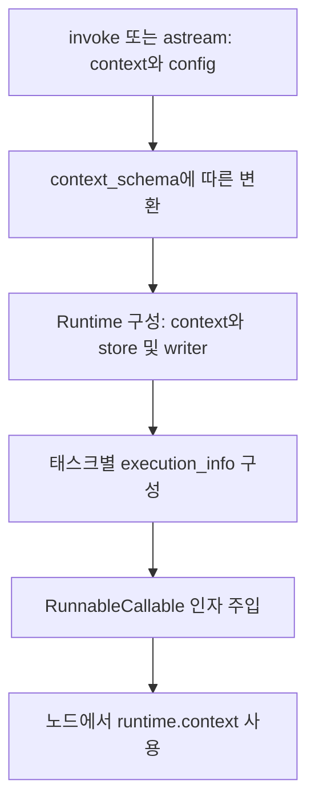
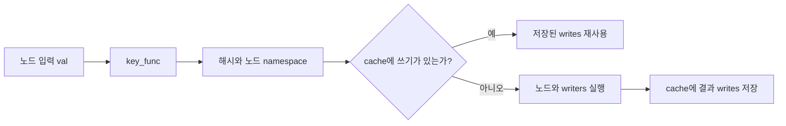
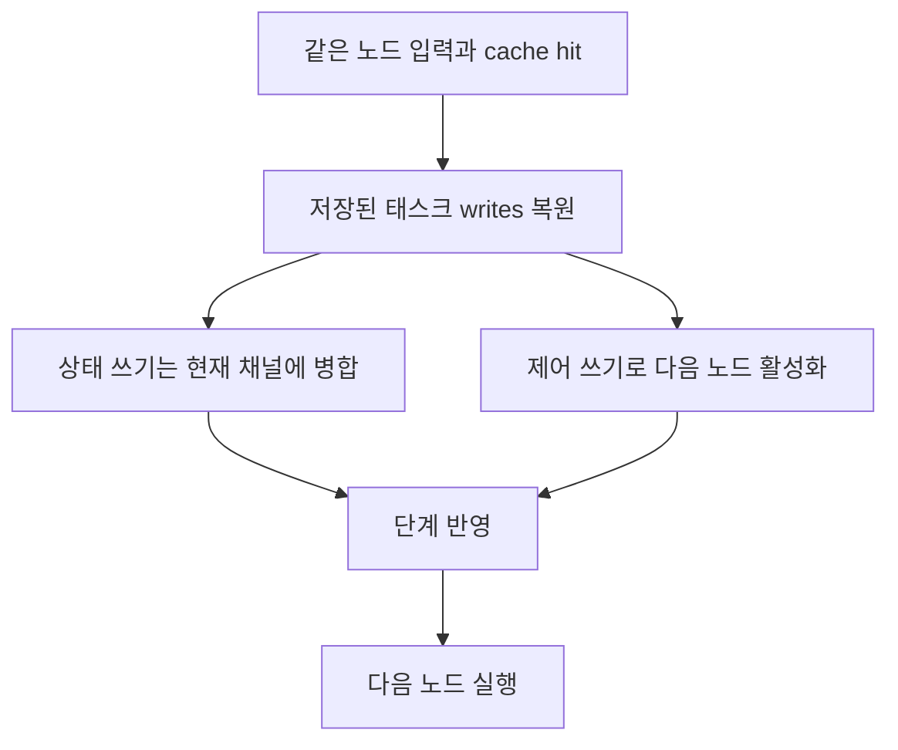
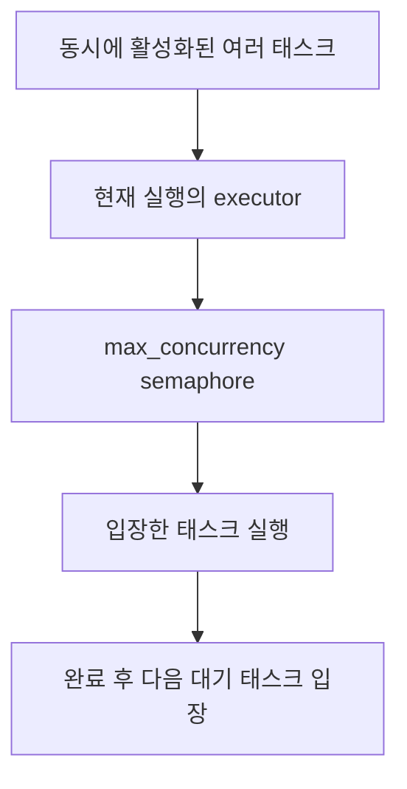
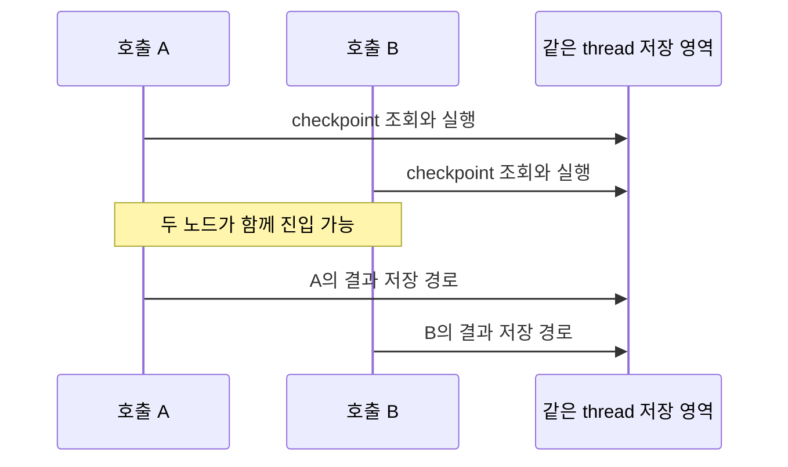
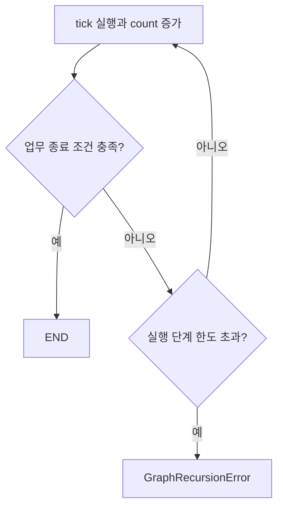

# 10. context, Runtime, cache, max_concurrency, recursion_limit

> 기준: LangGraph 1.2.11, 확인일 2026-10-05. 실제 설치 소스와 오프라인 실험에 근거한다.
>
> 이전: [09. 스트리밍과 취소](09_stream_modes_lifecycle_and_cancellation.md). 내부 분류 12의 실행 의존성·동시 실행·캐시·한도를 API에서 추적한다.

state는 채널로 전달하고 저장할 데이터, context는 호출의 실행 의존성, config는 호출·실행 설정이다. **Runtime은 context·store·stream_writer 등의 접근 경로를 묶는다.** 이 구분을 유지해야 캐시 결과, 동시성, 재개 동작을 정확히 설계할 수 있다.

## 1. 실제 그래프 작성과 호출

```python
from dataclasses import dataclass
from typing_extensions import TypedDict
from langgraph.checkpoint.memory import InMemorySaver
from langgraph.graph import END, START, StateGraph
from langgraph.runtime import Runtime

class State(TypedDict):
    question: str
    response: str

@dataclass
class Context:
    tenant: str
    client: object

def work(state: State, runtime: Runtime[Context]):
    return {"response": runtime.context.tenant + ":" + state["question"]}

builder = StateGraph(State, context_schema=Context)
builder.add_node("work", work)
builder.add_edge(START, "work")
builder.add_edge("work", END)
saver = InMemorySaver()
client = object()  # 실제 client 대신 의존성 전달만 관찰하는 표식
graph = builder.compile(checkpointer=saver)

graph.invoke(
    {"question": "q"},
    {"configurable": {"thread_id": "conversation-1"}, "recursion_limit": 20},
    context=Context("tenant-a", client),
)
```

context_schema 선언이 state에 tenant/client 채널을 추가하는 것은 아니다. 이번 예제에서는 node가 response만 반환하므로 checkpoint에는 question/response가 있고 client는 없다.

## 2. state, context, config, store의 역할

| 구분 | 주로 담는 내용 | 저장·조회 경계 |
| --- | --- | --- |
| state | 메시지, 결과, 작업 진행 데이터 | 채널/reducer/checkpointer |
| context | 호출에 필요한 tenant, client 등 의존성 | 호출에서 제공하고 Runtime으로 전달 |
| config | thread_id, callbacks, metadata, 실행 한도 등 | 실행 설정. checkpoint config·metadata 일부에 관여 |
| store | 별도 namespace/key 기반 데이터 | store API의 저장·조회 계약 |

모든 config 값이 영속 기억이 되거나 context 객체 전체가 checkpoint에 저장되는 것은 아니다. 반대로 코드가 context 데이터를 state 업데이트나 store에 쓰면 그 데이터는 해당 저장 경로로 이동한다.

store는 checkpointer와 다른 API다. `compile(store=...)`로 연결해 Runtime.store로 접근할 수 있다. thread의 채널 상태를 복원하는 checkpointer와 별도 key의 장기 데이터를 조회하는 store를 구분한다. 외부 store 구현과 DeepAgents backend 조립 상세로 학습 범위를 확장하지 않는다.

## 3. Runtime은 언제 구성되고 주입되나?

**소스:** [pregel/main.py](../../../../AI/agent_hitl/.venv/Lib/site-packages/langgraph/pregel/main.py)의 Runtime 구성 2872행 및 3315행, `_coerce_context` 4337행. [langgraph/runtime.py](../../../../AI/agent_hitl/.venv/Lib/site-packages/langgraph/runtime.py)의 Runtime 125행. [langgraph/_internal/_runnable.py](../../../../AI/agent_hitl/.venv/Lib/site-packages/langgraph/_internal/_runnable.py)의 signature 검사와 인자 주입.



등록 wrapper는 함수 signature를 조사해 runtime/config/writer/store 등 지원 인자를 기록한다. 실제 호출에서는 태스크 config의 Runtime을 사용해 인자를 전달한다. 임의 이름의 모든 매개변수를 자동 dependency injection하는 구조가 아니다.

dataclass 또는 Pydantic context_schema에 dict를 주면 객체로 변환하는 경로가 있다. TypedDict 등은 다른 경로다. 모든 context 값에 동일한 엄격한 검증이 수행된다고 가정하지 않는다. 실험에서는 dict tenant=B가 Context로 변환되어 B:q 응답을 만들었다.

Runtime.execution_info에는 checkpoint/task/thread 식별자와 node_attempt 등의 실행 정보가 구성된다. Runtime에는 config 전체가 멤버로 들어 있지 않다. 필요하면 `config: RunnableConfig`를 별도 매개변수로 받는다.

## 4. 재개 시 context가 자동으로 영속 복원되는가?

일반 checkpoint 채널 복원은 state를 대상으로 한다. 외부 client나 DB session을 context에 넣었다고 그 살아 있는 객체를 다음 프로세스에서 복원해 주는 것은 아니다. 다음 호출과 재개에 필요한 의존성을 호출 경로에서 다시 제공한다.

같은 thread가 있다고 이전 tenant/client가 자동으로 안전하게 재사용된다고 기대하지 않는다. 상태에 저장할 업무 식별자와 현재 호출에서 확인해 공급할 의존성을 구분한다. client의 생성·종료도 Runtime이 모든 사용자 자원에 대해 자동 관리하는 계약으로 취급하지 않는다.

실험은 `object()`를 context.client의 표식으로 넣고 실행했지만 state에는 저장하지 않았다. 이는 context 전달과 checkpoint state가 분리된 사례다. `object()` 자체가 모든 serializer에서 직렬화 불가능하다는 증거는 아니다. 실제 DB session/client의 저장 가능성과 다음 프로세스에서의 유효성도 이 실험으로 검증한 것은 아니다.

## 5. 캐시는 어떤 입력으로 키를 만드는가?

```python
from langgraph.cache.memory import InMemoryCache
from langgraph.types import CachePolicy

# 1절에서 work를 등록하는 줄에 cache_policy를 넣어 새 그래프를 구성한다
builder.add_node("work", work, cache_policy=CachePolicy())
graph = builder.compile(cache=InMemoryCache())
```

**소스:** [pregel/_algo.py](../../../../AI/agent_hitl/.venv/Lib/site-packages/langgraph/pregel/_algo.py)의 PULL 캐시 키 구성 668행, PUSH 1019행. [langgraph/_internal/_cache.py](../../../../AI/agent_hitl/.venv/Lib/site-packages/langgraph/_internal/_cache.py)의 default_cache_key. [types.py](../../../../AI/agent_hitl/.venv/Lib/site-packages/langgraph/types.py)의 CachePolicy 521행.

PULL 키는 노드에 구성한 입력 val에 key_func를 적용한다. PUSH는 Send의 packet.arg에 적용한다. namespace에는 노드 식별 정보 등이 들어가지만, 기본 키에 Runtime.context 전체나 thread_id가 자동 포함되는 것은 아니다.



**소스:** [pregel/_loop.py](../../../../AI/agent_hitl/.venv/Lib/site-packages/langgraph/pregel/_loop.py)의 match_cached_writes와 cache.set/aset.

캐시가 맞으면 태스크 writes에 저장 결과를 적용하고 해당 태스크 실행을 재사용한다. 입력 구성 캐시의 얕은 dict 복사와는 다른 기능이다. TTL은 재사용 기간의 설정이며, 외부 데이터가 바뀌는 의미를 자동으로 알아내는 장치는 아니다.

### 5-1. 캐시는 상태 병합과 라우터를 어떻게 바꾸나?

캐시에 저장하는 것은 단순 최종 상태 dict가 아니라 태스크의 writes다. 상태 쓰기뿐 아니라 엣지/분기의 제어 쓰기도 포함될 수 있다. 캐시 hit에서는 bound와 writer/라우터를 새로 호출하지 않고 저장된 쓰기를 태스크 버퍼에 넣는다. 이후 단계 반영은 channel.update를 거친다.



보강 실험은 work의 입력 스키마를 question 하나로 좁히고 `log`를 리스트 덧셈 reducer로 선언했다. 같은 thread에 question=q를 두 번 보냈을 때 결과는 다음과 같았다.

| 관찰 | 결과 | 이유 |
| --- | --- | --- |
| work 호출 | 1회 | 두 번째 태스크는 cache hit |
| work 뒤 route 호출 | 1회 | 두 번째 라우팅 신호는 캐시에서 재사용 |
| 다음 노드 호출 | 2회 | 캐시의 제어 쓰기도 실행 신호로 반영 |
| 최종 log | work, work | 캐시의 log 업데이트도 현재 누적값에 다시 병합 |

따라서 캐시를 사용한다고 누적 상태 쓰기의 중복까지 자동 제거되지 않는다. route가 입력 외 context나 외부 데이터에 의존하면 이전 분기 신호도 재사용할 수 있다. 노드 본문의 계산뿐 아니라 그 태스크의 writer와 분기까지 포함해 캐시의 유효 범위를 판단한다.

[보강 코드](code/probe_review_gaps.py), [결과](code/review_gaps_result.json)의 cached_control_writes에서 확인했다. 이 사례는 기본 덧셈 reducer다. ID 기반 messages reducer처럼 동일 ID의 교체를 수행하는 채널에는 같은 중복 결과를 그대로 일반화하지 않는다.

## 6. context만 다른 호출의 캐시 위험

이 캐시 실험은 checkpointer 없이 매번 question=q를 입력하고 context.tenant만 A/B로 바꿨다. 따라서 두 노드 입력이 같았다. 첫 결과 A:q가 저장된 뒤 두 번째 호출도 A:q를 받았고 work는 A context에서 한 번만 실행됐다. 1절처럼 checkpointer를 사용하는 그래프에서는 이전 response 등 읽기 필드까지 다음 입력에 포함될 수 있으므로 question만 같다고 전체 캐시 입력도 같다고 단정하지 않는다.

| 호출 | 노드 입력 | context | 응답 |
| --- | --- | --- | --- |
| 최초 | question=q | tenant A | A:q |
| 다음 | question=q | tenant B | A:q 캐시 재사용 |

tenant별로 결과가 다른 업무에는 잘못된 재사용이다. 권한·언어·사용자·외부 데이터 버전에 따라 결과가 달라진다면 그 구분값이 실제 캐시 입력이나 namespace 정책에 포함되는지 확인한다. 단순 TTL 설정만으로 이 문제가 해결되지는 않는다.

실험에서 tenant를 노드 입력에 포함하자 A:q/B:q가 각각 나왔다. 실제 앱에서는 신뢰할 호출 맥락에서 식별자를 공급하고 context와 일관되게 유지한다. 사용자 입력의 tenant 문자열을 그대로 권한의 근거로 삼지 않는다.

또는 해당 노드의 캐시를 사용하지 않는 선택도 가능하다. key_func가 받는 인자가 입력이라는 점을 고려해 키를 설계한다. 기본적으로 임의의 context를 두 번째 인자로 받는 함수라고 가정하지 않는다.

`clear_cache(["work"])` 후 B context를 호출한 실험은 B:q를 새로 계산했다. 캐시를 지웠다고 thread state도 초기화되는 것은 아니다. checkpointer와 cache의 목적을 구분한다.

## 7. max_concurrency는 무엇을 제한하나?

```python
await graph.ainvoke(input_state, {"max_concurrency": 2})
```

**소스:** [pregel/_executor.py](../../../../AI/agent_hitl/.venv/Lib/site-packages/langgraph/pregel/_executor.py)의 AsyncBackgroundExecutor 131행과 gated. 동기 executor는 config 기반 thread pool 경로를 사용한다.

async executor는 config의 max_concurrency로 semaphore를 만들고 제출된 coroutine 실행을 제한한다. 현재 호출의 executor에 대한 제어다.



실험은 같은 단계에서 다섯 async 노드를 활성화했고 max_concurrency=2로 최대 노드 동시 실행이 2였다. 노드 내부의 임의 asyncio.gather, 모델 API별 rate limit, 여러 graph 호출의 서버 전체 한도를 모두 대신한다고 기대하지 않는다.

제한은 노드 실행의 자원 보호에 도움이 되지만 병렬 채널 쓰기 규칙을 바꾸지는 않는다. semaphore 때문에 두 태스크의 실제 시간이 겹치지 않아도 같은 super-step의 LastValue 쓰기는 충돌할 수 있다.

## 8. 같은 thread_id면 자동 직렬화되는가?

아니다. thread_id는 상태 식별자다. 이번 InMemorySaver 실험에서 같은 thread_id의 ainvoke 두 개를 시작하고 각 work가 release Event를 기다리게 했다. Event를 풀기 전에 두 노드가 모두 진입했다.



최종 어느 저장값이 남을지는 이 실험의 판정 대상이 아니다. 증명한 것은 해당 환경에서 thread_id가 mutex로 작동하지 않았다는 사실이다. 외부 saver나 배포 플랫폼에 추가 동시 실행 정책이 있을 수 있으므로 사용 중인 계층의 계약을 확인한다.

같은 대화의 중복 요청에 대해 하나의 실행만 허용할지, 대기·거부·별도 분기를 만들지 실행 소유권을 정한다. 프레임워크 내부 채널 병합의 결정성이 여러 호출의 저장소 경합을 해결하는 것은 아니다. 새 service 구현으로 범위를 확장하지 않고 이 개발 책임을 명확히 구분한다.

## 9. recursion_limit은 무엇을 세는가?

**소스:** main.py의 `_defaults` 2563행, `_loop.py`의 step/stop 설정과 tick, main.py의 GraphRecursionError 처리.

recursion_limit은 실행 루프의 단계 한도다. Python 함수 재귀 깊이, LLM 호출 수, 메시지 개수, 비용을 그대로 세는 값이 아니다. 한 단계에 여러 노드나 Send 태스크가 실행될 수 있다.

실험에서 recursion_limit=3과 max_concurrency=2를 사용해 다섯 노드를 한 활성 단계에서 모두 실행했다. 노드 호출 수가 5라고 한도 3을 넘겼다는 의미가 아니다.

종료 조건 없는 tick → tick 루프는 GraphRecursionError로 실패했다. 조건부 엣지에 count>=3이면 END라는 규칙을 넣자 count=3으로 종료했다. 한도 초과는 정상 완료 결과가 아니다.



위 도식은 종료 조건과 보호 한도의 역할을 설명한다. 실제 코드는 노드 뒤 라우터와 다음 tick의 한도 검사로 나뉜다. 숨겨진 START, 하위 그래프와 재개 맥락을 고려해야 하므로 모든 실행의 절대 step 번호를 같은 것으로 가정하지 않는다.

## 10. DeepAgents 개발에서 지향할 구분

DeepAgents가 큰 실행 한도를 사용하더라도 비정상 model/tools 반복의 종료 조건과 비용 통제를 대신하지 않는다. 반복이 왜 이어지는지 입력·노드 업데이트·분기·도구 오류 처리의 경로를 먼저 확인한다.

Runtime과 config를 커스텀 노드·도구에 연결할 때도 실제 실행 맥락을 유지한다. 살아 있는 의존성을 checkpoint state에 무조건 넣지 않는다. tenant나 권한에 따라 결과가 달라지는 캐시와 같은 thread의 동시 요청을 각각 검토한다.

## 11. 지향할 패턴과 지양할 패턴

| 상황 | 지향 | 지양 |
| --- | --- | --- |
| 데이터 배치 | state/context/config/store 역할 구분 | 모두 state dict에 넣기 |
| 재개 | 필요한 호출 의존성을 다시 공급 | client 자동 영속 복원 기대 |
| 인자 주입 | 지원 signature와 실제 Runtime 확인 | 임의 인자가 모두 자동 주입된다고 가정 |
| 캐시 | 결과에 영향을 주는 입력·맥락을 키에 반영 | context가 기본 키에 자동 포함된다고 가정 |
| 캐시 삭제 | cache와 thread state 초기화 구분 | clear_cache로 대화도 초기화 기대 |
| 동시성 | graph 태스크·노드 내부·서비스 전체 구분 | 한 semaphore로 모든 API rate limit 대체 |
| 같은 thread | 실행 소유권과 중복 요청 계약 지정 | thread_id를 잠금으로 사용 |
| 종료 | 명시적 종료 조건과 보호 한도 모두 사용 | recursion_limit만 계속 높이기 |
| 비용 | 호출·시간·업무 예산을 각각 관리 | step 한도를 LLM 호출·비용 한도로 간주 |

## 12. 실험 근거

[코드](code/probe_execution_controls.py), [결과](code/execution_controls_result.json). 다섯 그룹은 context와 state 분리, 기본 캐시의 context 미포함 및 입력 분리, recursion 오류와 종료 조건, 태스크 동시성 제한, 같은 thread 호출 중첩을 확인했다. 외부 DB·다중 worker·실제 모델의 요청 제한은 검증하지 않았다.

```powershell
.\AI\agent_hitl\.venv\Scripts\python.exe -X utf8 .codex/research/LangGraph/runtime/code/probe_execution_controls.py
```

이 장까지 등록 → compile → 실행 → 상태 갱신 → 기억·수정·재개 → 재시도·저장 → 스트리밍 → 실행 제어의 흐름을 연결했다. 전체 내부 분류와 실험 범위의 대응은 [학습 목록](2026-10-05_langgraph_runtime_source_guide.md)에서 확인한다. [후속 소스 식별 정보](runtime_followup_source_manifest.json)에 이 장의 코드 기준을 보존했다.
