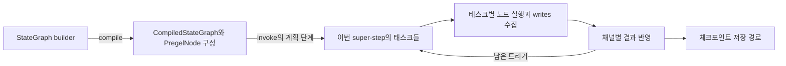
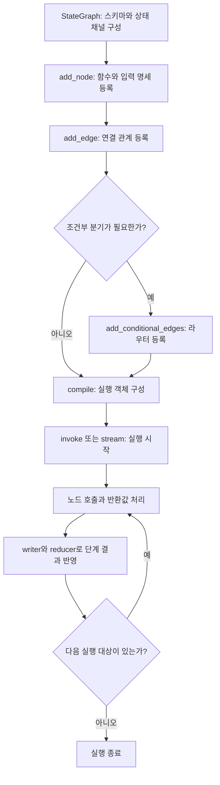
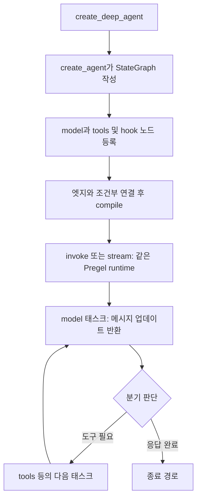
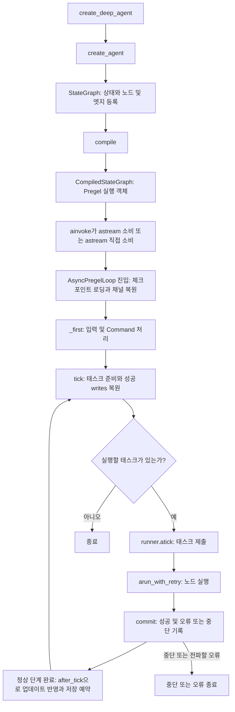
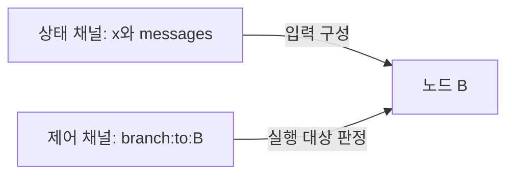
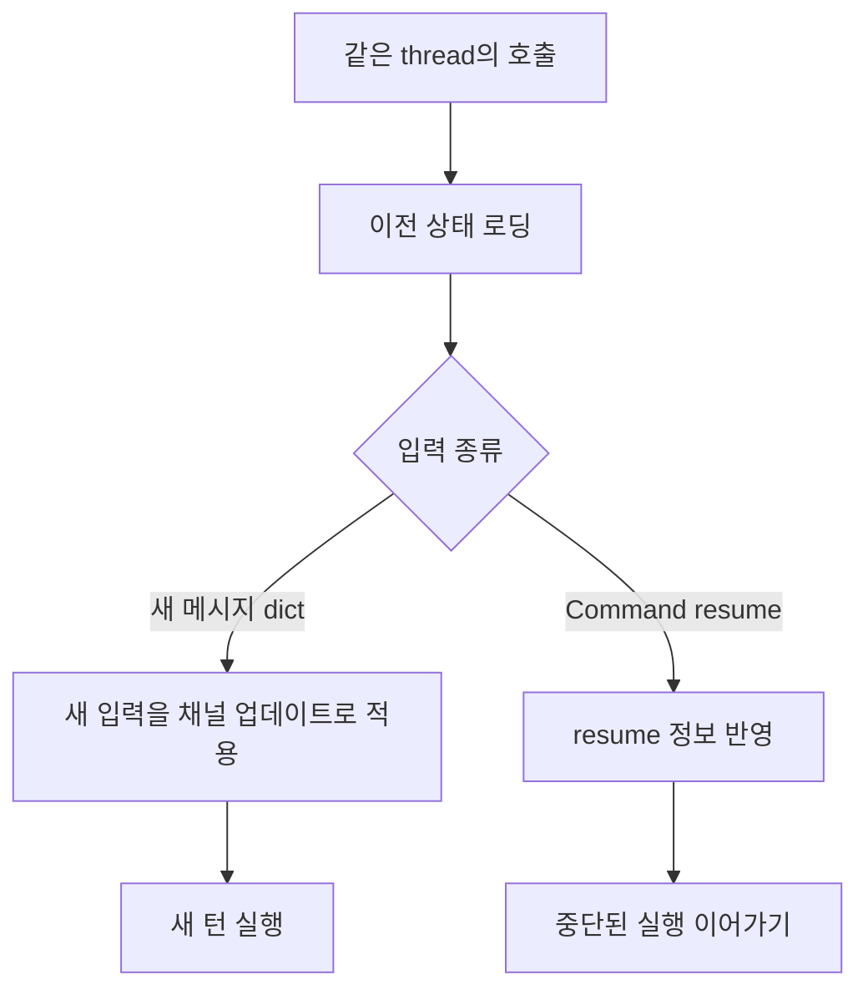
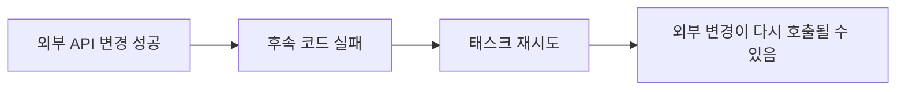

# LangGraph 내부 실행 구조 — DeepAgents 개발자를 위한 소스 분석

> 작성일: 2026-10-05
>
> 목표: 내부 실행을 코드 경로로 설명하고, 그 규칙을 커스텀 도구·미들웨어·상태·HITL·스트리밍 개발에 적용한다.
>
> 분석 기준: `AI/agent_hitl/.venv/Lib/site-packages`에 실제 설치된 패키지. GitHub `main`이나 2025년 설계 글을 현재 구현으로 간주하지 않는다.
>
> 이 문서는 연구 자료이며 애플리케이션 구현 변경은 수행하지 않았다.

## 분석 버전과 근거

| 패키지 | 설치 버전 |
| --- | --- |
| deepagents | 0.7.13 |
| langchain | 1.4.0 |
| langchain-core | 1.6.3 |
| langgraph | 1.2.11 |
| langgraph-checkpoint | 4.2.0 |
| langgraph-prebuilt | 1.1.0 |

소스가 가장 구체적인 근거다. 아래 함수와 줄 번호는 이 설치본 기준이다. 재설치나 업그레이드 후에는 달라질 수 있다. 분석한 20개 파일의 SHA-256과 함수 위치를 [소스 매니페스트](langgraph_runtime_source_manifest.json)에 보존했다.

후속 상세 자료 03~10의 설치 소스 27개와 클래스·함수 위치는 [후속 소스 매니페스트](runtime_followup_source_manifest.json)에 추가 보존했다. 서로 겹치는 파일이 있으므로 두 파일 수를 더해 고유 분석 파일 수로 계산하지 않는다. [생성 코드](code/inspect_runtime_sources.py)는 현재 설치 소스를 다시 식별한다.

전체 재검토에서 보강한 barrier와 DeepAgents 연결 경로의 추가 식별 정보는 [검토 소스 매니페스트](runtime_review_source_manifest.json)에 있다. [검토·보강 기록](2026-10-05_runtime_material_review.md)에서 발견한 설명의 빈틈과 수정 내용을 확인할 수 있다.

동작 일부는 [로컬 실험 코드](code/probe_langgraph_runtime.py)로 확인했다. [실행 결과](code/langgraph_runtime_probe_result.json)는 9개 실험이 통과한 결과다. 모델 호출, 외부 저장소, 다중 프로세스는 실험 범위에 포함하지 않는다. 나머지 설명은 읽은 코드의 정적 분석이며, 실습 애플리케이션의 버그 판정이나 전체 동작 보장을 뜻하지 않는다.

## 내부 구조 학습 목록

### 먼저 구분할 내부 객체와 실행 단위

| 이름 | 이 자료에서 뜻하는 것 | 혼동하기 쉬운 것 |
| --- | --- | --- |
| builder: StateGraph | 스키마·노드 명세·연결을 모으는 작성 객체 | 실행 중인 에이전트 |
| StateNodeSpec | add_node로 등록한 함수와 정책의 명세 | add_node 메서드의 반환값 |
| CompiledStateGraph | compile이 만든 Pregel 기반 실행 구성 | 한 대화의 현재 state 값 |
| PregelNode | 읽기 채널·트리거·bound·writers의 구성 | 실행할 때마다 생기는 태스크 |
| task | 이번 실행에서 노드와 입력·writes·config를 묶은 작업 | 노드 정의 하나와 항상 1:1인 객체 |
| channel | 값과 update/get/checkpoint 등의 규칙을 가진 전달 단위 | state dict의 값 그 자체 |
| writes | 태스크가 낸 채널 이름·업데이트 쌍 | 이미 전체 상태에 반영된 최종값 |
| super-step | 실행 대상을 고르고 실행한 뒤 채널에 결과를 반영하는 단계 | 노드 하나 또는 LLM 호출 하나 |
| checkpoint | 상태와 실행 진행 정보를 보존하는 저장 시점 | 메시지 한 턴이나 trace 로그 |
| thread | 이어서 조회할 상태의 식별 영역 | OS thread나 실행 잠금 |

state dict는 여러 상태 채널 값을 노드 입력으로 구성한 뷰다. 채널 버전은 checkpoint.channel_versions에, 노드가 본 트리거 버전은 versions_seen에 기록된다. 채널 객체마다 사용자 코드에서 직접 접근할 current_version 필드가 있다고 가정하지 않는다.

노드 한 개라도 Send가 여러 입력을 보내면 같은 단계의 여러 태스크가 될 수 있다. 반대로 한 tools 태스크 안에서 도구 여러 개를 호출하는 경로도 있으므로 “노드 수=태스크 수=도구 호출 수”가 아니다. 이 구분을 가지고 실행 한도·병렬 쓰기·재시도 범위를 읽는다.



학습의 진입점은 그래프를 작성할 때 실제로 호출하는 함수다. 아래 작성 순서로 따라가며 각 API가 만지는 내부 객체와 실행 경로를 연결한다. 모든 API가 모든 그래프에 필수인 것은 아니다. 조건부 분기는 분기가 필요할 때, 상태 조회·수정과 재개는 상태 보존이나 중단을 사용하는 경우에 다룬다.

### 실제 작성 순서에 따른 학습 경로

| 순서 | 우리가 사용하는 API 또는 코드 | 먼저 답할 질문 | 연결되는 내부 분석 |
| --- | --- | --- | --- |
| 1 | `StateGraph(State, ...)` | 생성 직후 어떤 객체와 채널이 생기는가? | [01: 스키마와 채널](01_state_schema_and_graph_compilation.md) |
| 2 | `add_node(...)` | 함수 이름·입력·정책을 어떻게 명세로 저장하는가? | [01-1: 등록 명세](01a_node_and_edge_registration.md) |
| 3 | `add_edge(START, ...)`, `add_edge(...)`, `add_edge(..., END)` | 등록한 연결은 언제 실행 신호가 되는가? 여러 source는 어떻게 기다리는가? | [01-1: 등록](01a_node_and_edge_registration.md), [02: 트리거와 barrier](02_conditional_edges_and_execution.md) |
| 4 | `add_conditional_edges(...)` | 라우터는 등록 시 실행되는가? 실행 시 어떤 상태를 받아 목적지를 정하는가? | [02: 분기 등록과 실행](02_conditional_edges_and_execution.md) |
| 5 | `compile(checkpointer=...)` | builder가 어떤 실행 객체로 바뀌며 무엇을 검증하는가? | [01: compile와 attach](01_state_schema_and_graph_compilation.md) |
| 6 | `invoke(input, config)` / `ainvoke(...)` | 입력은 어디에 쓰이고 첫 노드는 어떻게 선택되는가? | [02: 입력과 태스크 선택](02_conditional_edges_and_execution.md), [03: 단계 반영](03_node_returns_reducers_and_supersteps.md) |
| 7 | 노드의 `return {...}` / `Command(...)` | 반환값은 언제 어떤 상태에 반영되며 다음 노드는 어떻게 결정되는가? | [03: writer와 reducer](03_node_returns_reducers_and_supersteps.md), [02: goto](02_conditional_edges_and_execution.md) |
| 8 | `stream(...)` / `astream(...)` | 같은 실행의 어느 시점에 어떤 이벤트가 나오는가? | [09: 출력과 취소](09_stream_modes_lifecycle_and_cancellation.md) |
| 9 | `get_state(config)` / `get_state_history(config)` | 현재 상태와 실행 이력은 무엇을 조회하는가? | [05: checkpoint와 pending writes](05_checkpointer_stm_and_state_views.md) |
| 10 | `update_state(config, values, as_node=...)` | 직접 상태 수정도 reducer를 거치는가? 다음 실행 경로는 어떻게 바뀌는가? | [06: writer와 실행 위치 수정](06_update_state_writers_and_execution_position.md) |
| 11 | 노드의 `interrupt(...)`와 `invoke(Command(resume=...), config)` | 어디서 멈추고 재개할 때 어느 코드가 반복되는가? | [07: 중단과 재실행](07_interrupt_resume_and_reexecution.md) |

동기 API를 먼저 기준으로 읽고, 비동기 API가 달라지는 실행·저장 경로를 나란히 비교한다. API 사용 예시만으로 끝내지 않고 **호출 전 객체 → 호출 함수의 분기 → 호출 후 객체 → 실제 실행 시 효과 → 개발 시 주의점**을 같은 예제로 확인한다.



아래 12개 항목은 내부 동작을 찾아보기 위한 분류다. 학습을 진행할 때는 위 API 흐름을 기준으로 해당 항목을 연결한다. 상세 자료의 번호는 읽는 순서이며 아래 내부 분류 번호와 구분한다.

현재 상세 자료는 다음 순서로 읽는다.

1. [01. 상태 스키마에서 실행 가능한 그래프까지](01_state_schema_and_graph_compilation.md)
2. [01-1. add_node와 add_edge 등록 과정](01a_node_and_edge_registration.md)
3. [02. add_conditional_edges에서 invoke의 다음 노드 실행까지](02_conditional_edges_and_execution.md)
4. [03. invoke와 노드 반환값: writer, reducer, super-step](03_node_returns_reducers_and_supersteps.md)
5. [04. messages 반환값과 DeepAgents의 DeltaChannel](04_messages_identity_and_deepagent_delta.md)
6. [05. checkpointer, STM, 현재 상태와 이력 조회](05_checkpointer_stm_and_state_views.md)
7. [06. update_state의 writer와 실행 위치 수정](06_update_state_writers_and_execution_position.md)
8. [07. interrupt와 Command.resume의 재실행](07_interrupt_resume_and_reexecution.md)
9. [08. retry_policy, timeout, durability의 실행·저장 경계](08_retry_timeout_and_durability.md)
10. [09. stream과 astream의 이벤트·종료·취소](09_stream_modes_lifecycle_and_cancellation.md)
11. [10. context, Runtime, 캐시, 동시성과 실행 한도](10_context_cache_concurrency_and_limits.md)

각 상세 자료에는 소스 호출 경로, Mermaid 도식, 오프라인 관찰 근거와 지향·지양할 개발 패턴을 포함한다.

아래 내부 분류 12개는 모두 상세 자료에 연결했다. 상세 문서 번호와 내부 분류 번호가 다르므로, 특정 동작을 찾을 때는 다음 대응표를 사용한다.

| 내부 분류 | 상세 자료 | 동작 근거와 개발 시 확인할 점 |
| --- | --- | --- |
| 01. 스키마·등록·컴파일 | [01](01_state_schema_and_graph_compilation.md), [01-1](01a_node_and_edge_registration.md) | compilation 실험: 등록 명세와 실행 객체를 구분하고 compile 검증 시점을 확인 |
| 02. 반환값·채널 병합 | [03](03_node_returns_reducers_and_supersteps.md) | state_updates 실험: 변경분 반환, reducer와 LastValue 충돌 확인 |
| 03. 실행 대상·라우팅 | [01-1](01a_node_and_edge_registration.md), [02](02_conditional_edges_and_execution.md), [06](06_update_state_writers_and_execution_position.md) | routing/update_state/review_gaps 실험: trigger와 barrier, 정적 엣지와 goto를 구분 |
| 04. 입력·객체 공유 | [01](01_state_schema_and_graph_compilation.md), [03](03_node_returns_reducers_and_supersteps.md) | runtime/state_updates 실험: 입력 격리를 중첩 객체의 deep copy로 가정하지 않기 |
| 05. super-step·쓰기 반영 | [01-1](01a_node_and_edge_registration.md), [03](03_node_returns_reducers_and_supersteps.md) | state_updates/review_gaps 실험: 완료 순서·단계 깊이·barrier를 구분 |
| 06. 메시지·증분 저장 | [04](04_messages_identity_and_deepagent_delta.md) | message_channels 실험: ID 기반 교체·삭제와 DeltaChannel의 복원 경로 확인 |
| 07. checkpoint·STM | [05](05_checkpointer_stm_and_state_views.md) | checkpoint_views 실험: 같은 thread의 새 입력과 resume를 구분 |
| 08. 저장·실패 복구 | [05](05_checkpointer_stm_and_state_views.md), [08](08_retry_timeout_and_durability.md) | checkpoint_views/reliability 실험: pending writes, 저장 완료, durability 경계 구분 |
| 09. interrupt·resume | [07](07_interrupt_resume_and_reexecution.md) | interrupt_resume 실험: 노드 재진입과 중단 순서, 앞선 부수 효과 반복 확인 |
| 10. retry·timeout | [08](08_retry_timeout_and_durability.md) | reliability 실험: 반복 대상과 외부 변경을 구분하고 async 취소 가능성 확인 |
| 11. streaming·취소 | [09](09_stream_modes_lifecycle_and_cancellation.md) | streaming 실험: mode/version/namespace와 generator 수명, 성공 완료 구분 |
| 12. 실행 의존성·동시성·한도 | [10](10_context_cache_concurrency_and_limits.md) | execution_controls/review_gaps 실험: context와 캐시 writes, thread 잠금, 단계 한도의 의미 확인 |

각 실험의 코드와 JSON 결과는 해당 상세 문서 마지막에 연결했다. source manifest는 설치본의 식별 근거이고 실험은 그 환경에서의 관찰 근거다. 외부 DB·다중 worker·프로세스 강제 종료·실제 모델 토큰·SSE 연결 종료는 별도의 검증이 필요하며 이번 결과로 보장하지 않는다.

| 번호 | 분석할 동작 | 핵심 코드 | 확인해야 할 개발 문제 |
| --- | --- | --- | --- |
| 01 | 상태 스키마·노드/엣지 등록·그래프 컴파일 | `add_node`, `add_edge`, `compile`, `attach_node`, `_get_channel` | 등록 시점과 실행 시점, 스키마 추론을 혼동하는가? |
| 02 | 노드 반환값과 채널 병합 | `_get_updates`, `LastValue.update`, `BinaryOperatorAggregate.update` | 전체 상태 반환으로 누적 데이터를 중복시키는가? |
| 03 | 실행 대상과 라우팅 | `attach_edge`, `attach_branch`, `_triggers`, `prepare_next_tasks` | 읽는 필드가 실행 트리거라고 가정하는가? |
| 04 | 노드 입력 구성과 객체 공유 | `_proc_input`, `local_read` | 중첩 객체를 직접 수정하는가? |
| 05 | super-step 실행과 결과 반영 | `astream`, `tick`, `atick`, `after_tick`, `apply_writes` | 병렬 작업 완료 순서와 상태 반영 순서를 혼동하는가? |
| 06 | 메시지 ID·병합·증분 저장 | `add_messages`, `DeepAgentState`, `DeltaChannel` | 메시지를 단순 append라고 생각하는가? |
| 07 | 체크포인트 로딩과 STM | `AsyncPregelLoop.__aenter__`, `_first` | 새 턴과 중단 재개를 혼동하는가? |
| 08 | 저장 시점과 실패 복구 | `commit`, `put_writes`, `_put_checkpoint` | 노드 완료를 저장 완료로 취급하는가? |
| 09 | interrupt와 resume | `interrupt`, `_scratchpad`, `_first` | 재개를 다음 줄부터 실행하는 것으로 생각하는가? |
| 10 | 재시도·타임아웃·부수 효과 | `arun_with_retry`, `RetryPolicy`, runner | 재시도 시 외부 변경이 중복되는가? |
| 11 | 스트리밍과 취소 | `astream`, `ainvoke`, executor | SSE 연결의 수명과 실행 수명을 결합하는가? |
| 12 | context·동시 실행·실행 한도 | 태스크 Runtime 구성, executor, recursion 처리 | thread를 잠금으로 생각하거나 한도만 높이는가? |

01~05는 실행 모델의 기반, 06~10은 상태 보존과 복구, 11~12는 스트리밍과 실행 제어다. DeepAgents가 사용하는 LangGraph 실행 규칙을 이해하는 것이 목적이다. LangChain 미들웨어 조립과 DeepAgents 서브에이전트 상세 구현은 이번 학습 범위에 포함하지 않는다.

## 전체 호출 경로

### 이 흐름이 DeepAgents에 적용되는 정확한 위치

**소스:** [deepagents/graph.py](../../../../AI/agent_hitl/.venv/Lib/site-packages/deepagents/graph.py) 956행의 create_agent 호출, [langchain/agents/factory.py](../../../../AI/agent_hitl/.venv/Lib/site-packages/langchain/agents/factory.py) 1185행의 StateGraph 생성, 1543행의 model 등록, 1675행 이후의 연결, 1841행의 compile 반환. 다음 설명은 설치 소스의 정적 분석이며 실제 모델 실행 실험은 아니다.

사용자가 add_node를 직접 호출하지 않아도 create_deep_agent 내부의 create_agent가 이 builder API들을 사용한다. 기본 state_schema는 DeepAgentState이고, checkpointer/store/cache/context_schema도 create_agent에 전달된다. create_agent는 스키마를 해석하고 model, 필요하면 tools 및 hook 노드를 등록한 뒤 compile한다.

model 노드가 만드는 메시지는 이 설치본의 `_build_commands()` 213행에서 `Command(update={"messages": ...})`를 포함한 목록으로 반환된다. 이 값도 [03의 반환값 추출](03_node_returns_reducers_and_supersteps.md)을 통과한다. 키가 messages이면 실제 채널/reducer의 규칙은 [04](04_messages_identity_and_deepagent_delta.md)를 따른다. 모델 함수가 저장소를 직접 대체하는 것이 아니다.



이 도식은 model/tools 반복의 골격이다. 실제 hook·return_direct·구조화 응답·동적 Send 경로에 따라 연결과 태스크 단위가 달라진다. 모든 DeepAgent 실행이 정확히 두 노드만 오간다는 뜻은 아니다. 조립 세부로 범위를 확장하지 않고, 조립된 뒤 적용되는 채널·태스크·단계·복구 규칙을 학습한다.

반환 직전 `.with_config(...)`는 [Pregel.with_config](../../../../AI/agent_hitl/.venv/Lib/site-packages/langgraph/pregel/main.py) 927행에서 설정을 병합한 실행 객체 복사본을 만든다. DeepAgents에는 recursion_limit=9_999 등의 설정을 넣지만 별도의 실행 엔진을 만드는 것은 아니다. [10](10_context_cache_concurrency_and_limits.md)의 단계 한도·context 규칙은 이 호출에도 적용된다.

개발 중 “왜 다음 모델 호출이 실행됐는가?”는 분기와 제어 writes, “왜 메시지가 남았는가?”는 채널과 checkpointer, “왜 도구가 반복됐는가?”는 해당 도구의 태스크 위치와 retry/interrupt/replay 범위를 따라 확인한다. 도구 하나를 항상 그래프 노드 하나로 가정하지 않는다.

아래는 비동기 경로의 주요 골격이다. 캐시·분기·중단·오류 처리에 따른 모든 경로를 그린 것은 아니다.



---

## 01. 상태 스키마는 어떻게 실행 채널로 바뀌는가?

상세 학습: [01_상태_스키마와_그래프_컴파일](01_state_schema_and_graph_compilation.md).

등록 과정 상세: [01-1_add_node와_add_edge](01a_node_and_edge_registration.md). 사용법에 이어 이름·타입 힌트·runnable·명세 저장과 검증 시점을 코드에서 확인한다. 이후 흐름 도식도 Mermaid로 작성한다.

**소스:** [graph/state.py](../../../../AI/agent_hitl/.venv/Lib/site-packages/langgraph/graph/state.py) — `_get_channels` 1815행, `_get_channel` 1850행, `compile` 1177행, `attach_node` 1444행.

스키마의 타입 힌트와 `Annotated` 메타데이터를 읽어서 필드별 채널을 만든다. 이 설치본의 선택 순서는 managed value → 명시적 채널 → 두 인자를 받는 reducer → 기본 `LastValue`다.

```python
# 실제 선택 로직을 단순화한 의사 코드
if explicit_channel:
    channel = explicit_channel
elif binary_reducer:
    channel = BinaryOperatorAggregate(type_hint, reducer)
else:
    channel = LastValue(type_hint)
```

`compile()`은 `CompiledStateGraph`를 만들고, 상태 채널·START 입력·노드·엣지·조건부 분기를 연결한다. `attach_node()`가 만드는 `PregelNode`에는 읽을 채널, 실행 트리거, 반환값을 업데이트로 변환하는 writer, 실제 runnable, retry/cache/timeout 정책 등이 들어간다.

이것은 Python 함수를 기계어로 컴파일하는 과정이 아니다. 그래프 정의를 실행 엔진이 사용할 구성으로 변환하는 과정이다.

**개발 시 주의점**

- `TypedDict`는 필드 선언이다. 모든 입력·출력이 자동으로 엄격한 런타임 검증을 통과한다는 뜻이 아니다.
- 일반 필드의 기본 채널과 reducer 필드의 채널은 서로 다른 업데이트 규칙을 갖는다.
- `Annotated[str, "설명"]`처럼 문자열 메타데이터를 넣는 것과 callable reducer를 등록하는 것은 다르다.
- 컴파일한 그래프의 내부 객체를 직접 수정하는 방식을 공개 확장 API 대신 사용하면 버전 결합이 커진다.

**실험:** `compiled_channels`에서 컴파일된 노드의 `channels`와 `triggers`를 직접 관찰했다.

## 02. 노드의 반환값은 상태 교체인가, 업데이트인가?

상세 학습: [03. 반환값과 reducer 및 단계 반영](03_node_returns_reducers_and_supersteps.md).

**소스:** `graph/state.py` — `_get_updates` 1456행. [channels/last_value.py](../../../../AI/agent_hitl/.venv/Lib/site-packages/langgraph/channels/last_value.py) — 56행. [channels/binop.py](../../../../AI/agent_hitl/.venv/Lib/site-packages/langgraph/channels/binop.py) — 123행.

노드가 딕셔너리를 반환하면 `_get_updates()`가 그래프에 등록된 키의 `(채널, 값)` 쌍을 추출한다. `None`은 업데이트 없음으로 처리된다. 지원하는 Command 등의 형식 외에 잘못된 반환 형식은 `InvalidUpdateError`를 낸다. 딕셔너리의 미등록 키는 이 경로에서 필터링되므로, 필드 오타가 반드시 오류가 된다고 기대하면 안 된다.

`LastValue.update()`는 한 단계에서 0개 값을 받으면 갱신하지 않고, 1개면 교체하며, 2개 이상이면 충돌 오류를 낸다. 일반 필드를 병렬로 두 번 쓰면 “마지막 완료 노드가 이긴다”가 아니다.

`BinaryOperatorAggregate.update()`는 기존 값과 각 업데이트에 연산자를 적용한다. 따라서 누적 리스트 필드에는 누적된 전체 리스트가 아니라 추가할 항목을 반환하는 것이 보통 의도에 맞다.

```python
# items가 operator.add로 누적되는 리스트인 경우
def good(state):
    return {"items": ["new"]}

def duplicates_previous_items(state):
    return {"items": state["items"] + ["new"]}
```

기존 값이 `["seed"]`이면 첫 함수의 결과는 `["seed", "new"]`, 두 번째 함수의 결과는 `["seed", "seed", "new"]`다. 기존 상태가 reducer의 왼쪽 인자에 이미 들어 있기 때문이다.

**개발 시 주의점**

- 병렬 노드가 변경하지 않은 필드까지 전체 상태로 반환하면 원치 않는 다중 쓰기가 생길 수 있다.
- “딕셔너리를 복사했으니 안전하다”와 “업데이트의 의미가 정확하다”는 다른 문제다.
- reducer는 업무 규칙이다. 단순히 충돌 오류를 없애려고 덧셈이나 리스트 병합을 붙이지 않는다.
- reducer가 없는 상태 필드의 쓰기 담당을 명확히 정한다.

**실험:** `partial_updates`, `concurrent_collision`로 중복과 `InvalidUpdateError`를 확인했다.

## 03. 어떤 노드가 다음에 실행되는가?

API 흐름을 따르는 상세 학습: [02. 조건부 분기 등록과 실행](02_conditional_edges_and_execution.md). add_conditional_edges → compile → invoke → 다음 노드 선택을 하나의 예제로 연결한다.

**소스:** `graph/state.py` — `attach_edge` 1551행, `attach_branch` 1577행. [pregel/_algo.py](../../../../AI/agent_hitl/.venv/Lib/site-packages/langgraph/pregel/_algo.py) — `prepare_next_tasks` 392행, `prepare_single_task` 524행, `_triggers` 1260행.

StateGraph 노드는 여러 상태 필드를 읽지만, 이 설치본에서는 기본 실행 트리거가 `branch:to:<노드명>` 형태의 별도 채널이다. A→B라는 일반 엣지는 A의 writer가 B의 트리거 채널에 쓰도록 연결된다.



`_triggers()`는 트리거 채널이 읽을 수 있는 상태인지, 현재 버전이 그 노드가 본 버전보다 새로운지를 확인한다. 따라서 “B가 x를 읽는다”는 이유만으로 x 변경이 B 실행을 뜻하지 않는다.

`prepare_next_tasks()`는 두 유형을 합친다.

- PULL: 엣지/트리거에 따라 실행할 노드.
- PUSH: `Send`로 전달한 인자와 함께 실행할 태스크.

변경 채널과 트리거→노드 매핑이 있으면 모든 노드를 순회하지 않고 실행 후보를 줄인다. fallback 경로도 있으므로 “항상 모든 노드 수와 무관하다”는 결론은 피한다.

**개발 시 주의점**

- `add_edge("a", "c")`, `add_edge("b", "c")`와 `add_edge(["a", "b"], "c")`를 동일한 join으로 생각하지 않는다. 후자는 `NamedBarrierValue`를 만들어 지정한 시작 노드들의 완료 신호를 모은다. 분기 깊이가 달라지는 경우 특히 중요하다.
- 조건부 분기는 `fresh=True`로 현재 노드 자신의 업데이트를 반영한 값을 읽도록 구성된다. 같은 단계의 다른 노드 업데이트까지 모두 읽는다는 뜻은 아니다.
- 동적 fan-out에서 `Send`의 인자 크기와 태스크 수를 함께 고려한다.

**실험:** B의 읽기 채널에는 `x`가 있지만 트리거에는 `x`가 없음을 확인했다.

## 04. 입력 상태는 깊은 복사인가?

상세 학습: [03의 입력 구성과 객체 공유](03_node_returns_reducers_and_supersteps.md).

**소스:** `_algo.py` — `_proc_input` 1348행, `local_read` 188행. [pregel/_read.py](../../../../AI/agent_hitl/.venv/Lib/site-packages/langgraph/pregel/_read.py) — `PregelNode` 97행.

`_proc_input()`은 각 채널의 값을 읽어 입력 딕셔너리를 만들고, 필요하면 mapper를 적용한다. 동일한 입력 구성을 캐시한 경우 `copy(input_cache[...])`로 얕게 복사한다. 채널 값 자체를 모두 `deepcopy()`하는 구조가 아니다.

```python
# 지양할 패턴
state["nested"]["count"] += 1
state["messages"].append(message)
```

최상위 딕셔너리가 달라도 그 안의 리스트·딕셔너리·메시지 객체는 공유될 수 있다. 반환 writer와 reducer를 거치지 않은 직접 변경은 엔진이 관리하는 업데이트 경계를 우회한다.

```python
# nested가 일반 교체 필드이고 이 노드가 쓰기를 담당하는 경우
new_nested = {**state["nested"], "count": state["nested"]["count"] + 1}
return {"nested": new_nested}
```

더 깊은 구조는 수정할 경로의 객체도 새로 구성해야 한다. 위 예시는 일반 필드용이며, reducer 필드에서는 그 reducer가 요구하는 업데이트 형식을 사용해야 한다.

**개발 시 주의점**

- 입력 상태와 메시지 객체는 읽기 전용으로 다루고 명시적 업데이트를 반환한다.
- 무조건 전체 상태를 깊게 복사하는 것도 큰 상태에서 비싸다. 실제 변경 경로를 기준으로 새 객체를 만든다.
- `local_read(fresh=True)`가 복사한 채널에 현재 태스크의 writes를 적용하는 것과, 외부 저장소의 트랜잭션 격리는 구분한다.

**실험:** 같은 단계의 두 노드는 서로 다른 최상위 dict를 받았지만 `nested`는 동일한 객체였다.

## 05. 한 super-step의 실제 실행 순서

상세 학습: [03의 단계 쓰기 수집과 반영](03_node_returns_reducers_and_supersteps.md).

**소스:** [pregel/main.py](../../../../AI/agent_hitl/.venv/Lib/site-packages/langgraph/pregel/main.py) — `astream` 3063행, 실행 반복 3437행. [pregel/_loop.py](../../../../AI/agent_hitl/.venv/Lib/site-packages/langgraph/pregel/_loop.py) — `tick` 599행, `after_tick` 683행. [pregel/_runner.py](../../../../AI/agent_hitl/.venv/Lib/site-packages/langgraph/pregel/_runner.py) — `atick` 360행.

```python
# 핵심 흐름을 축약한 의사 코드
while loop.tick():
    restore_cached_writes()
    await runner.atick(tasks_without_writes)
    loop.after_tick()
    if durability == "sync":
        await checkpoint_save
```

`tick()`은 태스크를 준비하고, 이전 성공 태스크의 pending writes를 재적용한다. runner는 아직 writes가 없는 태스크만 실행한다. `after_tick()`은 `apply_writes()`로 결과를 채널에 반영하고 체크포인트를 만든다.

`apply_writes()`는 태스크 경로를 기준으로 정렬한 뒤 채널별 업데이트를 모아서 `channel.update(vals)`를 호출한다. 완료 시간으로 병합 순서를 정하는 구조가 아니다. 실행을 유발한 채널의 관찰 버전도 기록한다.

**개발 시 주의점**

- 병렬 작업 A가 빨리 끝나도 같은 단계의 B가 A의 일반 채널 업데이트를 즉시 읽지는 않는다.
- 외부 DB나 파일을 직접 변경하면 이 상태 전달 규칙 밖에서 경쟁이 생길 수 있다.
- 내부 정렬 순서를 업무상의 우선순위로 사용하지 않는다. 중요하다면 결과에 순서 키를 넣고 명시적으로 정렬한다.

**실험:** x=0을 읽은 병렬 노드 두 개 모두 0을 관찰했고, A가 반환한 x=1은 단계 반영 후 상태에 나타났다.

## 06. 메시지는 단순 append가 아니다 — DeepAgents는 DeltaChannel

상세 학습: [04. 메시지 ID와 DeepAgents DeltaChannel](04_messages_identity_and_deepagent_delta.md). 수동 수정 API의 ID 처리 차이는 [06. update_state](06_update_state_writers_and_execution_position.md)에 별도로 확인했다.

**소스:** [graph/message.py](../../../../AI/agent_hitl/.venv/Lib/site-packages/langgraph/graph/message.py) — `add_messages` 61행, 병합 본문 187행. [deepagents/graph.py](../../../../AI/agent_hitl/.venv/Lib/site-packages/deepagents/graph.py) — `DeepAgentState` 73행. [deepagents/_messages_reducer.py](../../../../AI/agent_hitl/.venv/Lib/site-packages/deepagents/_messages_reducer.py) — 31행. [channels/delta.py](../../../../AI/agent_hitl/.venv/Lib/site-packages/langgraph/channels/delta.py) — 118행부터.

일반 `add_messages`는 ID로 기존 메시지를 교체하고, 새 ID를 추가하고, `RemoveMessage`를 처리한다. ID가 없으면 생성한다. 따라서 append-only 리스트와 다르다.

이 설치본의 DeepAgents 기본 상태는 다음처럼 메시지 필드를 선언한다.

```python
# deepagents/graph.py의 핵심 선언
messages: Required[
    Annotated[list[AnyMessage],
              DeltaChannel(_messages_delta_reducer, snapshot_frequency=50)]
]
```

저장 관점에서는 매번 누적 메시지 전체를 저장하는 대신 writes를 보존하고 필요한 시점에 스냅샷을 남긴다. 복원 시 메시지 스냅샷이 없는 체크포인트는 saver의 delta history를 통해 이전 seed와 writes를 모아 복원한다. 구현 위치는 `pregel/_checkpoint.py`의 `channels_from_checkpoint` 229행과 비동기 버전 280행이다.

**문서와 소스의 차이:** 확인했던 현재 웹 문서는 delta reducer가 write 시점에 실행되지 않는다고 설명하지만, 설치본 1.2.11의 `DeltaChannel.update()` 182행은 reducer를 호출한다. `replay_writes()` 157행도 reducer를 호출한다. 이 환경을 개발할 때는 reducer가 **업데이트와 복원에서 모두 실행될 수 있다**는 실제 코드에 맞춰 판단한다.

DeepAgents reducer는 ID를 새로 생성하지 않는다. `_loop.put_writes()` 458행 이후의 `ensure_message_ids()` 경로가 직렬화 전에 안정적인 메시지 ID를 준비한다. 또한 snapshot 빈도 50은 설치본의 snapshot 판단 로직상 채널이 갱신된 super-step 카운터와 연결되고, 별도 전체 super-step 상한도 있다. “모델 토큰 50개마다”나 “사용자 대화 50턴마다”가 아니다.

**개발 시 주의점**

- reducer 안에서 난수 ID 생성, 시각 읽기, 외부 호출 등의 부수 효과를 만들지 않는다.
- custom `state_schema`로 messages annotation을 바꾸면 기본 DeltaChannel 구성을 바꿀 수 있다. factory의 스키마 병합 순서상 최종 base state 선언이 충돌 시 우선한다.
- checkpoint history를 삭제할 때 delta 복원에 필요한 seed/writes를 함께 고려한다.
- saver가 delta 복원에 필요한 계약을 충족하는지는 사용하는 저장소 구현에서 확인한다. 이번 실험은 InMemorySaver이며 Redis 복원 호환성 전체를 검증하지 않았다.

**실험:** 실제 `DeepAgentState`로 만든 그래프의 채널 종류·snapshot 빈도를 확인하고, 두 호출의 메시지를 `get_state()`로 복원했다.

## 07. Checkpointer는 STM과 실행 복구를 어떻게 함께 제공하는가?

상세 학습: [05. STM과 체크포인트 상태 뷰](05_checkpointer_stm_and_state_views.md), [06. 수동 수정의 실행 위치](06_update_state_writers_and_execution_position.md).

**소스:** `_loop.py` — `AsyncPregelLoop.__aenter__` 1887행, `_first` 848행. [checkpoint/base/__init__.py](../../../../AI/agent_hitl/.venv/Lib/site-packages/langgraph/checkpoint/base/__init__.py) — `Checkpoint` 92행.

호출 시작 시 saver의 `aget_tuple()`로 체크포인트를 가져온다. 없으면 빈 체크포인트를 만들고, 있으면 채널 값·버전·metadata·pending writes를 로딩한다. 이어서 채널을 복원하고 `_first()`로 입력을 처리한다.



즉 STM은 “지난 상태를 바탕으로 다음 턴을 실행한다”는 활용이고, 실행 재개는 “남아 있는 작업을 이어간다”는 활용이다. 같은 상태 보존 기반 위에서 입력 처리 경로가 달라진다.

**개발 시 주의점**

- 새 사용자 메시지와 승인 응답을 구분한다. 중단된 작업에 무조건 새로운 dict 입력을 보내는 것은 resume과 다르다. `_first()`의 새 입력 경로에는 이전 미완료 태스크를 처리하는 별도 로직이 있다.
- 같은 대화를 유지하려면 해당 thread의 상태가 조회되어야 한다. 다른 대화에 같은 ID를 잘못 사용하면 상태도 섞인다.
- checkpoint_id를 명시하면 최신 상태가 아니라 지정된 과거 상태를 대상으로 할 수 있다.
- STM의 내용을 모두 모델에 그대로 보내는 것은 별도 문제다. 요약·모델 요청 미들웨어가 최종 입력을 바꿀 수 있다.
- InMemorySaver는 이번 실행 프로세스의 메모리 저장소다. 이 실험은 프로세스 재시작 후 복구 증거가 아니다.

**실험:** 같은 thread의 두 호출은 메시지 u1/u2를 유지했고, 다른 thread는 v1만 가졌다.

## 08. 노드 완료, pending writes, 체크포인트 저장 완료

성공 pending writes의 최신 조회와 특정 시점 조회 차이 및 복구 실험: [05. 상태 조회](05_checkpointer_stm_and_state_views.md). 저장 대기와 durability의 상세 분석은 [08. 재시도·타임아웃·저장 경계](08_retry_timeout_and_durability.md)에서 이어진다.

**소스:** `_runner.py` — `commit` 574행. `_loop.py` — `put_writes` 415행, `_reapply_writes_to_succeeded_nodes` 736행, `_put_checkpoint` 1081행. `main.py` — 3461행.

runner가 성공 태스크를 commit하면 task writes를 saver에 전달하는 경로가 동작한다. 오류나 중단은 별도 제어 writes로 기록된다. 모든 작업의 정상 반영 단계에서는 채널 업데이트를 적용한 다음 체크포인트 저장을 예약한다.

다음은 서로 다른 시점이다.

1. 외부 도구/API의 작업이 완료됨.
2. 태스크가 정상 반환하고 writes를 기록함.
3. super-step의 결과가 채널에 반영됨.
4. 저장소에 필요한 writes/checkpoint 저장이 완료됨.


`_reapply_writes_to_succeeded_nodes()`는 ERROR·INTERRUPT·RESUME 같은 제어 신호를 성공 결과처럼 적용하지 않는다. 그래서 실패/중단 태스크는 재실행 대상에 남는다.

| durability | 코드에서의 핵심 차이 | 고려할 점 |
| --- | --- | --- |
| sync | 단계 저장 future를 다음 단계 진행 전에 await | 저장 지연이 다음 단계 지연에 포함됨 |
| async | 저장을 예약하고 실행과 겹쳐 진행 | 진행 중 강제 종료 시 아직 저장되지 않은 구간 가능 |
| exit | 일반 중간 저장을 건너뛰고 종료 경로에서 처리 | 실행 중 프로세스가 사라지면 중간 복구 범위가 제한됨 |

**개발 시 주의점**

- DB 변경 완료 직후 checkpoint 저장 전에 종료될 수 있다. Checkpointer만으로 외부 부수 효과의 exactly-once를 보장하지 않는다.
- 성공 태스크 재사용은 writes가 실제로 기록·조회 가능한 경우의 동작이다. “성공했다고 화면에 보였다”만으로 보장되지 않는다.
- 오류 복구와 과거 checkpoint 재실행은 구분한다. replay는 의도적으로 코드를 다시 실행하는 경로일 수 있다.

**실험:** InMemorySaver와 sync 모드에서 A 1회/B 2회 실행으로 실패 복구 결과 `[a, b]`를 얻었다. 강제 프로세스 종료 실험은 아니다.

## 09. interrupt는 어떻게 멈추고 재개하는가?

상세 학습: [07. interrupt와 resume](07_interrupt_resume_and_reexecution.md).

**소스:** [langgraph/types.py](../../../../AI/agent_hitl/.venv/Lib/site-packages/langgraph/types.py) — `interrupt` 851행, 실행 본문 950행. `_algo.py` — `_scratchpad` 1280행. `_loop.py` — `_first`의 Command 처리 902행.

`interrupt()`는 현재 태스크 scratchpad의 interrupt 인덱스를 증가시키고, 그 인덱스에 대응하는 resume 값이 있으면 반환한다. 값이 없으면 `GraphInterrupt`를 발생시킨다. runner는 이를 일반 성공 결과나 보통의 업무 오류와 다르게 처리한다.

```python
# 핵심 동작을 단순화한 의사 코드
index = scratchpad.interrupt_counter()
if resume_value_exists(index):
    return resume_value(index)
raise GraphInterrupt(payload)
```

재개는 함수 내부의 메모리 실행 위치를 복원하는 방식이 아니다. 노드가 다시 실행되면서 interrupt 호출에 도착하고, 저장된 resume 값이 반환되어 이후 코드가 진행된다.

**개발 시 주의점**

- `interrupt()` 앞의 코드가 반복되는 것을 고려한다. 알림·파일 교체·결제 등 외부 변경은 중복 방지 설계가 필요하다.
- 하나의 노드에 여러 interrupt가 있다면 호출 순서가 중요하다. 중단된 thread가 있는 상태에서 그 순서나 조건을 바꾸는 배포를 신중하게 다룬다.
- broad `except Exception`이 interrupt 제어 예외를 삼키지 않도록 한다.
- 이 설치본의 `_first()`는 여러 pending interrupt가 있을 때 interrupt ID를 지정한 resume mapping을 요구한다.
- interrupt를 임의의 함수나 별도 실행 컨텍스트에서 호출하면 태스크 설정과 scratchpad를 얻지 못할 수 있다.

**실험:** 승인 노드의 interrupt 앞 코드가 최초 실행과 재개에서 총 두 번 실행되었다.

## 10. 재시도는 어느 범위의 코드를 반복하는가?

상세 학습: [08. 재시도·타임아웃·저장 경계](08_retry_timeout_and_durability.md).

**소스:** [pregel/_retry.py](../../../../AI/agent_hitl/.venv/Lib/site-packages/langgraph/pregel/_retry.py) — `arun_with_retry` 685행, writes 초기화 738행, 정책 선택 799행. `_runner.py` — 태스크 제출 450행.

runner는 태스크를 `arun_with_retry()`로 제출한다. 각 시도는 이전 시도의 writes를 비우고 해당 태스크 runnable을 다시 실행한다. 오류와 일치하는 retry policy가 없으면 재시도하지 않는다. 정책이 있으면 시도 한도와 backoff를 적용한다. `GraphBubbleUp` 계열은 일반 재시도 오류와 구분하여 전파한다.



writes 초기화는 그래프 내부 버퍼의 초기화다. 이미 수행한 외부 변경을 되돌리지 않는다.

**개발 시 주의점**

- 네트워크 호출의 timeout은 서버가 요청을 처리하지 않았다는 증거가 아니다. 중복 실행 방지 키나 결과 조회가 필요한 작업인지 검토한다.
- 노드 재시도와 model/tool retry 미들웨어가 겹치면 시도 횟수가 늘어난다. 실패가 어느 계층에서 처리되는지 파악한다.
- ToolNode나 미들웨어가 오류를 ToolMessage로 바꿔 정상 반환하면, 그래프 관점에서는 예외 재시도가 아닐 수 있다.
- 잘못된 입력이나 프로그램 오류까지 무조건 재시도하지 않는다.
- 타임아웃/취소는 이미 수행한 외부 변경의 롤백이 아니다.

**실험:** 실패 후 재시도한 노드의 모의 외부 효과가 두 번 발생했다.

## 11. 스트리밍은 별도 실행 엔진인가? 취소하면 어떻게 되는가?

상세 학습: [09. 스트리밍·종료·취소](09_stream_modes_lifecycle_and_cancellation.md).

**소스:** `main.py` — `ainvoke` 4013행, v1의 `astream` 소비 4090행, `astream`의 runner 반복 3437행. [pregel/_executor.py](../../../../AI/agent_hitl/.venv/Lib/site-packages/langgraph/pregel/_executor.py) — `AsyncBackgroundExecutor` 131행, `__aexit__` 186행.

`ainvoke()`는 `astream()`의 결과를 소비해서 마지막 값이나 출력 목록을 만든다. 최종값 호출과 스트림 호출이 전혀 다른 실행기를 쓰는 구조가 아니다.

`astream()`은 실행 중 큐의 출력도 yield하고, 단계가 끝난 뒤 채널 결과도 반영한다. 따라서 토큰 출력과 최종 상태 반영·저장 완료는 같은 시점이 아니다.

runner는 실행 태스크에 `__cancel_on_exit__=True`를 설정한다. async executor의 종료 처리는 해당 태스크를 취소하고 기다린다. 따라서 스트림을 닫는 경로와 취소는 실행 수명에 영향을 줄 수 있다. 전송 계층의 연결 종료가 어떤 경로로 전파되는지는 애플리케이션 구조까지 함께 확인해야 한다.

**개발 시 주의점**

- 도구 인자 스트리밍의 부분 조각을 완성된 도구 호출이나 실행 완료로 취급하지 않는다.
- 출력 이벤트를 받았다고 성공·저장 완료를 확정하지 않는다.
- `subgraphs=True`의 이벤트를 부모 최종 응답과 구분한다.
- 연결 종료 뒤에도 작업을 유지하려면 실행을 소유하는 서비스/작업과 이벤트 소비자를 구분한다. Checkpointer는 워커나 태스크 큐를 자동으로 만들어 주지 않는다.
- `async def` 도구 안에서 blocking I/O를 수행하면 이벤트 루프를 막을 수 있다.


## 12. context, thread 동시 실행, recursion limit

상세 학습: [10. 실행 의존성·캐시·동시성·한도](10_context_cache_concurrency_and_limits.md).

**소스:** `_algo.py` — 태스크 Runtime 구성 688행, 입력 기반 캐시 키 구성 670행. `_executor.py` — max_concurrency semaphore 135행. `main.py` — 한도 초과 처리 3483행.

태스크의 Runtime에는 context와 store 등 실행에 필요한 객체가 전달되고, 실행 식별 정보도 구성된다. state는 채널을 통해 보존할 데이터이고, context는 호출에서 제공하는 실행 의존성을 전달할 수 있는 경로다. DB 세션이나 HTTP 클라이언트를 일반 checkpoint state에 넣을 이유와 직렬화 가능성을 먼저 검토한다.

이 설치본의 기본 태스크 캐시 키 계산은 입력 값에 key_func를 적용한다. context의 tenant나 권한에 따라 결과가 달라지는 노드를 캐시한다면, 같은 입력이라는 이유만으로 다른 실행 맥락의 결과를 재사용하지 않도록 키와 namespace를 설계해야 한다.

async executor는 max_concurrency가 있으면 semaphore로 제출 태스크의 동시 실행을 제한한다. 이것은 전체 서비스의 요청 제한이나 외부 API별 rate limit과 동일하지 않다. ToolNode 내부 gather나 사용자가 만든 별도 태스크의 제한까지 전부 대신한다고 기대하지 않는다.

thread_id는 상태 조회의 식별자다. 동일 thread에 대한 중복 요청이나 두 워커의 동시 실행을 자동으로 직렬화한다는 계약으로 취급하지 않는다. 잠금과 실행 소유권은 thread_id의 역할과 구분해서 이해해야 한다.

`recursion_limit` 초과는 이 설치본에서 `GraphRecursionError`다. 정상 종료 결과가 아니다. DeepAgents의 큰 기본 한도는 비정상적인 model→tools 반복의 종료 조건이나 비용 제한을 대신하지 않는다.

**개발 시 주의점**

- 영속 업무 상태, 호출 의존성, 외부 장기 저장 데이터의 경계를 정한다.
- 동일 thread 실행의 소유권과 중복 요청 정책을 서비스에서 정의한다.
- 그래프 내 태스크 동시성, 서버 전체 작업 동시성, 모델/API rate limit을 구분한다.
- 한도 상향 전에 왜 종료되지 않는지 확인하고 시간·호출·비용 예산을 별도로 둔다.
- 프레임워크 업그레이드 전에는 진행 중 interrupt, 기존 checkpoint, 메시지 reducer, 자식 namespace 경로를 검증한다.

---

## 로컬 실험 재실행

저장소 루트에서 실행한다.

```powershell
.\AI\agent_hitl\.venv\Scripts\python.exe -X utf8 .codex/research/LangGraph/runtime/code/probe_langgraph_runtime.py
```

| 실험 | 확인한 결과 |
| --- | --- |
| compiled_channels | 읽기 필드 x와 트리거 branch:to:b가 구분됨 |
| partial_updates | 누적 전체 리스트 반환 시 seed가 중복됨 |
| step_visibility_and_aliases | 같은 단계는 이전 x를 읽음. 최상위 dict는 다르고 nested 객체는 공유됨 |
| concurrent_collision | 일반 필드에 병렬 쓰기 시 InvalidUpdateError |
| short_term_memory | 같은 thread의 메시지가 누적되고 다른 thread와 분리됨 |
| interrupted_node_restarts | interrupt 앞 코드가 재개 시 다시 실행됨 |
| retry_reexecutes_effect | 재시도에서 모의 외부 효과가 반복됨 |
| pending_writes_recovery | A는 한 번, 실패한 B는 두 번 실행되어 복구됨 |
| deepagents_message_channel | DeltaChannel, snapshot_frequency=50, 두 호출의 메시지 복원 |

실험 코드는 개발 규칙을 이해하기 위한 작은 재현 사례다. 프로덕션 저장소·실제 모델·SSE 연결 종료·동시 worker·강제 종료를 검증하는 통합 테스트가 아니다.

## 전체 자료 검증 범위

2026-10-05 전체 재검토 후 compilation 관찰 코드와 11개 probe 스크립트를 다시 실행해 모두 정상 종료했다. probe 스크립트의 총 59개 관찰 그룹이 통과했고, 보강한 08·10의 완결 예제 세 개도 본문에서 추출해 실행했다. [재검토 검증 결과](code/runtime_review_verification.json)에 목록을 저장했다. 모델 없이 실행한 작은 그래프와 InMemory 기반 저장·캐시 사례이므로, 실제 서비스의 장애 복구나 외부 작업의 exactly-once를 보장하는 결과는 아니다.

네 매니페스트의 56개 소스 해시 기록은 현재 설치본과 일치했다. 중복을 제외하면 소스 파일은 32개다. 문서의 로컬 링크 존재, 코드 블록 짝과 UTF-8 텍스트를 확인했다. Mermaid는 코드 블록으로 작성했으며 브라우저 렌더링 검증은 포함하지 않았다.

## 참고 자료와 학습 방식

- [이전 설계 글 번역](../../Agent/2025-09-04_building_langgraph_ko_translation_and_notes.md): 왜 이런 실행 구조를 선택했는지에 대한 배경.
- [공식 Graph API 설명](https://docs.langchain.com/oss/python/langgraph/graph-api): 상태, reducer, 라우팅의 공개 의미. 확인일 2026-10-05. 설치본보다 새 API가 포함될 수 있음.
- [공식 Pregel 문서](https://docs.langchain.com/oss/python/langgraph/pregel): 실행 모델 참고. reducer 실행 시점 등 설치본과 차이는 06절에 표시함.
- [소스 매니페스트](langgraph_runtime_source_manifest.json): 이번 분석 근거의 파일 버전 식별.

한 항목씩 더 깊이 공부할 때는 실제 사용하는 API를 진입점으로 삼고, 같은 예제의 입력·명세·업데이트·트리거·저장값을 따라간다. 상세 문서에서도 이 흐름을 유지하며 내부 함수명은 API 동작을 설명하는 위치에서 소개한다. 다음 학습도 위 API 흐름과 내부 동작 목록 안에서 진행한다.
